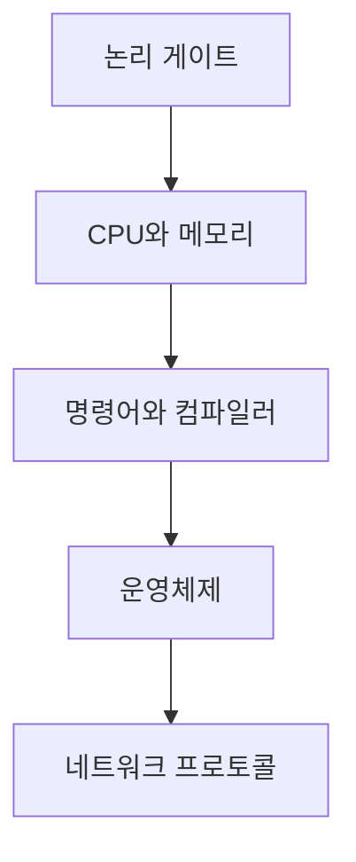

> OSSU의 공개 컴퓨터과학 커리큘럼 README(기준 커밋 `8f8272b1d378`)의 Core CS 부분을 영역별로 재구성한 노트다.

## Core CS란

Core CS는 컴퓨터과학 전공의 **첫 3년에 해당하는 공통 필수 과목**이다. 따로 표시가 없으면 모든 강좌가 필수이고, 이미 배운 내용이 확실할 때만 건너뛴다. 고교 수학(대수, 기하, 프리캘큘러스)을 마쳤다고 가정한다. 영역은 위에서 아래 순서로 듣는 것이 기본이지만, 수학을 입문·프로그래밍 강좌와 나란히 듣는 식의 병행도 흔하다. 어느 쪽이든 강좌별 선수 과목은 지킨다.

| 영역 | 배우는 것 | 강좌 수 |
| --- | --- | --- |
| 프로그래밍 | 프로그램 설계, 함수형·객체 지향, 타입, 테스트, 아키텍처 | 5 |
| 수학 | 미적분, 이산수학, 증명, 확률 | 4 |
| CS 도구 | 터미널, 셸, 편집기, 버전 관리 | 1 |
| 시스템 | 논리 회로에서 운영체제·네트워크까지 | 4 |
| 이론 | 알고리즘 설계와 분석, NP-완전성 | 2 |
| 보안 | CIA, 안전한 코딩, 취약점 | 3 + 선택 1 |
| 응용 | 데이터베이스, 머신러닝, 그래픽스, 소프트웨어 공학 | 6 |
| 윤리 | 직업 윤리, 지식재산, 프라이버시 | 3 |

아래 표의 기간과 주당 학습량은 OSSU가 적어 둔 계획치다. 실제 개설 여부, 수강료, 과제 채점 접근은 강좌 제공처에서 확인한다(무료 청강 조건은 [[ossu-introduction#비용과 접근 조건|비용과 접근 조건]]). 강좌 이름 옆의 alternative는 같은 내용을 다른 경로로 듣는 대체 링크다.

## Core programming: 프로그래밍

같은 문제를 여러 언어와 설계 방식으로 풀어 보면서 **문제 명세에서 테스트 가능한 프로그램을 만드는 과정**을 익힌다. 함수형 설계와 객체 지향 설계는 서로 배척하는 구호가 아니라 상태와 의존성을 다루는 서로 다른 도구다. Standard ML, Racket, Ruby로 ML 계열, Lisp 계열, 동적 객체 지향 언어를 비교한다.

| 개념 | 확인할 질문 |
| --- | --- |
| 프로그램 명세 | 입력·출력·예외 조건이 충분히 정의됐는가 |
| 함수형 설계 | 부작용을 분리하고 데이터를 변환할 수 있는가 |
| 객체 지향 설계 | 책임과 협력을 어떤 객체에 둘 것인가 |
| 타입 시스템 | 오류를 실행 전에 얼마나 드러낼 수 있는가 |
| 테스트 | 예제뿐 아니라 경계 조건을 검증하는가 |
| 소프트웨어 아키텍처 | 변경이 다른 부분에 퍼지는 범위를 줄였는가 |

| 강좌 | 기간 | 주당 학습량 | 선수 과목 |
| --- | --- | --- | --- |
| [Systematic Program Design](https://github.com/ossu/computer-science/blob/8f8272b1d378d31494240aa1d667aa6b045c6552/coursepages/spd/README.md) | 13 weeks | 8-10 hours/week | none |
| [Class-based Program Design](https://github.com/ossu/computer-science/blob/8f8272b1d378d31494240aa1d667aa6b045c6552/coursepages/class-based/README.md) | 13 weeks | 5-10 hours/week | Systematic Program Design, High School Math |
| [Programming Languages](https://courses.cs.washington.edu/courses/cse341/19sp/#lectures) | 11 weeks | 4-8 hours/week | Systematic Program Design |
| [Object-Oriented Design](https://course.ccs.neu.edu/cs3500f19/) | 13 weeks | 5-10 hours/week | Class-based Program Design |
| [Software Architecture](https://www.coursera.org/learn/software-architecture) | 4 weeks | 2-5 hours/week | Object Oriented Design |

실습에서는 명세와 예제가 연결된 함수와 자동 테스트, 변경에 견디는 객체 설계와 모듈 경계, 정적·동적 타입과 함수형·객체 지향을 고른 이유를 결과물로 남긴다. 개념은 [[programming-paradigms|프로그래밍 패러다임]], [[type-systems|타입 시스템]], [[responsibility-driven-design|책임 주도 설계]]에 있다.

## Core math: 수학

수학은 복잡한 시스템을 설명하는 언어다. **이산수학과 증명은 알고리즘이 언제 올바르고 얼마나 빠른지 설명하는 근거**가 되므로, Mathematics for Computer Science는 알고리즘 이론 강좌의 선수 과목이다. 미적분은 변화율과 누적량을, 확률은 불확실한 사건을 정량화한다.

| 영역 | 소프트웨어에서의 쓰임 |
| --- | --- |
| 미적분 | 최적화, 모델링, 머신러닝 |
| 명제·귀납·증명 | 반복문 불변식, 알고리즘의 정당성 |
| 집합·관계·그래프 | 데이터 모델과 네트워크 |
| 확률·통계 | 무작위 알고리즘, 실험 평가 |
| 점근 표기법 | 입력 크기에 따른 계산량 비교 |

| 강좌 | 기간 | 주당 학습량 | 선수 과목 | 참고 |
| --- | --- | --- | --- | --- |
| [Calculus 1A: Differentiation](https://openlearninglibrary.mit.edu/courses/course-v1:MITx+18.01.1x+2T2019/about) ([alternative](https://ocw.mit.edu/courses/mathematics/18-01sc-single-variable-calculus-fall-2010/index.htm)) | 13 weeks | 6-10 hours/week | [high school math](https://ossu.dev/precollege-math) | alternative 하나가 1A·1B·1C 세 강좌를 모두 다룬다 |
| [Calculus 1B: Integration](https://openlearninglibrary.mit.edu/courses/course-v1:MITx+18.01.2x+3T2019/about) | 13 weeks | 5-10 hours/week | Calculus 1A | - |
| [Calculus 1C: Coordinate Systems & Infinite Series](https://openlearninglibrary.mit.edu/courses/course-v1:MITx+18.01.3x+1T2020/about) | 6 weeks | 5-10 hours/week | Calculus 1B | - |
| [Mathematics for Computer Science](https://openlearninglibrary.mit.edu/courses/course-v1:OCW+6.042J+2T2019/about) ([alternative](https://ocw.mit.edu/courses/6-042j-mathematics-for-computer-science-fall-2010/)) | 13 weeks | 5 hours/week | Calculus 1C | 풀이: [2015/2019](https://github.com/spamegg1/Math-for-CS-solutions), [2010](https://github.com/frevib/mit-cs-math-6042-fall-2010-problems), [2005](https://ocw.mit.edu/courses/6-042j-mathematics-for-computer-science-fall-2005/pages/assignments/) |

개념은 [[calculus-basics|미적분 기초]], [[big-o|빅오 표기법]], [[number-theory-basics|정수론 기초]], [[permutation-combination|순열과 조합]]에 있다.

## CS Tools: 도구

이론과 별개로 과제와 프로젝트에서는 실제로 프로그램을 만들어야 한다. 터미널과 셸 스크립트, vim, 명령줄 환경, 버전 관리처럼 수업에서 따로 가르치지 않는 도구를 한 강좌로 익힌다.

| 강좌 | 기간 | 주당 학습량 | 선수 과목 |
| --- | --- | --- | --- |
| [The Missing Semester of Your CS Education](https://missing.csail.mit.edu/) | 2 weeks | 12 hours/week | - |

## Core systems: 시스템

소스 코드는 CPU가 그대로 실행하는 명령이 아니다. 언어 번역, 운영체제 서비스, 메모리, 입출력을 거쳐 물리 장치에서 실행된다. 운영체제의 추상화(프로세스, 주소 공간, 파일)는 복잡한 하드웨어를 프로그래밍 가능한 환경으로 만든다.

| 강좌 | 기간 | 주당 학습량 | 선수 과목 | 참고 |
| --- | --- | --- | --- | --- |
| [Build a Modern Computer from First Principles: From Nand to Tetris](https://www.coursera.org/learn/build-a-computer) ([alternative](https://www.nand2tetris.org/)) | 6 weeks | 7-13 hours/week | C-like programming language | - |
| [Build a Modern Computer from First Principles: Nand to Tetris Part II](https://www.coursera.org/learn/nand2tetris2) | 6 weeks | 12-18 hours/week | one of [these programming languages](https://user-images.githubusercontent.com/2046800/35426340-f6ce6358-026a-11e8-8bbb-4e95ac36b1d7.png), From Nand to Tetris Part I | - |
| [Operating Systems: Three Easy Pieces](https://github.com/ossu/computer-science/blob/8f8272b1d378d31494240aa1d667aa6b045c6552/coursepages/ostep/README.md) | 10-12 weeks | 6-10 hours/week | Nand to Tetris Part II | - |
| [Computer Networking: a Top-Down Approach](https://gaia.cs.umass.edu/kurose_ross/online_lectures.htm) | 8 weeks | 4-12 hours/week | algebra, probability, basic CS | 과제: [Wireshark Labs](https://gaia.cs.umass.edu/kurose_ross/wireshark.php) |

- **Nand to Tetris**: 기본 논리 회로부터 간단한 컴퓨터와 소프트웨어 스택(어셈블러, 가상 머신, 컴파일러)을 직접 만든다.
- **OSTEP**: 가상화, 동시성, 영속성의 세 관점으로 프로세스, 메모리, 파일 시스템을 다룬다.
- **네트워크**: 응용 계층에서 링크 계층까지 내려가며 캡슐화, 혼잡, 손실, 재전송을 추적한다.

개념은 [[how-programs-run|프로그램 실행 원리]], [[Computer-Architecture|컴퓨터 구조]], [[os-overview|운영체제 개요]], [[transport-layer|전송 계층]]에 있다.

## Core theory: 알고리즘 이론

알고리즘을 외우는 것보다 **어떤 성질 때문에 해결책이 옳고 효율적인지 증명하는 일**이 중요하다.

| 접근법 | 적용되는 문제의 성질 |
| --- | --- |
| 분할 정복 | 독립적인 부분 문제로 쪼개고 결합할 수 있다 |
| 탐욕 | 국소 최적 선택이 전역 최적을 보장하는 구조가 있다 |
| 동적 계획법 | 부분 문제가 겹치고 최적 부분 구조가 있다 |
| 그래프 알고리즘 | 관계를 정점과 간선으로 표현할 수 있다 |
| 복잡도 분석 | 입력이 커질 때 시간·공간 비용을 비교한다 |

| 강좌 | 기간 | 주당 학습량 | 선수 과목 |
| --- | --- | --- | --- |
| [Algorithms: Design and Analysis, Part 1](https://www.edx.org/learn/algorithms/stanford-university-algorithms-design-and-analysis-part-1) ([alternative](https://www.algorithmsilluminated.org/)) | 8 weeks | 4-8 hours/week | any programming language, Mathematics for Computer Science |
| [Algorithms: Design and Analysis, Part 2](https://www.edx.org/learn/algorithms/stanford-university-algorithms-design-and-analysis-part-2) | 8 weeks | 4-8 hours/week | Algorithms Part 1 |

정렬, 탐색, 최단 경로, 최소 신장 트리를 구현한 뒤에는 올바름의 근거와 시간·공간 복잡도를 각각 설명해 본다. NP-완전성은 「어렵다」는 경험적 표현이 아니라 문제 환원에 바탕을 둔 계산 복잡도 분류다. 개념은 [[divide-and-conquer|분할 정복]], [[greedy|그리디]], [[dynamic-programming|동적 계획법]], [[shortest-path|최단 경로]]에 있다.

## Core security: 보안

보안은 프로그램을 완성한 뒤 덧붙이는 옵션이 아니라 **요구 사항과 설계의 제약 조건**이다. 기밀성·무결성·가용성(CIA), 입력 검증, 권한 최소화, 위협 모델, 암호 기술이 함께 작동한다.

| 구분 | 질문 |
| --- | --- |
| 기밀성 | 허가되지 않은 주체에게 데이터가 노출되는가 |
| 무결성 | 의도하지 않은 변조를 탐지하거나 방지하는가 |
| 가용성 | 장애·공격에도 필요한 서비스를 유지하는가 |
| 안전한 개발 | 입력·상태·신뢰 경계가 검토됐는가 |
| 취약점 분석 | 실패하는 조건과 영향을 재현할 수 있는가 |

| 강좌 | 구분 | 기간 | 주당 학습량 | 선수 과목 |
| --- | --- | --- | --- | --- |
| [Cybersecurity Fundamentals](https://www.edx.org/learn/cybersecurity/rochester-institute-of-technology-cybersecurity-fundamentals) | 필수 | 8 weeks | 10-12 hours/week | - |
| [Principles of Secure Coding](https://www.coursera.org/learn/secure-coding-principles) | 필수 | 4 weeks | 4 hours/week | - |
| [Identifying Security Vulnerabilities](https://www.coursera.org/learn/identifying-security-vulnerabilities) | 필수 | 4 weeks | 4 hours/week | - |
| [Identifying Security Vulnerabilities in C/C++ Programming](https://www.coursera.org/learn/identifying-security-vulnerabilities-c-programming) | 둘 중 하나 | 4 weeks | 5 hours/week | - |
| [Exploiting and Securing Vulnerabilities in Java Applications](https://www.coursera.org/learn/exploiting-securing-vulnerabilities-java-applications) | 둘 중 하나 | 4 weeks | 5 hours/week | - |

마지막 두 언어별 취약점 강좌는 C/C++와 Java 가운데 **하나만 고른다.** 개념은 [[secure-system-design|안전한 시스템 설계]], [[api-security|API 보안 체크리스트]]에 있다.

## Core applications: 응용

핵심 이론이 실제 소프트웨어에서 어떻게 쓰이는지 배운다. 데이터 모델은 저장·조회 방식을 결정하고, 머신러닝은 데이터에서 일반화하는 모델을 다루며, 소프트웨어 공학은 변경과 협업의 품질을 관리한다.

| 응용 | 주요 역량 |
| --- | --- |
| 데이터베이스 | 관계형 모델, SQL, 반정형 데이터 |
| 머신러닝 | 지도·비지도 학습, 데이터 평가 |
| 그래픽스 | 3D 기하, 렌더링의 기본 개념 |
| 소프트웨어 공학 | 요구 사항, 테스트, 리팩터링, 팀 협업 |

| 강좌 | 기간 | 주당 학습량 | 선수 과목 |
| --- | --- | --- | --- |
| [Databases: Modeling and Theory](https://www.edx.org/learn/databases/stanford-university-databases-modeling-and-theory) | 2 weeks | 10 hours/week | core programming |
| [Databases: Relational Databases and SQL](https://www.edx.org/learn/relational-databases/stanford-university-databases-relational-databases-and-sql) | 2 weeks | 10 hours/week | core programming |
| [Databases: Semistructured Data](https://www.edx.org/learn/relational-databases/stanford-university-databases-semistructured-data) | 2 weeks | 10 hours/week | core programming |
| [Machine Learning](https://www.deeplearning.ai/courses/machine-learning-specialization/) | 11 weeks | 9 hours/week | Basic coding |
| [Computer Graphics](https://www.edx.org/learn/computer-graphics/the-university-of-california-san-diego-computer-graphics) ([alternative](https://cseweb.ucsd.edu/~viscomp/classes/cse167/wi22/schedule.html)) | 6 weeks | 12 hours/week | C++ or Java, [Basic Linear Algebra](https://ossu.dev/precollege-math/coursepages/precalculus) |
| [Software Engineering: Introduction](https://www.edx.org/learn/software-engineering/university-of-british-columbia-software-engineering-introduction) ([alternative](https://github.com/ubccpsc/310/blob/main/resources/README.md)) | 6 weeks | 8-10 hours/week | Core Programming, and a [sizable project](https://github.com/ossu/computer-science/blob/8f8272b1d378d31494240aa1d667aa6b045c6552/FAQ.md#why-require-experience-with-a-sizable-project-before-the-Software-Engineering-courses) |

Software Engineering이 규모 있는 프로젝트 경험을 요구하는 이유는, 그런 프로젝트를 다뤄 봐야 설계·테스트·협업의 필요가 추상적인 이론에 머물지 않기 때문이다. 개념은 [[database-models|데이터베이스 모델]], [[backend-testing|백엔드 테스트]], [[graphics-rendering-basics|렌더링 기초]]에 있다.

## Core ethics: 윤리

개인정보, 지식재산, 사회적 영향을 기술 선택의 일부로 다룬다. 사회적 맥락, 분석 도구, 직업 윤리, 지식재산, 프라이버시와 시민의 자유가 주제다.

| 강좌 | 기간 | 주당 학습량 | 선수 과목 |
| --- | --- | --- | --- |
| [Ethics, Technology and Engineering](https://www.coursera.org/learn/ethics-technology-engineering) | 9 weeks | 2 hours/week | none |
| [Introduction to Intellectual Property](https://www.coursera.org/learn/introduction-intellectual-property) | 4 weeks | 2 hours/week | none |
| [Data Privacy Fundamentals](https://www.coursera.org/learn/northeastern-data-privacy) | 3 weeks | 3 hours/week | none |

관련 노트: [[ossu-introduction|OSSU 입문 과정과 이용 안내]], [[ossu-advanced-cs|OSSU Advanced CS와 최종 프로젝트]], [[ossu-extras|OSSU 보충 강좌와 읽을거리]]
