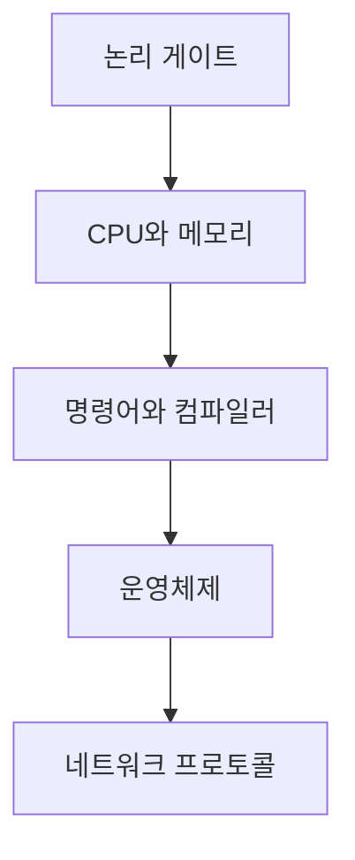

> OSSU의 공개 컴퓨터과학 커리큘럼과 관련 자료를 주제별로 재구성한 노트다.

## 시스템을 계층으로 이해하기

소스 코드는 CPU가 그대로 실행하는 명령이 아니다. 언어 번역·운영체제 서비스·메모리·입출력을 거쳐 물리적 장치에서 실행된다. 운영체제의 추상화(프로세스, 주소 공간, 파일)는 복잡한 하드웨어를 프로그래밍 가능한 환경으로 만든다.

## 강좌 및 선수 관계

### Core systems
| 강좌 | 기간 | 주당 학습량 | 선수 지식·참고 |
| --- | --- | --- | --- |
| [Build a Modern Computer from First Principles: From Nand to Tetris](https://www.coursera.org/learn/build-a-computer) ([alternative](https://www.nand2tetris.org/)) | 6 weeks | 7-13 hours/week | -; C-like programming language |
| [Build a Modern Computer from First Principles: Nand to Tetris Part II](https://www.coursera.org/learn/nand2tetris2) | 6 weeks | 12-18 hours/week | -; one of [these programming languages](https://user-images.githubusercontent.com/2046800/35426340-f6ce6358-026a-11e8-8bbb-4e95ac36b1d7.png), From Nand to Tetris Part I |
| [Operating Systems: Three Easy Pieces](https://github.com/ossu/computer-science/blob/8f8272b1d378d31494240aa1d667aa6b045c6552/coursepages/ostep/README.md) | 10-12 weeks | 6-10 hours/week | -; Nand to Tetris Part II |
| [Computer Networking: a Top-Down Approach](https://gaia.cs.umass.edu/kurose_ross/online_lectures.htm) | 8 weeks | 4–12 hours/week | [Wireshark Labs](https://gaia.cs.umass.edu/kurose_ross/wireshark.php); algebra, probability, basic CS |

## 구체적으로 이해할 내용

- Nand to Tetris: 기본 논리 회로부터 간단한 컴퓨터와 소프트웨어 스택을 직접 만들어 본다.
- OSTEP: 가상화·동시성·영속성 관점으로 프로세스와 메모리, 파일 시스템을 다룬다.
- 네트워크: 응용 계층에서 링크까지 캡슐화·혼잡·손실·재전송을 추적한다.

관련 노트: [[how-programs-run|프로그램 실행 원리]], [[os-kernel|커널]], [[tcp|TCP]], [[computer-architecture|컴퓨터 구조]]
