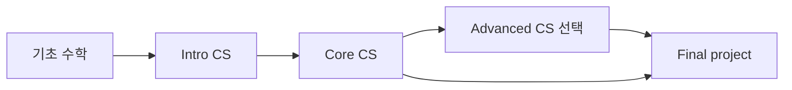

> OSSU의 공개 컴퓨터과학 커리큘럼과 관련 자료를 주제별로 재구성한 노트다.

## OSSU가 다루는 학습 범위

컴퓨터과학은 특정 언어의 문법을 익히는 것을 넘어, 프로그램의 의미·계산의 한계·시스템 내부·자료 표현·보안을 함께 이해하는 학문이다. **OSSU는 대학교 CS 전공의 중심 과목을 온라인 자료로 재구성한 학습 경로**다. 학위 수여 과정이 아니며, 학습 자료에 접근할 수 있다고 해서 모든 평가와 수료증이 무료인 것은 아니다.

| 단계 | 목적 | 선택 기준 |
| --- | --- | --- |
| Intro CS | 프로그래밍과 계산 개념을 체험 | 수학 기초를 점검하고 시작 |
| Core CS | 프로그래밍·수학·시스템·이론·보안·응용·윤리 | 원칙적으로 필수 과목 |
| Advanced CS | 관심 분야를 깊게 파고듦 | 목표 분야의 선택 과목을 골라 이수 |
| Final project | 배운 개념을 실제 문제에 통합 | 직접 설계·구현·검증 |

## 선수 지식과 도구

- Core CS를 시작하기 전에 고교 수준의 대수·기하·미적분 예비 지식이 필요하다. [사전 수학 과정](https://ossu.dev/precollege-math)을 참고한다.
- Advanced CS는 Core CS의 이해를 전제로 하며 Advanced systems에는 물리 기초도 필요하다.
- 터미널, Git, 셸 스크립트, 편집기 사용법은 과제와 프로젝트를 수행하기 위한 도구다.
- 학습 진행은 README를 fork해 완료한 과목을 표시하거나, 각 강좌의 과제를 저장하는 방식으로 관리할 수 있다.

## 입문 과목과 개발 도구

### Intro CS
| 강좌 | 기간 | 주당 학습량 | 선수 지식·참고 |
| --- | --- | --- | --- |
| [Introduction to Computer Science and Programming using Python](https://github.com/ossu/computer-science/blob/8f8272b1d378d31494240aa1d667aa6b045c6552/coursepages/intro-cs/README.md) | 14 weeks | 6-10 hours/week | [high school algebra](https://ossu.dev/precollege-math) |

### CS Tools
| 강좌 | 기간 | 주당 학습량 | 선수 지식·참고 |
| --- | --- | --- | --- |
| [The Missing Semester of Your CS Education](https://missing.csail.mit.edu/) | 2 weeks | 12 hours/week | - |

## 학습 순서

이 도식은 선수 지식의 큰 흐름이다. Core CS 내부에서는 여러 영역을 병렬로 학습할 수 있으나, 각 강좌의 선수 과목은 지킨다.

관련 노트: [[ossu-core-programming|OSSU 핵심 프로그래밍]], [[ossu-faq-community|OSSU 이용과 비용 안내]], [[how-programs-run|프로그램 실행 원리]]
