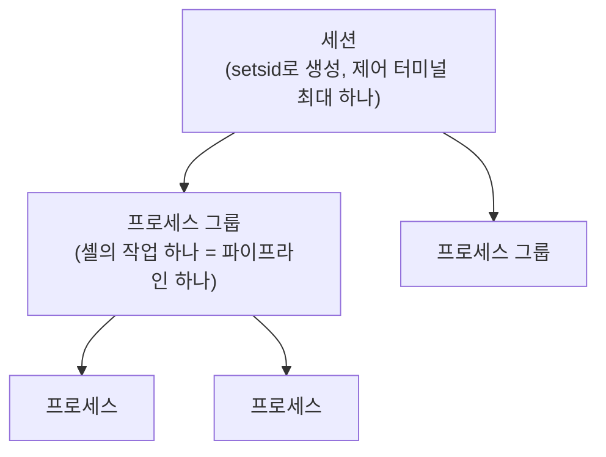

> 팔만코딩경(42Seoul 커뮤니티 위키)의 「[linux] fork 그만, systemd를 이용해 데몬 생성하기」, 「서버 관리 맛보기」, 「[Born2beRoot] 보너스 서비스로 sendmail 어때요?」를 바탕으로 재구성한 노트다.
>
> 부팅 과정은 ByteByteGo의 System Design 101 가이드 「[Linux Boot Process Explained](https://bytebytego.com/guides/linux-boot-process-explained)」를 바탕으로 보강했다.

## 데몬이란

데몬(daemon)은 **제어 터미널 없이 백그라운드에서 계속 실행되며 요청이나 일정에 따라 일하는 프로세스**다. 웹 서버(`nginx`), SSH 서버(`sshd`), 예약 작업(`cron`), 메일 서버(`sendmail`·`postfix`) 같은 것들이다. 이름 끝에 `d`가 붙는 관례가 있다. Linux에서 "서비스"는 서비스 매니저가 관리하는 데몬을 가리킨다.

데몬이 터미널에서 분리되어야 하는 이유:

- 터미널을 닫으면 그 세션의 프로세스에 `SIGHUP`이 간다. 데몬은 로그아웃과 무관하게 살아야 한다.
- 사용자가 실수로 누른 `Ctrl+C`가 데몬에 가면 안 된다.
- 표준 입출력으로 사람과 대화하지 않는다. 소켓·파일로 다른 프로세스와 소통하고, 서비스 매니저의 시그널(`SIGTERM`으로 정지, 관례상 `SIGHUP`으로 설정 다시 읽기)로 제어된다.

## 프로세스 그룹, 세션, 제어 터미널



터미널은 세션 단위로 붙는다. `Ctrl+C`의 `SIGINT`는 그 터미널의 **포그라운드 프로세스 그룹** 전체에 간다. 그래서 터미널에서 벗어나려면 새 세션을 만들어야 한다.

## 전통 방식: SysV 데몬 만들기

예전의 init 스크립트(`/etc/init.d`)는 프로그램을 실행만 해 줬다. 나머지는 데몬이 스스로 해야 했다. `man 7 daemon`이 정리한 핵심 절차는 이렇다.

| 단계 | 하는 일 | 이유 |
| --- | --- | --- |
| 1 | 0·1·2를 뺀 fd를 모두 닫고, 시그널 핸들러·마스크·환경 변수를 초기화 | 부모에게서 물려받은 것 정리 |
| 2 | `fork()` 후 부모는 종료 | 셸에 제어를 돌려주고, 자식은 프로세스 그룹 리더가 아니게 됨 |
| 3 | 자식에서 `setsid()` | 새 세션의 리더가 되어 제어 터미널과 분리 |
| 4 | 다시 `fork()` 후 첫 자식은 종료 | 세션 리더가 아니게 만들어 터미널을 다시 얻을 수 없게 함. 남은 손자는 init(PID 1)에 입양됨 |
| 5 | 0·1·2를 `/dev/null`에 연결, `umask(0)`, `chdir("/")` | 터미널 출력 차단, 생성 파일 권한을 직접 통제, 마운트 해제를 막지 않게 |
| 6 | PID를 `/run/이름.pid`에 기록(경쟁 없이), 권한 낮추기 | 매니저가 PID를 알게 하고 중복 실행 방지 |
| 7 | 준비 완료를 원래 프로세스에 알린 뒤 원래 프로세스 종료 | 시작 성공 여부 보고 |

이중 fork 때문에 init 스크립트는 실제 데몬의 PID를 알 수 없었고, PID 파일에 의존해야 했다. PID 파일이 남아 있거나 다른 프로세스가 그 번호를 재사용하면 관리가 꼬였다.

## systemd: 매니저가 다 해 준다

현재 주요 배포판(Debian·Ubuntu·RHEL 계열·Fedora·Arch)은 PID 1로 **systemd**를 쓴다. macOS의 PID 1은 `launchd`다.

systemd 아래의 데몬(new-style daemon)은 **포그라운드로 그냥 실행하면 된다.** fork·setsid·PID 파일·`/dev/null` 연결은 systemd가 한다. 출력은 stdout·stderr로 쓰면 저널이 모은다.

| 비교 | SysV init | systemd |
| --- | --- | --- |
| 설정 | 셸 스크립트 | 선언형 유닛 파일 |
| 프로세스 추적 | PID 파일 | cgroup. 자식·손자까지 빠짐없이 추적하고 정지 시 모두 정리 |
| 시작 순서 | 번호 붙은 스크립트를 순서대로 | 의존 관계 그래프. 의존 없는 유닛은 병렬로 시작해 부팅이 빠름 |
| 재시작 | 직접 구현 | `Restart=on-failure` |
| 로그 | syslog 파일 | journald (`journalctl`) |
| 실행 사용자 | 스크립트에서 처리 | `User=`로 지정 |

## 유닛 파일

systemd가 관리하는 대상은 모두 유닛(unit)이다. 종류는 확장자로 구분한다: `.service`, `.timer`, `.socket`, `.target`(유닛 묶음, 옛 runlevel 역할), `.mount`, `.path` 등.

| 위치 | 용도 |
| --- | --- |
| `/usr/lib/systemd/system/` (Debian 계열은 `/lib/...`와 같은 곳) | 패키지가 설치한 유닛. 직접 고치지 않는다 |
| `/etc/systemd/system/` | **관리자가 만들거나 덮어쓰는 유닛.** 같은 이름이면 이쪽이 우선 |
| `~/.config/systemd/user/` | 사용자 세션 유닛 (`systemctl --user`) |

```ini
# /etc/systemd/system/myapp.service
[Unit]
Description=My app
Wants=network-online.target
After=network-online.target

[Service]
Type=simple
User=myapp
WorkingDirectory=/srv/myapp
ExecStart=/usr/bin/myapp
Restart=on-failure

[Install]
WantedBy=multi-user.target
```

- `[Unit]`의 `Wants`·`Requires`는 함께 켤 유닛, `After`·`Before`는 순서다. 둘은 별개라 보통 같이 쓴다. `Conflicts`는 동시에 켜지지 않게 한다.
- `[Install]`의 `WantedBy=multi-user.target`은 "일반 다중 사용자 부팅에 포함"이라는 뜻이다. `enable`할 때 이 정보로 링크를 만든다.
- 기존 유닛 일부만 바꾸려면 `systemctl edit 이름`으로 드롭인(`.d/override.conf`)을 만든다.

| 명령 | 뜻 |
| --- | --- |
| `systemctl daemon-reload` | 유닛 파일을 고친 뒤 다시 읽기 |
| `systemctl enable --now myapp` | 부팅 시 자동 시작 등록 + 지금 시작 |
| `systemctl status myapp` | 상태, 최근 로그, 프로세스 트리 |
| `systemctl restart`·`stop`·`disable` | 재시작·정지·자동 시작 해제 |
| `journalctl -u myapp -f` | 그 유닛의 로그를 따라 보기 |

## cron 대신 systemd 타이머

cron은 `/etc/crontab`이나 `crontab -e`에 `분 시 일 월 요일 명령`을 적는다. systemd 타이머는 같은 일을 하는 `.timer` 유닛이다. 기본으로 **같은 이름의 `.service`를 실행**한다.

```ini
# /etc/systemd/system/myapp.timer
[Unit]
Description=Run myapp hourly

[Timer]
OnCalendar=hourly          # *-*-* *:00:00 과 같음
OnBootSec=30s              # 부팅 30초 뒤에도 한 번
Persistent=true            # 꺼져 있어 놓친 실행은 켜진 뒤 바로
RandomizedDelaySec=1min    # 여러 서버가 동시에 몰리지 않게

[Install]
WantedBy=timers.target
```

| 비교 | cron | systemd 타이머 |
| --- | --- | --- |
| 표현 | 한 줄 | 타이머 + 서비스 두 파일 |
| 꺼져 있을 때 놓친 작업 | 실행 안 됨 (anacron 별도) | `Persistent=true`로 보충 |
| 로그 | 메일이나 직접 리다이렉션 | 저널에 자동 기록 |
| 중복 실행 | 직접 막아야 함 | 이전 실행이 끝나지 않았으면 새로 시작하지 않음 |
| 시간 기준 | 달력 | 달력(`OnCalendar`) + 상대 시간(`OnBootSec`, `OnUnitActiveSec`) |
| 자원 제한·의존 관계 | 없음 | 서비스 유닛 설정을 그대로 사용 |

`systemctl list-timers`로 마지막·다음 실행 시각을 보고, `systemd-analyze calendar "Mon *-*-* 09:00"`으로 표현식을 검증한다. 한 줄짜리 간단한 작업에는 cron도 여전히 충분하다.

## 데몬 예: 메일 서버

메일 서버는 데몬의 전형적인 예다. 25번 포트에서 SMTP 연결을 기다리고, 받은 메일은 다른 서버로 넘기거나 `/var/mail/사용자`에 넣는다. 로그는 저널이나 `/var/log/mail.log`에 남는다. 다만 아무 서버나 Gmail 같은 곳으로 메일을 보내면 거부된다. 수신 측은 보낸 도메인이 SPF·DKIM·DMARC 레코드([[dns|DNS]])로 인증되는지 확인하고, 가정용·클라우드 IP의 25번 포트 발신은 막혀 있는 경우가 많다. 실서비스는 메일 발송 서비스를 쓴다.

## 부팅 과정: 전원에서 로그인까지

systemd가 PID 1로 뜨기까지와 그 이후의 흐름은 다음과 같다.

| 단계 | 하는 일 |
| --- | --- |
| 1. 펌웨어 시작 | 전원이 들어오면 비휘발성 메모리의 BIOS 또는 UEFI 펌웨어가 실행되고 POST(Power-On Self Test)로 하드웨어를 점검한다 |
| 2. 장치 탐지 | CPU, RAM, 저장 장치 같은 연결된 장치를 찾는다 |
| 3. 부팅 장치 선택 | 정해진 순서대로 디스크, 네트워크(PXE), USB 등에서 부팅할 장치를 고른다 |
| 4. 부트 로더 | GRUB 같은 부트 로더가 실행된다. 운영체제나 커널을 고르는 메뉴를 보여 주고, 커널과 초기 램디스크(initramfs)를 메모리에 올린다 |
| 5. 커널 초기화 | 커널이 하드웨어를 초기화하고 루트 파일 시스템을 마운트한 뒤, 첫 사용자 공간 프로세스인 **systemd(PID 1)**를 실행한다 |
| 6. 유닛 실행 | systemd가 기본 타깃(`default.target`, 보통 `multi-user.target`이나 `graphical.target`)에 필요한 유닛을 의존 관계에 따라 병렬로 띄운다. 남은 하드웨어 탐지, 파일 시스템 마운트, 서비스 시작이 여기서 일어난다 |
| 7. 환경 구성 | 시작 스크립트와 설정이 실행돼 네트워크, 로그, 사용자 환경을 준비한다 |
| 8. 로그인 | 로그인 프롬프트나 그래픽 로그인 화면이 뜨고 시스템이 준비된다 |

`systemd-analyze blame`으로 부팅 중 어떤 유닛이 오래 걸렸는지 볼 수 있다.

## 정리

- 데몬 = 터미널과 분리되어 백그라운드에서 도는 서비스 프로세스다.
- SysV 시절에는 데몬이 이중 fork·setsid·PID 파일을 직접 처리했다.
- systemd 아래에서는 포그라운드로 실행하고, 나머지는 유닛 파일에 선언한다.
- 관리자 유닛은 `/etc/systemd/system`에 두고 `daemon-reload` → `enable --now`.
- **주기 작업은 타이머 + 서비스로 만들면 로그·재시도·놓친 실행 보충을 공짜로 얻는다.**

관련 노트: [[unix-signals|UNIX 시그널]], [[process-and-thread|프로세스와 스레드]], [[linux-distributions|리눅스 배포판과 패키지 관리]], [[linux-access-control|리눅스 접근 제어]]
