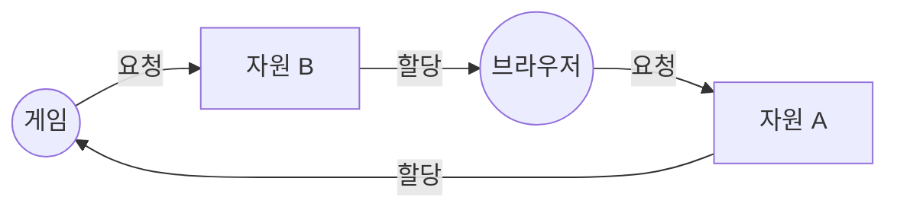

> 노션 정리를 바탕으로 재구성하고, 데이터베이스의 교착 상태 처리는 ByteByteGo의 System Design 101 가이드 「[What is a Deadlock?](https://bytebytego.com/guides/what-is-a-deadlock)」를 바탕으로 보강한 노트다.
> 「식사하는 철학자 문제」, 「자원 할당 그래프」, 「회피」 등 일부 절은 강민철의 「혼자 공부하는 컴퓨터 구조+운영체제」 강의(한빛미디어)를 바탕으로 보강했다.
> 네 조건이 필요 조건인 이유 부분은 fru1tworld/cs-basic 모의 면접 질문 목록을 점검해 빠진 개념을 보강했다.

**교착 상태(deadlock)** 는 일련의 프로세스들이 서로가 가진 자원을 기다리며 모두 blocked 된 상태다. 예를 들어 두 프로세스가 각각 lock 하나씩을 쥔 채 상대방의 lock을 기다리면 둘 다 영원히 진행할 수 없다.

## 식사하는 철학자 문제

교착 상태를 설명하는 고전적인 예다. 원탁에 철학자 5명이 앉고, 철학자 사이마다 포크가 하나씩 놓여 있다. 식사하려면 포크 두 개가 필요하고, 철학자는 모두 같은 순서를 따른다.

```text
1. 왼쪽 포크가 비면 집는다
2. 오른쪽 포크가 비면 집는다
3. 두 개를 다 들면 정해진 시간 동안 먹는다
4. 오른쪽 포크, 왼쪽 포크 순으로 내려놓고 1로 돌아간다
```

한두 명만 먹을 때는 문제가 없다. 그러나 다섯 명이 **동시에 왼쪽 포크를 집으면** 모두 오른쪽 포크를 기다리고, 아무도 포크를 내려놓지 않으니 누구도 먹지 못한다. 철학자는 프로세스(스레드), 포크는 자원, 식사는 자원을 써서 실행하는 일에 대응한다. 즉 **일어나지 않을 사건을 서로 기다리며 진행이 멈추는 것**이 교착 상태다. 고전적인 동기화 문제로서의 다른 문제들은 [[process-synchronization|프로세스 동기화]]에 있다.

## 자원과 사용 절차

- 자원(resource)은 하드웨어(I/O 장치, CPU, 메모리)와 소프트웨어(lock, 세마포어 등)를 모두 포함한다.
- 프로세스는 **Request → Allocate → Use → Release** 순서로 자원을 사용한다.

## 발생 조건 4가지

네 조건이 **모두** 성립해야 교착 상태가 생긴다.

| 조건 | 의미 |
| --- | --- |
| 상호 배제 (Mutual Exclusion) | 매 순간 하나의 프로세스만 자원을 독점적으로 사용 |
| 비선점 (No Preemption) | 프로세스는 자원을 스스로 내놓을 뿐, 강제로 빼앗기지 않음 |
| 보유 대기 (Hold and Wait) | 자원을 가진 채로 다른 자원을 기다리며, 가진 것을 놓지 않음 |
| 순환 대기 (Circular Wait) | 자원을 기다리는 프로세스들 사이에 사이클이 형성됨 |

네 조건은 **필요 조건**이라 하나만 빠져도 교착 상태가 생기지 않는다. 순환 대기가 없으면 「누가 누구를 기다리나」를 따라가다 결국 아무것도 기다리지 않는 프로세스에 닿고, 그 프로세스가 끝나 자원을 내놓으면 사슬이 차례로 풀린다. 선점이 되면 자원을 빼앗아 사슬을 끊을 수 있고, 보유 대기가 없으면 기다리는 프로세스는 아무것도 쥐고 있지 않아 남을 막지 않는다. 상호 배제가 없으면 애초에 기다릴 일이 없다. 반대로 네 조건이 다 성립해도 자원 인스턴스가 여러 개면 교착 상태가 아닐 수 있다(아래 자원 할당 그래프). 처리 방법 중 「예방」이 바로 이 조건 하나를 깨는 방식이다.

## 자원 할당 그래프

프로세스와 자원을 정점으로, "요청"과 "할당"을 간선으로 그린 그래프다. 지금 누가 무엇을 쥐고 무엇을 기다리는지가 한눈에 보인다.

| 요소 | 그리는 법 |
| --- | --- |
| 프로세스 | 원 |
| 자원 종류 | 사각형. 같은 종류의 자원(인스턴스)이 여러 개면 사각형 안에 그 수만큼 점을 찍는다 |
| 할당 | **자원 → 프로세스** 화살표 |
| 요청(대기) | **프로세스 → 자원** 화살표 |



게임은 A를 쥔 채 B를, 브라우저는 B를 쥔 채 A를 기다린다. 식사하는 철학자를 그려도 철학자와 포크가 번갈아 이어진 원이 된다. **교착 상태가 생긴 그래프는 원(사이클) 모양**이다.

- 그래프에 **사이클이 없으면** 교착 상태가 아니다.
- 사이클이 있고 **자원마다 인스턴스가 하나**라면 교착 상태다.
- 사이클이 있지만 자원에 인스턴스가 여러 개라면, 교착 상태일 수도 있고 아닐 수도 있다.

## 처리 방법

아래로 갈수록 대응이 약해진다(사전 대응 → 사후 대응 → 방치).

### 1. 예방 (Deadlock Prevention)

네 조건 중 하나가 **절대 성립하지 않도록** 만든다.

| 깨뜨릴 조건 | 방법 |
| --- | --- |
| 상호 배제 | 공유해서는 안 되는 자원은 반드시 성립하므로 현실적으로 깨기 어렵다 |
| 보유 대기 | ① 프로세스 시작 시 필요한 자원을 모두 할당받게 하거나, ② 자원이 필요하면 가진 자원을 모두 내놓고 다시 요청하게 한다 |
| 비선점 | 자원을 빼앗을 수 있게 한다. CPU·메모리처럼 상태를 쉽게 저장·복원할 수 있는 자원에만 적용 가능 (파일 I/O 같은 자원은 어렵다) |
| 순환 대기 | 모든 자원에 순서를 매기고, 정해진 순서대로만 자원을 요청하게 한다. 포크에 1~5번을 매기고 번호가 낮은 포크부터 집게 하면, 5번을 든 철학자는 1번을 집을 수 없어 원이 끊긴다. 원탁이 일렬 식탁이 되는 셈이다. 네 방법 중 가장 현실적이지만 자원이 많으면 번호를 매기기 어렵고, 번호에 따라 특정 자원의 활용률이 떨어질 수 있다 |

생기지도 않은 교착 상태를 막기 위해 제약이 많아서 **자원 이용률과 처리량이 떨어지고 기아(starvation)가 생길 수 있다.**

### 2. 회피 (Deadlock Avoidance)

프로세스가 앞으로 쓸 자원의 **최대량을 미리 선언**하게 하고, 그 정보를 이용해 교착 상태 가능성이 없는 경우(**안전 상태, safe state**)에만 자원을 할당한다. 가용 자원이 남아 있어도 최악의 경우 교착 상태가 생길 수 있다면 할당하지 않는다.

- **안전 상태**: 시스템 내 프로세스들에 대해 **안전 순서열(safe sequence)** 이 존재하는 상태
- **안전 순서열**: 각 프로세스의 남은 요청을 "현재 가용 자원 + 앞선 프로세스들이 끝나며 반납할 자원"으로 충족시킬 수 있는 순서
- **불안전 상태(unsafe state)**: 안전 순서열이 없는 상태. 반드시 교착 상태인 것은 아니지만 교착 상태가 생길 수 있다

예를 들어 같은 종류의 자원이 12개 있고, 프로세스 셋이 9개를 나눠 쥐어 가용 자원이 3개 남았다고 하자. 회피는 **모든 프로세스가 최대치를 한꺼번에 요구하는 최악의 경우**를 가정해 판단한다.

| 프로세스 | 최대 요구량 | 현재 할당량 | 추가 필요량 |
| --- | --- | --- | --- |
| P1 | 10 | 5 | 5 |
| P2 | 4 | 2 | 2 |
| P3 | 9 | 2 | 7 |

```text
가용 3 → P2에 2개 주고 P2 종료, 4개 반납 → 가용 5
가용 5 → P1에 5개 주고 P1 종료, 10개 반납 → 가용 10
가용 10 → P3에 7개 주고 P3 종료
```

`P2 → P1 → P3`이 안전 순서열이므로 안전 상태다. 그런데 이 상태에서 P3의 요청 하나를 선뜻 들어주면 가용 자원이 2개가 된다. P2를 끝내도 가용은 4개인데 P1은 5개, P3은 6개가 더 필요하므로 안전 순서열이 없다(불안전 상태). 그래서 회피 알고리즘은 이 요청을 **가용 자원이 있어도 거절하고** 기다리게 한다. 할당 전에도 안전 상태이고 할당 뒤에도 안전 상태일 때만 내준다.

| 알고리즘 | 적용 대상 | 방식 |
| --- | --- | --- |
| 자원 할당 그래프 알고리즘 | 자원당 인스턴스가 하나 | 앞으로 요청할 수 있음을 나타내는 **claim edge**를 미리 그려 두고, 요청을 할당 간선으로 바꿨을 때 사이클이 생기지 않는 경우에만 할당 |
| 은행원 알고리즘 (Banker's Algorithm) | 자원당 인스턴스가 여러 개 | 할당량(Allocation), 최대 요구량(Max), 가용량(Available), 추가 필요량(Need = Max - Allocation)을 표로 관리. 요청을 들어줬을 때도 안전 순서열이 존재하는지 확인한 뒤 할당 |

### 3. 탐지와 복구 (Detection and Recovery)

교착 상태 발생은 허용하되, 주기적으로 탐지하고 발생하면 복구한다.

**탐지**

- 자원당 인스턴스가 하나: 자원 할당 그래프를 프로세스끼리의 대기 관계만 남긴 **wait-for graph**로 바꿔 사이클을 찾는다. 사이클 탐색에 O(n²)이 걸린다.
- 자원당 인스턴스가 여러 개: 은행원 알고리즘과 비슷하게 할당·요청·가용 표를 만들어 끝낼 수 있는 순서가 있는지 확인한다(단, 미래 최대량이 아니라 **현재 요청**만 본다).

**복구**

- **프로세스 종료**: 교착 상태에 연루된 프로세스를 모두 죽이거나, 사이클이 풀릴 때까지 하나씩 죽인다. 모두 죽이면 확실히 풀리지만 잃는 작업이 많다. 하나씩 죽이면 잃는 작업은 줄지만, 하나 죽일 때마다 교착 상태가 풀렸는지 다시 탐지해야 해서 오버헤드가 크다.
- **자원 선점**: 연루된 프로세스(victim)의 자원을 빼앗고, 그 프로세스를 안전한 상태로 롤백해 재시작한다. 같은 프로세스가 계속 victim으로 뽑히면 기아가 생기므로, 롤백 횟수를 비용에 반영한다.

### 4. 무시 (Deadlock Ignorance)

**타조 알고리즘(ostrich algorithm)**이라고도 한다. 교착 상태를 시스템이 책임지지 않는다. 교착 상태는 매우 드물게 일어나므로, 이를 막으려고 쓰는 오버헤드가 오히려 더 크다고 보는 것이다. 문제가 생기면 사용자가 프로세스를 직접 종료한다. **UNIX, Windows 등 대부분의 현대 범용 OS가 채택**한 방식이다.

## 데이터베이스의 교착 상태

DB에서는 프로세스 대신 **트랜잭션**이 행·테이블의 잠금(lock)을 서로 기다리며 교착 상태에 빠진다. 네 조건(Coffman 조건)은 똑같이 적용된다.

```text
트랜잭션 T1: UPDATE 계좌 A (A 잠금) → UPDATE 계좌 B (B 대기...)
트랜잭션 T2: UPDATE 계좌 B (B 잠금) → UPDATE 계좌 A (A 대기...)
```

OS와 달리 DBMS는 교착 상태를 무시하지 않는다. **탐지하고 희생자를 골라 롤백**하는 것이 기본이다.

| 대응 | 방법 |
| --- | --- |
| 탐지 | 트랜잭션 간 대기 관계를 wait-for graph로 보고 사이클을 찾는다. MySQL InnoDB는 즉시, PostgreSQL은 `deadlock_timeout`만큼 기다린 뒤 검사한다 |
| 희생자 선택 | 사이클을 끊을 트랜잭션 하나를 고른다. 바꾼 행 수, 롤백 비용, 우선순위 등을 기준으로 삼으며 설정으로 조정할 수 있는 DB도 있다 |
| 롤백 | 희생자 트랜잭션을 전체 또는 교착을 풀 만큼만 되돌리고 오류를 돌려준다 |
| 재시도 | 애플리케이션은 교착 상태 오류를 받으면 트랜잭션을 **처음부터 다시 실행**하도록 짠다 |
| 타임아웃 | 잠금을 너무 오래 기다리면 포기하고 롤백한다(`lock_timeout`, `innodb_lock_wait_timeout`) |
| 예방: 잠금 순서 | 모든 트랜잭션이 같은 순서(예: 계좌 번호 오름차순)로 잠그면 순환 대기가 생기지 않는다. 실무에서 가장 효과적인 예방법이다 |
| 예방: 짧은 트랜잭션 | 잠금을 쥔 시간을 줄이고, 트랜잭션 안에서 외부 API 호출 같은 느린 일을 하지 않는다 |

트랜잭션의 잠금 규약은 [[transaction|트랜잭션과 회복]]에 있다.

## 핵심 정리

- 발생 조건: 상호 배제, 비선점, 보유 대기, 순환 대기. 넷 다 성립해야 발생.
- 예방은 조건 하나를 원천 차단, 회피는 안전 상태일 때만 할당(은행원 알고리즘), 탐지·복구는 사후 처리.
- 대부분의 현대 OS는 비용 대비 효과 때문에 교착 상태를 무시한다.
