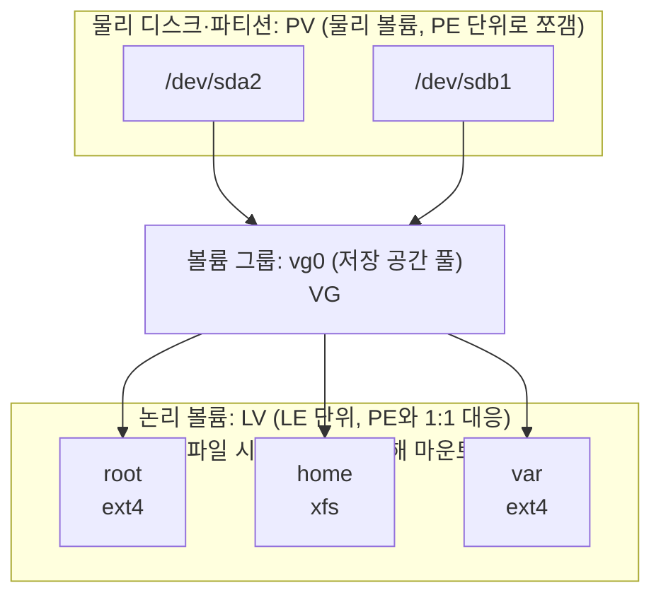

> 파티션 테이블과 LVM 부분은 팔만코딩경(42Seoul 커뮤니티 위키)의 「Born2BeRoot를 진행하며 궁금했던 부분들」, 「LVM 수박 겉핥기」, 「서버 관리 맛보기」를 바탕으로 보강했다.
> CAV·CLV, 스토리지 연결 방식, VBR, 스케줄링 평가 기준과 SLTF·SPTF, 리눅스 디스크 스케줄러의 변천은 고려사이버대학교 「운영체제이론 및 실습」(2024-1학기) 강의 내용으로 보강했다.
> 부팅 과정의 POST 단계는 GitHub 자료 모음 「[Subjective-studies_OS-CN-DBMS](https://github.com/avgspacelover/Subjective-studies_OS-CN-DBMS)」의 OS 면접 정리를 바탕으로 보강했다.

디스크는 파일을 영구 저장하는 곳이자, 메모리가 모자랄 때 쓰는 스왑 공간이다. 디스크 접근은 CPU·메모리에 비해 매우 느리기 때문에, 운영체제는 요청을 처리하는 **순서**를 조절해 성능을 높인다.

## 디스크 구조

| 용어 | 설명 |
| --- | --- |
| 논리 블록 (logical block) | 디스크 **외부**(호스트)에서 보는 정보 저장 단위. 주소를 가진 1차원 배열처럼 취급하며, 정보를 전송하는 최소 단위다 |
| 섹터 (sector) | 디스크 **내부**에서 관리하는 최소 단위. 논리 블록이 매핑되는 물리적 위치다 |
| 플래터 (platter) | 데이터가 기록되는 원판. 보통 여러 장으로 구성 |
| 트랙 (track) | 플래터 한 장 위의 동심원 기록선 |
| 실린더 (cylinder) | 여러 플래터에서 같은 반지름에 있는 트랙들의 묶음 |
| 헤드 / 암 | 헤드가 읽고 쓰며, 암(액추에이터)이 헤드를 원하는 트랙으로 옮긴다 |

용량은 `섹터 크기 × 트랙당 섹터 수 × 트랙 수 × 헤드(면) 수`다.

회전 방식도 매체마다 다르다. 하드 디스크는 **각속도 일정(CAV)**, 즉 늘 같은 rpm으로 돌고 트랙마다 섹터 수를 같게 두던 것이 고전 방식이다. 바깥 트랙의 넓은 면적을 덜 쓰는 대신 어느 섹터든 위치 계산이 간단하다(현대 HDD는 바깥 구역에 섹터를 더 넣는 zoned recording으로 이 낭비를 줄인다). CD는 **선속도 일정(CLV)** 으로, 나선형 트랙의 모든 섹터 크기가 같고 바깥쪽을 읽을 때 회전을 늦춘다. 용량은 늘지만 임의 위치로 옮길 때마다 회전 속도를 바꿔야 해 랜덤 접근이 느리다.

호스트가 "논리 블록 10번에 써라"라고 요청하면, 디스크 컨트롤러가 어느 플래터·트랙·섹터에 쓸지 결정한다. **섹터 0**은 가장 바깥 실린더의 첫 트랙의 첫 섹터로, 부팅 관련 정보가 들어 있다.

## 디스크 관리

### 물리적 포맷팅 (low-level formatting)

디스크를 컨트롤러가 읽고 쓸 수 있도록 섹터들로 나누는 과정이다. 각 섹터는 다음으로 구성된다.

```text
[ header | data (보통 512바이트) | trailer ]
```

- **data**: 외부에서 요청한 논리 블록의 내용. 전통적으로 512바이트였고, 지금의 대용량 HDD는 4KB 물리 섹터(Advanced Format)를 쓴다. 호환을 위해 밖으로는 512바이트 섹터처럼 보이게 하는 방식(512e)도 있다.
- **header·trailer**: 섹터 번호, ECC(Error-Correcting Code) 같은 부가 정보. 디스크 컨트롤러가 직접 접근·운영한다.

### 파티셔닝

물리 디스크를 하나 이상의 독립적인 **논리 디스크**로 나누는 과정이다. 하나의 디스크를 C 드라이브, D 드라이브로 나누면 각각이 논리 디스크가 된다. 운영체제는 물리 디스크가 아니라 논리 디스크를 독립적인 디스크로 다룬다. 파티션을 파일 시스템으로 포맷해 OS가 쓸 수 있게 된 공간을 **볼륨**이라 한다.

| 파티션 테이블 | 구조 | 한계 |
| --- | --- | --- |
| MBR | 디스크 첫 섹터(512바이트)에 부트 코드와 파티션 항목 4개 | 주 파티션 최대 4개. 더 필요하면 하나를 **확장 파티션**으로 만들고 그 안에 논리 파티션을 둔다(리눅스에서 `sda5`부터 붙는 이유). 디스크 최대 2TiB |
| GPT | UEFI 표준. 디스크 앞뒤에 테이블과 백업을 둔다 | 기본 128개 파티션, 사실상 크기 제한 없음. 현재 기본 |

### 논리적 포맷팅

파티션은 파일 시스템 용도나 스왑 영역 용도로 쓸 수 있다. 이 중 **파일 시스템을 만드는 것**이 논리적 포맷팅이며, FAT, inode(UNIX), free-space 관리 구조 등이 생성된다([[file-system-implementation|파일 시스템 구현]]).

### 부팅 과정

1. 전원을 켜면 CPU가 ROM의 주소를 가리키고, 펌웨어가 먼저 CPU·메모리·장치가 정상인지 확인하는 **POST**(Power-On Self-Test)를 한다. 이어서 ROM에 있는 **small bootstrap loader**가 실행된다. ROM은 고치기 어려우므로 여기에는 로더만 두고 실제 부트스트랩 프로그램은 디스크에 둔다.
2. small bootstrap loader는 디스크의 **섹터 0(boot block)** 을 메모리에 올려 실행한다. 파티션된 디스크라면 섹터 0이 **MBR**이고, MBR의 코드는 파티션 테이블에서 부팅할 파티션을 찾아 그 파티션의 첫 섹터인 **VBR**(Volume Boot Record, PBR이라고도 한다)을 읽어 실행한다.
3. VBR(파티션이 없으면 섹터 0)에는 **full bootstrap loader**가 있어, 파일 시스템에서 운영체제 커널의 위치를 찾아 메모리에 올리고 실행한다.
4. 운영체제가 메모리에 올라와 실행된다.

> 위 흐름은 BIOS + MBR 방식의 고전적인 설명이다. 현재 PC는 BIOS 대신 **UEFI** 펌웨어를 쓰고, 디스크는 GPT로 파티셔닝한다. UEFI는 섹터 0의 코드를 실행하는 대신 **EFI 시스템 파티션(ESP)** 에 있는 부트로더 파일을 찾아 실행한다. "펌웨어 → 부트로더 → 커널"이라는 큰 흐름은 같다.

## 접근 시간 (Access Time)

`접근 시간 = 탐색 시간 + 회전 지연 + 전송 시간`

| 구성 | 의미 |
| --- | --- |
| 탐색 시간 (Seek Time) | 헤드를 해당 실린더로 옮기는 시간. **접근 시간의 대부분을 차지** |
| 회전 지연 (Rotational Latency) | 헤드가 원하는 섹터에 닿을 때까지 디스크가 회전하는 시간. 평균은 반 바퀴로, 7200rpm이면 약 4.2ms |
| 전송 시간 (Transfer Time) | 실제로 데이터를 읽고 쓰는 시간 |

**디스크 대역폭(disk bandwidth)** 은 단위 시간당 전송된 바이트 수로, 디스크 성능의 척도다.

탐색 시간이 가장 크고 회전 지연, 전송 시간 순으로 작다. 그래서 디스크 스케줄링은 주로 탐색 시간을, 일부 알고리즘은 회전 지연까지 줄인다.

### 스토리지 연결 방식

디스크를 서버에 어떻게 붙이느냐도 성능과 공유 방식을 바꾼다.

| 방식 | 연결 | 장점 | 단점 |
| --- | --- | --- | --- |
| DAS (Direct Attached Storage) | 서버에 전용 케이블(SATA, SAS)로 직접 | 싸고 빠르다 | 용량 확장과 서버 간 공유가 어렵다 |
| NAS (Network Attached Storage) | 일반 LAN에 붙은 파일 서버. NFS·SMB로 **파일 단위** 접근 | 설치가 쉽고 여러 서버가 파일을 쉽게 공유한다 | 일반 네트워크를 함께 써서 트래픽이 많으면 느려지고, 대량 트랜잭션 DB에는 맞지 않는다 |
| SAN (Storage Area Network) | 파이버 채널·iSCSI 같은 스토리지 전용 네트워크. 서버에는 **블록 장치**로 보인다 | 빠르고 확장성이 좋아 DB에도 쓴다 | 장비와 운영 비용이 비싸다 |

## 디스크 스케줄링

**탐색 시간을 최소화**해 디스크 대역폭을 높이는 것이 목표다. 요청이 들어온 순서대로만 처리하면 헤드가 앞뒤로 자주 오가므로, 나중에 들어왔더라도 지금 헤드 근처의 요청을 먼저 처리하는 편이 나을 수 있다.

알고리즘을 평가하는 기준은 셋이다.

| 기준 | 묻는 것 |
| --- | --- |
| 처리량(throughput) | 단위 시간에 요청을 몇 개나 처리하나 |
| 평균 응답 시간 | 요청 하나가 평균 얼마 만에 처리되나 |
| 응답 시간의 예측성 | 응답 시간의 편차가 작아 얼마나 걸릴지 짐작할 수 있나. 평균이 좋아도 어떤 요청은 한없이 밀리면 예측성이 나쁘다 |

아래 알고리즘들은 다음 예제로 비교한다.

```text
실린더 범위: 0 ~ 199, 헤드 시작 위치: 53
요청 큐: 98, 183, 37, 122, 14, 124, 65, 67
```

### FCFS (First Come First Served)

들어온 순서대로 처리한다. 53 → 98 → 183 → 37 → 122 → 14 → 124 → 65 → 67처럼 헤드가 크게 왔다 갔다 해 매우 비효율적이다(총 이동 640실린더).

### SSTF (Shortest Seek Time First)

헤드에서 **가장 가까운 요청**부터 처리한다. 53 → 65 → 67 → 37 → 14 → 98 → 122 → 124 → 183 (총 이동 236실린더).

- 문제: **기아(starvation)**. 헤드 근처에 요청이 계속 들어오면, 멀리 있는 요청(예: 183)은 오랫동안 처리되지 않을 수 있다.

### SCAN (엘리베이터 스케줄링)

요청 위치와 상관없이 헤드가 디스크의 **한쪽 끝에서 다른 쪽 끝까지** 이동하며 길목의 모든 요청을 처리하고, 끝에 닿으면 방향을 바꿔 다시 처리하며 돌아온다.

- 장점: 헤드 이동 거리 면에서 효율적이고 기아가 없다.
- 단점: **실린더 위치에 따라 대기 시간이 다르다.** 가운데는 헤드가 자주 지나가지만, 양 끝은 한 번 지나가면 왕복해 돌아올 때까지 기다려야 한다. 1~30층 엘리베이터에서 15층 사람과 1층 사람의 평균 대기 시간이 다른 것과 같다.

### C-SCAN (Circular SCAN)

헤드가 한쪽 끝에서 다른 쪽 끝으로 이동하며 요청을 처리하고, 끝에 도달하면 **요청을 처리하지 않고 곧바로 출발점으로 돌아간다.** 예제에서 헤드가 위로 간다면 65, 67, 98, 122, 124, 183을 처리하고 199까지 간 뒤, 0으로 바로 돌아가 14, 37을 처리한다.

- SCAN보다 **균일한 대기 시간**을 보장한다.

### N-SCAN

SCAN의 변형이다. 헤드가 한 방향으로 움직이기 시작하면, **그 이후 도착한 요청은 이번에 처리하지 않고 되돌아올 때** 처리한다. 예를 들어 53에서 199 방향으로 출발할 때 큐에 있던 98, 122, 124, 183은 처리하고, 이동 중에 새로 들어온 102, 140, 155는 길목에 있어도 지나친 뒤 돌아오는 길에 처리한다. 대기 시간의 편차를 줄인다.

### LOOK과 C-LOOK

SCAN·C-SCAN은 헤드가 무조건 디스크 끝까지 간다. LOOK·C-LOOK은 진행 방향에 **더 이상 요청이 없으면 즉시 방향을 바꾼다.** 예제의 C-LOOK이라면 183을 처리한 뒤 199까지 가지 않고, 0이 아니라 가장 작은 요청인 14로 바로 이동한다.

### SLTF와 SPTF: 회전 지연까지 줄이기

위 알고리즘은 모두 탐색 거리만 본다. 같은 실린더에 요청이 여럿 몰려 있으면 회전 지연이 차이를 만든다.

- **SLTF**(Shortest Latency Time First): 헤드가 이미 그 실린더에 있을 때, 지금 헤드 아래로 가장 먼저 돌아올 섹터의 요청부터 처리한다. 섹터마다 큐를 둔다고 해서 섹터 큐잉(sector queueing)이라고도 한다.
- **SPTF**(Shortest Positioning Time First): 탐색 시간 + 회전 지연, 즉 위치를 잡는 데 걸리는 전체 시간이 가장 짧은 요청을 고른다. SSTF처럼 멀리 있는 요청이 굶을 수 있다.

헤드의 정확한 각도는 드라이브 안에서만 알 수 있으므로 이 계열은 운영체제보다 **드라이브 펌웨어**가 실행한다. 현대 디스크는 내부 구조를 감추고 논리 블록만 보여 주며, 명령 큐(NCQ)에 쌓인 요청을 스스로 재정렬하고 다음 블록을 버퍼에 미리 읽어 둔다(read-ahead). 그래서 운영체제의 스케줄러는 탐색 최적화보다 프로세스 간 공정성, 우선순위, 페이징·스와핑 요청 우대 같은 상위 정책에 집중한다.

### 알고리즘 선택

- SCAN·C-SCAN과 그 응용인 LOOK·C-LOOK이 일반적이며, 디스크 입출력이 많은 시스템에서 효율적이다.
- 파일을 디스크에 어떻게 할당하느냐(연속 할당 등)도 디스크 요청 성능에 영향을 준다.
- 디스크 스케줄링 알고리즘은 필요하면 쉽게 바꿀 수 있도록 커널과 분리된 **별도 모듈**로 작성하는 것이 바람직하다.
- 이 알고리즘들은 헤드가 움직이는 **HDD**를 전제로 한다. SSD는 기계적인 탐색이 없어 요청 순서를 바꾸는 이득이 거의 없으므로, 리눅스는 NVMe SSD에 기본적으로 스케줄러를 거의 쓰지 않는다(`none`).
- 리눅스는 2.6 시절부터 오랫동안 **CFQ**(Completely Fair Queuing)를 기본으로 썼다. 프로세스마다 요청 큐를 두고 시간 조각을 돌아가며 주어, 디스크를 프로세스 사이에 공정하게 나누고 실시간·best-effort·idle 우선순위 클래스를 지원했다. 멀티 큐 블록 계층(blk-mq)으로 옮기면서 CFQ는 커널 5.0에서 제거되었고, 지금은 `mq-deadline`, CFQ의 공정성을 이어받은 `bfq`, 빠른 장치용 `kyber`, 아무것도 하지 않는 `none` 중에서 고른다. 장치별 현재 값은 `cat /sys/block/<장치>/queue/scheduler`로 본다.

## 스왑 공간 관리

디스크를 쓰는 이유는 두 가지다.

1. 메모리는 휘발성이라 **영구 저장**을 위해 파일 시스템이 필요하다.
2. DRAM은 용량이 한정되어 있어 프로그램 실행에 필요한 공간이 부족하므로, **메모리의 연장 공간**으로 스왑 영역이 필요하다([[virtual-memory|가상 메모리]]).

스왑 영역의 특징:

- 파일 시스템 안에 둘 수도 있지만 보통 **별도의 파티션**을 쓴다.
- **공간 효율성보다 속도 효율성이 우선**이다. 스왑 영역의 내용은 프로세스가 끝나면 사라지는 데이터이고, 메모리에서 쫓아내고 다시 올리는 일이 빨라야 하기 때문이다. 디스크는 탐색 시간이 대부분이라 헤드 이동을 최소화하는 것이 중요하다.
- 일반 파일보다 훨씬 짧게 존재하고 자주 참조된다.
- 그래서 블록 크기와 저장 방식이 일반 파일 시스템(보통 512바이트 섹터 단위)과 다르다. 큰 단위로 한 번에 올리고 내린다.

### LVM: 파티션 위의 가상화 계층

파티션은 한 번 나누면 크기를 바꾸기 어렵고 디스크 한 장을 넘을 수 없다. 리눅스의 **LVM**(Logical Volume Manager)은 파티션과 파일 시스템 사이에 층을 하나 더 둔다.



- 디스크 여러 장의 빈 공간을 합쳐 하나의 논리 볼륨으로 쓸 수 있다. 디스크0에 2GB, 디스크1에 5GB가 남아도 7GB 파일을 담을 수 있다.
- 운영 중에 볼륨을 늘릴 수 있다. 새 디스크를 `pvcreate` → `vgextend`로 그룹에 넣고, `lvextend -r -L +10G /dev/vg0/home`으로 볼륨과 파일 시스템을 함께 키운다. 스냅샷도 만들 수 있다.
- 확인 명령: `lsblk`(블록 장치 트리), `pvs`·`vgs`·`lvs`.
- LVM 자체는 중복 저장을 하지 않는다. 디스크 한 장이 고장 나면 그 위에 걸친 볼륨이 손상되므로 신뢰성은 RAID와 백업으로 따로 챙긴다.

## RAID (Redundant Array of Independent Disks)

저렴한 디스크 여러 개를 묶어 하나처럼 쓰는 기술이다.

| 목적 | 방법 |
| --- | --- |
| 처리 속도 향상 | 여러 디스크에 블록을 **분산 저장**하고 **병렬로** 읽어 온다(interleaving, striping) |
| 신뢰성 향상 | 같은 정보를 여러 디스크에 **중복 저장**해 하나가 고장 나도 다른 디스크에서 읽는다(mirroring, shadowing) |

데이터 전체를 중복 저장하는 대신, 일부 디스크에 **패리티(parity)** 만 저장해 오류를 검출·복구하면 공간 효율을 높일 수 있다. RAID 레벨별 구성은 [[memory-hierarchy|메모리 계층 구조]]에 정리했다. 패리티 계산의 원리(XOR, 해밍 코드)는 [[data-representation|데이터의 표현]]에 있다.

### 리눅스 소프트웨어 RAID (md)

RAID는 전용 컨트롤러 없이 커널의 **md** 드라이버(`mdadm`으로 관리)로도 구성한다. 성격이 다른 장치끼리 묶을 수 있어, 빠른 장치와 안전한 장치를 섞는 데 쓴다.

- RAID 1의 한쪽 장치에 **write-mostly**를 표시하면 그 장치는 쓰기만 받고, 다른 장치를 쓸 수 없을 때만 읽기를 맡는다. 일반 RAID 1은 읽기를 양쪽에 나눠 보낸다.
- 예: 빠르지만 휘발성인 클라우드 로컬 SSD를 RAID 0으로 묶고, 그 배열을 느리지만 복제·스냅샷이 되는 네트워크 디스크(write-mostly)와 RAID 1로 미러링한다. 읽기는 로컬 SSD 속도로, 내구성은 네트워크 디스크로 얻는다. 자세한 구성은 [[wide-column-database|와이드 컬럼 DB와 대규모 메시지 저장: Cassandra·ScyllaDB]]에 있다.

## 핵심 정리

- 외부에서 보는 단위는 논리 블록, 내부 단위는 섹터. 부팅은 ROM의 작은 로더 → 섹터 0 → 커널 순.
- 접근 시간 = 탐색 + 회전 지연 + 전송이며 탐색이 대부분이므로, 디스크 스케줄링은 탐색 시간 최소화가 목표.
- SSTF는 기아, SCAN은 대기 시간 불균형, C-SCAN은 균일한 대기, LOOK 계열은 불필요한 끝까지 이동을 없앤다.
- 스왑 영역은 속도 우선, RAID는 분산(속도)과 중복(신뢰성)으로 디스크 여러 개를 묶는다.

관련 노트: [[file-system-implementation|파일 시스템 구현]], [[virtual-memory|가상 메모리]], [[system-structure#커널 입출력 서브시스템|운영체제의 입출력 시스템]]
