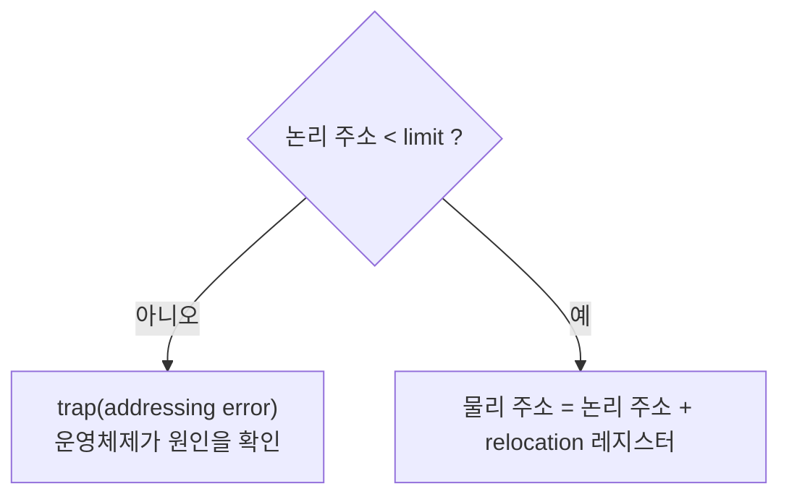

> 노션 정리를 바탕으로 재구성하고, 페이징과 세그멘테이션 비교는 ByteByteGo의 System Design 101 가이드 「[Paging vs Segmentation](https://bytebytego.com/guides/what-are-the-differences-between-paging-and-segmentation)」을 바탕으로 보강한 노트다.
> 커널 메모리 할당(버디·슬랩)은 「[개념 정리 - 운영 체제 편](https://brunch.co.kr/@toughrogrammer/15)」을 바탕으로 보강했다.
> 「스와핑」, 「연속 할당」, 「페이징」, 「공유 페이지와 쓰기 시 복사」 등 일부 절은 강민철의 「혼자 공부하는 컴퓨터 구조+운영체제」 강의(한빛미디어)를 바탕으로 보강했다.
> TLB의 위치, 32비트 주소 한계와 PAE, 요구 세그멘테이션, segfault, protection 비트 확인 부분은 fru1tworld/cs-basic 모의 면접 질문 목록을 점검해 빠진 개념을 보강했다.

메모리는 주소로 접근하는 바이트들의 배열이다(C에서 주소를 직접 다루는 모습은 [[pointers-and-memory|포인터와 메모리]]). 여러 프로세스가 한정된 물리 메모리를 나눠 쓰려면, 프로세스가 보는 주소를 실제 메모리 위치로 바꿔 주고 서로의 영역을 보호해야 한다. 이 노트는 프로세스 전체 또는 일부를 **어떻게 메모리에 배치하는지**를 다룬다. 필요한 부분만 올리는 방법은 [[virtual-memory|가상 메모리]]에서 이어진다.

## 논리 주소와 물리 주소

| 주소 | 설명 |
| --- | --- |
| 논리 주소 (logical / virtual address) | 프로세스마다 독립적으로 갖는 주소 공간의 주소. 각 프로세스는 0번지부터 시작한다. **CPU가 보는 주소**는 논리 주소다 |
| 물리 주소 (physical address) | 실제 메모리에 올라간 위치 |

### 주소 바인딩 (Address Binding)

주소가 `심볼릭 주소(변수·함수 이름) → 논리 주소 → 물리 주소`로 결정되는 과정이다. 논리 주소가 물리 주소로 정해지는 시점에 따라 세 가지로 나뉜다.

| 시점 | 설명 |
| --- | --- |
| 컴파일 타임 바인딩 | 컴파일할 때 물리 주소가 정해진다. 컴파일러가 **절대 코드(absolute code)** 를 만들고, 시작 위치를 바꾸려면 다시 컴파일해야 한다 |
| 로드 타임 바인딩 | 프로그램을 메모리에 올릴 때 로더가 물리 주소를 정한다. 컴파일러가 **재배치 가능 코드(relocatable code)** 를 만들어야 한다 |
| 실행 타임 바인딩 | 실행 도중에도 프로세스의 위치를 옮길 수 있다. CPU가 주소를 참조할 때마다 변환 정보를 확인하므로 **하드웨어 지원**(base·limit 레지스터, MMU)이 필요하다 |

앞의 두 방식은 한 번 정해지면 바뀌지 않고, 현대 컴퓨터는 실행 타임 바인딩을 쓴다.

## MMU (Memory-Management Unit)

논리 주소를 물리 주소로 바꿔 주는 하드웨어다. 가장 단순한 방식은 프로세스의 물리 시작 주소를 담은 **relocation(base) 레지스터**와 주소 공간 크기를 담은 **limit 레지스터**를 쓴다. 쓸 수 있는 물리 주소는 `base 이상, base + limit 미만`이고, 벗어나면 트랩으로 막는다(메모리 보호).



예: 논리 주소 공간이 0~3000인 프로세스가 물리 메모리 14000번지에 올라가 있다면, 논리 주소 346은 14346이 된다. 사용자 프로그램은 논리 주소만 다루고 실제 물리 주소는 볼 수도, 알 필요도 없다.

## 관련 기법

| 기법 | 설명 | 누가 구현하나 |
| --- | --- | --- |
| 동적 로딩 (Dynamic Loading) | 프로세스 전체를 미리 올리지 않고, 해당 루틴이 **호출될 때** 메모리에 올린다. 오류 처리 루틴처럼 가끔 쓰는 코드가 많을 때 메모리 이용률이 좋아진다 | 프로그램 자체(OS는 라이브러리로 지원 가능) |
| 오버레이 (Overlays) | 프로세스에서 실제 필요한 부분만 올린다. 프로세스가 메모리보다 클 때 쓰던 초창기 방식 | 프로그래머가 수작업(manual overlay), 매우 복잡 |
| 스와핑 (Swapping) | 프로세스를 통째로 메모리에서 **backing store(swap area)** 로 쫓아냈다가 나중에 다시 올린다 | 운영체제(중기 스케줄러) |
| 동적 링킹 (Dynamic Linking) | 라이브러리 연결을 실행 시간까지 미뤄, 공유 라이브러리(`.so`, DLL) 한 벌을 여러 프로세스가 함께 쓴다. 호출 지점에는 루틴의 실제 위치를 찾아 주는 작은 코드(**stub**)만 두고, 라이브러리가 이미 메모리에 있으면 그 주소로, 없으면 디스크에서 읽어 와 연결한다(ELF의 PLT·GOT가 이 역할을 한다). 정적 링킹과의 비교는 [[gcc-compile-and-link\|GCC 컴파일과 링크]] | 운영체제 지원 필요 |

### 스와핑

backing store는 프로세스 이미지를 담을 만큼 빠르고 큰 디스크 공간이다. 중기 스케줄러가 보통 우선순위가 낮은 프로세스를 내보낸다. 컴파일·로드 타임 바인딩이면 **원래 위치로** swap in 해야 하지만, 실행 타임 바인딩이면 빈 곳 어디에나 올릴 수 있다. 스왑 시간의 대부분은 데이터 양에 비례하는 전송 시간이다.

| 용어 | 뜻 |
| --- | --- |
| swap out | 지금 쓰지 않는 프로세스를 메모리에서 스왑 영역으로 내보낸다 |
| swap in | 스왑 영역의 프로세스를 다시 메모리로 올린다 |

스와핑을 쓰면 **프로세스들의 크기 합이 물리 메모리보다 커도** 동시에 실행할 수 있다. A, B, C를 올린 상태에서 D가 필요하면 당장 쓰지 않는 B를 swap out 하고 D를 올리고, 다시 B가 필요하면 A를 내보내고 B를 올리는 식이다. 페이징에서는 같은 일을 페이지 단위로 하며 page out, page in이라고 부른다. 스왑 영역의 크기와 사용량은 Linux에서 `free -h`의 `Swap` 줄이나 `top`으로, macOS에서 `sysctl vm.swapusage`로 확인한다.

## 물리 메모리 할당

메모리는 보통 **낮은 주소의 OS 상주 영역**(인터럽트 벡터 포함)과 **높은 주소의 사용자 프로세스 영역**으로 나뉜다. 사용자 영역을 프로세스에 나눠 주는 방법은 두 가지다.

프로세스를 연속된 공간에 올리는 **연속 할당**(고정·가변 분할)과, 여러 영역에 나눠 올리는 **불연속 할당**(페이징, 세그멘테이션, 페이지드 세그멘테이션)이 있다. 오늘날 쓰는 것은 불연속 할당이다.

## 연속 할당

| 방식 | 설명 | 단편화 |
| --- | --- | --- |
| 고정 분할 (Fixed partition) | 물리 메모리를 미리 몇 개의 분할로 나누고(크기 동일 또는 다름) 분할마다 프로그램 하나를 적재. 동시에 올릴 수 있는 프로그램 수와 최대 크기가 고정되어 융통성이 없다 | 내부·외부 단편화 모두 발생 |
| 가변 분할 (Variable partition) | 미리 나누지 않고 프로그램 크기에 맞게 할당. 분할의 크기·개수가 동적으로 변한다 | 외부 단편화 발생 |

### 단편화와 대응

가변 분할에서는 크기가 제각각인 빈 공간(**hole**)이 흩어지고, 운영체제는 할당 공간과 hole 목록을 관리한다.

| 문제 | 원인 | 대응 |
| --- | --- | --- |
| 외부 단편화 (External) | 빈 공간의 합은 충분하지만 조각마다 너무 작아 프로그램이 들어가지 못한다(분할 < 프로그램) | hole 선택 전략을 고르고, 그래도 쌓이면 **컴팩션**: 사용 중인 메모리를 한쪽으로 몰아 큰 hole 하나를 만든다. 모든 주소가 바뀌므로 실행 시간 바인딩일 때만 가능하고 비용이 크다. 근본 해결은 페이징 |
| 내부 단편화 (Internal) | 배정된 분할이 프로그램보다 커서 안에서 남는 공간(분할 > 프로그램) | 분할·페이지 크기를 작게 잡는다. 대신 관리 비용(페이지 테이블 크기)이 는다 |

| hole 선택 | 고르는 hole (크기 n 요청) | 특징 |
| --- | --- | --- |
| First-fit | n 이상 중 **처음 찾은** 것 | 빠르다 |
| Best-fit | n 이상 중 **가장 작은** 것 | 정렬되어 있지 않으면 전체 탐색, 아주 작은 hole이 많이 생긴다 |
| Worst-fit | **가장 큰** 것 | 전체 탐색, 비교적 큰 hole이 남는다 |

예를 들어 hole이 순서대로 A 30MB, B 60MB, C 20MB이고 20MB짜리 프로세스를 올린다면 First-fit은 처음 맞는 A, Best-fit은 크기가 딱 맞는 C, Worst-fit은 가장 큰 B를 고른다.

실험적으로 **First-fit과 Best-fit이 Worst-fit보다** 속도와 공간 이용률이 낫다.

Worst-fit은 큰 hole을 쪼개 남는 조각도 쓸 만한 크기로 남기려는 발상이라, 요청 크기가 고르고 아주 작은 조각이 쌓이는 것을 피하고 싶을 때만 의미가 있다. 대신 큰 요청이 들어갈 자리를 먼저 써 버려서 실제로는 거의 쓰지 않는다.

외부 단편화가 생기는 과정은 다음과 같다. 사용자 영역 200MB에 A 50MB, B 30MB, C 100MB, D 20MB를 차례로 빈틈없이 올렸다가 B와 D가 끝나면, 빈 공간은 B 자리 30MB와 D 자리 20MB로 합쳐 50MB다. 그런데 두 hole이 떨어져 있어 **50MB짜리 프로세스는 어디에도 올릴 수 없다.**

```text
[ A 50 | 빈 30 | C 100 | 빈 20 ]   빈 공간 합 50MB, 가장 큰 hole 30MB
```

컴팩션으로 hole을 모을 수는 있지만, 옮기는 동안 프로세스들이 일을 멈춰야 하고, 어떤 순서로 옮겨야 비용이 가장 적은지도 정하기 어렵다. 그래서 현대 운영체제는 연속 할당 대신 페이징을 쓴다. 연속 할당은 프로세스 전체를 올려야 하므로 **물리 메모리보다 큰 프로세스를 실행할 수 없다**는 한계도 있다.

## 페이징 (Paging)

프로세스의 논리 주소 공간을 **같은 크기의 페이지(page)** 로 자르고, 물리 메모리도 같은 크기의 **프레임(page frame)** 으로 나눈 뒤 페이지를 아무 빈 프레임에나 올린다. 외부 단편화가 생기지 않는다(마지막 페이지에 약간의 내부 단편화는 생길 수 있다).

```text
논리 주소 = [ 페이지 번호 p | 오프셋 d ]
                  │ 페이지 테이블[p] = 프레임 번호 f
물리 주소 = [ 프레임 번호 f | 오프셋 d ]
```

- 프로세스마다 별도의 **페이지 테이블**이 있고, 엔트리 수는 논리 주소 공간의 페이지 수와 같다(배열의 인덱스 = 페이지 번호).
- 페이지 크기는 보통 **4KB**이고, 페이지 테이블은 메인 메모리에 있다. 실제 크기는 `getconf PAGESIZE`로 확인한다.

페이지가 물리 메모리 곳곳에 흩어져 있어도 CPU는 논리 주소의 0번 페이지부터 차례로 실행하면 된다. 페이지 테이블이 각 페이지가 어느 프레임에 있는지 알려 주므로, **물리적으로는 흩어져 있어도 CPU에게는 연속된 것처럼 보인다.** 페이지와 프레임의 크기가 같으므로 오프셋 d는 변환 전후가 같다. 예를 들어 페이지 크기가 4바이트이고 페이지 테이블에서 5번 페이지가 1번 프레임에 있다면, 논리 주소 `(5, 2)`는 1번 프레임의 시작(4번지)에서 2만큼 떨어진 6번지가 된다.

### 페이지 테이블 구현과 TLB

페이지 테이블의 위치와 크기는 **PTBR**(Page-Table Base Register)과 **PTLR**(Page-Table Length Register)이 가리킨다. 페이지 테이블은 프로세스마다 있으므로 PTBR 값은 프로세스의 PCB에 저장되고, 문맥 교환 때 실행할 프로세스의 값으로 바뀐다. 테이블이 메모리에 있으므로 데이터 하나를 읽는 데 **메모리 접근이 두 번**(테이블 + 데이터) 필요하다.

이를 줄이려고 **TLB(Translation Look-aside Buffer)** 라는 고속의 주소 변환용 캐시(associative register)를 둔다.

- TLB에는 자주 참조되는 페이지 테이블 엔트리 **일부**만 들어 있고, 병렬 검색(parallel search)이 가능하다.
- 페이지 번호가 TLB에 있으면 바로 프레임 번호를 얻고, 없으면 메모리의 페이지 테이블에서 찾는다.
- 프로세스마다 주소 변환 정보가 다르므로, 기본적으로는 **문맥 교환 때 TLB를 비운다(flush).** 다만 현대 CPU는 TLB 엔트리에 주소 공간 식별자(ARM의 ASID, x86의 PCID)를 붙여 여러 프로세스의 엔트리를 함께 담아 둘 수 있어, 매번 전체를 비우지 않아도 된다.

MMU와 TLB는 **CPU 코어 안에** 있다. 코어마다 명령어용·데이터용 L1 TLB와 그보다 큰 공용 L2 TLB를 두고, TLB 미스가 나면 x86·ARM은 하드웨어 **페이지 테이블 워커**가 메모리의 페이지 테이블을 직접 따라가 채운다. 운영체제는 테이블을 만들어 둘 뿐 미스 처리에 끼지 않는다. MIPS처럼 TLB 미스를 운영체제 트랩으로 처리하는 구조도 있다. 코어가 여럿이면 TLB도 코어마다 따로라서, 매핑을 바꿀 때 다른 코어의 옛 항목을 지우는 TLB shootdown이 필요하다([[cache-friendly-code|캐시를 고려한 코드]]).

TLB 접근 시간을 ε, 메모리 접근 시간을 1, TLB에서 찾을 확률(hit ratio)을 α라고 하면 실질 접근 시간(EAT)은 다음과 같다.

```text
EAT = (1 + ε)α + (2 + ε)(1 - α) = 2 + ε - α
```

α가 1에 가까울수록 페이지 테이블만 쓸 때(2)보다 훨씬 빠르다.

### 2단계 페이지 테이블

32비트 주소면 주소 공간이 2³² B = 4GB다. 페이지가 4KB면 페이지가 1M(2²⁰)개, 엔트리 하나가 4B면 페이지 테이블 하나에 **4MB**가 필요하다. 페이지가 1KB라면 오프셋이 10비트, 페이지 번호가 22비트라 엔트리가 2²² = 약 420만 개(4B 엔트리면 16MB)로 늘어난다. 페이지가 작을수록 테이블이 커진다. 프로세스마다 이만큼을 연속으로 잡는 것은 낭비인데, 실제 프로그램은 주소 공간의 일부만 쓴다.

**2단계 페이지 테이블**은 페이지 테이블 자체를 페이지로 나누고, 바깥 페이지 테이블이 안쪽 페이지 테이블을 가리킨다. 사용하지 않는 주소 영역에 대한 바깥 테이블 엔트리는 NULL로 두어 안쪽 테이블을 만들지 않는다. 또 **바깥 페이지 테이블만 항상 메모리에 두고**, 안쪽 테이블은 지금 필요한 것만 메모리에 올려 둘 수 있다. 공간은 줄지만 주소 변환 시간은 늘어난다.

```text
논리 주소 [ p1 | p2 | d ]
  p1 → 바깥 페이지 테이블에서 안쪽 페이지 테이블의 위치를 찾는다
  p2 → 안쪽 페이지 테이블에서 프레임 번호를 찾는다
  d  → 프레임 번호에 오프셋을 붙여 물리 주소를 만든다
```

```text
32비트 논리 주소 = [ p1 (10비트) | p2 (10비트) | d (12비트) ]
```

오프셋 d는 페이지 크기 4KB = 2¹²에서, p2는 안쪽 테이블 한 장(4KB)에 4B 엔트리가 2¹⁰개 들어가서, p1은 나머지 32 − 12 − 10에서 나온다.

32비트 운영체제가 메모리를 4GB까지만 쓰는 것도 같은 계산에서 나온다. 가상 주소가 32비트라 한 프로세스가 가리킬 수 있는 주소는 2³² = 4GB가 끝이고, 그중 일부(Linux 32비트는 보통 1GB, Windows는 2GB)는 커널 영역이라 사용자 프로그램은 그보다 적게 쓴다. 물리 주소의 한계는 페이지 테이블 엔트리의 프레임 번호 폭이 정하므로, x86의 **PAE**(Physical Address Extension)는 엔트리를 8바이트로 키우고 3단계 테이블을 써 물리 메모리를 64GB(36비트 주소)까지 늘렸다. 그래도 프로세스 하나의 가상 주소 공간은 4GB 그대로라서, 결국 64비트로 넘어갔다. 32비트와 64비트의 레지스터·포인터·주소 공간 비교는 [[data-representation|데이터의 표현]]에 있다.

단계가 늘수록 메모리 접근이 많아지지만, TLB 덕분에 다단계 페이지 테이블도 실제 오버헤드는 크지 않다. 64비트 시스템은 더 많은 단계를 쓴다. 예를 들어 x86-64는 가상 주소 48비트에 4단계 페이지 테이블을 쓰고, 이를 57비트·5단계로 늘린 방식도 지원한다.

### 페이지 테이블 엔트리와 변형

| 항목 | 내용 |
| --- | --- |
| valid / invalid 비트 | valid는 페이지가 프레임에 올라가 있음, invalid는 쓰지 않는 주소이거나 지금 메모리에 없음(스왑 영역) |
| protection 비트 | read / read-write / read-only 같은 접근 권한. 읽기·쓰기·실행을 비트 하나씩으로 나눠 `r w x = 1 0 0`(읽기 전용, 예: 코드 영역), `1 1 1`(모두 가능)처럼 두기도 한다 |
| 참조(reference) 비트 | 적재 뒤 읽거나 쓴 적이 있으면 1. 페이지 교체의 Clock 알고리즘이 쓴다([[virtual-memory\|가상 메모리]]) |
| 수정(dirty) 비트 | 쓴 적이 있으면 1. 내보낼 때 디스크에 다시 써야 하는지 판단한다. 0이면 디스크의 내용과 같으므로 그냥 버려도 된다 |
| 역 페이지 테이블 | 프로세스마다가 아니라 **물리 프레임마다** 엔트리 하나(`프로세스 ID, 페이지 번호`)를 둔 시스템 전체 테이블. 공간은 크게 줄지만 변환할 때 전체를 검색해야 해 associative register로 병렬 검색한다 |
| protection 비트 확인 | 어떤 주소가 쓰기 가능한지는 그 페이지의 protection 비트가 정한다. 사용자 프로그램은 `/proc/<pid>/maps`의 권한 열(`r-xp`, `rw-p`)로 확인하고 `mprotect()`로 바꾼다. 권한을 어긴 접근은 MMU가 보호 위반 폴트를 내고 운영체제가 `SIGSEGV`로 프로세스에 알린다 |
| 공유 페이지 | 같은 코드(에디터, 컴파일러)를 한 번만 올리고 여러 페이지 테이블이 같은 프레임을 가리킨다. **재진입 가능(re-entrant) 코드**여야 하고 read-only이며, 모든 프로세스의 논리 주소 공간에서 같은 위치에 있어야 한다. 통신용 shared memory IPC와는 목적이 다르다 |

### 쓰기 시 복사 (Copy-on-Write)

페이징이 주는 이점은 외부 단편화 해결만이 아니다. 여러 페이지 테이블이 같은 프레임을 가리킬 수 있으므로 프로세스 사이에 페이지를 공유할 수 있고, 그 대표적인 쓰임이 `fork()`의 쓰기 시 복사다.

프로세스는 원래 자원을 공유하지 않으므로, 이론대로라면 `fork()`는 부모의 메모리를 다른 프레임에 통째로 복사해야 한다. 그러면 자식을 만드는 데 오래 걸리고 같은 내용이 메모리에 두 벌 올라간다. 쓰기 시 복사는 이를 다음처럼 피한다.

```text
fork() 직후 : 자식의 페이지 테이블이 부모와 같은 프레임을 가리킨다 (복사 없음)
              공유된 페이지는 둘 다 읽기 전용으로 표시해 둔다
누군가 쓰기 : 읽기 전용 페이지라 트랩이 나고, 커널이 그 페이지만 새 프레임에 복사해
              쓴 쪽의 페이지 테이블이 새 프레임을 가리키게 한다 (쓰기 가능으로 바꿔 둔다)
              나머지 페이지는 계속 공유한다
```

예를 들어 부모와 자식이 프레임 5, 4, 6을 함께 가리키다가 자식이 2번 페이지에 쓰면, 2번 페이지의 사본만 새 프레임에 만들어지고 자식만 그쪽을 가리킨다. 부모는 영향을 받지 않는다. 읽기만 하는 동안에는 한 벌만 있으므로 생성이 빠르고 메모리도 아낀다. `fork()` 직후 바로 `exec()`로 다른 프로그램을 올리는 흔한 경우에는 복사가 거의 일어나지 않는다([[process-and-thread|프로세스와 스레드]]).

페이징도 마지막 페이지에는 **내부 단편화**가 남는다. 페이지가 10KB, 프로세스가 108KB면 마지막 페이지의 2KB가 낭비된다. 그래서 페이지 크기는 내부 단편화와 페이지 테이블 크기 사이에서 정한다.

## 세그멘테이션 (Segmentation)

프로세스의 주소 공간을 **의미 단위(segment)** 로 나눈다. 작게는 함수 하나, 크게는 프로그램 전체가 하나의 세그먼트가 될 수 있고, 보통 code·data·stack을 각각 하나의 세그먼트로 둔다. 예: `main()`, 함수, 전역 변수, 스택, 심볼 테이블, 배열. 의미 단위이므로 세그먼트 크기는 제각각이다.

```text
논리 주소 = [ 세그먼트 번호 s | 오프셋 d ]
세그먼트 테이블[s] = (base: 시작 물리 주소, limit: 세그먼트 길이)
```

세그먼트 테이블의 위치는 **STBR**, 세그먼트 수는 **STLR**이 담는다. `s < STLR`이고 `d < limit`이어야 유효하며, 아니면 trap이 발생한다. 통과하면 물리 주소 = base + d.

| 항목 | 내용 |
| --- | --- |
| 보호 | 세그먼트마다 protection 비트(valid 비트, read/write/execute 권한)를 둔다 |
| 공유 | 공유 세그먼트는 프로세스들이 **같은 세그먼트 번호**로 접근해야 한다 |
| 할당 | 크기가 제각각이라 가변 분할과 같은 문제(first-fit/best-fit, 외부 단편화)를 그대로 가진다 |

의미 단위라서 공유와 보호가 페이징보다 자연스럽고, 세그먼트 수가 적어 테이블 낭비도 적다.

세그멘테이션으로도 가상 메모리를 만들 수 있다. 세그먼트 테이블 엔트리에 valid 비트를 두고, 메모리에 없는 세그먼트를 참조하면 트랩을 내 디스크에서 올리는 **요구 세그멘테이션**이다(Burroughs B5000, 80286의 OS/2 1.x). 다만 세그먼트 크기가 제각각이라 올릴 자리를 찾다 외부 단편화가 쌓이고, 큰 세그먼트는 일부만 필요해도 통째로 오가야 한다. 그래서 실제 가상 메모리는 페이징이나 페이지드 세그멘테이션 위에서 구현한다.

### 페이징과 세그멘테이션 비교

| 기준 | 페이징 | 세그멘테이션 |
| --- | --- | --- |
| 나누는 단위 | 같은 크기의 페이지(물리 메모리는 프레임) | 의미 단위(코드, 데이터, 스택, 함수, 배열)의 가변 크기 세그먼트 |
| 논리 주소 | 페이지 번호 + 페이지 안 오프셋 | 세그먼트 번호 + 세그먼트 안 오프셋 |
| 변환 | 페이지 테이블에서 프레임 번호를 찾아 오프셋을 붙인다 | 세그먼트 테이블에서 시작 주소(base)를 찾아 오프셋을 **더한다**(limit으로 범위 검사) |
| 단편화 | 외부 단편화 없음, 마지막 페이지에 약간의 내부 단편화 | 내부 단편화 없음, 외부 단편화 발생 |
| 장점 | 할당이 단순하고 스와핑·가상 메모리와 잘 맞는다 | 프로그램 구조와 맞아 보호·공유 단위가 자연스럽고, 커지는 자료구조를 다루기 쉽다 |
| 프로그래머 시점 | 보이지 않는다 | 프로그램의 논리 구조가 그대로 드러난다 |

```text
페이징:      [페이지 번호 p | 오프셋 d] ─ 페이지 테이블[p] = 프레임 f ─▶ 물리 주소 = f × 페이지 크기 + d
세그멘테이션: [세그먼트 번호 s | 오프셋 d] ─ 세그먼트 테이블[s] = (base, limit) ─▶ d < limit 이면 base + d
```

### Segmentation fault는 세그멘테이션과 상관있나

이름만 남았다. 세그먼트의 limit을 넘는 접근을 잡던 시절의 용어이고, x86-64 Linux는 세그먼트를 사실상 쓰지 않고(base 0인 평면 모델) 페이징만으로 메모리를 보호한다. 지금의 segfault는 페이지 테이블에 매핑이 없는 주소(NULL 역참조, 해제된 메모리, 스택 끝의 가드 페이지)나 권한을 어긴 접근(읽기 전용인 문자열 리터럴에 쓰기, 실행 금지 페이지 실행)에서 MMU가 페이지 폴트를 내고, 운영체제가 이를 정상 요청이 아니라고 판정해 `SIGSEGV`를 보내는 것이다. 아직 메모리에 올라오지 않은 페이지에 접근하는 정상 페이지 폴트와 하드웨어 경로는 같고 **판정만 다르다**([[virtual-memory|가상 메모리]]의 「페이지 폴트 처리」 1단계). 디버깅은 [[c-debugging-tools|C 디버깅 도구]]에 있다.

## 페이지드 세그멘테이션 (Paged Segmentation)

세그멘테이션과 페이징을 합친 방식이다. 세그먼트 하나를 여러 페이지로 구성한다.

- 세그먼트 테이블 엔트리가 세그먼트의 시작 주소 대신 **그 세그먼트의 페이지 테이블 시작 주소**를 가진다. 즉 세그먼트마다 페이지 테이블이 있다.
- 메모리에는 페이지 단위로 올라가므로 **할당(외부 단편화) 문제가 사라진다.**
- 공유·보안처럼 의미 단위로 해야 하는 일은 세그먼트 테이블에서 처리한다.

주소 변환은 모두 하드웨어(MMU)가 하며, 이 과정에 운영체제는 관여하지 않는다. 운영체제는 페이지 폴트처럼 메모리에 없는 페이지를 참조할 때 개입한다([[virtual-memory|가상 메모리]]). MMU의 역할(재배치·공유·보호)과 보호 필드는 [[cache-and-virtual-memory|캐시 메모리와 MMU]]에 있다.

## 커널 메모리 할당: 버디와 슬랩

사용자 프로세스의 메모리는 페이징으로 흩어 놓아도 되지만, 커널은 장치 I/O 버퍼처럼 **물리적으로 연속된 메모리**가 필요하고 수십~수백 바이트짜리 작은 구조체를 아주 자주 만들고 버린다. 그래서 커널은 별도 할당자를 쓴다.

| 할당자 | 방식 | 장점 | 단점 |
| --- | --- | --- | --- |
| 버디 시스템(buddy system) | 연속된 물리 페이지를 2의 거듭제곱 크기 블록으로 관리한다. 요청 크기에 맞을 때까지 반으로 쪼개고, 반납 시 짝(버디)도 비어 있으면 다시 합친다 | 쪼개기·합치기가 빨라 외부 단편화를 억제한다 | 33KB 요청에 64KB를 주는 식의 내부 단편화 |
| 슬랩 할당(slab allocation) | 자주 쓰는 커널 객체(프로세스 디스크립터, inode, 소켓 버퍼)마다 캐시를 두고, 연속 페이지 묶음(슬랩)을 그 객체 크기로 미리 잘라 둔다 | 객체 크기와 딱 맞아 단편화가 없고, 해제한 객체를 초기화된 상태로 재사용해 빠르다 | 객체 종류마다 캐시를 관리해야 한다 |

리눅스는 페이지 단위는 버디 할당자로, 그 위의 작은 객체는 슬랩 계열 할당자(지금은 SLUB)로 나눠 준다. `/proc/buddyinfo`, `/proc/slabinfo`(또는 `slabtop`)로 상태를 볼 수 있다.

## 핵심 정리

- CPU는 논리 주소를 보고, MMU가 실행 시간에 물리 주소로 바꾼다(base + offset, limit으로 보호).
- 연속 할당은 단편화가 문제다. 외부 단편화는 컴팩션으로 해결할 수 있지만 비싸다.
- 페이징은 같은 크기로 잘라 외부 단편화를 없애고, TLB로 주소 변환을 빠르게, 다단계 테이블로 테이블 공간을 줄인다.
- 세그멘테이션은 의미 단위라 공유·보호에 유리하지만 외부 단편화가 생기고, 페이지드 세그멘테이션이 둘의 장점을 합친다.

관련 노트: [[virtual-memory|가상 메모리]], [[cache-and-virtual-memory|캐시 메모리와 MMU]], [[process-and-thread|프로세스와 스레드]], [[pointers-and-memory|포인터와 메모리]]
