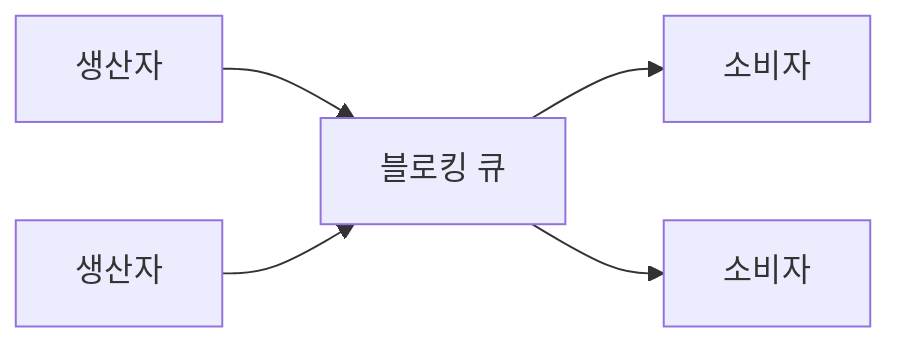
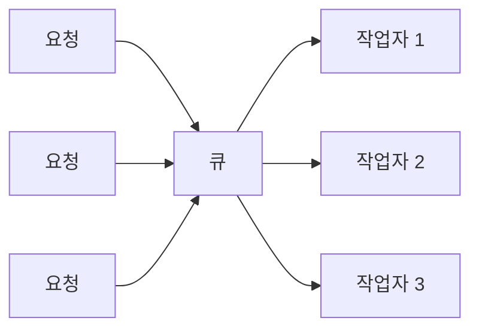

> ByteByteGo의 System Design 101 가이드 「[Top 6 Multithreading Design Patterns You Must Know](https://bytebytego.com/guides/top-6-multithreading-design-patterns-you-must-know)」, 「[Blocking vs Non-Blocking Queue](https://bytebytego.com/guides/blocking-vs-non-blocking-queue)」를 바탕으로 재구성한 노트다. 설계 규칙은 「[멀티 쓰레드 프로그램 설계를 위한 8가지 규칙](https://brunch.co.kr/@chris-song/95)」으로 보강했다.
> 「스레드 안전」(언어별 자료구조, 동시성 해시 테이블 설계 포함), 「스레드 풀의 크기」, 「포크-조인」 절은 fru1tworld/cs-basic 모의 면접 질문 목록을 점검해 빠진 개념을 보강했다.

## 왜 패턴이 필요한가

**스레드는 프로세스의 메모리를 공유하는 가벼운 실행 단위다.** 공유 덕분에 빠르게 협력하지만, 같은 데이터를 동시에 건드리면 경쟁 상태(race condition)가 생기고, 락을 잘못 쓰면 교착 상태와 기아가 생긴다. 멀티스레딩 패턴은 이런 동기화·통신 문제를 정형화된 구조로 푼 것이다.

기초가 되는 뮤텍스·세마포어·모니터는 [[process-synchronization|프로세스 동기화]], POSIX API는 [[pthread-sync-api|POSIX 스레드와 동기화 API]]에 있다.

## 여섯 가지 패턴

| 패턴 | 구조 | 푸는 문제 | 쓰는 곳 |
| --- | --- | --- | --- |
| **생산자-소비자(Producer-Consumer)** | 생산 스레드와 소비 스레드 사이에 블로킹 큐를 둔다 | 만드는 속도와 처리하는 속도의 차이를 버퍼로 흡수 | 로그 수집, 작업 큐, 스트림 처리 |
| **스레드 풀(Thread Pool)** | 미리 만든 작업 스레드들이 큐에서 일을 꺼내 처리한다 | 스레드 생성·소멸 비용과 스레드 폭증 | 웹 서버의 요청 처리, 짧은 작업이 많을 때 |
| **퓨처·프로미스(Future/Promise)** | 프로미스는 나중에 채워질 결과를 담고, 퓨처는 그 결과를 읽는 창구다 | 오래 걸리는 작업을 기다리느라 호출 스레드가 멈추는 것 | 비동기 I/O, 병렬 계산 결과 합치기 |
| **모니터 객체(Monitor Object)** | 객체의 메서드에 한 번에 한 스레드만 들어가게 하고, 조건 변수로 대기·깨우기 | 공유 자원에 대한 경쟁 상태 | Java `synchronized`, 스레드 안전한 컬렉션 |
| **배리어(Barrier)** | 스레드들이 정해진 지점에 모두 도착할 때까지 기다린 뒤 함께 다음 단계로 | 단계별로 맞춰 진행해야 하는 병렬 작업 | 반복 수치 계산, 병렬 시뮬레이션의 각 스텝 |
| **읽기-쓰기 락(Read-Write Lock)** | 읽기는 여럿이 동시에, 쓰기는 하나만 배타적으로 | 읽기가 대부분인데 단일 락이 읽기끼리도 막는 낭비 | 설정 캐시, 읽기 위주 자료구조 |

생산자-소비자



큐가 차면 생산자가, 비면 소비자가 기다린다.

스레드 풀



(스레드를 재사용한다)

- 스레드 풀의 크기를 정하는 법은 아래 「스레드 풀의 크기」에 있다.
- 퓨처·프로미스는 JavaScript의 `Promise`, Java의 `CompletableFuture`, Python의 `concurrent.futures`로 쓴다. 이벤트 루프 기반의 비동기와의 관계는 [[concurrency-models|동시성 모델]]에 있다.
- 읽기-쓰기 락은 쓰기 스레드가 계속 밀리는 **쓰기 기아**가 생길 수 있어, 구현에 따라 대기 중인 쓰기를 우선하는 정책을 둔다.

## 스레드 안전 (Thread Safety)

여러 스레드가 동시에 호출하거나 접근해도, 실행 순서나 끼어드는 시점과 상관없이 **혼자 실행했을 때와 같은 올바른 결과**를 내면 그 함수·클래스는 스레드 안전하다. 경쟁 상태는 **공유 + 가변 상태 + 동기화 없음**이 겹칠 때 생기므로, 셋 중 하나를 없애면 된다.

| 방법 | 없애는 조건 | 예 |
| --- | --- | --- |
| 공유하지 않기(스레드 한정) | 공유 | 지역 변수만 쓰는 함수, 스레드 로컬 저장소(Java `ThreadLocal`, C `_Thread_local`), 데이터를 나눠 스레드마다 자기 몫만 다루게 하기 |
| 바꾸지 않기(불변 객체) | 가변 상태 | 만든 뒤 바뀌지 않는 객체(Java `String`·`record`), 바꿀 때마다 새 객체를 만드는 영속 자료구조 |
| 원자 연산 | 동기화 없음 (락 없이) | `AtomicInteger`, C11 `atomic_int`, 아래의 CAS 기반 논블로킹 자료구조 |
| 락 | 동기화 없음 | 뮤텍스, `synchronized`, 읽기-쓰기 락 |
| 스레드 안전한 라이브러리 | 동기화를 라이브러리에 맡긴다 | `ConcurrentHashMap`, `BlockingQueue` |
| 메시지 전달 | 공유 | 액터, CSP 채널로 데이터 소유권을 넘긴다([[concurrency-models\|동시성 모델]]) |

**락이 꼭 필요하지는 않다.** 공유를 없애거나 불변으로 만들면 동기화 자체가 필요 없고, 카운터 하나 같은 단순한 상태는 원자 연산으로 충분하다. 락은 여러 변수를 한꺼번에 일관되게 바꿔야 할 때 쓴다.

- 스레드 안전한 객체를 이어 써도 안전하지 않을 수 있다. `if (!map.containsKey(k)) map.put(k, v)`는 두 호출 사이에 다른 스레드가 끼어든다. `putIfAbsent`·`computeIfAbsent` 같은 원자적 복합 연산을 쓴다.
- **재진입 가능(reentrant)** 은 다른 개념이다. 실행 도중 같은 함수가 다시 불려도(시그널 핸들러, 재귀) 안전하다는 뜻이고, 전역·정적 상태를 쓰지 않아야 한다. `strtok`는 내부 정적 상태 때문에 둘 다 아니고 `strtok_r`은 재진입 가능하다. 락으로 보호한 함수는 스레드 안전하지만, 시그널 핸들러에서 같은 락을 다시 잡으면 교착되므로 재진입 가능하지는 않다([[unix-signals|UNIX 시그널]]).

### 언어별 기본 자료구조의 스레드 안전성

대부분의 언어는 **기본 컬렉션을 스레드 안전하게 만들지 않는다.** 한 스레드에서만 쓸 때 동기화 비용을 치르지 않게 하려는 선택이다. 대신 스레드 안전한 별도 구현이나 감싸는 래퍼를 준다.

| 언어 | 기본 컬렉션 | 스레드 안전한 선택지 |
| --- | --- | --- |
| Java | `ArrayList`, `HashMap`은 안전하지 않다 | 동기화 래퍼 `Collections.synchronizedMap` 등, 동시성 컬렉션 `ConcurrentHashMap`·`CopyOnWriteArrayList`·`BlockingQueue`([[java-concurrency\|Java 동시성]]) |
| C++ | STL 컨테이너는 여러 스레드의 동시 읽기(const 멤버 호출)만 안전하다. 쓰기가 하나라도 섞이면 외부에서 잠가야 한다 | 표준 동시성 컨테이너는 없다. `std::mutex`로 감싸거나 TBB 같은 라이브러리 |
| Go | `map`, 슬라이스는 안전하지 않다. 동시 쓰기를 런타임이 감지하면 프로세스를 죽인다 | `sync.Mutex`로 감싼 맵, `sync.Map`, 채널로 소유권 넘기기([[go-concurrency\|Go 동시성]]) |
| Python | CPython의 `list`·`dict` 개별 연산은 원자적이다. GIL 빌드는 GIL이, free-threaded 빌드는 객체별 내부 잠금이 보장한다. `d[k] += 1` 같은 복합 연산은 안전하지 않다 | `queue.Queue`, `threading.Lock` |
| C# | `List<T>`, `Dictionary<K,V>`는 안전하지 않다 | `System.Collections.Concurrent`의 `ConcurrentDictionary`, `ConcurrentQueue` |
| Rust | 스레드 사이에 공유하려면 타입이 `Send`·`Sync`여야 해서, 동기화 없는 공유는 컴파일되지 않는다 | `Arc<Mutex<T>>`, `RwLock`, 채널 |

### 동시성 자료구조 설계: 해시 테이블

자료구조 전체를 락 하나로 감싸면(동기화 래퍼) 정확하지만 모든 연산이 줄을 서서 코어가 늘어도 빨라지지 않는다. 성능을 지키려면 **잠그는 범위를 데이터가 실제로 겹치는 곳으로 좁힌다.** 해시 테이블은 키마다 버킷이 정해져 있어 이 방법이 잘 통한다.

| 단계 | 방법 | 효과와 대가 |
| --- | --- | --- |
| 1. 전역 락 | 테이블 전체에 뮤텍스 하나 | 구현이 쉽다. 동시성이 1이다 |
| 2. 읽기-쓰기 락 | 읽기끼리는 함께 들어가게 한다 | 읽기 위주면 좋다. 쓰기는 여전히 한 번에 하나 |
| 3. 락 스트라이핑(lock striping) | 락을 N개 두고 버킷 `i`는 락 `i % N`으로 보호한다. 다른 줄무늬(stripe)의 키는 동시에 쓴다 | 동시성이 최대 N배. 크기 조정처럼 테이블 전체를 바꾸는 일은 락 N개를 모두 잡아야 한다. Java 7의 `ConcurrentHashMap` 세그먼트 방식이다 |
| 4. 버킷 단위 락 + CAS | 빈 버킷에는 CAS로 첫 노드를 넣고, 노드가 있는 버킷만 그 버킷의 머리 노드를 잠근다 | 락 메모리가 따로 들지 않고 충돌이 버킷 하나로 좁혀진다. Java 8 이후 `ConcurrentHashMap`의 방식이다 |
| 5. 락 없는 읽기 | 노드의 값·다음 포인터를 원자적으로(Java `volatile`, C++ acquire 읽기) 읽어 읽기는 잠그지 않는다 | 읽기가 쓰기를 기다리지 않는다. 대신 순회는 순간의 스냅숏이 아니라 약한 일관성(weakly consistent)이 된다 |

설계할 때 함께 풀어야 하는 것:

- **크기 조정(rehash)**: 전체를 잠그고 옮기면 그동안 모두 멈춘다. 옮긴 버킷에 「이미 새 테이블로 갔다」는 표시(forwarding 노드)를 두고, 그 버킷에 접근한 스레드가 이동을 거들게 하면 조금씩 나눠 옮긴다.
- **전체 크기(size)**: 카운터 하나를 모든 스레드가 CAS로 고치면 그 변수가 새 병목이 된다. 카운터를 셀 여러 개로 나눠 각자 더하고 읽을 때 합친다(Java `LongAdder`). 대신 동시 수정 중의 `size`는 근삿값이다.
- **복합 연산**: 「없으면 넣기」, 「있으면 더하기」를 `putIfAbsent`·`compute`처럼 한 번의 원자 연산으로 제공해야 사용자가 경쟁 상태를 만들지 않는다.
- **거짓 공유(false sharing)**: 서로 다른 락이나 카운터가 같은 캐시 라인에 있으면 다른 데이터를 고쳐도 캐시 라인이 코어 사이를 오간다. 자주 고치는 변수는 캐시 라인 크기(보통 64바이트)로 띄워 둔다.

### 길이를 아는 배열: 인덱스 단위 원자 연산

배열의 길이가 정해져 있으면 **크기 조정이 없어서 구조 자체가 바뀌지 않는다.** 동기화가 필요한 것은 각 칸의 값뿐이고, 칸끼리는 서로 독립이다. 그래서 자료구조 전체를 잠글 이유가 없다.

| 방법 | 동작 | 예 |
| --- | --- | --- |
| 칸마다 원자 연산 | 각 칸을 원자 변수로 두고 CAS·`getAndAdd`로 고친다. 서로 다른 칸을 고치는 스레드는 전혀 부딪치지 않는다 | Java `AtomicIntegerArray`·`AtomicReferenceArray`, C++ `std::atomic<T> arr[N]` |
| 구간 나누기 | 스레드마다 맡을 인덱스 구간을 정해 공유 자체를 없앤다. 끝나면 결과만 합친다 | 병렬 합계, 히스토그램을 스레드별로 만든 뒤 합치기 |
| 고정 크기 해시 테이블 | 개방 주소법 테이블의 칸을 CAS로 차지한다. 테이블이 커지지 않으니 락 없이 구현하기 쉽다 | 크기를 미리 아는 캐시·인덱스 |
| 고정 크기 링 버퍼 | 크기를 2의 거듭제곱으로 두고 읽기·쓰기 위치만 원자 변수로 관리한다. 생산자·소비자가 하나씩이면 CAS 없이 원자적 읽기·쓰기만으로 큐가 된다 | 단일 생산자-단일 소비자 큐, LMAX Disruptor |

## 스레드 풀의 크기

풀이 너무 작으면 코어가 놀고, 너무 크면 문맥 교환, 스레드마다의 스택 메모리, 락 경합이 늘어난다. 크기는 작업이 CPU를 얼마나 쓰는지로 정한다. 『Java Concurrency in Practice』의 공식이 출발점이다.

```text
스레드 수 ≈ 코어 수 × 목표 CPU 사용률 × (1 + 대기 시간 / 계산 시간)
```

| 작업 | 성격 | 크기 | 최적화 방향 |
| --- | --- | --- | --- |
| CPU 바운드 | 계산이 대부분이고 기다리는 시간이 거의 없다 | 코어 수(또는 +1) | 코어를 넘는 스레드는 전환 비용만 늘린다. 알고리즘·캐시 지역성·SIMD로 계산을 줄이고, 아래 포크-조인으로 고르게 나눈다 |
| I/O 바운드 | DB·네트워크 응답을 기다리는 시간이 대부분이다 | 대기/계산 비율만큼 크게. 대기가 계산의 9배면 8코어에서 약 80개 | 스레드를 늘리기보다 이벤트 루프·비동기 I/O·가상 스레드로 기다리는 동안 스레드를 붙잡지 않는다. 결국 DB 커넥션 수 같은 하위 자원이 상한이므로 그 한도에 맞춘다 |

공식은 시작점이고, 최종값은 부하를 걸어 처리량과 지연이 꺾이는 지점을 측정해 정한다. CPU 작업과 I/O 작업을 한 풀에 섞으면 느린 I/O가 계산 스레드를 붙잡으므로 풀을 나눈다(벌크헤드).

## 포크-조인 (Fork-Join)

큰 작업을 작은 작업으로 **나누고(fork)**, 각각을 병렬로 처리한 뒤 결과를 **합치는(join)** 분할 정복형 병렬 모델이다. 작업이 임계값보다 작아지면 더 나누지 않고 순차로 처리한다. 나누고 합치는 비용이 일보다 커지기 때문이다.

```text
solve(작업):
  작업이 임계값보다 작으면 → 순차로 처리
  아니면 → 반으로 나눠 왼쪽은 fork(다른 스레드가 가져갈 수 있게 큐에 넣는다)
          오른쪽은 지금 스레드가 직접 solve
          → 왼쪽을 join해 두 결과를 합친다
```

- 일반 스레드 풀은 큐 하나를 모든 스레드가 나눠 쓴다. 포크-조인 풀은 스레드마다 덱(deque)을 두고 자기 일은 한쪽 끝에서 꺼내며, 할 일이 없는 스레드가 남의 덱 반대쪽 끝에서 큰 작업을 훔쳐 온다(**작업 훔치기**, work stealing). 쪼갠 작업의 크기가 고르지 않아도 코어가 놀지 않고, 큐 하나를 두고 다투지도 않는다.
- Java의 `ForkJoinPool`·`RecursiveTask`, 병렬 스트림, `Arrays.parallelSort`가 이 모델이다. Go·Tokio 런타임의 작업 훔치기 스케줄러도 같은 발상이다([[concurrency-models|동시성 모델]]).
- **큰 데이터를 정렬할 때**는 배열을 조각으로 나눠 스레드마다 자기 조각만 정렬하고, 정렬된 조각을 병합하는 병렬 병합 정렬이 대표 전략이다. 조각끼리 메모리를 공유하지 않아 락이 필요 없으므로 안전하고, 병합 단계만 순차 비용으로 남는다. 데이터가 작으면 나누고 합치는 비용이 더 커서 순차 정렬이 빠르므로, `Arrays.parallelSort`도 배열이 일정 크기보다 작으면 순차 정렬로 처리한다. 모니터는 [[process-synchronization|프로세스 동기화]]에 있다.

## 블로킹과 논블로킹 알고리즘

공유 자료구조(예: 큐)를 여러 스레드가 쓰게 만드는 방법은 둘이다.

| 비교 | 블로킹(blocking) | 논블로킹(non-blocking) |
| --- | --- | --- |
| 수단 | 락 | CAS(Compare-And-Swap) 같은 원자 명령 |
| 충돌하면 | 락을 쥔 스레드가 풀 때까지 **멈춰서 기다린다** | 즉시 **거절당하고** 다시 시도하거나 다른 일을 한다 |
| 위험 | 락을 쥔 스레드가 선점되거나 멈추면 나머지가 무한정 기다린다. 교착 상태 가능 | 재시도가 반복되며 특정 스레드가 계속 밀릴 수 있다 |
| 장점 | 구현이 쉽다 | 스레드가 잠들지 않아 지연이 짧고, 락이 없으니 교착 상태가 없다 |

### CAS로 큐에 넣기

```text
반복:
  tail ← 현재 꼬리 읽기
  CAS(tail.next, 기대값=null, 새값=새 노드)
    성공 → 꼬리 포인터를 새 노드로 옮기고 끝
    실패 → 다른 스레드가 먼저 넣었다. 처음부터 다시
```

CAS는 "메모리 값이 기대한 값과 같을 때만 새 값으로 바꾼다"를 하드웨어가 원자적으로 처리하는 명령이다. 실패해도 아무것도 망가지지 않으므로 다시 읽고 시도하면 된다. 이 방식의 대표 구현이 Michael-Scott 큐이고, Java의 `ConcurrentLinkedQueue`가 이를 바탕으로 한다. CAS는 값이 A → B → A로 바뀐 것을 알아채지 못하는 **ABA 문제**가 있어 버전 번호를 함께 비교하는 식으로 보완한다.

### 진행 보장의 단계

| 단계 | 보장 |
| --- | --- |
| 블로킹 | 보장 없음. 한 스레드가 멈추면 모두 멈출 수 있다 |
| 락 프리(lock-free) | 시스템 전체로는 늘 누군가 진행한다. 특정 스레드는 굶을 수 있다 |
| 기아 없음(starvation-free) | 자원을 기다리는 스레드가 결국은 얻는다 |
| **대기 없음(wait-free)** | **모든** 스레드가 유한한 단계 안에 작업을 끝낸다. 논블로킹이면서 기아가 없는 가장 강한 보장 |

대기 없음은 구현이 어렵고 느린 경우가 많아, 실무 자료구조는 대개 락 프리 수준을 목표로 한다.

## 멀티스레드 프로그램 설계 규칙

패턴을 고르기 전에, 프로그램을 어떻게 쪼갤지 정하는 일반 규칙이다. Intel의 Clay Breshears가 「[8 Simple Rules for Designing Threaded Applications](https://jacobfilipp.com/DrDobbs/2008webarticles/print09b6.html)」(Dr. Dobb's, 2008)에서 정리한 여덟 가지다.

| 규칙 | 내용 |
| --- | --- |
| 1. 독립적인 계산을 찾는다 | 서로 간섭 없이 동시에 돌 수 있는 작업이 없으면 병렬화할 것도 없다. 의존 관계부터 그린다 |
| 2. 가능한 한 높은 수준에서 나눈다 | 핫스팟 루프 안쪽보다 그것을 감싼 호출 스택 위쪽에서 나눠야 작업 단위가 굵어지고 동기화 비용이 준다 |
| 3. 코어가 늘 때를 계획한다 | 작업 종류가 아니라 **데이터를 기준으로** 나누면 코어 수와 데이터 크기가 늘어도 성능이 따라 는다 |
| 4. 스레드 안전한 라이브러리를 쓴다 | 직접 구현하기보다 검증된 병렬 라이브러리를 쓰고, 쓰는 라이브러리가 스레드 안전·재진입 가능한지 확인한다 |
| 5. 알맞은 스레딩 모델을 고른다 | 스레드를 직접 다루기 전에 스레드 풀, 병렬 스트림, OpenMP 같은 암시적 모델로 충분한지 본다 |
| 6. 실행 순서를 가정하지 않는다 | 스레드 실행 순서는 예측할 수 없다. 순서가 꼭 필요한 곳에서만 동기화로 맞춘다 |
| 7. 스레드 로컬 저장소나 데이터별 락을 쓴다 | 공유를 줄이려 스레드마다 사본을 두고 마지막에 합친다. 락은 보호할 데이터 하나에 일관되게 묶는다 |
| 8. 병렬성을 위해 알고리즘을 바꾼다 | 순차로는 최적이지만 병렬화가 어려운 알고리즘보다, 순차로는 조금 손해여도 잘 나뉘는 알고리즘이 전체로는 빠를 수 있다 |

## 정리

- 멀티스레딩 패턴은 공유 메모리의 동기화·통신 문제를 정형화한 해법이다.
- 속도 차이는 생산자-소비자, 생성 비용은 스레드 풀, 결과 대기는 퓨처, 경쟁은 모니터, 단계 맞추기는 배리어, 읽기 위주 공유는 읽기-쓰기 락이 푼다.
- 스레드 안전은 공유·가변 상태·동기화 없음 중 하나를 없애 얻는다. 락은 그중 한 방법일 뿐이다.
- 기본 컬렉션은 대부분 스레드 안전하지 않다. 동시성 자료구조는 락 범위를 좁혀(락 스트라이핑, 버킷 단위 CAS) 성능을 지키고, 길이가 고정된 배열은 칸마다 원자 연산으로 충분하다.
- 스레드 풀은 CPU 바운드면 코어 수, I/O 바운드면 대기 비율만큼 키운다. 포크-조인은 작업 훔치기로 쪼갠 일을 고르게 나눈다.
- 블로킹 알고리즘은 락으로 기다리게 하고, 논블로킹 알고리즘은 CAS로 시도하고 실패하면 재시도한다.
- 논블로킹은 교착 상태가 없고 지연이 짧지만 구현이 어렵다. 진행 보장은 락 프리 → 대기 없음 순으로 강해진다.

관련 노트: [[process-synchronization|프로세스 동기화]], [[pthread-sync-api|POSIX 스레드와 동기화 API]], [[concurrency-models|동시성 모델]], [[deadlock|교착 상태]], [[process-and-thread|프로세스와 스레드]], [[gof-design-patterns|GoF 디자인 패턴]], [[java-concurrency|Java 동시성: 메모리 모델, 동기화, 스레드 풀, 가상 스레드]], [[hash-table|해시 테이블]]
