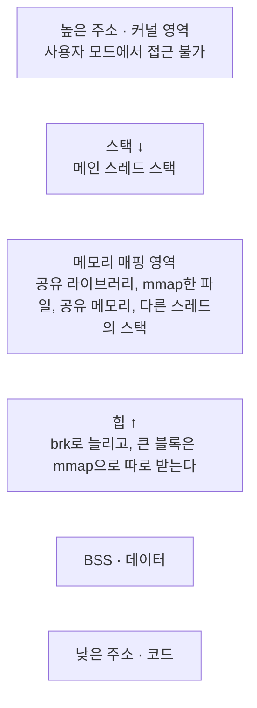
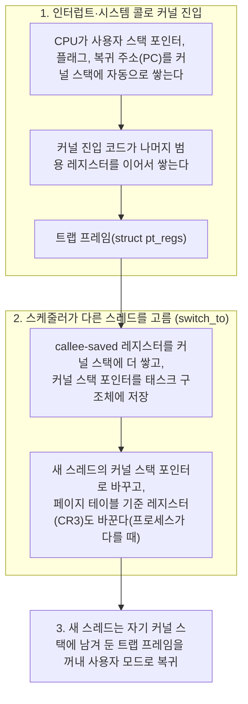
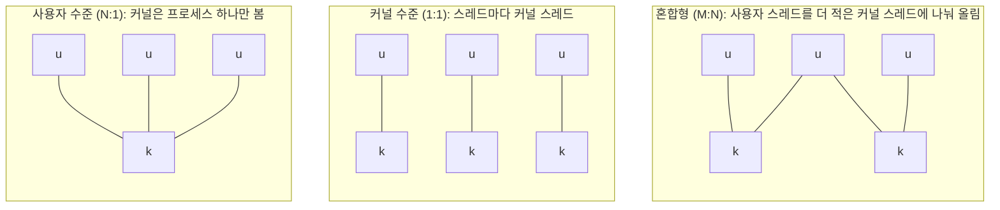

> 노션 정리와 개발장의 「[프로세스와 스레드의 차이](https://velog.io/@raejoonee/프로세스와-스레드의-차이)」(2020.08)를 바탕으로 재구성한 노트다.
> exec·wait 세부와 종료·좀비 부분은 팔만코딩경(42Seoul 커뮤니티 위키)의 「프로세스 생성과 종료 함수」, 「exit() atexit() _exit() 뭐가 다른지 설명할 수 있어?」를 바탕으로 보강했다.
> 프로그램·프로세스·스레드의 관계는 ByteByteGo의 System Design 101 가이드 「[Process vs Thread: Key Differences](https://bytebytego.com/guides/what-is-the-difference-between-process-and-thread)」를 바탕으로 보강했다.
>
> IPC 수단 비교는 ByteByteGo의 System Design 101 가이드 「[Inter-Process Communication on Linux](https://bytebytego.com/guides/how-do-processes-talk-to-each-other-on-linux)」로 확인해 보강했다.
> 「PCB」, 「리눅스에서는 둘 다 태스크」, 「코드로 직접 확인하기」 등 일부 절은 강민철의 「혼자 공부하는 컴퓨터 구조+운영체제」 강의(한빛미디어)를 바탕으로 보강했다.
> 주소 공간의 배치·크기와 TCB, 「커널 스택에 남는 것」, 「문맥 교환의 비용과 줄이는 법」 절은 fru1tworld/cs-basic 모의 면접 질문 목록을 점검해 빠진 개념을 보강했다.
> `wait()`가 돌려주는 종료 상태의 비트 구성, 「스레드 모델」 절, 「프로세스 간 협력 (IPC)」 절의 파이프·FIFO·공유 메모리·메시지 큐는 고려사이버대학교 「운영체제이론 및 실습」(2024-1학기) 강의 내용으로 보강했다.

먼저 세 개념의 관계를 잡는다.

| 개념 | 정의 | 예 |
| --- | --- | --- |
| **프로그램** | 디스크에 저장된 명령어 묶음. 실행 파일 자체이며 수동적이다 | `chrome` 실행 파일 |
| **프로세스** | 메모리에 올라와 실행 중인 프로그램. 주소 공간과 자원을 받는다 | 크롬은 탭·사이트마다 프로세스를 따로 띄운다. 프로그램 하나가 프로세스 여럿이 될 수 있다 |
| **스레드** | 프로세스 안에서 CPU가 실행하는 가장 작은 단위. 같은 프로세스의 스레드끼리 메모리를 공유한다 | 문서 편집기에서 한 스레드는 입력을, 다른 스레드는 맞춤법 검사를 맡는다 |


**프로세스**는 실행 중인 프로그램이다. 디스크에 있던 실행 파일이 메모리에 올라와 CPU를 받을 수 있는 상태가 되면, 운영체제는 그것을 하나의 프로세스로 관리한다. 프로세스를 이해하려면 "지금 어디까지 실행했는가"를 나타내는 **문맥(context)** 을 알아야 한다.

## 프로세스의 문맥

| 구분 | 내용 |
| --- | --- |
| CPU 수행 상태 | PC(Program Counter), 각종 레지스터 값 |
| 프로세스의 주소 공간 | 아래 네 영역 |
| 커널이 가진 프로세스 정보 | PCB, 커널 스택 |

| 영역 | 담는 것 | 할당 |
| --- | --- | --- |
| 코드(텍스트) | 실행할 기계어 명령어. 실행 중에 바뀔 일이 없으므로 쓰기가 금지된 읽기 전용 영역이다 | 정적 (크기 고정) |
| 데이터 | 전역·static 변수처럼 프로그램이 끝날 때까지 유지할 데이터. 초기값이 없는 것은 BSS 영역에 따로 두기도 한다 | 정적 |
| 힙 | 프로그래머가 직접 할당하는 공간. 다 쓰면 반환해야 하며, 반환하지 않으면 **메모리 누수**가 된다. C처럼 직접 반환하는 언어와 달리, 가비지 컬렉션이 있는 언어는 쓰지 않는 객체를 런타임이 회수한다 | 동적. 낮은 주소 → 높은 주소로 자란다 |
| 스택 | 매개변수·지역 변수처럼 함수가 끝나면 사라질 임시 데이터. PUSH/POP으로 쌓고 뺀다 | 동적. 높은 주소 → 낮은 주소로 자란다 |

힙과 스택이 서로를 향해 자라다 한계를 넘으면 오버플로우가 난다. C 코드에서 각 영역이 어떻게 쓰이는지는 [[pointers-and-memory|포인터와 메모리]]에 있다.

### 주소 공간을 영역으로 나누는 이유

영역마다 **권한·수명·크기 변화**가 다르기 때문이다. 코드는 읽기·실행만, 데이터·힙·스택은 읽기·쓰기만 허용하고 실행은 막아(NX 비트) 코드 변조와 스택에 심은 코드의 실행을 막는다. 권한은 페이지 단위로 붙으므로([[memory-management|메모리 관리]]) 성질이 같은 것끼리 모아야 한다. 읽기 전용인 코드 영역은 같은 프로그램을 실행하는 프로세스끼리 한 벌만 올려 공유하고, 크기가 고정된 영역과 실행 중에 자라는 힙·스택을 떨어뜨려 서로 침범하지 않게 한다.

실제 배치는 교과서의 네 영역보다 하나가 더 있다. 힙과 스택 사이의 **메모리 매핑 영역**이다.



IPC의 **공유 메모리**(`shm_open` + `mmap`, `shmat`)는 이 매핑 영역에 들어간다. 실행 중에 원하는 크기로 만들어 붙이는 것이라 크기가 고정된 데이터 영역에 둘 수 없고, 여러 프로세스의 페이지 테이블이 같은 물리 프레임을 가리키게 하는 것이 곧 mmap의 일이기 때문이다. 붙는 가상 주소는 프로세스마다 다를 수 있으므로 공유 메모리 안에는 포인터 대신 시작점으로부터의 오프셋을 저장한다. 실행 중인 프로세스의 실제 배치와 영역별 권한(`r-xp`, `rw-p`)은 Linux `/proc/<pid>/maps`, macOS `vmmap <pid>`로 본다.

### 스택과 힙의 크기는 언제 정해지나

그림의 빈 공간은 가상 주소일 뿐이다. 물리 메모리는 실제로 건드린 페이지에만 붙으므로 스택과 힙이 처음부터 큰 것은 아니다. 정해지는 것은 **얼마까지 자랄 수 있나**(한도)다.

| 영역 | 정해지는 때 | 바꾸는 방법 |
| --- | --- | --- |
| 메인 스레드 스택 | `exec`할 때 자원 한도 `RLIMIT_STACK`이 상한이 되고, 쓰는 만큼 페이지가 붙으며 자란다. Linux 기본 한도는 보통 8MB | 실행 전에 셸에서 `ulimit -s`(사용자가 바꿀 수 있다), 프로그램에서 `setrlimit` |
| 다른 스레드의 스택 | 스레드를 만들 때 고정 크기로 잡는다. glibc 기본값은 `RLIMIT_STACK` 값을 따르고, macOS 보조 스레드는 512KB | `pthread_attr_setstacksize`, Java `-Xss` |
| 힙 | 미리 정하지 않는다. `malloc`이 모자랄 때마다 `brk`·`mmap`으로 늘린다 | `ulimit -v`(`RLIMIT_AS`), 언어 런타임 옵션(Java `-Xmx`) |

스택 끝에는 접근하면 폴트가 나는 **가드 페이지**가 있어, 한도를 넘는 재귀는 다른 영역을 덮어쓰지 않고 `SIGSEGV`로 끝난다.

### 스택이 힙보다 빠른 이유

이미 캐시에 올라온 뒤 한 바이트를 읽는 속도는 둘이 같다. 차이는 **할당 비용과 지역성**에서 온다.

| 비교 | 스택 | 힙 |
| --- | --- | --- |
| 할당·해제 | 스택 포인터를 더하고 빼는 명령 하나 | 할당자가 맞는 빈 블록을 찾고 메타데이터를 갱신한다. 멀티스레드면 잠금이나 스레드별 캐시가 필요하고, 모자라면 시스템 콜까지 간다 |
| 캐시 | 늘 꼭대기 근처만 쓰므로 거의 항상 캐시에 있다 | 블록이 흩어져 있고 포인터를 거쳐 접근해 캐시 미스가 잦다 |
| 수명 관리 | 함수가 끝나면 자동 | `free`나 가비지 컬렉션 |

### 자료구조의 스택·힙과의 관계

**스택 영역은 자료구조 스택과 같은 원리다.** 함수를 부르면 스택 프레임을 push하고 반환하면 pop하는 LIFO라서, 호출의 역순으로 정리된다([[calling-convention|호출 규약과 스택 프레임]]). **힙 영역은 자료구조 힙(우선순위 큐)과 관계가 없다.** 순서 없이 쌓아 둔 「더미」라는 뜻의 이름이고, 할당자는 빈 블록 목록(free list)이나 크기별 bin으로 공간을 관리한다.

프로세스 상태(new, ready, running, blocked, suspended, terminated)와 전이는 [[process-scheduling|CPU 스케줄링]] 노트에 정리했다. `suspended`는 `blocked`와 달리 스와퍼 같은 **외부 요인**으로 정지된 상태라서, 외부에서 재개해 줘야 다시 active 상태가 된다.

## PCB (Process Control Block)

커널이 프로세스마다 유지하는 관리 정보다. 커널 주소 공간의 data 영역에 있고, 프로세스가 생성될 때 만들어져 실행이 끝나면 폐기된다. 프로세스를 식별하는 고유 번호가 **PID**다.

| 묶음 | 내용 |
| --- | --- |
| OS 관리용 | 큐 연결 포인터, PID, 상태, 스케줄링 정보·우선순위 |
| CPU 문맥 | PC, 레지스터 |
| 메모리 | code·data·stack 영역의 위치. 베이스·한계 레지스터 값이나 페이지 테이블 정보로 기록한다([[virtual-memory\|가상 메모리]]) |
| 파일 | 열어 둔 파일, 할당받은 입출력 장치 |

레지스터 값을 PCB에 저장하는 이유는 **멈춘 자리에서 다시 시작하기** 위해서다. 타이머 인터럽트로 CPU를 빼앗긴 프로세스가 PC 값을 잃으면 다음 차례에 어느 명령어부터 실행할지 모르고, 범용 레지스터에 있던 연산 중간값을 잃으면 계산을 처음부터 다시 해야 한다. 담기는 항목은 운영체제마다 조금씩 다르다.

스레드는 PCB를 통째로 따로 갖지 않고 **TCB(Thread Control Block)** 를 갖는다. TCB에는 스레드 ID, 상태, PC·레지스터, 스택 포인터, 스케줄링 우선순위처럼 스레드마다 다른 것만 담고, 주소 공간·열린 파일 같은 공유 자원은 프로세스의 PCB를 가리킨다. 사용자 수준 스레드라면 TCB는 커널이 아니라 스레드 라이브러리가 사용자 공간에 둔다. Linux는 스레드마다 `task_struct`를 하나씩 두고 같은 프로세스의 스레드들이 메모리 정보(`mm_struct`)와 파일 테이블을 함께 가리키게 해서, 스레드도 PCB를 하나씩 가진 셈이 된다(아래 「리눅스에서는 둘 다 태스크」).

## 문맥 교환 (Context Switch)

CPU를 다른 프로세스로 넘기는 과정이다. 실행 중이던 프로세스의 문맥을 그 PCB에 저장하고, 새 프로세스의 PCB에서 문맥을 읽어 CPU에 복원한다.

시스템 콜이나 인터럽트로 커널 모드에 들어갔다가 **같은 프로세스로 돌아오는 것은 문맥 교환이 아니다.** 이때도 PCB에 일부 정보를 저장하긴 하지만, 캐시를 비우는 것처럼 비용이 큰 작업은 하지 않는다. 문맥 교환은 사용자 프로세스가 바뀔 때만 일어난다.

### 커널 스택에 남는 것

교재 그림은 레지스터를 모두 PCB에 복사하는 것처럼 그리지만, 실제로는 대부분 그 스레드의 **커널 스택**에 놓인다(Linux x86-64 기준).



즉 PCB(태스크 구조체)는 레지스터 값을 직접 다 들고 있기보다 **저장된 커널 스택을 가리키는 포인터**를 갖는다.

### 문맥 교환의 비용과 줄이는 법

| 비용 | 내용 | 프로세스 사이 | 같은 프로세스의 스레드 사이 |
| --- | --- | --- | --- |
| 직접 비용 | 커널 진입·복귀, 레지스터 저장·복원, 스케줄러 실행 | 있음 | 있음 |
| 주소 공간 전환 | 페이지 테이블 교체, TLB 무효화 | 있음 | 없음 |
| 간접 비용 | 새 작업의 데이터가 캐시·TLB에 없어 한동안 미스가 이어진다 | 크다 | 작다. 공유 데이터는 캐시에 남는다 |

대개 간접 비용이 직접 비용보다 크다. 줄이는 방법은 양쪽에 있다.

| 쪽 | 방법 |
| --- | --- |
| 하드웨어 | TLB 항목에 주소 공간 식별자(x86 PCID, ARM ASID)를 붙여 전환 때 TLB를 비우지 않는다. SMT는 문맥 여러 벌을 코어에 동시에 두어 전환 없이 번갈아 실행한다 |
| 소프트웨어 | 스레드 수를 코어 수 근처로 묶는 스레드 풀, 커널을 거치지 않고 사용자 공간에서 전환하는 코루틴·가상 스레드, 이벤트 루프로 블로킹 대기 자체를 없애기([[concurrency-models\|동시성 모델]]), CPU 친화도(affinity)로 스레드를 같은 코어에 묶어 캐시를 데운 채 유지 |

## 스케줄링 큐와 스케줄러

PCB는 커널 data 영역의 큐(job·ready·device queue)에 매달려 관리되고, 단기·장기·중기 스케줄러가 그 사이를 옮긴다. 큐와 세 스케줄러의 역할은 [[process-scheduling|CPU 스케줄링]]에 정리했다.

## 스레드 (Thread)

스레드는 프로세스 안에서 **CPU를 수행하는 단위**다. 프로세스는 운영체제에게서 자원을 할당받는 단위이고, 스레드는 그 자원을 쓰며 코드를 실행하는 흐름이다. 모든 프로세스는 스레드를 하나 이상 가지며, 처음 실행되는 흐름이 메인 스레드다.

한 프로세스 안의 여러 스레드는 주소 공간과 자원을 공유하고, 실행 흐름에 필요한 부분만 따로 가진다.

| 공유하는 것 (Task) | 스레드마다 따로 갖는 것 |
| --- | --- |
| Code 영역, Data 영역, Heap 영역, OS 자원(열린 파일 등), PID | 스레드 ID, PC, 레지스터 집합, Stack 영역 |

스택은 스레드마다 함수 호출 흐름이 독립적이라 따로 갖는다. 힙을 공유하므로 한 스레드가 `malloc`으로 만든 객체를 다른 스레드가 포인터로 바로 읽는다. 따로 갖는 것이 적어서 스레드는 생성과 문맥 교환이 가벼워 **경량 프로세스(Lightweight Process)** 라고도 부르고, 스레드가 하나뿐인 전통적인 프로세스는 **중량 프로세스(Heavyweight Process)** 라고 부른다.

### 스레드의 장점

| 장점 | 내용 |
| --- | --- |
| 응답성 | 한 스레드가 blocked 되어도 다른 스레드가 계속 일한다(이미지를 받는 동안 텍스트를 먼저 보여 주는 브라우저) |
| 자원 공유·경제성 | 코드·데이터를 공유해 메모리를 아끼고, 생성·문맥 교환 비용이 프로세스보다 훨씬 적다 |
| 멀티프로세서 활용 | 스레드들을 여러 코어에서 병렬로 실행한다 |

반대로 자원을 공유하기 때문에 **한 스레드에 문제가 생기면 프로세스 전체가 영향을 받는다.** 한 스레드에서 세그멘테이션 폴트가 나면 같은 프로세스의 모든 스레드가 함께 종료된다. 다른 프로세스는 영향을 받지 않는다.

### 멀티프로세스와 멀티스레드

여러 일을 동시에 처리하는 방법은 두 가지다. 프로세스를 여러 개 띄우거나(멀티프로세스), 한 프로세스 안에 스레드를 여러 개 둔다(멀티스레드). 운영체제가 여러 프로세스를 번갈아 실행하는 것은 **멀티태스킹**이라고 부른다.

| 기준 | 멀티프로세스 | 멀티스레드 |
| --- | --- | --- |
| 메모리 | 프로세스마다 독립된 주소 공간 | 스택만 따로, 나머지는 공유 |
| 생성·문맥 교환 비용 | 크다 (주소 공간 전환, 캐시·TLB 비우기) | 작다 |
| 데이터 공유 | IPC가 필요하다 | 공유 메모리를 바로 읽고 쓴다 |
| 장애 격리 | 한 프로세스가 죽어도 나머지는 산다 | 한 스레드가 죽으면 프로세스 전체가 죽는다 |
| 주된 위험 | 통신 비용, 메모리 사용량 | 경쟁 상태, 교착 상태, 재현하기 어려운 버그 |
| 예 | 크롬의 탭·사이트별 렌더러 프로세스, Nginx 워커, PostgreSQL 연결별 프로세스 | 자바·C# 서버의 스레드 풀, 게임 엔진 |

스레드도 커널 스레드라면 **운영체제가 스케줄링한다.** 프로그래머가 맡는 것은 스케줄링이 아니라 공유 자원에 대한 **동기화**다. 스레드 A가 값을 읽은 직후 스레드 B로 CPU가 넘어가 그 값을 바꾸면, A는 낡은 값으로 계속 계산한다. 어느 시점에 전환될지 알 수 없으므로 뮤텍스·세마포어 같은 도구로 임계 구역을 지켜야 한다([[process-synchronization|프로세스 동기화]]).

안정성이 중요하면 멀티프로세스, 데이터를 자주 주고받는 작업이면 멀티스레드가 유리하다. 둘을 섞어 프로세스 여러 개가 각각 스레드 풀을 갖는 구성도 흔하다.

CPU의 하이퍼스레딩처럼 코어 하나가 명령어를 동시에 처리하는 **하드웨어 스레드**는 여기서 말하는 스레드와 다른 개념이다([[computer-system-basics|컴퓨터 시스템의 기본 구성]]).

### 리눅스에서는 둘 다 태스크

리눅스 커널은 프로세스와 스레드를 따로 구분하지 않고 둘 다 **태스크(task)** 라는 하나의 실행 문맥으로 다룬다. 새 태스크는 `clone()` 시스템 콜로 만들고, 이때 주는 플래그가 부모와 무엇을 공유할지 정한다. 주소 공간·파일 디스크립터·시그널 처리기를 모두 공유하면 스레드처럼, 아무것도 공유하지 않으면 프로세스처럼 동작한다. glibc의 `fork()`와 `pthread_create()`도 내부에서 `clone()` 계열 시스템 콜을 부른다.

교과서는 흔히 "CPU를 할당받는 단위는 프로세스"라고 쓰지만, 현대 운영체제의 스케줄러가 실제로 고르는 대상은 스레드(커널 스레드)다. 스레드가 하나뿐인 프로세스라면 두 표현이 같다.

## 스레드 모델: 사용자 수준과 커널 수준

스레드를 관리하는 주체는 둘 중 하나다. 사용자 공간의 스레드 라이브러리가 스레드 표(TCB 목록)를 들고 직접 전환하거나(**사용자 수준 스레드**), 커널이 스레드마다 TCB를 두고 스케줄링 대상으로 삼는다(**커널 수준 스레드**). 사용자 스레드를 커널 스레드에 몇 대 몇으로 잇느냐가 **스레드 모델**이다.



| 기준 | 사용자 수준 (N:1) | 커널 수준 (1:1) | 혼합형 (M:N) |
| --- | --- | --- | --- |
| 생성·전환 비용 | 함수 호출 수준. 모드 전환이 없다 | 시스템 콜과 모드 전환이 든다 | 대부분 사용자 공간에서 처리 |
| 블로킹 시스템 콜 | 한 스레드가 `read()`로 막히면 커널은 **프로세스 전체**를 재운다 | 그 스레드만 멈춘다 | 라이브러리가 블로킹 직전에 다른 스레드를 올리면 그 스레드만 |
| 멀티코어 활용 | 불가. 커널은 CPU를 프로세스 단위로 준다 | 가능 | 가능 |
| 선점 | 타이머 인터럽트는 커널이 받으므로 스레드가 스스로 양보해야 한다 | 커널이 선점·우선순위·시그널을 일관되게 처리 | 런타임이 맡는다 |
| 그 밖의 장점 | 커널 지원 없이 어느 OS에서나 돈다. 응용에 맞는 스케줄링 정책을 고를 수 있다. 커널 메모리를 쓰지 않아 많이 만들 수 있다 | 안정적이고 단순하다 | 둘의 장점을 함께 노린다 |
| 그 밖의 단점 | 스레드 간 보호, 시그널 전달 대상 같은 문제를 라이브러리가 떠안는다 | 스레드마다 커널 스택과 자료구조가 필요해 수십만 개는 부담 | 커널과 라이브러리가 상태를 맞추는 코드가 복잡하고 디버깅이 어렵다 |
| 대표 | 초기 JVM의 그린 스레드 | Linux(NPTL), Windows, macOS | Go 고루틴, Java 가상 스레드 |

- N:1 라이브러리는 블로킹 문제를 피하려고 블로킹 호출을 논블로킹 호출로 감싼다(`select`로 준비됐는지 확인한 뒤 읽기).
- M:N에서 라이브러리가 블로킹 순간을 알 수 있도록, 커널이 "이 커널 스레드가 곧 블로킹된다"고 위로 알려 주는 **scheduler activation**(upcall)이 제안됐다.
- 교재에 따라 실시간 기능을 지원하는 **실시간 스레드**를 구현 방식의 하나로 따로 꼽기도 한다.
- Linux에서 스레드는 위 「리눅스에서는 둘 다 태스크」대로 `task_struct`를 가진 태스크라, 스레드마다 다른 ID가 보인다.

```bash
ps -eLf | grep my_server     # LWP 열에 스레드마다 다른 ID
ls /proc/<pid>/task           # 스레드마다 디렉터리가 하나씩
top -H -p <pid>               # 스레드별 CPU 사용률
```

### 운영체제는 1:1로, M:N은 런타임으로

Solaris는 M:N을 쓰다가 Solaris 9에서 1:1로 바꿨고, 다른 Unix 계열도 같은 길을 갔다. 커널 스레드의 생성·전환이 충분히 싸지자 M:N의 복잡도를 감수할 이유가 줄었다. 대신 M:N은 **언어 런타임**에서 되살아났다. 런타임은 자기 언어의 블로킹 지점(채널 대기, 네트워크 I/O)을 모두 알기 때문에, OS가 하기 어려웠던 "블로킹 직전에 갈아 끼우기"를 정확히 한다.

| 런타임 | 구조 |
| --- | --- |
| Go 고루틴 | 코어 수만큼의 OS 스레드 위에 고루틴 수십만 개를 올린다([[go-language\|Go 언어]]) |
| Java 가상 스레드(21+) | 블로킹 I/O를 만나면 가상 스레드를 OS 스레드에서 내리고 다른 것을 올린다 |
| Erlang/BEAM | 코어마다 스케줄러를 두고 가벼운 프로세스를 선점식으로 돌린다 |

이 런타임들의 스케줄링 방식은 [[concurrency-models|동시성·병렬·비동기·논블로킹과 동시성 모델]]에 있다.

## 프로세스 생성과 종료

### 생성

부모 프로세스가 자식 프로세스를 만들어 **트리 형태의 계층 구조**가 생긴다. 트리의 뿌리는 부팅 때 커널이 처음 띄우는 PID 1(리눅스는 systemd, macOS는 launchd)이고, 로그인 프로세스 → 셸(bash) → 셸에서 실행한 편집기(vim)처럼 아래로 뻗는다. 데몬도 PID 1의 자손이다([[daemon-and-systemd|데몬과 systemd]]). 지금의 트리는 `pstree`(macOS는 Homebrew로 설치)나 `ps -ef`의 PPID 열로 본다. Windows는 부모 PID를 기록하긴 하지만 이런 계층으로 프로세스를 관리하지는 않는다. 자식은 부모와 다른 PID를 받고, 자식의 PCB에 부모의 PID인 **PPID**가 기록되기도 한다. 사용자 눈앞에서 실행되는 포그라운드 프로세스와 달리, 보이지 않는 곳에서 도는 백그라운드 프로세스를 유닉스에서는 **데몬**, 윈도우에서는 **서비스**라고 부른다.

- 생성은 ① 부모의 주소 공간과 PCB를 복사(`fork()`) → ② 그 공간에 새 프로그램을 덮어써 실행(`exec()`) 순이다. 주소 공간은 바로 복사하지 않고 공유하다가 **쓰기가 일어날 때 복사**한다(COW, Copy-On-Write).
- 부모는 자식과 별개로 계속 실행하거나, 자식이 끝날 때까지 기다린다(`wait`).

### 종료

마지막 명령 뒤 `exit()`로 스스로 끝나는 **자발적 종료**와, 부모가 자식을 끝내는 **비자발적 종료(abort)** 가 있다. 부모는 자식이 자원 한도를 넘었거나, 맡긴 일이 필요 없어졌거나, 자신이 종료될 때 자식을 끝낸다. `kill`처럼 외부에서 시그널로 끝내기도 한다.

## 프로세스 관련 시스템 콜

### fork(): 자식 프로세스 생성

```c
pid_t pid = fork();
if (pid == 0)       printf("child\n");    // 자식은 0을 받는다
else if (pid > 0)   printf("parent\n");   // 부모는 자식의 PID를 받는다
else                perror("fork");       // -1: 실패
```

자식은 부모의 문맥(PC 포함)까지 복제하므로 `fork()` 다음 줄부터 실행을 이어 간다. 둘을 구분하는 유일한 단서가 반환값이다.

### exec(): 새로운 프로그램 실행

`exec`는 현재 프로세스의 주소 공간을 새 프로그램으로 **덮어쓴다.** PID는 그대로다. **성공하면 돌아오지 않으므로**, `exec` 다음 줄이 실행됐다면 실패(-1)한 것이다.

| exec 계열 접미사 | 의미 |
| --- | --- |
| `l` | 인자를 리스트로 나열. 마지막에 `(char *)0`(NULL)을 넣는다 |
| `v` | 인자를 배열(vector)로 전달 |
| `p` | 실행 파일을 환경 변수 `PATH`에서 찾는다 |
| `e` | 새 프로그램에 환경 변수를 직접 전달 |

- 실제 시스템 콜은 `execve(path, argv, envp)` 하나이고 나머지는 이를 감싼 라이브러리 함수다. 관례상 `argv[0]`에는 프로그램 이름을 넣는다.
- `fork()`는 주소 공간을 COW로 공유해 싸다. 그래도 큰 프로세스에서 곧바로 `exec`할 거라면 `posix_spawn()`이 더 가볍다. `vfork()`는 POSIX에서 제거됐다.

### wait()와 exit()

- `wait()`: 부모가 호출하면 커널이 자식이 끝날 때까지 부모를 **sleep(blocked)** 시키고, 자식이 종료되면 부모를 깨운다.
- `exit()`: 프로세스를 종료한다. 코드에 명시하지 않아도 `main`이 반환하면 C 런타임의 시작 코드가 그 반환값으로 `exit()`를 부른다. 라이브러리 함수 `exit()`는 `atexit()`로 등록한 함수 실행 → stdio 버퍼 flush → 시스템 콜 `_exit()` 순으로 동작한다([[unix-file-io|UNIX 파일 입출력]]).
- `wait(&status)`가 채우는 `status`는 정수의 하위 16비트에 두 경우를 나눠 담는다(Linux 기준). 정상 종료면 상위 8비트에 `exit()`에 넘긴 값, 하위 8비트는 0이다. 시그널로 죽었으면 하위 7비트에 시그널 번호(코어 덤프면 0x80 비트도)가 들어간다. 그래서 자식이 `exit(2)`로 끝나면 `status`를 16진수로 찍었을 때 `0x200`이 나온다. 이 배치는 구현마다 다를 수 있으므로 코드에서는 아래 매크로로 읽는다.
- 자식이 끝나면 커널은 자원을 회수하지만 종료 상태는 부모가 `wait`로 거둘 때까지 남긴다. 거두지 않은 자식이 **좀비**, 부모가 먼저 끝난 자식이 **고아**(init이 입양)다. 부모는 `SIGCHLD`로 자식의 종료를 알고, `waitpid`와 `WIFEXITED` 같은 매크로로 종료 상태를 읽는다([[unix-signals|UNIX 시그널]]).

## 코드로 직접 확인하기

프로세스와 스레드의 차이는 PID와 스레드 ID를 찍어 보면 바로 보인다. 파이썬 표준 라이브러리로 확인하는 패턴은 다음과 같다. 다른 언어도 프로세스·스레드를 만드는 API만 다를 뿐 결과는 같다.

```python
import os, threading
from multiprocessing import Process

def work():
    print("pid", os.getpid(), "ppid", os.getppid(), "tid", threading.get_native_id())

if __name__ == "__main__":
    print("parent pid", os.getpid())
    for _ in range(3):
        Process(target=work).start()            # 자식 프로세스 3개
    for _ in range(3):
        threading.Thread(target=work).start()   # 같은 프로세스 안의 스레드 3개
```

| 실행 단위 | `getpid()` | `getppid()` | `get_native_id()` |
| --- | --- | --- | --- |
| 자식 프로세스 | 저마다 다르다 | 모두 메인 프로세스의 PID | 저마다 다르다 |
| 스레드 | 모두 메인 프로세스와 같다 | 메인 프로세스를 실행한 셸의 PID | 저마다 다르다 |

- PID는 실행할 때마다 운영체제가 새로 준다. 같은 코드를 다시 돌리면 다른 번호가 나온다.
- 동시에 실행되므로 출력 순서는 매번 달라질 수 있다.
- `multiprocessing`은 플랫폼에 따라 `fork` 대신 새 인터프리터를 띄우는 방식(spawn 등)으로 자식을 만든다. 그래서 자식이 모듈을 다시 import해도 자식을 또 만들지 않도록 `if __name__ == "__main__":` 안에서 시작한다.
- 이미 떠 있는 프로세스는 `ps`, `top`, Windows 작업 관리자의 세부 정보 탭으로 본다.

## 프로세스 간 협력 (IPC)

프로세스는 서로의 주소 공간을 볼 수 없으므로 협력하려면 커널에 부탁해야 한다. 이것이 IPC(Interprocess Communication)다. 크게 두 갈래다.

| 갈래 | 수단 | 데이터 경로 | 비용과 동기화 |
| --- | --- | --- | --- |
| 커널이 복사해 주기 (메시지 전달) | 파이프, FIFO, 메시지 큐, 소켓 | 보내는 쪽 버퍼 → 커널 버퍼 → 받는 쪽 버퍼 | 주고받을 때마다 시스템 콜과 복사 2번. 대신 커널이 버퍼가 비면 읽는 쪽을, 차면 쓰는 쪽을 재워 순서와 동기화를 대신 해 준다 |
| 같이 보기 (공유 메모리) | 공유 메모리 | 두 프로세스의 페이지 테이블이 같은 물리 프레임을 가리킨다 | 설정할 때만 시스템 콜. 이후는 일반 메모리 읽기·쓰기라 가장 빠르지만 동기화를 직접 해야 한다 |

메시지 전달은 상대를 직접 지명하는 direct 방식과 mailbox·port를 거치는 indirect 방식으로도 나눈다.

| 수단 | 커널 경유? | 방향 | 용도 |
| --- | --- | --- | --- |
| Shared Memory | 설정할 때만. 이후 직접 읽고 쓴다 | 양방향 | 큰 데이터를 가장 빠르게 공유. 동기화는 직접 해야 한다 |
| Pipe | 예 (커널 버퍼) | 단방향 | 부모·자식 사이 바이트 스트림, 셸 파이프라인 |
| Named Pipe (FIFO) | 예 | 단방향 | 파일 이름으로 관계없는 프로세스끼리 연결 |
| Message Queue | 예 | 양방향 | 메시지 단위로 넣고 꺼낸다. 보낼 때와 받을 때마다 시스템 콜이 필요하고 데이터가 송신자 → 커널 버퍼 → 수신자로 두 번 복사되어, 큰 데이터에는 공유 메모리보다 느리다 |
| Socket | 예 | 양방향 | 다른 컴퓨터의 프로세스와도 통신 |
| Signal | 예 | 단방향 | 데이터 없이 사건만 알린다([[unix-signals\|UNIX 시그널]]) |
| File | 예 (파일 시스템) | 양방향 | 한 프로세스가 파일에 쓰고 다른 프로세스가 읽는 가장 단순한 방법. 동시 접근은 파일 잠금으로 조율한다 |
| Semaphore | 예 | - | 데이터 전달이 아니라 공유 자원 접근 제어 |

### 익명 파이프

`pipe(fd)`는 커널 안에 버퍼 하나를 만들고 fd 두 개를 돌려준다. `fd[0]`이 읽는 끝, `fd[1]`이 쓰는 끝이다. 이름이 없으므로 **fd를 물려받은 프로세스끼리만** 쓸 수 있어, `fork()` 전에 만들어 부모와 자식이 나눠 갖는다.

```c
int fd[2];
pipe(fd);
if (fork() == 0) {            /* 자식: 읽기만 */
    close(fd[1]);
    char buf[64];
    ssize_t n = read(fd[0], buf, sizeof buf);
    write(STDOUT_FILENO, buf, n);
    _exit(0);
}
close(fd[0]);                 /* 부모: 쓰기만 */
write(fd[1], "ping\n", 5);
close(fd[1]);                 /* 닫아야 자식의 read가 EOF를 받는다 */
wait(NULL);
```

- **단방향**이다. 양쪽으로 주고받으려면 파이프를 두 개 만든다.
- 쓰지 않는 끝은 반드시 닫는다. 쓰는 끝이 하나라도 열려 있으면 읽는 쪽은 EOF를 받지 못하고 영원히 기다린다. 셸이 파이프라인을 만들며 이 규칙을 지키는 방법은 [[shell-pipeline|셸이 명령을 실행하는 방식]]에 있다.
- 읽는 끝이 모두 닫힌 파이프에 쓰면 `SIGPIPE`를 받는다.
- Linux의 기본 버퍼는 64KiB다. `PIPE_BUF`(Linux 4096바이트) 이하의 쓰기는 원자적이라 여러 프로세스가 동시에 써도 섞이지 않는다.
- 데이터는 경계 없는 바이트 스트림이다. 메시지를 나누려면 길이를 앞에 붙이거나 줄바꿈으로 구분한다.

### FIFO (이름 있는 파이프)

익명 파이프의 두 한계(친족끼리만 쓴다, 프로세스가 끝나면 사라진다)를 풀려고 파이프에 **파일 시스템 경로**를 붙인 것이다. 경로만 알면 관계없는 프로세스끼리도 `open`해서 쓴다.

```bash
mkfifo /tmp/jobs              # C에서는 mkfifo("/tmp/jobs", 0600)
ls -l /tmp/jobs               # prw------- : 첫 글자 p가 FIFO
cat /tmp/jobs &               # 읽는 쪽이 먼저 열고 기다린다
echo "build" > /tmp/jobs      # 쓰는 쪽이 열면 둘이 연결된다
```

- 디스크에 남는 것은 이름뿐이고, 데이터는 익명 파이프처럼 커널 버퍼만 지난다.
- 블로킹 모드의 `open`은 상대가 반대 방향으로 열 때까지 기다린다. 그래서 FIFO는 "준비됐다"는 신호로도 쓰인다.
- 파일 권한으로 접근을 정하고, 다 쓰면 `unlink`(`rm`)로 지운다.

### 공유 메모리

메모리 영역 하나를 여러 프로세스의 주소 공간(위 「주소 공간」의 메모리 매핑 영역)에 붙인다. 운영체제의 보호를 일부러 푸는 것이므로 참여하는 프로세스끼리 같은 키나 이름에 합의해야 한다. 순서는 **만들기 → 붙이기 → 읽고 쓰기 → 떼기 → 지우기**다.

| System V 호출 | 하는 일 |
| --- | --- |
| `shmget(key, size, IPC_CREAT \| 0600)` | 키에 해당하는 세그먼트를 찾거나 만들고 식별자를 돌려준다. `IPC_EXCL`을 함께 주면 이미 있을 때 실패한다 |
| `shmat(id, NULL, 0)` | 내 주소 공간에 붙이고 시작 주소를 돌려준다. `NULL`을 주면 주소는 커널이 고른다 |
| `shmdt(addr)` | 내 주소 공간에서 뗀다. 세그먼트는 남아 있다 |
| `shmctl(id, IPC_RMID, NULL)` | 삭제를 예약한다. 붙은 프로세스가 모두 떼면 실제로 사라진다 |

System V 세그먼트는 프로세스가 아니라 **커널에 속한다.** `IPC_RMID` 없이 프로세스가 죽으면 재부팅할 때까지 남는다. 쌓인 것은 `ipcs -m`으로 보고 `ipcrm -m <id>`로 지운다.

새로 짠다면 이름을 파일 경로처럼 쓰는 POSIX 방식이 다루기 쉽다. Linux에서는 `/dev/shm` 아래 파일로 보인다.

```c
int fd = shm_open("/counter", O_CREAT | O_RDWR, 0600);
ftruncate(fd, sizeof(long));
long *p = mmap(NULL, sizeof(long), PROT_READ | PROT_WRITE, MAP_SHARED, fd, 0);
/* 다른 프로세스도 같은 이름으로 shm_open + mmap 하면 같은 값을 본다 */
munmap(p, sizeof(long));
shm_unlink("/counter");       /* 이름 제거. 열려 있는 매핑은 닫힐 때까지 유효 */
```

공유 메모리에서 지킬 것은 세 가지다.

- **동기화를 직접 한다.** 공유 영역 안에 `pshared` 세마포어나 프로세스 공유 뮤텍스를 두거나, 작은 값이면 원자 연산을 쓴다([[pthread-sync-api|POSIX 스레드와 동기화 API]]).
- **포인터 대신 오프셋을 저장한다.** 붙는 가상 주소가 프로세스마다 다를 수 있다.
- **알림은 따로 보낸다.** "데이터가 준비됐다"는 사실은 공유 메모리만으로 전할 수 없으므로 세마포어, 시그널, 파이프 한 바이트 같은 신호를 함께 쓴다.

### 메시지 큐

커널 안의 큐에 **경계가 있는 메시지** 단위로 넣고 꺼낸다(System V `msgget`/`msgsnd`/`msgrcv`, POSIX `mq_open`/`mq_send`/`mq_receive`). 바이트 스트림인 파이프와 달리 메시지 하나가 통째로 오가고, 메시지 타입이나 우선순위로 골라 꺼낼 수 있다.

### 무엇을 고를까

| 상황 | 고를 것 |
| --- | --- |
| 부모가 자식의 출력을 받는다, 명령을 이어 붙인다 | 익명 파이프 |
| 관계없는 로컬 프로세스 사이의 단순한 스트림 | FIFO |
| 메시지 경계와 우선순위가 필요하다 | 메시지 큐 |
| 큰 데이터를 자주, 빠르게 공유한다(영상 프레임, 캐시) | 공유 메모리 + 세마포어 |
| 다른 컴퓨터와도 통신해야 한다 | 소켓 |

| 수단 | 수명 |
| --- | --- |
| 익명 파이프 | 마지막 fd가 닫히면 사라진다 |
| FIFO | 이름은 지울 때까지, 데이터는 열린 동안만 |
| System V 공유 메모리·메시지 큐 | 명시적으로 지우거나 재부팅할 때까지 |
| POSIX 공유 메모리 | `shm_unlink`하고 모든 매핑이 풀릴 때까지 |

공유 메모리를 함께 쓰거나 한 프로세스 안의 스레드들이 data 영역을 공유하면 경쟁 상태가 생길 수 있다. 이를 막는 방법은 [[process-synchronization|프로세스 동기화]]에서 다룬다.

## 핵심 정리

- 프로세스 = 실행 중인 프로그램, 그 상태는 문맥(PC·레지스터·주소 공간·PCB)으로 표현된다.
- 문맥 교환은 PCB 저장 → 다른 PCB 복원. 커널 모드에 갔다 같은 프로세스로 돌아오는 건 문맥 교환이 아니다.
- 스레드는 code·data·heap·자원을 공유하고 PC·레지스터·스택만 따로 가진다.
- 멀티프로세스는 격리가 강하고 통신이 비싸며, 멀티스레드는 통신이 싸지만 동기화가 필요하고 한 스레드의 장애가 프로세스 전체로 번진다.
- 스레드 모델은 N:1(빠르지만 블로킹 하나에 전체가 멈추고 멀티코어 불가), 1:1(현대 OS의 표준), M:N(OS에서는 사라지고 Go·Java 가상 스레드 같은 런타임에서 쓰임)이다.
- `fork()`로 복제하고 `exec()`로 덮어쓰며, 부모는 `wait()`로 자식을 기다린다.
- IPC는 커널이 복사해 주는 방식(파이프·FIFO·메시지 큐)과 메모리를 같이 보는 방식(공유 메모리)으로 나뉜다. 파이프는 안 쓰는 끝을 닫아야 EOF가 오고, 공유 메모리는 동기화와 알림을 직접 해야 하며 System V 세그먼트는 지우지 않으면 남는다.

관련 노트: [[process-scheduling|프로세스 상태와 CPU 스케줄링]], [[unix-signals|UNIX 시그널]], [[shell-pipeline|셸이 명령을 실행하는 방식]], [[pthread-sync-api|POSIX 스레드와 동기화 API]], [[concurrency-models|동시성 모델]], [[unix-file-io|UNIX 파일 입출력과 파일 디스크립터]], [[memory-management|메모리 관리]]
