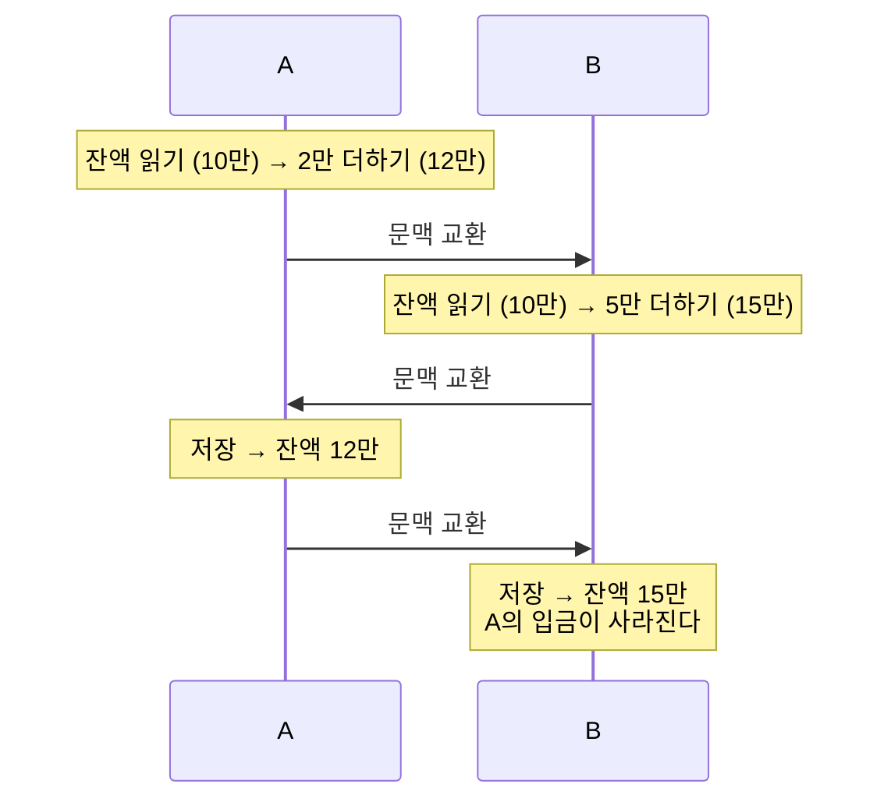
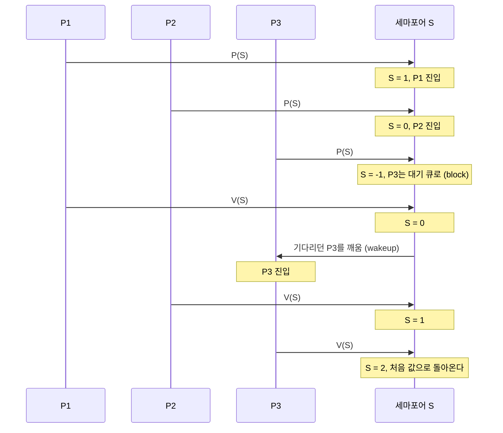

> 「임계 구역 문제의 해법」 절은 고무오리 CS 스터디의 KOCW 반효경 「운영체제」 강의 정리를 바탕으로 보강했다.
> 「경쟁 상태」, 「세마포어」, 「모니터」 등 일부 절은 강민철의 「혼자 공부하는 컴퓨터 구조+운영체제」 강의(한빛미디어)를 바탕으로 보강했다.
> 뮤텍스와 이진 세마포어의 차이, 우선순위 역전 부분은 fru1tworld/cs-basic 모의 면접 질문 목록을 점검해 빠진 개념을 보강했다.

여러 실행 주체가 같은 데이터를 동시에 읽고 쓰면, 실행 순서에 따라 결과가 달라지는 문제가 생긴다. 프로세스 동기화는 이런 **공유 데이터의 일관성**을 지키기 위해 협력하는 프로세스들의 실행 순서를 정해 주는 메커니즘이다. 이름은 프로세스 동기화지만 스레드처럼 실행 문맥을 가진 실행 단위는 모두 대상이다.

## 데이터 접근의 기본 구조

모든 연산은 "저장된 곳에서 읽어 → 연산하고 → 다시 저장"하는 흐름이다. 연산하는 쪽(CPU, 프로세스)이 여럿이고 저장된 곳(메모리, 디스크, 주소 공간)을 함께 쓰면, 누가 언제 읽고 썼는지에 따라 결과가 달라진다.

## 경쟁 상태 (Race Condition)

여러 프로세스(또는 스레드)가 공유 데이터에 **동시에 접근**하고, 최종 결과가 **마지막으로 데이터를 다룬 쪽**에 따라 달라지는 상황이다.

예를 들어 `count++`는 한 줄이지만 실제로는 "메모리에서 읽기 → 레지스터에서 1 더하기 → 메모리에 쓰기" 세 단계다. 한쪽이 `count++`, 다른 쪽이 `count--`를 하는 도중에 끼어들면, 원래 값으로 돌아와야 할 `count`가 한쪽 결과만 반영된 값이 될 수 있다.

계좌 잔액으로 보면 더 분명하다. 잔액이 10만 원일 때 A는 2만 원을, B는 5만 원을 더한다. 기대하는 결과는 17만 원이다.



A의 "읽고 더하고 저장"이 끝나기 전에 B가 같은 잔액에 접근했기 때문이다. A가 잔액을 다루는 동안에는 B가 문맥 교환으로 CPU를 받더라도 기다려야 한다.

## 운영체제에서 경쟁 상태가 생기는 경우

사용자 프로세스는 주소 공간이 분리되어 있지만 **커널 데이터는 공유**되므로 커널 안에서 경쟁 상태가 생긴다.

| 상황 | 무엇이 꼬이나 | 해결 |
| --- | --- | --- |
| 커널 수행 중 인터럽트 | 커널이 `count`를 레지스터로 읽은 직후 인터럽트 핸들러가 `count--`를 하고 돌아오면, 커널은 옛 값에 1을 더해 저장해 `count--`가 사라진다 | 공유 변수를 건드리는 동안 **인터럽트를 막는다.** 너무 오래·자주 막으면 응답성이 떨어진다 |
| 시스템 콜 수행 중 문맥 교환 | A가 시스템 콜로 커널 데이터를 고치던 중 시간이 끝나 B로 넘어가고, B도 같은 데이터를 고치면 A의 수정이 꼬인다 | 고전적인 답은 **커널 모드에서는 선점하지 않고** 사용자 모드로 돌아갈 때 선점하는 비선점형 커널이다. Linux는 2.6부터 커널 선점(`CONFIG_PREEMPT`)을 지원하고, 실시간용 PREEMPT_RT가 6.12에 메인라인에 합쳐졌다. 선점형 커널은 공유 데이터를 스핀락이나 `preempt_disable()`로 지킨다([[pthread-sync-api\|POSIX 스레드와 동기화 API]]) |
| 멀티프로세서의 커널 데이터 | 다른 CPU가 같은 커널 데이터에 동시에 접근하므로 인터럽트를 막아도 소용없다 | 커널 전체에 한 CPU만 들어가게 하거나(비효율적), 공유 데이터마다 **lock**을 걸어 한 번에 한 CPU만 접근하게 한다 |

## 임계 구역 문제 (Critical-Section Problem)

**임계 구역(critical section)** 은 각 프로세스의 코드 중 공유 데이터에 접근하는 부분이다. 목표는 **한 프로세스가 임계 구역에 있을 때 다른 프로세스는 임계 구역에 들어갈 수 없게** 하는 것이다.

```text
do {
    entry section        // 들어가도 되는지 확인하고 잠금
    critical section     // 공유 데이터 접근
    exit section         // 잠금 해제
    remainder section
} while (1);
```

### 해결책이 만족해야 할 조건

| 조건 | 의미 |
| --- | --- |
| 상호 배제 (Mutual Exclusion) | 한 프로세스가 임계 구역에 있으면 다른 프로세스는 들어갈 수 없다 |
| 진행 (Progress) | 임계 구역에 아무도 없으면, 들어가려는 프로세스는 들어갈 수 있어야 한다 |
| 유한 대기 (Bounded Waiting) | 들어가려고 요청한 프로세스가 무한정 기다리지 않도록, 다른 프로세스가 먼저 들어가는 횟수에 한계가 있어야 한다 |

동기화가 필요한 이유는 두 가지로 정리할 수 있다.

| 목적 | 의미 |
| --- | --- |
| 실행 순서 제어 | 프로세스(스레드)를 올바른 순서대로 실행한다. 예: 쓰는 쪽이 먼저 쓰고 읽는 쪽이 나중에 읽기 |
| 상호 배제 | 동시에 접근하면 안 되는 자원에 한 번에 하나만 접근하게 한다 |

상호 배제의 대표 예가 **생산자-소비자 문제**다. 생산자는 버퍼에 물건을 넣고 공유 변수 `총합`을 1 늘리고, 소비자는 물건을 빼고 `총합`을 1 줄인다. 같은 횟수만큼 돌렸는데도 동기화가 없으면 `총합`이 처음 값과 달라진다. 전역 변수·파일·입출력장치 같은 **공유 자원**에 접근하는 코드가 임계 구역이고, 여기서 생기는 문제가 앞의 경쟁 상태다.

## 임계 구역 문제의 해법

### 소프트웨어 해법: 피터슨 알고리즘

두 프로세스 P0, P1이 공유 변수만으로 entry·exit section을 짜는 시도다. 앞의 두 시도는 세 조건 중 하나를 깨뜨린다.

| 시도 | entry section | 깨지는 조건 |
| --- | --- | --- |
| `turn` 변수 하나 | `turn == i`일 때만 들어가고, 나올 때 `turn = j` | **진행**. 반드시 번갈아 들어가야 해서, 상대가 들어갈 생각이 없으면 내 차례가 다시 오지 않는다 |
| `flag[]` 배열 | `flag[i] = true`로 의사를 밝히고, `flag[j]`가 false가 될 때까지 대기 | **진행**. 둘이 동시에 flag를 세우면 둘 다 영원히 기다린다 |
| 피터슨 (`flag[]` + `turn`) | 아래 코드 | 세 조건을 모두 만족한다 |

```text
// 프로세스 i 기준 (상대는 j)
flag[i] = true;                  // 들어가고 싶다
turn = j;                        // 그래도 상대에게 먼저 양보한다
while (flag[j] && turn == j) ;   // 상대도 원하고 상대 차례일 때만 기다린다
critical section
flag[i] = false;
```

둘이 동시에 들어가려 해도 `turn`에는 마지막에 쓴 값 하나만 남으므로 한쪽만 통과한다. 한계는 셋이다.

- 기다리는 동안 루프를 돌며 CPU를 쓰는 **바쁜 대기**다.
- 프로세스 둘을 전제로 한다(n개로 일반화한 것이 빵집 알고리즘이다).
- 현대 CPU와 컴파일러는 메모리 읽기·쓰기 순서를 바꿀 수 있어서, **메모리 배리어 없이 그대로 쓰면 상호 배제가 깨진다.** 교재용 알고리즘이고, 실제로는 아래 하드웨어 명령을 쓴다.

### 하드웨어 해법: 원자 명령어

소프트웨어 해법이 복잡한 이유는 "읽고 → 검사하고 → 쓰는" 과정 중간에 다른 프로세스가 끼어들 수 있어서다. 하드웨어가 이 과정을 **명령어 하나로 원자적으로** 실행해 주면 해법이 간단해진다.

```text
Test_and_Set(lock): lock의 원래 값을 돌려주고 lock을 true로 바꾼다 (한 번에)

while (Test_and_Set(lock)) ;   // 원래 값이 false였던 한 명만 통과
critical section
lock = false;
```

실제 CPU의 compare-and-swap, LL/SC 같은 원자 명령어와 이를 감싼 C·C++ API는 [[pthread-sync-api|POSIX 스레드와 동기화 API]]에 있다.

## 뮤텍스 락 (Mutex Lock)

상호 배제만을 위한 가장 단순한 동기화 도구다. 전역 변수 하나와 함수 두 개로 구현할 수 있다.

```text
lock = false             // 자물쇠. 모든 프로세스가 공유

acquire():               // 임계 구역에 들어가기 전에 호출
    while (lock == true) ;   // 잠겨 있으면 열릴 때까지 반복 확인
    lock = true              // 열려 있으면 잠그고 들어간다

release():               // 임계 구역을 나오며 호출
    lock = false
```

`acquire(); 임계 구역; release();`로 감싸면 한 프로세스만 임계 구역에 들어간다. 잠겼는지 계속 확인하며 기다리는 방식이 **바쁜 대기(busy-wait)**다. 위 의사 코드는 검사와 잠금이 두 단계로 나뉘어 그 사이에 끼어들 수 있으므로, 실제 `acquire()`는 앞의 Test-and-Set 같은 원자 명령어로 구현한다.

## 세마포어 (Semaphore)

뮤텍스 락이 공유 자원이 하나인 상황을 가정한다면, 세마포어는 **공유 자원이 여러 개**인 상황까지 일반화한 도구다. 교재에 따라 P/V 대신 `wait()`/`signal()`이라고 부른다.

이름은 철도 신호기(semaphore)에서 왔다. 신호기가 내려가 있으면 열차가 멈춰 기다리고 올라가면 지나가듯, 프로세스는 임계 구역 앞에서 세마포어를 보고 기다리거나 들어간다. 교재에 따라 연산 이름을 `down()`/`up()`으로 쓰기도 한다.

세마포어 `S`는 정수 변수 하나와, 그것에 접근하는 두 가지 **원자적(atomic)** 연산으로 이루어진 추상 자료형이다. `S`의 값은 **사용 가능한 자원의 개수**(임계 구역에 동시에 들어갈 수 있는 프로세스 수)를 뜻한다.

- **P(S)**: 자원을 획득한다. 자원이 없으면(`S <= 0`) 기다린다.
- **V(S)**: 자원을 반납한다.

```text
P(S):  while (S <= 0) ;   // 자원이 생길 때까지 대기
       S--;

V(S):  S++;
```

임계 구역에 적용하면 `S = 1`로 두고 `P(mutex); 임계 구역; V(mutex);` 형태로 쓴다.

### Busy-wait vs Block/Wakeup

위 구현은 기다리는 동안 반복문을 돌며 CPU를 쓴다. 기다리는 프로세스를 재우면 이 낭비가 사라진다.

| 방식 | 기다리는 동안 | 유리한 경우 |
| --- | --- | --- |
| Busy-wait (spin lock) | 루프를 돌며 값을 계속 확인한다. CPU를 낭비한다 | 임계 구역이 아주 짧아 재우고 깨우는 비용이 더 클 때 |
| Block/Wakeup | P에서 자원이 없으면 대기 리스트에 넣고 block, V에서 대기자가 있으면 wakeup | 대부분의 경우. 기다림이 길수록 이득 |

```text
P(S):  S.value--;  if (S.value < 0) { S.L에 넣고 block(); }
V(S):  S.value++;  if (S.value <= 0) { S.L에서 P를 꺼내 wakeup(P); }
```

Block/Wakeup에서 `value`가 음수이면 그 절댓값이 기다리는 프로세스 수다. 대기 리스트는 PCB를 넣는 대기 큐이고, block은 프로세스를 대기 상태로, wakeup은 준비 상태로 바꿔 준비 큐에 넣는 일이다([[process-and-thread|프로세스와 스레드]]).

자원이 2개(`S = 2`)이고 P1, P2, P3 순서로 들어오는 경우를 따라가면 다음과 같다.



### 세마포어로 실행 순서 제어하기

세마포어는 상호 배제뿐 아니라 실행 순서도 맞출 수 있다. `S = 0`으로 두고, 먼저 실행할 P1 뒤에 `V(S)`(signal), 나중에 실행할 P2 앞에 `P(S)`(wait)를 둔다.

```text
P1:  임계 구역; V(S);
P2:  P(S); 임계 구역;
```

P2가 먼저 CPU를 받아도 `S = 0`이라 기다리게 되므로, 어느 쪽이 먼저 실행되든 항상 P1 → P2 순서가 된다.

### 세마포어의 두 종류

| 종류 | 값의 범위 | 용도 |
| --- | --- | --- |
| Counting semaphore | 0 이상의 임의의 정수 | 여러 개인 자원의 개수 관리 |
| Binary semaphore (mutex) | 0 또는 1 | 상호 배제(lock) |

이진 세마포어는 뮤텍스처럼 쓸 수 있지만 같은 것은 아니다. 차이는 **소유권**이다.

| 비교 | 뮤텍스 | 이진 세마포어 |
| --- | --- | --- |
| 소유권 | 잠근 스레드만 풀 수 있다 | 소유자가 없어 아무 스레드나 V(signal)를 부를 수 있다 |
| 주 용도 | 상호 배제 | 다른 스레드에 알리는 신호(실행 순서 제어). 상호 배제에도 쓸 수 있다 |
| 우선순위 역전 대응 | 누가 쥐고 있는지 알므로 **우선순위 상속**을 걸 수 있다(`PTHREAD_PRIO_INHERIT`) | 소유자를 몰라 걸 수 없다 |
| 그 밖의 기능 | 같은 스레드의 재귀 잠금, 소유 스레드가 죽은 것을 알리는 robust 뮤텍스(`EOWNERDEAD`) | 없음 |

**우선순위 역전**은 낮은 우선순위 작업이 락을 쥔 채 중간 우선순위 작업에 밀려, 그 락을 기다리는 높은 우선순위 작업까지 무한정 늦어지는 현상이다. 1997년 화성 탐사선 패스파인더가 이 때문에 계속 재부팅됐고, 뮤텍스의 우선순위 상속을 켜서 고쳤다. 우선순위 상속은 락을 쥔 작업의 우선순위를 기다리는 작업 중 가장 높은 것까지 잠시 올려 준다.

### 교착 상태와 기아

세마포어를 잘못 쓰면 문제가 생긴다.

- **교착 상태**: 두 프로세스가 서로 상대가 가진 세마포어를 기다리며 영원히 멈춘다. 예: P0는 `P(S); P(Q);`, P1은 `P(Q); P(S);` 순서로 획득하려는 경우. 획득 순서를 통일하면 피할 수 있다. 자세한 내용은 [[deadlock|교착 상태]].
- **기아(starvation)**: 특정 프로세스가 대기 리스트에서 영원히 깨어나지 못한다.

## 고전적인 동기화 문제

| 문제 | 상황 |
| --- | --- |
| Bounded-Buffer (생산자-소비자) | 크기가 정해진 버퍼에 생산자는 데이터를 넣고 소비자는 꺼낸다. 버퍼가 가득 차거나 비었을 때의 대기, 버퍼 접근의 상호 배제가 필요하다 |
| Readers-Writers | 읽기는 여럿이 동시에 해도 되지만, 쓰기는 혼자 해야 한다 |
| Dining-Philosophers (식사하는 철학자) | 원탁의 철학자들이 양옆의 젓가락 두 개를 집어야 식사할 수 있다. 모두 왼쪽 젓가락을 동시에 집으면 교착 상태가 된다([[deadlock\|교착 상태]]) |

## 모니터 (Monitor)

세마포어는 임계 구역마다 P·V를 직접 짝지어 불러야 한다. 순서를 바꾸거나, 한쪽을 빠뜨리거나, 두 번 부르는 실수를 한 번만 해도 오류가 나고 찾기도 어렵다. **모니터**는 공유 데이터와 그 데이터에 접근하는 프로시저를 하나로 묶은 고수준 동기화 구조다. 모니터 안에서는 한 번에 하나의 프로세스만 활동하도록 언어 차원에서 보장하므로, 프로그래머가 직접 lock을 걸 필요가 없다. Java의 `synchronized`가 대표적인 예다.

모니터는 두 종류의 큐로 두 가지 동기화를 모두 제공한다. **두 큐는 서로 다른 큐다.**

| 큐 | 들어가는 때 | 맡는 동기화 |
| --- | --- | --- |
| 진입 큐(entry queue) | 모니터 안에 이미 다른 프로세스가 있을 때, 공개된 프로시저(인터페이스)를 부르려는 프로세스가 줄을 선다 | 상호 배제 |
| 조건 변수 큐 (조건 변수마다 하나) | 모니터 안에서 `x.wait()`를 부른 프로세스가 대기 상태로 들어간다 | 실행 순서 제어 |

- `x.wait()`: 부른 프로세스를 조건 변수 `x`의 큐에 넣고 대기 상태로 만든다. 모니터 안을 비워 주므로 다른 프로세스가 들어올 수 있다.
- `x.signal()`: `x`의 큐에서 기다리던 프로세스 하나를 깨운다. 기다리는 프로세스가 없으면 아무 일도 하지 않는다(값을 기억하는 세마포어의 V와 다른 점이다).

실행 순서 제어는 세마포어와 같은 발상이다. 나중에 실행할 A는 조건이 갖춰지지 않았으면 `x.wait()`로 멈추고, 먼저 실행할 B는 일을 마친 뒤 `x.signal()`로 A를 깨운다.

`signal()`을 부른 쪽과 깨어난 쪽이 동시에 모니터 안에 있을 수는 없으므로 둘 중 하나가 양보해야 한다.

| 방식 | 동작 |
| --- | --- |
| Signal and Wait (Hoare 방식) | `signal()`을 부른 프로세스가 잠시 멈추고, 깨어난 프로세스가 먼저 실행된다. 깨어난 쪽이 모니터를 떠나면 신호를 보낸 쪽이 이어서 실행된다 |
| Signal and Continue (Mesa 방식) | `signal()`을 부른 프로세스가 계속 실행되고, 그 프로세스가 모니터를 떠난 뒤에 깨어난 프로세스가 실행을 재개한다. 그 사이 조건이 다시 바뀔 수 있어 깨어난 쪽은 조건을 `while`로 다시 확인한다 |

Java와 POSIX 조건 변수는 Signal and Continue 방식이다. Java 모니터와 pthread의 대응은 [[pthread-sync-api|POSIX 스레드와 동기화 API]]에 있다.

### 세 도구 비교

| 도구 | 상호 배제 | 실행 순서 제어 | 특징 |
| --- | --- | --- | --- |
| 뮤텍스 락 | O | X | 공유 자원이 하나일 때. 잠근 쪽이 풀어야 한다 |
| 세마포어 | O | O | 공유 자원이 여러 개여도 된다. P·V를 직접 짝지어 불러야 한다 |
| 모니터 | O | O (조건 변수) | 언어가 상호 배제를 보장해 실수가 적다 |

데이터베이스도 같은 문제를 로킹·MVCC 같은 병행 제어로 푼다([[transaction|트랜잭션]]).

## 핵심 정리

- 경쟁 상태 = 공유 데이터에 동시 접근해 실행 순서에 따라 결과가 달라지는 것.
- OS에서는 인터럽트, 시스템 콜 중 선점, 멀티프로세서 때문에 커널 데이터에서 경쟁 상태가 생긴다. 선점형 커널은 스핀락과 선점 끄기로 지킨다.
- 임계 구역 해결 조건: 상호 배제, 진행, 유한 대기.
- 세마포어 P는 획득(없으면 대기), V는 반납(대기자가 있으면 깨움). Busy-wait 대신 block/wakeup으로 CPU 낭비를 줄인다.

관련 노트: [[pthread-sync-api|POSIX 스레드와 동기화 API]], [[deadlock|교착 상태]], [[concurrency-models|동시성·병렬·비동기·논블로킹과 동시성 모델]]
