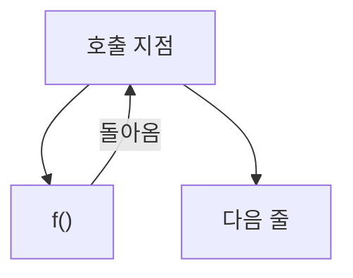
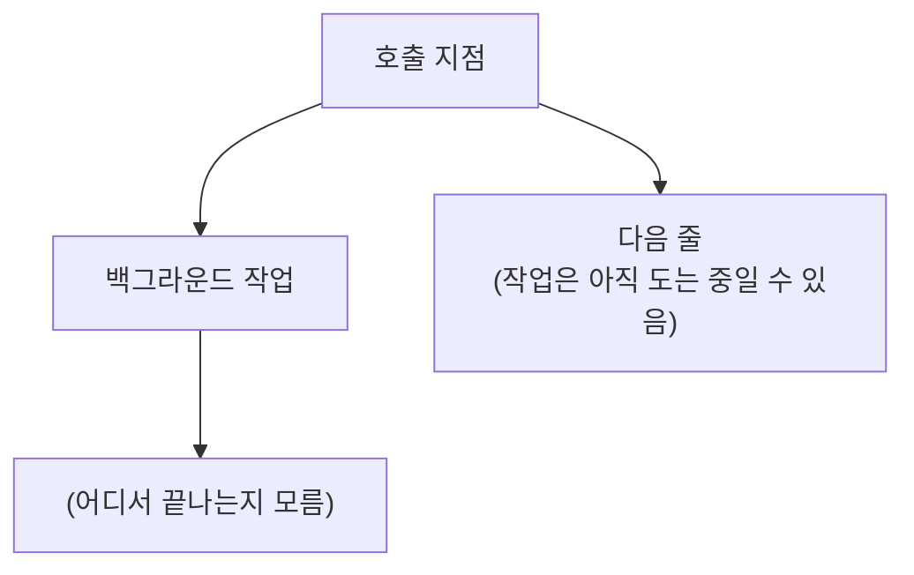

> Nathaniel J. Smith의 「[Notes on structured concurrency, or: Go statement considered harmful](https://vorpus.org/blog/notes-on-structured-concurrency-or-go-statement-considered-harmful/)」(2018)과 그 번역 「[구조적 동시성에 대한 소고, 또는 Go 문의 해로움](https://muchtrans.com/translations/notes-on-structured-concurrency-or-go-statement-considered-harmful.ko.html)」을 바탕으로, 언어별 지원 현황은 각 공식 문서로 확인해 재구성한 노트다.

## 구조적 동시성이란

**구조적 동시성(structured concurrency)**은 동시에 도는 작업의 수명을 **코드의 블록 구조에 묶는** 원칙이다. 블록 안에서 띄운 작업은 블록이 끝나기 전에 반드시 끝난다. 그래서 함수가 반환됐다면 그 함수가 시작한 일도 모두 끝났다고 믿을 수 있다.

구조적 프로그래밍이 `goto`를 `if`·`for`·함수 호출로 바꿨듯, 구조적 동시성은 「작업을 띄우고 잊는(fire-and-forget)」 기본 요소를 블록 단위 기본 요소로 바꾼다.

## 왜: `go` 문은 `goto`와 같은 모양이다

`go` 문, 스레드 생성, 콜백 등록, 기다리지 않는 Future·Promise는 모두 같은 모양이다. 흐름이 둘로 갈라지고, 한쪽은 호출자에게 돌아가며, 다른 쪽은 **어디로도 돌아오지 않는다.**

일반 함수 호출



go 문 (fire-and-forget)



`goto`가 해로운 이유는 함수를 블랙박스로 다룰 수 없게 만들어 **지역적 추론**을 깨뜨리기 때문이다. 돌아오지 않는 동시 작업도 같은 문제를 만든다.

| 깨지는 것 | 증상 |
| --- | --- |
| **추상화** | 함수가 반환된 뒤에도 그 안에서 띄운 작업이 돌고 있을 수 있다. 함수 시그니처만 보고는 알 수 없다 |
| **자원 정리** | `with`·`try-with-resources`·`using` 블록이 끝나 파일을 닫았는데 백그라운드 작업이 계속 쓴다 |
| **오류 처리** | 백그라운드 작업의 예외가 호출자에게 가지 않고 사라진다 |
| **취소** | 상위 작업을 멈춰도 하위 작업은 방치된다 |

## 어떻게: nursery(작업 그룹)

해법은 자식 작업을 **반드시 어떤 블록(스코프) 안에서만** 띄우게 하는 것이다. Python 라이브러리 Trio는 이 블록을 nursery라고 부른다.

```python
import asyncio

async def main():
    async with asyncio.TaskGroup() as tg:   # 이 블록이 nursery 역할
        tg.create_task(fetch("a"))
        tg.create_task(fetch("b"))
    # 여기 도달하면 두 작업이 모두 끝났다. 하나가 실패하면 나머지는 취소되고 예외가 올라온다
```

| 성질 | 내용 |
| --- | --- |
| 진입과 종료가 짝 | 블록은 안의 모든 작업이 끝날 때까지 빠져나가지 않는다 |
| 동적 추가 가능 | 서버의 accept 루프처럼 블록이 열려 있는 동안 작업을 계속 더할 수 있다 |
| 스코프 전달 | 스코프 객체를 인자로 넘기면 함수 밖에서 작업을 띄울 수 있지만, 수명은 여전히 그 스코프에 묶인다. 「이 함수는 반환 뒤에도 작업을 남긴다」는 사실이 시그니처에 드러난다 |

## 얻는 것

| 이점 | 이유 |
| --- | --- |
| 함수 추상화 회복 | 반환 = 그 안의 일이 모두 끝남 |
| 자원 정리 | 블록 끝에서 자식이 모두 끝나므로 `with` 같은 구문이 다시 안전하다 |
| 예외 전파 | 자식의 처리 안 된 예외 → 형제 작업 취소 → 대기 → 부모에서 다시 던짐. 여러 예외는 묶어서(`ExceptionGroup`) 올린다 |
| 안정적인 취소 | 취소는 트리를 따라 아래로 전파되고, 정리가 끝날 때까지 기다린다 |
| 관측 | 작업이 트리를 이루므로 디버거·트레이서가 부모-자식 관계를 보여 줄 수 있다 |

## 언어별 지원

| 언어·런타임 | 구조적 동시성 기본 요소 |
| --- | --- |
| Python | Trio의 nursery, AnyIO의 task group, 표준 `asyncio.TaskGroup`(3.11+) |
| Kotlin | 코루틴은 기본이 구조적이다. `coroutineScope`, `supervisorScope` |
| Swift | `async let`, `withTaskGroup` |
| Java | 가상 스레드와 함께 쓰는 `StructuredTaskScope` (프리뷰 API로 도입) |
| Go | 언어 차원 지원은 없다. `errgroup`, `sync.WaitGroup`으로 관례적으로 흉내 낸다 |
| Rust | `std::thread::scope`(스레드), 비동기에서는 `JoinSet` 등 라이브러리 수준 |

Erlang의 슈퍼바이저 트리, CSP의 병렬 합성, fork/join 모델도 같은 계열의 생각이다.

## 한계

- 요청이 끝난 뒤에도 살아야 하는 진짜 백그라운드 작업(캐시 워밍, 큐 소비자)은 더 오래 사는 스코프를 명시적으로 만들어 넘겨야 한다. 번거롭지만 그 번거로움이 수명을 드러낸다.
- 기존 fire-and-forget API와 섞으면 보장이 깨진다. 구조적 스코프 밖으로 새는 호출이 하나라도 있으면 그 부분은 다시 추적이 어려워진다.

## 정리

- 동시 작업도 블록 구조를 따라야 지역적 추론이 가능하다.
- 띄운 작업은 그 스코프가 끝나기 전에 끝난다. 예외와 취소는 트리를 따라 흐른다.
- 대부분의 현대 비동기 런타임이 작업 그룹 형태로 이를 제공한다.

작업을 띄울 때는 「누가 이 작업의 끝을 기다리나」를 먼저 정한다.

관련 노트: [[concurrency-models|동시성·병렬·비동기·논블로킹과 동시성 모델]], [[process-and-thread|프로세스와 스레드]], [[async-await|async/await]], [[multithreading-patterns|멀티스레딩 패턴]]
