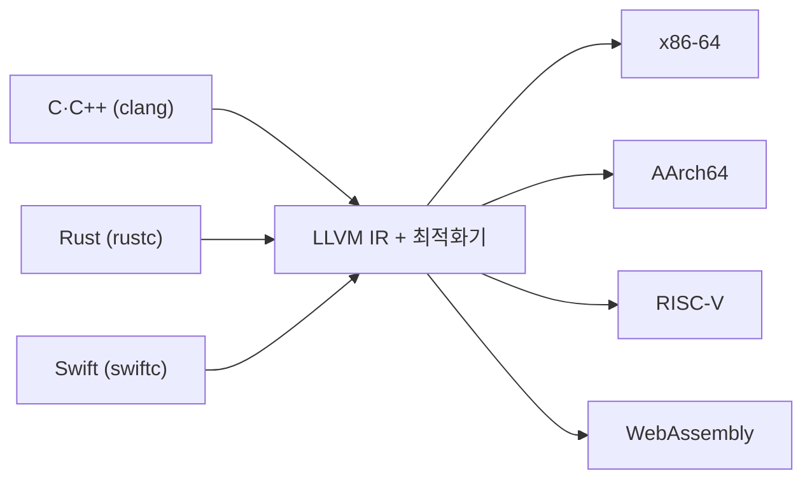

> Nicole Orchard의 「[An Intro to Compilers](https://nicoleorchard.com/blog/compilers/)」(2017.05)를 바탕으로 재구성한 노트다. 세 단계 구조의 이점은 Chris Lattner의 「[LLVM](https://aosabook.org/en/v1/llvm.html)」(The Architecture of Open Source Applications)으로 보강했다. 분석·합성 구분, 심볼 테이블, 3주소 코드, 저장 배치와 활성 레코드는 Pablo Díaz의 「[Writing My First Compiler](https://dev.to/fcpauldiaz/writing-my-first-compiler)」(2017.04)를 바탕으로 보강했다. 예제 출력은 Homebrew LLVM 23.1.6(arm64 macOS)으로 다시 확인했다.

## 컴파일러란

컴파일러는 **프로그램을 번역하는 프로그램**이다. 전통적인 컴파일러는 소스 코드를 CPU가 바로 실행하는 기계어로 바꾼다. 소스 코드를 다른 프로그래밍 언어로 바꾸는 컴파일러는 소스 대 소스 번역기, 곧 트랜스파일러(transpiler)라 부른다. TypeScript의 `tsc`와 [[babel|Babel]]이 그 예다.

C 컴파일을 전처리 → 컴파일 → 어셈블 → 링크의 네 단계로 나누면([[c-basics|C 기초]]), 이 노트는 그중 「컴파일」 한 칸의 안쪽을 연다. 컴파일이 인터프리터·바이트코드 VM과 어떻게 다른지는 [[how-programs-run|프로그램이 실행되기까지]]에 있다.

## 세 단계 구조


| 단계 | 하는 일 | LLVM 도구 |
| --- | --- | --- |
| 프론트엔드(frontend) | 소스 코드를 읽어 문법·의미를 검사하고 **중간 표현(IR, intermediate representation)**으로 바꾼다 | `clang`(C·C++·Objective-C) |
| 최적화기(optimizer) | IR을 분석해 같은 일을 더 빠르게, 또는 더 작게 하는 IR로 바꾼다 | `opt` |
| 백엔드(backend) | IR을 대상 CPU의 명령어 집합에 맞춰 기계어로 바꾼다 | `llc` |

**가운데의 IR이 핵심이다.** 프론트엔드는 언어만, 백엔드는 CPU만 알면 되고, 최적화기는 둘 다 몰라도 된다. 단계가 붙어 있으면 언어 M개와 아키텍처 N개를 지원하는 데 컴파일러 M×N개가 필요하다. 나뉘어 있으면 프론트엔드 M개와 백엔드 N개를 만들고 최적화기 하나를 함께 쓴다. 새 언어는 프론트엔드만 만들면 기존 최적화기와 모든 백엔드를 얻는다.



LLVM은 이 부품들을 라이브러리와 독립 도구로 나눠 둔 컴파일러 프로젝트다. GCC도 내부는 같은 세 단계(GENERIC·GIMPLE·RTL이라는 IR)를 거치지만, 단계가 독립 도구로 나뉘어 있지 않다.

교과서(드래곤 북)는 같은 일을 **분석(analysis)**과 **합성(synthesis)** 둘로 나눈다. 분석은 소스를 조각내 문법 구조를 세우고 이름·타입 같은 정보를 모아 중간 표현을 만드는 일(어휘·구문·의미 분석, 중간 코드 생성)이고, 합성은 그 중간 표현과 심볼 테이블로 대상 프로그램을 만드는 일(코드 생성)이다. 분석이 프론트엔드, 합성이 백엔드이고, 최적화는 둘 사이에 끼는 선택 단계다.

## LLVM IR

LLVM IR은 어셈블리와 비슷한 저수준 언어다. 특징은 세 가지다.

- **SSA(정적 단일 대입) 형식**: 값마다 한 번만 대입되는 이름(`%1`, `%2`, …)을 붙인다. 이름은 개수 제한이 없는 가상 레지스터라서, 실제 CPU 레지스터가 몇 개인지는 백엔드가 걱정한다.
- **타입이 있다**: `i32`(32비트 정수), `[18 x i8]`(바이트 18개 배열)처럼 값마다 타입이 붙는다.
- **포인터는 `ptr` 하나다**: 예전 IR은 `i8*`, `i32*`처럼 가리키는 대상의 타입을 포인터에 적었다. LLVM 15부터 타입 없는 불투명 포인터(opaque pointer) `ptr`이 기본이 됐고, LLVM 17부터는 `ptr`만 쓴다. 2017년 이전 자료의 IR 예제는 지금 도구에서 그대로 읽히지 않는다.

### 3주소 코드와 SSA

교과서의 고전적인 IR은 **3주소 코드(three-address code)**다. 명령 하나가 피연산자 둘과 결과 하나, 곧 주소를 최대 셋만 쓰고, 중간값은 임시 이름(`t1`, `t2`)에 담는다. `position = initial + rate * 60`(`rate`는 실수)은 이렇게 된다.

```text
t1 = inttofloat(60)      ← 의미 분석이 넣은 형 변환
t2 = id3 * t1
t3 = id2 + t2
id1 = t3
```

최적화하면 상수 변환을 미리 끝내고 쓸데없는 복사를 지워 두 줄이 된다.

```text
t1 = id3 * 60.0
id1 = id2 + t1
```

LLVM IR의 `%6 = add nsw i32 %4, %5`도 3주소 형태다. 다른 점은 SSA라는 것이다. 3주소 코드에서는 같은 이름에 여러 번 대입할 수 있지만, SSA에서는 이름마다 대입이 한 번뿐이고 제어 흐름이 합쳐지는 곳에서는 `phi` 명령이 어느 갈래에서 온 값인지 고른다. 값마다 정의가 한 곳이라 「이 값은 어디서 왔나」를 따지는 최적화가 단순해진다.

**IR이 완전히 하드웨어 중립인 것은 아니다.** clang이 만든 IR 파일 머리에는 `target triple = "arm64-apple-macosx…"`와 `target datalayout`(포인터 크기, 정렬)이 박히고, 함수 속성에 대상 CPU 이름까지 들어간다. 호출 규약처럼 언어와 CPU에 함께 걸린 결정도 프론트엔드가 IR을 만들 때 내린다. 그래서 arm64용으로 만든 IR을 `llc -mtriple=x86_64-…`에 넣으면 실패하고, 다른 아키텍처용 코드는 소스부터 `clang --target=x86_64-apple-macos`로 다시 만든다.

## 예제 프로그램

```c
// compile_me.c
#include <stdio.h>

int main() {
  printf("Hello, Compiler!\n");
  return 0;
}
```

## 프론트엔드: clang

clang의 프론트엔드는 다섯 부분으로 나뉜다. 각 단계에서 멈추고 결과를 보는 명령이 있다.

| 부분 | 하는 일 | 결과를 보는 명령 |
| --- | --- | --- |
| 전처리기(preprocessor) | `#include`, `#define` 같은 지시문을 처리한다. `#include <stdio.h>` 한 줄이 헤더 전체(`printf` 선언 포함)로 펼쳐진다 | `clang -E compile_me.c -o preprocessed.i` |
| 어휘 분석기(lexer) | 문자열을 토큰(낱말)의 열로 자른다 | `clang -Xclang -dump-tokens -fsyntax-only compile_me.c` |
| 구문 분석기(parser) | 토큰열이 문법에 맞는 문장인지 확인하고 추상 구문 트리(AST)를 만든다 | `clang -Xclang -ast-dump -fsyntax-only compile_me.c` |
| 의미 분석기(semantic analyzer) | AST를 돌며 문장이 뜻이 통하는지(타입, 선언) 검사한다 | 오류·경고 메시지 |
| IR 생성기 | AST를 LLVM IR로 바꾼다 | `clang -S -emit-llvm -o llvm_ir.ll compile_me.c` |

`-E` 결과는 수백 줄이다(macOS SDK에서 약 570줄). `-E`·`-S`·`-c`로 단계를 끊는 법은 [[gcc-compile-and-link|GCC 컴파일과 링크]]에 있다.

### 토큰

C 표준의 토큰은 **키워드, 식별자, 상수, 문자열 리터럴, 구두점(punctuator)** 다섯 종류다. 주석은 토큰이 아니다. 소스를 토큰으로 자르는 단계에서 공백 하나로 바뀌어 사라진다. `main` 함수 부분의 토큰은 이렇다.

```text
int              'int'                      ← 키워드
identifier       'main'                     ← 식별자
l_paren          '('                        ← 구두점
r_paren          ')'
l_brace          '{'
identifier       'printf'
l_paren          '('
string_literal   '"Hello, Compiler!\n"'     ← 문자열 리터럴
r_paren          ')'
semi             ';'
return           'return'
numeric_constant '0'                        ← 상수
semi             ';'
r_brace          '}'
```

### 심볼 테이블

어휘 분석기는 식별자를 만나면 **심볼 테이블(symbol table)**에 항목을 만들고, 토큰에는 그 항목 번호를 단다. 교과서의 예에서 `position = initial + rate * 60`은 아래 토큰열이 된다.

```text
<id, 1> <=> <id, 2> <+> <id, 3> <*> <60>

심볼 테이블
1  position
2  initial
3  rate
```

뒤 단계가 이 테이블에 타입, 스코프, 저장 위치를 채워 가며 쓴다. Clang은 이 역할을 식별자 문자열을 한 번만 저장하는 식별자 테이블과, 의미 분석에서 선언을 찾는 스코프 구조로 나눠 맡는다.

### AST

Clang AST의 노드는 크게 선언(`Decl`), 문장(`Stmt`, 식 `Expr`은 그 하위), 타입(`Type`)이다. 파서는 토큰열을 이런 트리로 묶는다.

```text
FunctionDecl main 'int ()'
`-CompoundStmt
  |-CallExpr 'int'
  | |-ImplicitCastExpr 'int (*)(const char *, ...)' <FunctionToPointerDecay>
  | | `-DeclRefExpr 'printf'
  | `-ImplicitCastExpr 'const char *' <NoOp>
  |   `-ImplicitCastExpr 'char *' <ArrayToPointerDecay>
  |     `-StringLiteral 'char[18]' "Hello, Compiler!\n"
  `-ReturnStmt
    `-IntegerLiteral 'int' 0
```

배열이 포인터로 바뀌는 것처럼 소스에 쓰지 않은 암시적 변환(`ImplicitCastExpr`)이 AST에는 노드로 드러난다. 파싱 알고리즘 자체는 [[pratt-parsing|파싱 알고리즘과 프랫 파서]]에 있다.

파서는 손으로 쓰기도 하고 문법 파일에서 생성하기도 한다. Clang과 GCC의 C·C++ 파서는 손으로 쓴 재귀 하강 파서다. GCC는 원래 Bison으로 생성한 파서를 썼지만 C++은 3.4, C는 4.1에서 손으로 쓴 파서로 바꿨다. C++ 문법은 LALR 파서 생성기로 다루기 어렵고, 손으로 쓰면 오류 메시지와 복구를 세밀하게 다룰 수 있다. 수업 과제나 작은 언어(DSL)에서는 ANTLR 같은 **파서 생성기**로 문법 파일(`.g4`)에서 렉서와 파서를 만들고, 생성된 리스너(Listener)나 방문자(Visitor)로 트리를 돌며 의미 분석과 코드 생성을 붙이는 경우가 많다.

### 의미 분석

구문은 맞아도 뜻이 안 통하는 코드는 의미 분석에서 걸린다. `int`를 돌려줘야 하는 `main`이 문자열을 돌려주면 이렇게 된다.

```c
int main() {
  return "zero";
}
```

```text
zero.c:2:10: error: incompatible pointer to integer conversion returning 'char[5]'
from a function with result type 'int' [-Wint-conversion]
```

포인터를 정수로 바꾸는 이 변환은 예전 C 컴파일러에서는 경고였지만, Clang에서는 기본으로 오류다.

의미 분석은 AST와 심볼 테이블을 함께 보며 선언되지 않은 이름, 타입이 맞지 않는 연산, 인자 개수가 틀린 호출을 찾는다. 언어를 직접 설계하면 정적 타입인가 동적 타입인가, 스코프를 중괄호로 여는가 들여쓰기로 여는가 같은 결정이 이 단계에 드러난다([[type-systems|타입 시스템]]).

### IR 생성

최적화 없이(`-O0`) 만든 IR의 `main`이다.

```llvm
@.str = private unnamed_addr constant [18 x i8] c"Hello, Compiler!\0A\00", align 1

define i32 @main() #0 {
  %1 = alloca i32, align 4                       ; 스택에 공간을 잡는다
  store i32 0, ptr %1, align 4
  %2 = call i32 (ptr, ...) @printf(ptr noundef @.str)
  ret i32 0
}

declare i32 @printf(ptr noundef, ...) #1

attributes #0 = { noinline nounwind optnone ... }
```

## 최적화기: opt

최적화기는 IR을 받아 개선된 IR을 내놓는다. `opt -O2`는 `opt -passes='default<O2>'`의 줄임이다.

**`-O0`으로 만든 IR은 `opt`가 손대지 않는다.** clang은 `-O0`에서 함수마다 `optnone`·`noinline` 속성을 붙이고, 최적화기는 이 속성이 붙은 함수를 건너뛴다. 위 IR에 `opt -O2`를 돌리면 결과가 그대로다. 단계를 나눠 실험하려면 속성을 빼고 IR을 만든다.

```bash
clang -S -emit-llvm -Xclang -disable-O0-optnone -o llvm_ir.ll compile_me.c
opt -O2 -S llvm_ir.ll -o optimized.ll
```

```llvm
@str = private unnamed_addr constant [17 x i8] c"Hello, Compiler!\00", align 1

define noundef i32 @main() local_unnamed_addr #0 {
  %puts = tail call i32 @puts(ptr nonnull dereferenceable(1) @str)
  ret i32 0
}
```

| 바뀐 것 | 이유 |
| --- | --- |
| `alloca`·`store`가 사라졌다 | 스택 칸에 0을 써 두고 읽지 않으므로 필요 없다. 스택 칸을 SSA 레지스터로 올리는 패스(SROA, mem2reg)가 지운다 |
| `printf`가 `puts`로 바뀌었다 | 서식 지정자(`%`)가 없고 `\n`으로 끝나는 `printf`는 `puts`와 같다. 라이브러리 호출을 아는 패스가 더 싼 함수로 바꾼다 |
| 문자열이 18바이트에서 17바이트가 됐다 | `puts`가 줄바꿈을 붙이므로 `\n`을 뺐다 |

최적화는 프로그램의 **관찰할 수 있는 동작**(출력)을 바꾸지 않는 선에서만 한다([[programming-language-semantics#의미를 보존하는 최적화|의미를 보존하는 최적화]]).

### 상수 전파와 접기

```c
// add.c
#include <stdio.h>

int main() {
  int a = 5, b = 10, c = a + b;
  printf("%i + %i = %i\n", a, b, c);
}
```

최적화 전 IR은 변수 세 개에 `alloca`를 하나씩 잡고, 5와 10을 메모리에 쓴 뒤 다시 읽어 더하고, 그 결과를 또 메모리에 썼다가 `printf` 직전에 세 값을 다시 읽는다(명령 14개). `opt -O2`를 거치면 한 줄이 남는다.

```llvm
define noundef i32 @main() local_unnamed_addr #0 {
  %1 = tail call i32 (ptr, ...) @printf(ptr noundef nonnull dereferenceable(1) @.str,
                                        i32 noundef 5, i32 noundef 10, i32 noundef 15)
  ret i32 0
}
```

값이 모두 상수라서 최적화기가 상수를 사용처까지 퍼뜨리고(상수 전파) `5 + 10`을 컴파일할 때 미리 계산했다(상수 접기). 최적화기는 이 밖에도 함수 인라인, 반복문 펼치기(loop unrolling), 쓰지 않는 코드 제거 같은 변환을 한다.

### 크기 최적화

`opt`는 `-Os`·`-Oz`를 받지 않는다(「Use O2 in conjunction with the optsize attribute instead」). 크기를 줄이는 결정은 함수 속성이 맡는다. `clang -Os`는 함수에 `optsize`를, `clang -Oz`는 `optsize`와 `minsize`를 붙이고, O2 파이프라인의 패스들이 이 속성을 보고 코드 크기를 늘리는 변환(인라인, 펼치기)을 줄인다.

## 백엔드: llc

백엔드는 IR을 대상 CPU의 기계어로 바꾼다. 일은 세 단계로 나뉜다.

| 단계 | 하는 일 |
| --- | --- |
| 명령어 선택(instruction selection) | IR 명령을 대상 CPU의 명령으로 옮긴다. 아직 개수 제한 없는 가상 레지스터를 쓴다. LLVM에는 SelectionDAG, GlobalISel, 그리고 `-O0`에서 빨리 끝내려고 쓰는 FastISel이 있다 |
| 레지스터 할당(register allocation) | 가상 레지스터를 실제 레지스터에 배정한다. 범용 레지스터는 AArch64가 31개(`x0`~`x30`), x86-64가 16개다. 동시에 살아 있는 값이 레지스터보다 많으면 일부를 스택에 내려 둔다(spill) |
| 명령어 스케줄링(instruction scheduling) | 대상 CPU의 파이프라인 제약(지연 시간, 실행 유닛)에 맞춰 명령 순서를 바꾼다. 한 번에 끝나는 단계가 아니라 명령어 선택 안, 레지스터 할당 전(MachineScheduler), 할당 뒤에 여러 번 돈다 |

`llc -stop-after=<패스>`로 중간 결과(MIR, 기계 수준 IR)를 볼 수 있다. 명령어 선택 직후에는 `%0` 같은 가상 레지스터가 남아 있다.

```text
# llc -stop-after=finalize-isel
%0:gpr64common = MOVaddr @str
$x0 = COPY %0
BL @puts, ...
```

레지스터 할당 뒤에는 `%0`이 실제 레지스터 `$x0`로 바뀌고, 필요 없어진 복사가 사라진다.

```text
# llc -stop-after=virtregrewriter
renamable $x0 = MOVaddr @str
BL @puts, ...
```

끝까지 돌리면 어셈블리가 나온다.

```bash
llc -o compiled-assembly.s optimized.ll
```

```asm
; AArch64 (Apple Silicon)
_main:
	stp	x29, x30, [sp, #-16]!     ; 프레임 포인터와 복귀 주소를 스택에 저장
	mov	x29, sp
	adrp	x0, l_str@PAGE            ; 첫 인자 레지스터 x0에 문자열 주소
	add	x0, x0, l_str@PAGEOFF
	bl	_puts
	mov	w0, #0                    ; 반환값 0
	ldp	x29, x30, [sp], #16
	ret
l_str:
	.asciz	"Hello, Compiler!"
```

같은 프로그램을 `clang --target=x86_64-apple-macos -O2 -S`로 만들면 x86-64 어셈블리가 된다.

```asm
_main:
	pushq	%rbp
	movq	%rsp, %rbp
	leaq	L_str(%rip), %rdi         ; 첫 인자 레지스터 rdi에 문자열 주소
	callq	_puts
	xorl	%eax, %eax                ; eax를 0으로: 반환값 0
	popq	%rbp
	retq
L_str:
	.asciz	"Hello, Compiler!"
```

IR까지는 같고 백엔드만 다르다. 어떤 레지스터로 인자와 반환값을 넘기는지는 [[calling-convention|호출 규약과 스택 프레임]]이, 명령어 집합 자체는 [[cpu-instructions|CPU와 명령어 구조]]가 다룬다.

### 저장 배치와 활성 레코드

코드 생성기는 값을 어디에 둘지 먼저 정한다.

| 결정 | 내용 |
| --- | --- |
| 타입의 크기와 정렬 | `int`는 몇 바이트이고 어느 경계에 맞추는가. LLVM에서는 IR의 `target datalayout`이 정한다 |
| 전역 변수·상수 | 데이터 섹션의 고정 주소에 둔다. 위 어셈블리의 `l_str` 같은 문자열 상수는 읽기 전용 섹션에 놓인다 |
| 지역 변수·임시값 | 레지스터에 두고, 모자라거나 주소가 필요하면 스택 프레임에 둔다 |

교과서의 단순한 코드 생성기는 **레지스터 기술자**(각 레지스터에 지금 어느 변수의 값이 들어 있나)와 **주소 기술자**(각 변수의 현재 값이 레지스터·메모리·스택 중 어디에 있나)를 들고 다니며, 언제 메모리에서 읽고 언제 되써야 하는지 정한다. 실제 컴파일러는 이 일을 전체 함수를 보는 레지스터 할당기에 맡긴다. LLVM의 최적화 빌드는 greedy 할당기를 쓴다.

함수가 불릴 때마다 스택에 하나씩 쌓이는 **활성 레코드(activation record)**, 곧 스택 프레임에는 인자, 반환값, 지역 변수와 임시값, 저장해 둔 레지스터와 복귀 주소, 호출한 쪽 프레임을 가리키는 **제어 링크**가 들어간다. 위 AArch64 코드의 `stp x29, x30`이 바로 제어 링크(프레임 포인터 `x29`)와 복귀 주소(`x30`)를 저장하는 줄이다. 호출마다 새 레코드가 생기므로 같은 함수가 자기 자신을 불러도(재귀) 각 호출의 지역 변수가 섞이지 않는다.

## 한 번에 돌리기

평소에는 단계를 나누지 않는다. `clang -O2 compile_me.c -o compile_me`가 프론트엔드, 최적화기, 백엔드에 어셈블러와 링커까지 한 번에 돌린다. 최적화 수준에 따라 코드가 어떻게 바뀌는지만 보고 싶으면 `clang -O2 -S -emit-llvm`(IR)이나 `clang -O2 -S`(어셈블리)로 충분하고, Compiler Explorer(godbolt.org)가 같은 일을 브라우저에서 해 준다.

## 다른 컴파일러에 대입하기

세 단계 구조는 기계어를 만들지 않는 컴파일러에도 그대로 보인다.

| 컴파일러 | 프론트엔드 | 가운데 | 끝 |
| --- | --- | --- | --- |
| TypeScript `tsc` | 스캐너 → 파서 → 바인더 → 체커 | AST와 심볼 | 이미터가 JavaScript·`.d.ts`를 쓴다([[typescript-compiler-internals\|TypeScript 컴파일러 내부 구조]]) |
| Babel | parse | AST를 플러그인이 고친다(transform) | generate가 JavaScript를 쓴다([[babel\|Babel과 AST 변환]]) |
| GCC | 언어별 프론트엔드 → GENERIC | GIMPLE에서 최적화 | RTL을 거쳐 어셈블리 |
| rustc | 파싱 → HIR → MIR(빌림 검사) | LLVM IR | LLVM 백엔드 |

인터프리터는 프론트엔드까지는 같고, IR이나 AST를 기계어로 바꾸는 대신 그 자리에서 실행한다([[tiny-interpreter|작은 언어 인터프리터 만들기]]).

## 더 읽을거리

- Keith Cooper, Linda Torczon, 『Engineering a Compiler』: 세 단계 구조를 따라 각 단계의 알고리즘을 다루는 교과서
- Bruno Cardoso Lopes, Rafael Auler, 『Getting Started with LLVM Core Libraries』(2014): clang·opt·llc와 LLVM 라이브러리 사용법. LLVM 3.x 기준이라 IR 문법(타입 있는 포인터)과 opt 명령(옛 패스 관리자)은 지금과 다르다
- 『Compilers: Principles, Techniques, and Tools』(드래곤 북): [[books/compilers-principles-techniques-and-tools]]
- [LLVM Language Reference Manual](https://llvm.org/docs/LangRef.html): IR 명령과 속성의 공식 정의

## 정리

- 컴파일러는 프론트엔드(언어를 안다), 최적화기(둘 다 모른다), 백엔드(CPU를 안다)로 나뉘고, 가운데 IR 덕분에 언어 M개 × 아키텍처 N개를 M+N개의 부품으로 지원한다.
- 교과서는 컴파일을 분석(구조와 정보를 모은다)과 합성(번역을 만든다)으로 나누고, 분석이 모은 이름·타입은 심볼 테이블에 쌓인다.
- 프론트엔드는 전처리 → 토큰 → AST → 의미 검사 → IR 순이고, clang의 `-E`, `-dump-tokens`, `-ast-dump`, `-emit-llvm`으로 단계마다 멈춰 볼 수 있다. 실무 컴파일러의 파서는 대개 손으로 쓴 재귀 하강이고, 작은 언어는 ANTLR 같은 생성기를 쓴다.
- LLVM IR은 SSA 형식의 타입 있는 저수준 언어이고, 포인터는 `ptr` 하나다. 대상 triple과 datalayout이 박혀 있어 완전히 중립적이지는 않다.
- 최적화기는 동작을 바꾸지 않는 선에서 스택 칸 제거, 라이브러리 호출 교체, 상수 전파·접기, 인라인을 한다. `-O0` IR에는 `optnone`이 붙어 `opt`가 건너뛰고, 크기 최적화는 `optsize`·`minsize` 속성이 맡는다.
- 백엔드는 명령어 선택(가상 레지스터)과 레지스터 할당(실제 레지스터, 모자라면 spill)으로 IR을 CPU 명령으로 바꾸고, 그 앞뒤로 명령 순서를 CPU에 맞게 스케줄링한다. 함수마다 쌓이는 활성 레코드(스택 프레임)가 재귀를 가능하게 한다.

관련 노트: [[how-programs-run|프로그램이 실행되기까지]], [[gcc-compile-and-link|GCC 컴파일과 링크]], [[c-basics|C 기초]], [[typescript-compiler-internals|TypeScript 컴파일러 내부 구조]], [[babel|Babel과 AST 변환]], [[pratt-parsing|파싱 알고리즘과 프랫 파서]], [[tiny-interpreter|작은 언어 인터프리터 만들기]], [[calling-convention|호출 규약과 스택 프레임]]
