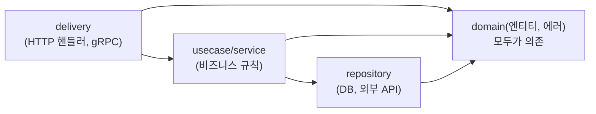

> 「[The Zen of Go](https://dave.cheney.net/2020/02/23/the-zen-of-go)」, 「[고루틴 vs 쓰레드](https://tech.ssut.me/goroutine-vs-threads/)」, 「[Go 작업 훔치기 스케쥴러](https://hueypark.gitlab.io/post/2018-10-13-go-work-stealing-scheduler/)」, 「[Go 언어의 GC에 대해](https://engineering.linecorp.com/ko/blog/go-gc)」, 「[Go Clean Architecture](https://github.com/bxcodec/go-clean-arch)」를 바탕으로, GC 동작과 최신 변경은 Go 공식 GC 가이드와 릴리스 노트로 확인해 재구성한 노트다. 장단점, 타입 시스템, 에러 처리, 빌드·모듈·워크스페이스, 테스트와 벤치마크는 fru1tworld/cs-basic 모의 면접 질문 목록의 Go 질문을 바탕으로 Go 언어 명세와 공식 문서로 확인해 보강했다.

## Go란

**Go는 단순함과 빠른 빌드, 쉬운 동시성을 목표로 설계된 정적 타입 컴파일 언어다.** 단일 바이너리로 배포되고, 언어 수준의 고루틴과 채널, 가비지 컬렉터를 갖췄다. 클라우드 인프라 도구(Docker, Kubernetes, Terraform)와 네트워크 서버에 많이 쓰인다.

| 장점 | 단점 |
| --- | --- |
| 문법이 작아 배우기 쉽고, 누가 써도 비슷한 코드가 나온다(`gofmt`) | 표현력이 낮다. 제네릭은 1.18에야 들어왔고, 예외·상속·연산자 오버로딩·열거형 합 타입이 없다 |
| 컴파일이 빠르고, 의존성 없는 정적 링크 단일 바이너리로 배포·크로스 컴파일이 쉽다 | `if err != nil` 반복으로 코드가 길어진다 |
| 고루틴·채널로 동시성 코드를 쉽게 쓴다 | GC가 있어 C·C++·Rust보다 지연과 메모리 제어가 거칠다 |
| 테스트·벤치마크·프로파일러·포매터·레이스 디텍터가 표준 도구에 들어 있다 | nil 포인터, nil 인터페이스 함정, 데이터 경쟁은 컴파일러가 막지 못한다 |
| 하위 호환 약속(Go 1 호환성)으로 오래된 코드가 계속 빌드된다 | 런타임이 바이너리에 포함돼 최소 크기가 수 MB다 |

## The Zen of Go: 코드를 쓰는 원칙

| 원칙 | 뜻 |
| --- | --- |
| 좋은 패키지는 좋은 이름에서 시작한다 | 패키지는 목적이 하나고, 그 목적을 한 단어로 말할 수 있어야 한다. `util`, `common` 같은 이름은 목적이 없다는 신호다 |
| 단순함이 중요하다 | 영리한 코드보다 읽기 쉬운 코드를 고른다 |
| 패키지 수준 상태를 피한다 | 전역 변수는 결합도를 높이고 테스트·병렬 실행을 어렵게 한다. 의존성은 구조체 필드로 넘긴다 |
| 성공이 아니라 실패를 대비한다 | 에러를 값으로 받아 명시적으로 처리한다. 실패 경로를 먼저 생각한다 |
| 깊이 중첩하지 말고 일찍 반환한다 | 보호절로 예외 경로를 먼저 빠져나가 정상 경로가 왼쪽 가장자리를 따라 흐르게 한다 |
| 느리다고 생각되면 벤치마크로 증명한다 | `go test -bench`와 pprof로 측정하고, 통념으로 최적화하지 않는다 |
| 고루틴을 시작하기 전에 언제 멈출지 안다 | 종료 조건, 종료시키는 방법(`context`), 종료를 기다리는 방법(`sync.WaitGroup`)을 먼저 정한다. 그렇지 않으면 고루틴 누수가 생긴다 |
| 동시성은 호출자에게 맡긴다 | 라이브러리는 동기 API를 제공하고, 고루틴으로 돌릴지는 호출자가 정하게 한다 |
| 테스트로 패키지 API의 동작을 고정한다 | 테스트는 공개 API가 지키는 계약이다 |
| 절제는 미덕이다 | 채널, 고루틴, 임베딩, 인터페이스를 쓸 수 있다고 다 쓰지 않는다 |

이 모두를 묶는 한 줄은 **유지보수성이 중요하다**다.

## 타입 시스템

### 인터페이스

**Go 인터페이스는 메서드 집합이고, 그 메서드를 모두 가진 타입은 선언 없이 자동으로 그 인터페이스를 구현한다(암묵적·구조적 구현).** `implements` 키워드가 없어서, 구현 쪽 패키지가 인터페이스를 몰라도 되고 쓰는 쪽에서 필요한 만큼 작은 인터페이스를 선언한다(`io.Reader`는 메서드 하나다).

```go
type Shape interface { Area() float64 }
type Rect struct{ W, H float64 }
func (r Rect) Area() float64 { return r.W * r.H }   // Rect는 이제 Shape다

var s Shape = Rect{2, 3}
if r, ok := s.(Rect); ok { _ = r.W }               // 타입 단언
switch v := s.(type) { case Rect: _ = v }          // 타입 스위치
```

- 인터페이스 값은 **(동적 타입, 동적 값)** 쌍이다. 둘 다 없을 때만 `nil`이다. `var p *Rect = nil; var s Shape = p`이면 `s`는 타입 `*Rect`를 가져 **`s != nil`** 이다. 에러를 반환할 때 nil 포인터를 `error`로 돌려주면 호출자의 `err != nil`이 참이 되는 유명한 함정이다. 실패가 없으면 `nil`을 직접 반환한다.
- `any`(= `interface{}`)는 메서드가 없어 모든 타입을 담는다. 꺼낼 때 타입 단언이 필요하므로 제네릭으로 대체할 수 있으면 그쪽을 쓴다.
- 「인터페이스를 받고, 구조체를 반환하라」가 관용이다. 상속이 없으므로 다형성은 인터페이스로만 얻는다.

### 값과 포인터

Go는 모든 대입과 인자 전달이 **값 복사**다. 구조체·배열도 통째로 복사된다. 원본을 바꾸거나 큰 구조체의 복사를 피하려면 포인터(`*T`)를 넘긴다. 포인터 연산은 없다(`unsafe` 제외).

| 리시버 | 메서드 안에서 | 메서드 집합 |
| --- | --- | --- |
| 값 리시버 `func (r Rect) Area()` | 복사본을 다룬다. 바꿔도 원본은 그대로 | `T`와 `*T` 모두 가진다 |
| 포인터 리시버 `func (r *Rect) Scale(k)` | 원본을 바꾼다 | **`*T`만** 가진다. 그래서 `Rect` 값은 포인터 리시버 메서드를 요구하는 인터페이스를 만족하지 못한다 |

- 한 타입의 메서드는 리시버를 한 종류로 통일한다. 상태를 바꾸거나, 크거나, `Mutex`를 담은 구조체는 포인터 리시버로 쓴다.
- 지역 변수의 포인터를 반환해도 안전하다. 컴파일러의 **탈출 분석**이 함수 밖으로 나가는 값을 힙에 둔다(`go build -gcflags=-m`으로 확인).
- 슬라이스·맵·채널·함수·인터페이스는 내부에 포인터를 가진 작은 헤더라 값으로 넘겨도 같은 데이터를 공유한다.

### 배열과 슬라이스

| 비교 | 배열 `[4]int` | 슬라이스 `[]int` |
| --- | --- | --- |
| 길이 | 타입의 일부. `[4]int`와 `[5]int`는 다른 타입 | 실행 중 바뀐다 |
| 정체 | 값 자체. 대입하면 원소가 모두 복사된다 | 배열을 가리키는 **헤더(포인터, 길이 `len`, 용량 `cap`)** |
| 쓰임 | 크기가 고정된 값(해시 결과 `[32]byte`), 맵 키 | 거의 모든 시퀀스 |

```go
a := []int{1, 2, 3, 4}
b := a[1:3]          // [2 3], len 2, cap 3. a와 같은 배열을 본다
b[0] = 99            // a도 [1 99 3 4]
b = append(b, 7)     // cap 안이라 a[3]을 덮어쓴다: a = [1 99 3 7]
b = append(b, 8)     // cap 초과: 새 배열로 복사된 뒤부터는 a와 무관
```

- `append`는 용량이 남으면 같은 배열에 쓰고, 모자라면 더 큰 배열을 새로 할당해 복사한 뒤 **새 헤더를 반환**한다. 그래서 결과를 반드시 다시 대입한다(`s = append(s, x)`). 늘리는 비율은 작은 슬라이스는 약 2배, 큰 슬라이스는 점점 1.25배에 가깝게 줄어든다.
- 부분 슬라이스는 원본 배열을 공유하므로 위처럼 서로를 덮어쓸 수 있고, 큰 배열의 작은 조각만 들고 있어도 배열 전체가 GC되지 않는다. 독립이 필요하면 `slices.Clone`이나 전체 슬라이스 식 `a[lo:hi:max]`로 용량을 제한한다.
- 크기를 알면 `make([]T, 0, n)`으로 미리 잡는다. nil 슬라이스와 빈 슬라이스는 `len`이 0으로 같게 동작하지만 JSON에서는 `null`과 `[]`로 다르다.

### 맵

**Go `map`은 해시 테이블이다.** Go 1.24부터 **Swiss Table** 방식으로 구현이 바뀌었다. 슬롯 8개를 한 그룹으로 묶고 각 슬롯 해시의 하위 7비트를 담은 제어 워드를 함께 둬, 한 그룹의 후보를 비트 연산으로 한 번에 비교하는 개방 주소법이다. 이전에는 버킷마다 8개 항목과 오버플로 버킷을 잇는 체이닝 방식이었다. 해시 테이블 일반은 [[hash-table|해시 테이블]]에 있다.

- **순회 순서는 정해지지 않았고 일부러 매번 무작위로** 시작한다. 순서가 필요하면 키를 정렬한다(`slices.Sorted(maps.Keys(m))`).
- 없는 키를 읽으면 제로값이 나온다. 존재 여부는 `v, ok := m[k]`로 본다.
- nil 맵은 읽기는 되지만 **쓰면 panic**이다. `make`나 리터럴로 만든다.
- 동시 쓰기에 안전하지 않다([[go-concurrency|Go 동시성]]의 `sync.Mutex`·`sync.Map`). 원소의 주소를 얻을 수 없어 `m[k].field = v`는 컴파일 오류다.
- 키는 비교 가능한(`==`) 타입이어야 한다. 슬라이스·맵·함수는 키가 될 수 없다.

### 구조체 임베딩

**임베딩은 필드 이름 없이 다른 타입을 구조체에 넣어, 그 필드와 메서드를 바깥 타입의 것처럼 쓰게 하는 기능이다.** 상속이 아니라 **컴포지션과 자동 위임**이다.

```go
type Logger struct{ prefix string }
func (l *Logger) Log(m string) { fmt.Println(l.prefix, m) }

type Server struct {
    *Logger                 // 임베딩
    addr string
}
s := Server{Logger: &Logger{"[srv]"}, addr: ":80"}
s.Log("start")              // s.Logger.Log로 승격(promotion)된다
```

- 승격된 메서드의 리시버는 여전히 안쪽 `Logger`다. 바깥 `Server`를 알지 못하므로 상속의 오버라이딩·`super` 같은 동적 디스패치가 없다.
- 바깥 타입이 같은 이름을 정의하면 그것이 안쪽을 가린다. 같은 깊이에 같은 이름이 둘이면 그 이름을 쓸 때 모호성 오류다.
- 임베딩한 타입의 메서드가 바깥 타입의 메서드 집합에 들어가므로, 인터페이스 구현을 물려받는 효과가 있다. 인터페이스 안에 인터페이스를 임베딩해 합칠 수도 있다(`io.ReadWriter`).
- 내부 타입의 모든 메서드가 공개 API로 새어 나가므로, 노출하고 싶지 않으면 이름 있는 필드로 둔다.

### 제네릭과 타입 제약

Go 1.18부터 함수와 타입이 **타입 매개변수**를 받는다. 제약(constraint)은 타입 매개변수가 될 수 있는 타입의 집합을 정하는 **인터페이스**다.

```go
type Number interface {
    ~int | ~int64 | ~float64          // 타입 집합. ~는 그 타입을 기반 타입으로 가진 모든 타입
}

func Sum[T Number](xs []T) T {
    var total T
    for _, x := range xs { total += x }   // 집합의 모든 타입이 +를 지원하므로 허용
    return total
}

type Stack[T any] struct{ items []T }
func (s *Stack[T]) Push(v T) { s.items = append(s.items, v) }

Sum([]float64{1.5, 2})                  // T는 인자에서 추론된다
```

| 제약 | 뜻 |
| --- | --- |
| `any` | 제약 없음. 대입·전달만 할 수 있다 |
| `comparable` | `==`, `!=`가 되는 타입. 맵 키 |
| `cmp.Ordered` | `<` 등 순서 비교가 되는 정수·실수·문자열 |
| 유니언 `~int \| ~string` | 나열한 타입(의 기반 타입) 집합. 집합 모두가 지원하는 연산만 쓸 수 있다 |
| 메서드 + 타입 집합 | `interface{ ~[]byte; String() string }`처럼 둘을 함께 요구할 수 있다 |

- 유니언이나 `~`가 들어간 인터페이스는 **제약으로만** 쓸 수 있고 일반 변수 타입이 될 수 없다.
- 메서드는 자기만의 타입 매개변수를 가질 수 없다(타입의 매개변수만 쓴다). 1.24부터 제네릭 타입 별칭을 쓸 수 있다.
- 구현은 같은 메모리 모양(GC shape)끼리 코드를 공유하고 타입 정보를 사전(dictionary)으로 넘기는 방식이라, 포인터 타입끼리는 단형화만큼 빠르지 않을 수 있다. 표준 라이브러리의 `slices`, `maps`, `cmp`가 제네릭으로 만든 도구다. 일반 개념은 [[type-systems|타입 시스템]]의 다형성에 있다.

## 에러 처리

**Go에는 예외가 없다. 실패는 `error` 인터페이스(`Error() string`) 값으로 반환하고, 호출자가 바로 확인한다.**

```go
f, err := os.Open(path)
if err != nil {
    return fmt.Errorf("설정 열기 %s: %w", path, err)   // %w: 원인을 감싼다(wrapping)
}
defer f.Close()
```

| 방식 | 예 | 확인 |
| --- | --- | --- |
| 센티널 에러 | `var ErrNotFound = errors.New("not found")`, `io.EOF` | `errors.Is(err, ErrNotFound)` (감싼 체인을 따라가며 비교) |
| 에러 타입 | `type ValidationError struct{ Field string }` | `errors.As(err, &ve)`, Go 1.26의 제네릭 `errors.AsType[*ValidationError](err)` |
| 불투명 에러 | 그냥 반환하고 내용은 보지 않는다 | `err != nil`만 |

**모범 사례**:

- 에러는 **한 번만 처리**한다. 로그를 남기고 또 반환하면 같은 에러가 여러 번 기록된다. 처리할 수 없으면 맥락을 붙여(`%w`) 올리고, 경계(핸들러, `main`)에서 로그를 남긴다.
- 맥락은 「무엇을 하다 실패했나」를 소문자로 시작해 짧게 붙인다. 원인을 외부에 숨기려면 `%v`로 감싸 체인을 끊는다.
- 에러 문자열 비교(`err.Error() == "..."`)로 분기하지 않는다. `errors.Is`·`As`를 쓴다.
- 여러 에러는 `errors.Join`(1.20)으로 합친다. 무시하는 에러는 `_ =`로 의도를 드러낸다.

### defer, panic, recover

| 도구 | 동작 |
| --- | --- |
| `defer f()` | 둘러싼 함수가 **반환될 때**(정상이든 panic이든) 실행한다. 여러 개면 **LIFO** 순서다. **인자는 `defer`를 만나는 시점에 평가**된다 |
| `panic(v)` | 현재 함수 실행을 멈추고, 지연된 함수들을 실행하며 호출 스택을 되감는다. 끝까지 잡히지 않으면 스택 트레이스를 찍고 프로그램이 죽는다 |
| `recover()` | **지연된 함수 안에서** 불렸을 때만 진행 중인 panic을 멈추고 그 값을 돌려준다. 다른 곳에서는 `nil` |

```go
func safe(fn func()) (err error) {
    defer func() {
        if r := recover(); r != nil {
            err = fmt.Errorf("panic: %v", r)   // 이름 있는 반환값을 지연 함수가 고친다
        }
    }()
    fn()
    return nil
}
```

- `defer`는 자원 해제(`Close`, `Unlock`)를 획득 바로 옆에 적게 해 준다. 반복문 안에서 `defer`하면 함수가 끝날 때까지 쌓이므로 반복 본문을 함수로 뺀다.
- panic은 **프로그래머 오류**(nil 역참조, 범위 초과, 불가능한 상태)용이다. 예상 가능한 실패는 `error`로 반환한다. 라이브러리는 panic을 패키지 밖으로 새게 하지 않는다.
- recover는 같은 고루틴의 panic만 잡는다. 다른 고루틴에서 난 panic은 프로그램 전체를 죽이므로, 서버는 고루틴마다 recover를 둔다(`net/http`는 핸들러 panic을 recover해 그 연결만 끊는다).

## 빌드, 모듈, 테스트

### 빌드와 컴파일

`go build`는 패키지 단위로 컴파일한다. 소스 → 파싱 → 타입 검사 → SSA 중간 표현으로 바꿔 최적화(인라이닝, 탈출 분석, 경계 검사 제거) → 기계어 → **링커가 런타임(스케줄러, GC)과 모든 의존 패키지를 하나의 정적 실행 파일로** 묶는다. 패키지 결과는 빌드 캐시에 저장돼 바뀐 패키지만 다시 컴파일한다. import 순환을 금지하고 쓰지 않는 import를 오류로 만드는 규칙이 빠른 빌드를 받친다.

```bash
GOOS=linux GOARCH=arm64 CGO_ENABLED=0 go build -o app ./cmd/app   # 크로스 컴파일
go build -ldflags="-s -w -X main.version=1.2.3" ./cmd/app          # 심볼 제거, 변수 주입
go build -tags integration ./...                                   # 빌드 태그로 파일 선택
```

`CGO_ENABLED=0`이면 C 라이브러리에 의존하지 않는 완전 정적 바이너리가 나와 `scratch`·distroless 이미지에 넣을 수 있다. C 코드와 연동(cgo)하면 크로스 컴파일과 정적 링크가 어려워진다. 실행 파일이 만들어지는 일반 과정은 [[how-programs-run|프로그램이 실행되기까지]]에 있다.

### 모듈과 의존성 관리

**모듈은 함께 버전이 매겨지는 패키지 묶음이고, 루트의 `go.mod`가 모듈 경로와 의존성을 선언한다(Go 1.11~, 1.16부터 기본).**

| 파일 | 역할 |
| --- | --- |
| `go.mod` | 모듈 경로, 최소 `go` 버전, `require`(의존 모듈과 버전), `replace`·`exclude`, Go 1.24의 `tool`(개발 도구 의존) |
| `go.sum` | 의존 모듈 내용의 암호학적 해시. 다운로드한 코드가 변조되지 않았는지 검증한다 |

- **최소 버전 선택(MVS)**: 의존 그래프에서 각 모듈에 대해 요구된 버전들 중 **가장 높은 최소 요구 버전**을 고른다. 「최신 버전」을 고르지 않으므로 잠금 파일 없이도 빌드가 재현 가능하다. 올리려면 `go get pkg@v1.5.0`으로 명시한다.
- **시맨틱 import 버전**: v2 이상의 메이저 버전은 import 경로에 `/v2`를 붙여 다른 모듈로 취급한다. 한 프로그램에 v1과 v2가 함께 있을 수 있다.
- 모듈은 기본으로 프록시(`proxy.golang.org`)에서 받고 체크섬 DB(`sum.golang.org`)로 검증한다. 사내 모듈은 `GOPRIVATE`로 제외한다.
- 자주 쓰는 명령: `go mod tidy`(쓰는 것만 남기기), `go get`, `go list -m all`, `go mod why`.

### 워크스페이스

**워크스페이스(`go.work`, Go 1.18)는 여러 모듈을 동시에 로컬에서 고치며 빌드하게 한다.** 모듈 A가 모듈 B에 의존할 때, B를 고쳐 A에서 바로 시험하려면 예전에는 A의 `go.mod`에 `replace ../b`를 넣었다가 커밋 전에 지워야 했다.

```bash
go work init ./service-a ./lib-b    # go.work 생성
go work use ./lib-c                  # 모듈 추가
```

`go.work`가 있으면 나열된 모듈들이 메인 모듈로 함께 쓰여, 서로의 로컬 코드를 버전 대신 직접 참조한다. 각 `go.mod`는 건드리지 않으므로 개인 개발 환경용이고 보통 저장소에 커밋하지 않는다(모노레포가 의도적으로 공유할 때는 예외). `GOWORK=off`로 끈다.

### 테스트와 벤치마크

테스트는 같은 패키지의 `_test.go` 파일에 `func TestXxx(t *testing.T)`로 쓰고 `go test ./...`로 돌린다. 단언 라이브러리 없이 `if got != want { t.Errorf(...) }`로 쓰는 것이 관용이다.

**테이블 기반 테스트**는 입력과 기대 결과를 구조체 슬라이스로 나열하고 반복문 하나로 검사한다. 경우를 추가하는 비용이 한 줄이고, `t.Run`으로 경우마다 이름 붙은 하위 테스트가 된다.

```go
func TestAbs(t *testing.T) {
    tests := []struct {
        name string
        in, want int
    }{
        {"양수", 3, 3},
        {"음수", -3, 3},
        {"영", 0, 0},
    }
    for _, tt := range tests {
        t.Run(tt.name, func(t *testing.T) {
            t.Parallel()                                  // 하위 테스트를 병렬로
            if got := Abs(tt.in); got != tt.want {
                t.Errorf("Abs(%d) = %d, want %d", tt.in, got, tt.want)
            }
        })
    }
}
```

`go test -run 'TestAbs/음수'`로 하위 테스트 하나만 돌린다. `t.Helper()`는 실패 위치를 도우미 함수가 아닌 호출 지점으로 보고하고, `t.Cleanup`은 정리 함수를 등록한다.

**벤치마크**는 `func BenchmarkXxx(b *testing.B)`로 쓴다.

```go
func BenchmarkJoin(b *testing.B) {
    parts := makeParts(1000)          // 준비 코드는 측정에서 빠진다
    for b.Loop() {                    // Go 1.24+. 예전에는 for i := 0; i < b.N; i++
        strings.Join(parts, ",")
    }
}
```

```bash
go test -bench=Join -benchmem -count=10 ./... > new.txt   # ns/op, B/op, allocs/op
benchstat old.txt new.txt                                  # 통계적으로 비교
```

`b.Loop()`는 반복 횟수를 런타임이 정하고, 루프 밖의 준비 코드를 측정에서 자동으로 빼며, 결과가 쓰이지 않는다고 컴파일러가 본문을 지우는 것을 막는다. `-cpuprofile`·`-memprofile`로 pprof 프로파일을 함께 얻는다. 퍼징(`func FuzzXxx(f *testing.F)`, 1.18)은 무작위 입력으로 경계 사례를 찾는다.

## 가비지 컬렉션

**Go의 GC는 애플리케이션과 동시에 도는 삼색(tri-color) mark-and-sweep 수집기다.** 쓰기 장벽(write barrier)으로 표시 중의 포인터 변경을 추적하고, 전체 멈춤은 짧은 두 구간에만 둔다.

| 설계 선택 | 이유 |
| --- | --- |
| **세대 구분을 하지 않는다** | 세대 간 참조를 기록하는 쓰기 장벽 비용이 컸다. 또 Go는 **탈출 분석(escape analysis)** 으로 함수 밖으로 나가지 않는 짧은 수명의 값을 스택에 할당하므로, 세대 구분이 노리는 젊은 객체가 힙에 적다 |
| **압축(compaction)을 하지 않는다** | 객체를 옮기지 않는다. 단편화는 크기별 클래스로 나눈 TCMalloc 계열 할당자로 줄인다 |
| 조정 손잡이가 적다 | Java처럼 수집기와 수많은 옵션을 고르지 않는다 |

남는 비용은 오래 사는 객체를 GC마다 다시 표시해야 한다는 점이다. 이를 줄이려고 Go 1.26부터 기본이 된 **Green Tea GC**는 작은 객체를 객체 단위가 아니라 메모리 페이지(span) 단위로 모아 표시해 메모리 접근 지역성을 높였다.

| 손잡이 | 뜻 |
| --- | --- |
| `GOGC`(기본 100) | 직전 GC 뒤 살아 있는 힙 대비 얼마나 늘면 다음 GC를 시작할지. 높이면 GC가 덜 돌고 메모리를 더 쓴다. `off`는 끈다 |
| `GOMEMLIMIT`(Go 1.19+) | 런타임이 쓰는 전체 메모리의 상한. 한도에 다가가면 GC를 더 자주 돌린다. 컨테이너 메모리 제한에 맞춰 두면 OOM을 줄인다 |

GC 일반 원리와 Java·Python과의 비교는 [[how-programs-run|프로그램이 실행되기까지]]의 「가비지 컬렉션」에 있다. 고루틴·채널·`context`·`sync`는 [[go-concurrency|Go 동시성]]에 있다.

## 프로젝트 구조: 클린 아키텍처 계층



- 비즈니스 규칙은 프레임워크·DB·전송 방식을 모른다. 그래서 핸들러나 DB를 바꿔도 유스케이스 코드는 그대로이고, 가짜 리포지토리로 테스트할 수 있다.
- **인터페이스는 쓰는 쪽(consumer)에서 선언한다.** 서비스 패키지가 자신이 필요한 메서드만 담은 리포지토리 인터페이스를 정의하고, 리포지토리 패키지는 구조체만 제공한다. Go 인터페이스는 암묵적으로 구현되므로 구현 쪽이 인터페이스를 알 필요가 없다.
- 외부에 공개하지 않을 패키지는 `internal/` 아래에 둔다. 컴파일러가 바깥 모듈의 import를 막는다.
- 계층 이름별 폴더(`models/`, `controllers/`)보다 기능·서비스 단위 패키지를 선호한다. 일반적인 아키텍처 패턴은 [[software-architecture-patterns|소프트웨어 아키텍처 패턴]]에 있다.

## 정리

- Go의 원칙은 단순함, 명시적 에러 처리, 측정 기반 최적화, 종료 조건이 분명한 고루틴이다.
- 인터페이스는 암묵적으로 구현되고, 인터페이스 값은 (타입, 값) 쌍이라 nil 포인터를 담으면 nil이 아니다.
- 모든 전달은 값 복사다. 슬라이스는 배열을 가리키는 헤더라 `append` 결과를 다시 대입하고 공유를 조심한다.
- 임베딩은 상속이 아니라 위임이고, 제네릭 제약은 타입 집합을 정한 인터페이스다.
- 에러는 값으로 반환해 `%w`로 맥락을 붙이고 `errors.Is`·`As`로 확인한다. panic은 프로그래머 오류에만 쓴다.
- 모듈은 MVS로 재현 가능하게 버전을 고르고, 여러 모듈을 함께 고칠 때는 워크스페이스를 쓴다. 테스트는 테이블 기반, 벤치마크는 `b.Loop`와 benchstat.
- GC는 동시 삼색 mark-and-sweep이며 세대·압축 없이 탈출 분석과 할당자로 버틴다. 조정은 `GOGC`와 `GOMEMLIMIT`.
- 프로젝트는 비즈니스 규칙을 가운데 두고, 인터페이스는 쓰는 쪽에서 선언한다.

관련 노트: [[go-concurrency|Go 동시성]], [[concurrency-models|동시성·병렬·비동기·논블로킹과 동시성 모델]], [[how-programs-run|프로그램이 실행되기까지]], [[process-and-thread|프로세스와 스레드]], [[software-architecture-patterns|소프트웨어 아키텍처 패턴]], [[programming-language-evolution|프로그래밍 언어의 계보와 선택]]
