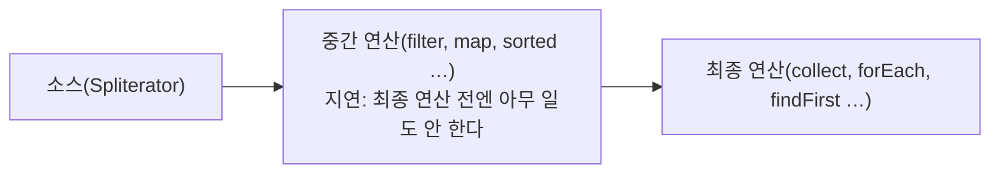

> 「[Java Enum 활용기](https://techblog.woowahan.com/2527/)」, 「[자바에서 null을 안전하게 다루는 방법](https://www.slideshare.net/mobile/gyumee/null-142590829)」, 「[Java Optional 바르게 쓰기](http://homoefficio.github.io/2019/10/03/Java-Optional-%EB%B0%94%EB%A5%B4%EA%B2%8C-%EC%93%B0%EA%B8%B0/)」, 「[Checked Exception을 대하는 자세](https://cheese10yun.github.io/checked-exception/)」, 「[Java 날짜와 시간 API의 문제점과 JDK8에서 개선된 부분](https://d2.naver.com/helloworld/645609)」, 「[자바 비동기 프로그래밍을 위한 CompletableFuture 검토](https://brunch.co.kr/@springboot/267)」, 「[Java Lambda Expression과 성능](https://brunch.co.kr/@heracul/3)」 등을 바탕으로, API는 Java SE 공식 문서로 확인해 재구성한 노트다. try-with-resources, 함수형 인터페이스와 메서드 참조, 스트림의 동작과 병렬 처리는 fru1tworld/cs-basic 모의 면접 질문 목록의 Java 질문을 바탕으로 보강했다.

## Enum: 상수에 상태와 행위를 묶는다

**Java의 enum은 정수 상수가 아니라 클래스다.** 상수마다 필드와 메서드를 가질 수 있고, 허용 값을 타입으로 제한한다. 오타는 컴파일 시점에 잡히고 IDE 자동완성이 된다.

| 활용 | 방법 | 효과 |
| --- | --- | --- |
| 연관 값 묶기 | `Y`, `"1"`, `true`처럼 같은 뜻의 여러 표현을 한 상수의 필드로 둔다 | 변환 `if` 문이 사라지고 관계가 코드에 드러난다 |
| 상태와 행위 결합 | 상수마다 계산식을 람다 필드(`Function`, `BiFunction`)로 둔다 | 호출하는 쪽이 코드 값으로 분기하지 않고 상수에게 계산을 시킨다 |
| 그룹 관리 | 상수가 하위 코드 목록을 갖고, 값이 어느 그룹에 속하는지 스스로 판단한다 | 결제 수단 → 결제 종류 같은 분류 로직이 한곳에 모인다 |
| 코드 테이블 대체 | 잘 안 바뀌는 코드는 DB 테이블 대신 enum으로 둔다 | 조회 쿼리와 캐시가 필요 없다 |

```java
enum CalculatorType {
    CALC_A(value -> value),
    CALC_B(value -> value * 10);

    private final LongUnaryOperator expression;
    CalculatorType(LongUnaryOperator expression) { this.expression = expression; }
    long calculate(long value) { return expression.applyAsLong(value); }
}
```

- JPA에 저장할 때는 `@Enumerated(EnumType.STRING)`을 쓴다. 기본값 `ORDINAL`은 순서 번호를 저장해서, 중간에 상수를 끼워 넣으면 기존 데이터의 뜻이 바뀐다.
- **한계**: 자주 바뀌거나 여러 시스템이 공유하는 코드는 enum을 고칠 때마다 배포해야 한다. 변경 빈도와 참조 범위를 보고 테이블과 나눠 쓴다.

## null을 API에서 몰아내기

**null은 "초기화 안 됨", "값 없음", "알 수 없음"을 구분하지 못한다.** 그래서 null을 반환하지도 받지도 않는 API를 기본으로 삼는다.

| 상황 | null 대신 |
| --- | --- |
| 결과가 없을 수 있는 단건 조회 | `Optional<T>` 반환, 또는 의미 있는 예외 |
| 컬렉션 반환 | 빈 컬렉션(`List.of()`) |
| 기본 동작이 있는 협력 객체 | 널 객체(Null Object) 패턴 |
| 선택적 매개변수 | 메서드 오버로딩, 빌더 |
| 사전 조건 위반 | 보호절에서 즉시 실패: `Objects.requireNonNull`, Spring `Assert`, Guava `Preconditions` |

- **계약에 의한 설계**: 사전 조건(받는 값), 사후 조건(돌려주는 값), 불변식(객체가 늘 지키는 상태)을 정하고 경계에서 검사한다.
- null이 퍼지는 범위를 줄인다. 클래스와 메서드를 작게 나누면 null이 지역 안에 머문다.
- 필드는 생성 시점에 모두 초기화한다. 지연 초기화가 필요하면 그 null 처리를 팩토리 메서드 안에 가둔다.
- 정적 분석으로 검사한다. `@Nullable`·`@NonNull` 어노테이션과 NullAway, Checker Framework가 컴파일 시점에 null 흐름을 추적한다. 표준 어노테이션은 JSpecify로 모이고 있다.

### Optional 규칙

`Optional`은 **"결과가 없을 수 있음"을 반환 타입으로 알리는 용도**로 설계됐다.

| 하지 않는다 | 대신 |
| --- | --- |
| `isPresent()` 다음 `get()` | `orElse`, `orElseGet`, `orElseThrow`, `map`, `ifPresent` |
| `orElse(new Foo())`, `orElse(계산())` | `orElseGet(() -> ...)`. `orElse`의 인자는 값이 있어도 **항상 평가된다** |
| 필드, 생성자·메서드 매개변수, 컬렉션 원소로 쓰기 | 필드는 null 허용 + 접근자에서 `Optional` 반환. 컬렉션은 비워 두고, `Map`은 `getOrDefault` |
| `Optional<List<T>>` | 빈 리스트 |
| null일 수 있는 값에 `Optional.of` | `of`는 null이 아닐 때만, null 가능하면 `ofNullable` |
| `Optional<Integer>` | `OptionalInt`, `OptionalLong`, `OptionalDouble` |
| 단순히 null 여부만 보려고 감싸기 | 그냥 `!= null` 비교 |

## 예외: checked를 unchecked로 바꾼다

| 종류 | 상속 | 처리 강제 | 예 |
| --- | --- | --- | --- |
| Checked | `Exception` (RuntimeException 제외) | `catch`하거나 `throws`로 선언해야 컴파일된다 | `IOException`, `SQLException` |
| Unchecked | `RuntimeException` | 강제하지 않는다 | `IllegalArgumentException`, `NullPointerException` |
| Error | `Error` | 애플리케이션이 복구할 대상이 아니다 | `OutOfMemoryError` |

처리 전략은 셋이다.

1. **복구**: 대안이 분명할 때만 잡아서 처리한다. 다만 예상 가능한 분기라면 예외보다 조건문이 낫다.
2. **회피(위임)**: `throws`로 넘긴다. 상위 계층이 알 필요 없는 하위 기술 예외가 시그니처를 타고 번지므로 피한다.
3. **전환**: 의미가 분명한 unchecked 예외로 감싸 던진다. **원인 예외(cause)를 꼭 함께 넘긴다.** 대부분의 경우 이 방식이 낫다.

```java
try {
    return objectMapper.writeValueAsString(value);
} catch (JsonProcessingException e) {
    throw new JsonSerializeFailedException("직렬화 실패: " + value.getClass(), e);
}
```

- Spring의 `@Transactional`은 기본적으로 **unchecked 예외와 `Error`에서만 롤백**하고 checked 예외에서는 커밋한다. checked 예외로도 롤백하려면 `rollbackFor`를 지정한다.
- 예외를 잡고 아무것도 하지 않는 빈 `catch`는 쓰지 않는다. 정말 무시해야 하면 이유를 주석으로 남긴다.

### try-with-resources

`try (자원 선언) { ... }`은 블록이 정상 종료하든 예외로 나가든 **선언한 자원의 `close()`를 자동으로 부른다**(Java 7). 자원은 `AutoCloseable`(또는 그 하위인 `Closeable`)을 구현해야 한다.

```java
try (var in = Files.newBufferedReader(src);
     var out = Files.newBufferedWriter(dst)) {   // 여러 개면 선언의 역순으로 닫힌다: out → in
    in.transferTo(out);
}
```

컴파일러는 이를 `try`·`finally`로 펼친다. 직접 쓴 `finally`와 달라지는 곳은 예외가 두 번 날 때의 처리다.

| 상황 | 직접 쓴 `finally { close(); }` | try-with-resources |
| --- | --- | --- |
| 본문 예외 + `close()` 예외 | `close()` 예외가 본문 예외를 **덮어써** 진짜 원인이 사라진다 | 본문 예외를 던지고, `close()` 예외는 그 예외의 **억제된 예외(suppressed)** 로 붙인다(`getSuppressed()`) |
| 자원이 `null` | `NullPointerException` | `close()`를 부르지 않는다 |
| 자원 여러 개 | 중첩 `try`가 필요하다 | 하나의 선언에 나열한다 |

Java 9부터는 이미 선언된 사실상 final 변수도 `try (in)`처럼 넣을 수 있다. `finalize()`와 달리 닫는 시점이 확정적이므로 파일·소켓·DB 커넥션·락은 항상 이 구문으로 정리한다.

## 날짜와 시간: java.time을 쓴다

`java.util.Date`와 `Calendar`는 설계 결함 때문에 새 코드에서 쓰지 않는다. Java 8부터 표준인 **`java.time`(JSR-310)** 을 쓴다.

| Date·Calendar의 문제 | java.time에서 |
| --- | --- |
| **가변 객체**라 공유하면 한 곳의 변경이 다른 곳에 번진다. 방어적 복사가 필요하다 | 모든 타입이 **불변**이고 스레드 안전하다. 연산은 새 객체를 돌려준다 |
| 월이 0부터 시작(`Calendar.OCTOBER == 9`). 13월을 넣어도 조용히 다음 해로 넘어간다 | 월은 1부터, `Month` enum. 범위를 벗어나면 즉시 예외 |
| 필드를 `int` 상수로 지정해 엉뚱한 상수를 넣어도 컴파일된다 | `ChronoUnit`, `DayOfWeek` 같은 타입 |
| 요일 번호가 `Calendar`(일=1)와 `Date.getDay()`(일=0)에서 다르다 | `DayOfWeek`는 월요일=1(ISO-8601) |
| 잘못된 타임존 ID(`"Seoul/Asia"`)가 조용히 GMT가 된다 | `ZoneId.of`가 예외를 던진다 |
| `Date`가 사실은 시각(instant)이고, 날짜만 다루려면 `Calendar`를 거쳐야 한다 | 쓰임별로 타입이 나뉜다 |
| `SimpleDateFormat`이 스레드 안전하지 않다 | `DateTimeFormatter`는 불변·스레드 안전 |

| 타입 | 뜻 | 쓰는 곳 |
| --- | --- | --- |
| `Instant` | UTC 기준 타임라인의 한 점 | 로그, 이벤트 시각, DB 저장 |
| `LocalDate` / `LocalTime` / `LocalDateTime` | 타임존 없는 날짜·시각 | 생일, 영업시간, "매일 9시" |
| `ZonedDateTime` | 타임존 규칙(서머타임 포함)을 아는 시각 | 특정 지역 기준 계산 |
| `OffsetDateTime` | 고정 오프셋(`+09:00`)이 붙은 시각 | API 응답, DB `timestamp with time zone` |
| `Duration` / `Period` | 시간 기반 / 날짜 기반 간격 | `Duration.ofMinutes(5)`, `Period.ofMonths(1)` |

- 타임존 규칙은 IANA tz database를 따른다. 서머타임 시작 시각에는 한 시간이 건너뛰어지고, 표준시가 바뀐 날에는 30분이 사라지는 식으로 **달력 계산은 지역의 제도 변경을 반영한다.** JDK는 OS와 별개로 자체 tz 데이터를 가지며 `TZUpdater`로 갱신할 수 있다.
- 윤초는 `Instant`를 포함해 Java 시간 API가 반영하지 않는다(하루는 늘 86,400초).
- 서드파티 Joda-Time은 `java.time`의 전신이며 지금은 유지보수만 한다. 타임존·오프셋 개념 자체는 [[timezone|자바스크립트에서 타임존 다루기]]에 있다.

## CompletableFuture: 비동기 작업 조합

**`Future.get()`은 결과가 나올 때까지 호출 스레드를 막는다. `CompletableFuture`는 완료 시 실행할 콜백을 이어 붙여 기다리지 않고 조합한다.**

| 분류 | 메서드 | 역할 |
| --- | --- | --- |
| 시작 | `supplyAsync(Supplier, Executor)` / `runAsync` | 값을 돌려주는 / 돌려주지 않는 비동기 작업 |
| 변환 | `thenApply` | 결과를 다른 값으로 바꾼다(`map`) |
| 소비 | `thenAccept`, `thenRun` | 결과를 쓰고 끝낸다 |
| 순차 연결 | `thenCompose` | 결과로 다음 비동기 작업을 시작한다(`flatMap`) |
| 병렬 결합 | `thenCombine`, `allOf`, `anyOf` | 두 작업 결과를 합치거나, 전부·하나 완료를 기다린다 |
| 예외 | `exceptionally`, `handle`, `whenComplete` | 실패를 복구하거나 결과와 예외를 함께 처리한다 |
| 시간 제한 | `orTimeout`, `completeOnTimeout` (Java 9+) | 지정 시간 안에 안 끝나면 예외 또는 기본값 |
| 결과 꺼내기 | `join`, `get` | 블로킹. `join`은 unchecked `CompletionException`, `get`은 checked 예외를 던진다 |

- `...Async` 메서드에 `Executor`를 주지 않으면 **`ForkJoinPool.commonPool()`** 에서 돈다. 공용 풀은 JVM 전체가 나눠 쓰고 크기가 코어 수에 맞춰져 있어, 블로킹 I/O를 올리면 다른 작업까지 굶는다. I/O 작업에는 전용 Executor를 넘긴다.
- 풀 크기가 작으면 `thenCombine`으로 묶은 두 작업도 병렬로 돌지 못하고 순서대로 실행된다.
- 동기/비동기는 호출된 쪽이 결과를 언제 주느냐, 블로킹/논블로킹은 호출한 쪽이 기다리느냐의 구분이다. 비동기 API를 써도 `join`을 부르는 순간 블로킹이다. 개념 구분은 [[concurrency-models|동시성·병렬·비동기·논블로킹과 동시성 모델]]에 있다.
- Java 21부터는 블로킹 코드를 그대로 두고 가상 스레드로 확장하는 방법도 있다. 콜백 조합이 필요한 곳에만 `CompletableFuture`를 쓴다.

## 람다, 함수형 인터페이스, 메서드 참조

**함수형 인터페이스(functional interface)는 추상 메서드가 정확히 하나인 인터페이스다.** Java에는 함수 타입이 따로 없어서, 람다식은 대상이 되는 함수형 인터페이스의 구현 객체로 취급된다(대상 타입, target typing). `@FunctionalInterface`를 붙이면 추상 메서드가 둘이 될 때 컴파일러가 잡아 준다. `default`·`static` 메서드는 몇 개든 있어도 된다.

| `java.util.function` | 시그니처 | 쓰임 |
| --- | --- | --- |
| `Function<T, R>` | `R apply(T)` | 변환(`map`) |
| `Supplier<T>` | `T get()` | 지연 생성(`orElseGet`) |
| `Consumer<T>` | `void accept(T)` | 소비(`forEach`) |
| `Predicate<T>` | `boolean test(T)` | 조건(`filter`) |
| `UnaryOperator<T>`, `BinaryOperator<T>` | `T apply(T)`, `T apply(T, T)` | 같은 타입 연산(`reduce`) |
| `IntFunction`, `ToLongFunction` 등 | 기본형 특화 | 박싱 비용을 피한다 |

`Runnable`, `Callable`, `Comparator`도 함수형 인터페이스라 람다로 쓴다.

```java
Predicate<String> notBlank = s -> !s.isBlank();
Function<String, Integer> len = String::length;
Comparator<User> byAge = Comparator.comparingInt(User::age);
```

- 람다는 바깥의 지역 변수를 **사실상 final(effectively final)** 일 때만 캡처한다. 값을 복사해 담기 때문에, 바뀔 수 있는 변수를 허용하면 람다 안팎의 값이 어긋나기 때문이다. 필드는 캡처 대상이 아니라 `this`를 통해 읽으므로 제약이 없다.
- 람다 안의 `this`는 람다를 감싼 객체다. 익명 클래스의 `this`는 익명 클래스 자신이다.
- 람다는 익명 클래스로 컴파일되지 않는다. `invokedynamic`과 `LambdaMetafactory`로 처음 호출할 때 구현을 만들고 이후에는 재사용한다. 캡처가 없는 람다는 객체 하나를 계속 쓴다.
- 람다 본문은 checked 예외를 던질 수 없다(`Function.apply`가 선언하지 않았으므로). unchecked로 감싸거나 예외를 던지는 함수형 인터페이스를 직접 정의한다.

**메서드 참조**는 이미 있는 메서드를 그대로 넘기는 람다의 축약형이다.

| 종류 | 형태 | 같은 람다 |
| --- | --- | --- |
| static 메서드 | `Integer::parseInt` | `s -> Integer.parseInt(s)` |
| 특정 객체의 인스턴스 메서드 | `System.out::println`, `this::save` | `x -> System.out.println(x)` |
| 임의 객체의 인스턴스 메서드 | `String::toUpperCase` | `s -> s.toUpperCase()` (첫 인자가 수신 객체) |
| 생성자 | `ArrayList::new`, `int[]::new` | `() -> new ArrayList<>()` |

## 스트림의 동작

스트림은 컬렉션·배열·I/O 같은 소스의 원소를 `filter`·`map`·`collect` 같은 선언적 연산으로 처리하는 파이프라인이다. 데이터를 저장하지 않고 원본을 바꾸지 않으며, **한 번만 소비**할 수 있다.



- **지연 평가와 융합**: 중간 연산은 파이프라인 단계만 연결하고, 최종 연산이 불릴 때 원소 **하나씩** 모든 단계를 통과시킨다(수직 처리). `filter`→`map`이 리스트를 두 번 도는 것이 아니다.
- **단락(short-circuit)**: `findFirst`, `anyMatch`, `limit`은 답이 나오면 나머지 원소를 보지 않는다. 그래서 `Stream.iterate`처럼 무한한 소스도 다룰 수 있다.
- **상태 없는 연산과 상태 있는 연산**: `filter`·`map`은 원소 하나만 보지만 `sorted`·`distinct`는 앞 원소를 기억하거나 전부 모아야 해서 지연의 이점이 줄고 메모리를 쓴다.
- 람다에 **부수 효과를 넣지 않는다.** 바깥 리스트에 `add`하지 말고 `collect(Collectors.toList())`·Java 16+의 `toList()`로 모은다.

### 병렬 스트림

`parallelStream()`이나 `.parallel()`은 소스의 `Spliterator`가 데이터를 반씩 쪼개고, 조각을 공용 `ForkJoinPool`의 작업 훔치기로 처리한 뒤 결과를 합친다([[java-concurrency|Java 동시성]]의 Fork/Join).

| 빨라지는 조건 | 느려지거나 틀리는 조건 |
| --- | --- |
| 원소가 많고 원소당 계산이 무겁다(CPU 바운드) | 원소가 적거나 연산이 가볍다. 분할·병합 비용이 더 크다 |
| 소스가 잘 쪼개진다(`ArrayList`, 배열, `IntStream.range`) | `LinkedList`, `Stream.iterate`, I/O 소스는 쪼개기 어렵다 |
| 연산이 순서에 무관하고 결합 법칙을 만족한다(`sum`, `max`) | `findFirst`, `limit`, `forEachOrdered`처럼 순서를 지켜야 한다. 필요 없으면 `unordered()`나 `findAny` |
| 상태 없는 순수 함수 | 공유 가변 상태를 고치면 경쟁 상태로 결과가 틀린다 |

공용 풀은 JVM 전체가 나눠 쓰므로 병렬 스트림 안에서 블로킹 I/O를 하면 다른 병렬 작업까지 굶는다.

## 람다와 스트림의 성능

- **순차 스트림은 단순 반복문보다 빠르지 않다.** 단순한 최댓값 찾기처럼 원소당 일이 적은 연산에서는 반복문이 몇 배 빠를 수 있다. JIT가 수십 년간 반복문을 최적화해 온 데 비해 스트림 파이프라인은 객체 할당과 간접 호출이 더 있다.
- 원소당 작업이 무거우면(I/O, 파싱) 차이가 묻힌다. 스트림을 고르는 이유는 성능이 아니라 **선언적 가독성**이다.
- 성능이 중요한 뜨거운 반복은 반복문으로 쓰고, 판단은 추측이 아니라 JMH 벤치마크로 한다.

## 정리

- enum은 상수에 데이터와 행위를 묶는 클래스다. DB에는 이름(STRING)으로 저장한다.
- null은 반환·매개변수에서 몰아내고, `Optional`은 반환 타입에만 쓴다.
- checked 예외는 의미 있는 unchecked 예외로 전환하되 원인을 함께 넘긴다.
- 날짜는 `java.time`의 불변 타입을 쓰고, 용도에 맞게 `Instant`·`LocalDate`·`ZonedDateTime`을 고른다.
- 자원은 try-with-resources로 닫는다. `close()` 예외는 본문 예외의 억제된 예외로 붙는다.
- 람다는 함수형 인터페이스의 구현이고 사실상 final 변수만 캡처한다. 메서드 참조는 그 축약이다.
- 스트림은 최종 연산 때 원소 단위로 흐르는 지연 파이프라인이다. 병렬 스트림은 무겁고 잘 쪼개지는 순수 연산에만 쓴다.
- `CompletableFuture`에는 전용 Executor를 주고, 스트림은 성능이 아니라 가독성을 위해 고른다.

관련 노트: [[jvm-internals|JVM 내부 구조]], [[java-concurrency|Java 동시성]], [[java-language-basics|Java 언어 기본]], [[java-serialization-jackson|Java 직렬화와 Jackson]], [[java-coding-convention|Java 코딩 컨벤션]], [[spring-application-design|스프링 애플리케이션 설계]], [[timezone|자바스크립트에서 타임존 다루기]], [[gof-design-patterns|GoF 디자인 패턴]]
