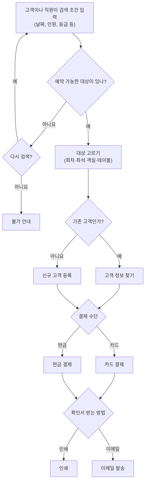
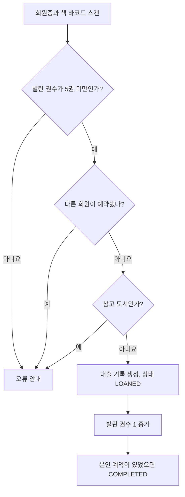
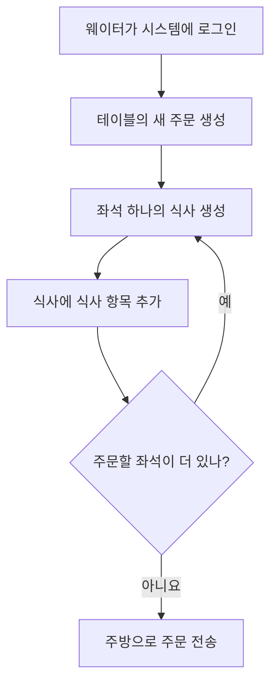

> GitHub 저장소 「[Grokking the Object Oriented Design Interview](https://github.com/tssovi/grokking-the-object-oriented-design-interview)」를 바탕으로 재구성한 노트다.

풀이 순서와 여러 사례에 공통으로 쓰는 부품(계정과 사람, 정의와 인스턴스 분리, Search 인터페이스, 알림·결제)은 [[ood-interview-approach|객체 지향 설계 면접: 풀이 순서와 반복되는 설계 부품]]에 있다. 이 노트는 사례별로 다른 부분만 적는다.

## 예약 시스템의 공통 골격

영화·항공·호텔·식당 예약은 활동 다이어그램이 거의 같다.



취소는 「예약 번호(와 성)로 예약 찾기 → 취소하고 남은 좌석·객실 수 되돌리기 → 환불 가능 기간이면 환불, 아니면 환불 없음 → 취소 내역을 인쇄 또는 이메일로」다. 사례마다 다른 것은 **예약 대상의 계층**, **환불 규칙**, **부가 요금**이다.

| 사례 | 예약 대상 | 상위 계층 | 특이 규칙 |
| --- | --- | --- | --- |
| 도서관 | `BookItem` | `Library` → `Rack` | 5권·10일 한도, 연체료, 대기 예약 |
| 영화 예매 | `ShowSeat` | `City` → `Cinema` → `CinemaHall` → `CinemaHallSeat` | 좌석 중복 예약 금지, 쿠폰 |
| 항공 | `FlightSeat` | `Airline` → `Flight` → `FlightInstance` | 여러 구간 여정, 승객 여럿 |
| 호텔 | `Room` | `Hotel` → `HotelLocation` | 24시간 전 취소 전액 환불, 룸서비스 요금 |
| 식당 | `Table` | `Restaurant` → `Branch` | 좌석별 식사 주문 |
| 렌터카 | `Vehicle` | `CarRentalSystem` → `CarRentalLocation` | 다른 지점 반납, 보험·장비·서비스, 연체료 |

## 도서관 관리 시스템

### 요구 사항

- 회원은 제목, 저자, 주제, 출판일로 책을 검색한다.
- 책마다 고유 번호와 **서가 번호**(실물 위치)가 있다. 같은 책의 사본 한 권 한 권을 **책 항목(book item)** 이라 부르고, 대출과 예약은 항목 단위다.
- 특정 책을 누가 빌렸는지, 특정 회원이 무엇을 빌렸는지 조회한다.
- 한 회원은 **최대 5권**, 한 권을 **최대 10일** 빌린다. 반납일을 넘기면 **연체료**를 걷는다.
- 지금 없는 책은 예약하고, 예약한 책이 돌아오면 알림을 받는다. 반납일을 넘겨도 알림이 간다.
- 책과 회원증에 고유 바코드가 있고, 시스템이 바코드를 읽는다.

### 액터와 유스케이스

| 액터 | 하는 일 |
| --- | --- |
| 사서(Librarian) | 책·책 항목·회원 추가와 수정, 대출·예약·반납 처리 |
| 회원(Member) | 카탈로그 검색, 대출, 예약, 연장, 반납 |
| 시스템 | 연체, 예약 취소 알림 |

유스케이스: 책 추가·삭제·수정, 카탈로그 검색, 회원 가입·탈퇴, 대출, 예약, 연장(다시 빌리기), 반납.

### 핵심 클래스

| 클래스 | 책임과 속성 |
| --- | --- |
| `Library` | 이름, 주소 |
| `Book` | ISBN, 제목, 주제, 출판사, 언어, 쪽수, 저자 목록 |
| `BookItem` (`Book` 상속) | 바코드, 참고 도서 여부(`is_reference_only`), 반납일, 가격, 형식, 상태, 구입일, 출판일, 놓인 서가. **대출 처리(`checkout`)를 맡는다** |
| `Account` ← `Librarian`, `Member` | 사서는 책 항목 추가, 회원 정지·해제. 회원은 가입일과 빌린 권수를 갖고 대출·예약·연장·반납 규칙을 검사한다 |
| `LibraryCard` | 대출·반납할 때 사용자를 식별한다 |
| `BookReservation` | 예약 일자, 상태, 책 항목 바코드, 회원 ID |
| `BookLending` | 대출일, 반납 예정일, 실제 반납일, 바코드, 회원 ID |
| `Catalog` (`Search` 구현) | 제목·저자·주제·출판일 네 개의 색인 |
| `Fine` | 연체료 계산과 징수(실행 예제는 하루 1달러, `FINE_PER_DAY = 1.0`) |
| `Author`, `Rack` | 저자 / 서가 번호와 위치 식별자 |
| `Notification` | 회원 알림 |

| enum | 값 |
| --- | --- |
| `BookFormat` | `HARDCOVER, PAPERBACK, AUDIO_BOOK, EBOOK, NEWSPAPER, MAGAZINE, JOURNAL` |
| `BookStatus` | `AVAILABLE, RESERVED, LOANED, LOST` |
| `ReservationStatus` | `WAITING, PENDING, CANCELED, NONE` (예약자가 빌려 가면 `COMPLETED`로 닫는다) |
| `AccountStatus` | `ACTIVE, CLOSED, CANCELED, BLACKLISTED, NONE` |

### 대출·반납·연장 규칙



| 동작 | 처리 |
| --- | --- |
| 반납 | 오늘이 반납 예정일보다 늦으면 지난 일수만큼 연체료를 걷는다. 대기 예약이 있으면 상태를 `RESERVED`로 두고 예약자에게 알림, 없으면 `AVAILABLE` |
| 연장 | 먼저 연체료를 정산한다. **다른 회원의 예약이 있으면 연장할 수 없다**: 빌린 권수를 줄이고 상태를 `RESERVED`로 바꾸고 예약자에게 알린다. 아니면 새 대출 기록을 만들고 반납일을 오늘 + 10일로 바꾼다 |

권수 한도와 예약 검사는 `Member`가, 참고 도서 검사와 상태 변경은 `BookItem`이 맡는다. 규칙을 그 정보를 가진 객체에 둔 배치다.

## 영화 티켓 예매 시스템

### 요구 사항

- 제휴 영화관이 있는 도시 목록을 보여 준다. 영화관에는 상영관이 여럿이고, **한 상영관은 한 번에 한 회차만** 상영한다. 영화 하나에 회차가 여럿이다.
- 제목, 언어, 장르, 개봉일, 도시로 영화를 검색한다. 영화를 고르면 상영하는 영화관과 회차를, 회차를 고르면 좌석 배치도를 보여 준다.
- 좌석을 여러 개 고르고, 빈 좌석과 팔린 좌석을 구분해 보여 준다.
- 새 영화 개봉, 예매, 취소 때 알림을 보낸다. 카드나 현금으로 결제하고 **할인 쿠폰**을 적용한다.
- **두 고객이 같은 좌석을 예매할 수 없다.**

### 액터와 클래스

| 액터 | 하는 일 |
| --- | --- |
| 관리자 | 영화·회차 추가, 영화·회차 취소, 고객 정지·해제 |
| 매표 직원(FrontDeskOfficer) | 예매·취소 |
| 고객 | 상영표 보기, 예매, 취소 |
| 손님(Guest) | 검색만. 예매하려면 회원 등록 |
| 시스템 | 새 영화, 예매, 취소 알림 |

유스케이스: 영화 검색, 예매 생성·수정·조회, 결제, 쿠폰 적용, 좌석 지정, 환불(허용 기간 안에 취소하면 결제 금액을 돌려준다).

| 클래스 | 책임과 속성 |
| --- | --- |
| `City` → `Cinema` → `CinemaHall` → `CinemaHallSeat` | 도시(이름, 주, 우편번호) / 영화관(이름, 상영관 수, 위치) / 상영관(이름, 좌석 수, 회차) / 상영관 좌석(좌석 ID, 좌석 종류) |
| `Movie` | 제목, 설명, 상영 시간(분), 언어, 개봉일, 국가, 장르, 등록한 관리자, 회차 목록 |
| `Show` | 회차 ID, 시작·종료 시각, 상영관, 영화 |
| `ShowSeat` | **회차 × 상영관 좌석.** 예약 여부, 가격. 예매는 이 객체를 대상으로 한다 |
| `Booking` | 예매 번호, 좌석 수, 상태, 회차, 좌석 목록, 결제. `make_payment()`, `cancel()`, `assign_seats()` |
| `Payment` | 금액, 거래 ID, 상태 |
| `Catalog` | 제목·언어·장르·개봉일·도시 색인 |
| `Person` ← `Customer`, `Admin`, `FrontDeskOfficer` | 사람이 `Account`를 갖는 구조. `Guest`는 `register_account()`만 있다 |

| enum | 값 |
| --- | --- |
| `BookingStatus` | `REQUESTED, PENDING, CONFIRMED, CHECKED_IN, CANCELED, ABANDONED` |
| `SeatType` | `REGULAR, PREMIUM, ACCESSIBLE, SHIPPED, EMERGENCY_EXIT, OTHER` |

예매 흐름은 공통 골격에 **좌석 고르기**와 **쿠폰 입력**이 더해진다. 검색 조건에는 날짜, 좌석 수, 제목·장르·개봉일·언어·도시가 들어간다.

### 같은 좌석의 동시 예매 막기

DB 트랜잭션으로 행을 잠근다. 가장 높은 격리 수준인 `SERIALIZABLE`은 더티 리드, 반복 불가능 읽기, 팬텀 읽기를 모두 막는다. 트랜잭션 안에서 읽은 행에는 쓰기 잠금이 걸려 다른 트랜잭션이 갱신하지 못한다.

```sql
SET TRANSACTION ISOLATION LEVEL SERIALIZABLE;
BEGIN TRANSACTION;
  -- 회차 99의 좌석 54, 55, 56을 잡으려 한다
  SELECT * FROM ShowSeat
   WHERE ShowID = 99 AND ShowSeatID IN (54, 55, 56) AND isReserved = 0;
  -- 돌아온 행이 3개가 아니면 실패를 돌려준다
  UPDATE ShowSeat ...;
  UPDATE Booking ...;
COMMIT TRANSACTION;
```

커밋에 성공하면 그 좌석은 이 고객 것으로 확정되고, 다른 고객은 같은 좌석을 잡을 수 없다. 격리 수준과 이상 현상은 [[transaction|트랜잭션과 회복]]에 있다.

## 항공사 관리 시스템

### 요구 사항

- 날짜와 출발·도착 공항으로 항공편을 검색하고, 예정된 항공편의 표를 예약한다. **여러 구간을 잇는 여정**을 만들 수 있고, 여정 하나에 **승객 여럿**을 예약한다.
- 운항 일정, 출발·도착 시각, 남은 좌석 같은 정보를 조회한다.
- 기체·항공편·운항 일정은 관리자만 추가한다. 관리자가 예정된 항공편을 취소하면 관련된 모두에게 알린다.
- 고객은 예약과 여정을 취소한다. 조종사와 승무원을 항공편에 배정한다. 결제와 알림(예약 생성·변경, 운항 상태 변경)을 처리한다.

### 액터와 클래스

| 액터 | 하는 일 |
| --- | --- |
| 관리자 | 항공편과 일정 추가, 항공편 취소, 직원 관리 |
| 매표 직원 | 예약·취소 |
| 고객 | 일정 보기, 예약, 취소 |
| 조종사·승무원 | 배정된 항공편과 일정 보기 |
| 시스템 | 여정 변경, 운항 상태 알림 |

유스케이스: 항공편 검색, 예약 생성·수정·조회, 승객 좌석 지정, 결제, 운항 일정 변경, 조종사·승무원 배정.

| 클래스 | 책임과 속성 |
| --- | --- |
| `Airline` | 이름, 항공사 코드 |
| `Airport` | 이름, 주소, 고유 코드. 출발·도착 항공편 조회 |
| `Aircraft` | 이름, 모델, 제조 연도, 좌석 목록 |
| `Flight` | 편명, 출발·도착 공항, 소요 시간(분), 주간·임시 일정 목록, 운항 회차 목록 |
| `WeeklySchedule` / `CustomSchedule` | 요일 + 출발 시각 / 특정 날짜 + 출발 시각. **일정 하나가 운항 회차를 만든다** |
| `FlightInstance` | 운항 회차 하나. 출발 시각, 게이트, 상태, 기체. 런던 → 도쿄 BA212편이 주 2회 뜨면 회차 2개다. `cancel()`, `update_status()` |
| `Seat` ← `FlightSeat` | 좌석 번호, 종류, 등급 / 회차별 운임 |
| `FlightReservation` | 예약 번호, 운항 회차, **승객 → 좌석 지도(`seat_map`)**, 생성일, 상태 |
| `Itinerary` | 고객, 출발 공항, 최종 도착 공항, 예약 목록. `make_reservation()`, `make_payment()` |
| `Customer` (`Person` 상속) / `Passenger` | 마일리지 번호를 가진 예약자 / 이름, 여권 번호, 생년월일만 가진 탑승자. 예약자와 탑승자는 다른 사람일 수 있다 |
| `Payment`, `Notification` | Java 예제는 `CreditCardPayment`·`CashPayment`, `EmailNotification`·`SMSNotification` 하위 클래스로 나눈다 |

| enum | 값 |
| --- | --- |
| `FlightStatus` | `ACTIVE, SCHEDULED, DELAYED, DEPARTED, LANDED, IN_AIR, ARRIVED, CANCELLED, DIVERTED, UNKNOWN` |
| `ReservationStatus` | `REQUESTED, PENDING, CONFIRMED, CHECKED_IN, CANCELLED, ABANDONED` |
| `SeatClass` | `ECONOMY, ECONOMY_PLUS, PREFERRED_ECONOMY, BUSINESS, FIRST_CLASS` |
| `SeatType` | `REGULAR, ACCESSIBLE, EMERGENCY_EXIT, EXTRA_LEG_ROOM` |

### 관계와 흐름

이 사례는 UML 클래스 다이어그램 설명의 예제로도 쓰인다.

| 관계 | 예 |
| --- | --- |
| 양방향 연관 + 다중성 | `FlightInstance`에는 조종사가 정확히 2명, 조종사 한 명은 여러 회차를 맡는다. 서로를 안다 |
| 단방향 연관 | `Flight`는 `Aircraft`를 알지만 기체는 항공편을 모른다 |
| 집합 | 기체는 항공사 없이도 존재한다 |
| 합성 | `WeeklySchedule`은 `Flight`에 속해 항공편이 사라지면 함께 사라진다 |
| 일반화 | `Crew`, `Pilot`, `Admin`은 모두 `Person`이다. `Person`과 `Account`는 추상 클래스 |
| 의존 | `FlightReservation`은 `Payment`에 의존한다 |

예약 흐름은 공통 골격에 검색 조건(날짜, 좌석 등급, 승객 수), **승객 정보 입력**, **승객별 좌석 고르기**가 더해진다. Java 예제의 `ReservationService`는 예약 생성 → 승객에게 좌석 배정 → 결제가 성공하면 `CONFIRMED`로 바꾸고 확정 이메일 → 취소하면 취소 이메일 순으로 묶는다. 취소는 성과 예약 번호로 예약을 찾고, 취소하면서 운항 회차의 좌석을 되돌린다.

## 호텔 관리 시스템

### 요구 사항

- 스탠더드, 디럭스, 패밀리 스위트 같은 객실 종류를 예약한다. 손님은 객실 재고를 검색해 빈 방을 예약한다.
- 누가 어느 방을, 어느 고객이 어떤 방들을 예약했는지 조회한다.
- **체크인 24시간 전까지 취소하면 전액 환불**한다.
- 체크인·체크아웃이 다가오면 알림을 보낸다. 객실 청소 기록을 남긴다.
- 룸서비스와 음식, 어메니티를 추가한다. 카드, 수표, 현금으로 결제한다.

### 액터와 클래스

| 액터 | 하는 일 |
| --- | --- |
| 손님(Guest) | 빈 방 검색, 예약 |
| 리셉션 직원 | 객실 추가·수정, 예약 생성, 체크인·체크아웃 |
| 매니저 | 직원 추가 |
| 하우스키퍼 | 객실 청소 기록 추가·수정 |
| 서버(Server) | 룸서비스 기록 추가·수정 |
| 시스템 | 예약·취소 알림 |

유스케이스: 객실 추가·삭제·수정, 객실 검색, 계정 등록·해지, 객실 예약, 체크인, 체크아웃(예약 종료와 객실 키 반납), 객실 요금 추가, 청소 기록 갱신.

| 클래스 | 책임과 속성 |
| --- | --- |
| `Hotel` → `HotelLocation` | 여러 지점을 둔다 |
| `Room` (`Search` 구현) | 객실 번호(고유), 객실 종류, 상태, 예약 가격, 흡연 여부, 키 목록, 청소 기록. `is_room_available()`, `check_in()`, `check_out()`, `search(style, start_date, duration)` |
| `RoomKey` | 키 ID, 바코드, 발급일, 활성 여부, **마스터 키 여부**. 전자 키 카드 |
| `RoomHouseKeeping` | 설명, 시작 시각, 소요 시간, 담당 하우스키퍼 |
| `RoomBooking` | 예약 번호, 시작일, 숙박 일수, 상태, 체크인·체크아웃 시각, 손님, 객실, 청구서, 알림 목록 |
| `RoomCharge` ← `Amenity`, `RoomService`, `KitchenService` | 요금 발생 시각 / 이름·설명 / 유료 여부·요청 시각 / 설명. 각 요금이 청구서 항목을 추가한다 |
| `Invoice` | 객실에 붙은 요금마다 청구 항목을 갖는다 |
| `Person` ← `Guest`, `Receptionist`, `Server` | 투숙 중인 객실 수 / 회원 검색·예약 생성 / 객실 요금 추가 |

| enum | 값 |
| --- | --- |
| `RoomStyle` | `STANDARD, DELUXE, FAMILY_SUITE, BUSINESS_SUITE` |
| `RoomStatus` | `AVAILABLE, RESERVED, OCCUPIED, NOT_AVAILABLE, BEING_SERVICED, OTHER` |
| `BookingStatus` | `REQUESTED, PENDING, CONFIRMED, CHECKED_IN, CHECKED_OUT, CANCELLED, ABANDONED` |
| `AccountType` | `MEMBER, GUEST, MANAGER, RECEPTIONIST` |

체크인은 「리셉션이 예약 검색 → 예약이 있나 → 객실이 준비됐나(아니면 기다려 달라고 안내) → 객실 키 발급 → 예약 상태를 `CHECKED_IN`으로」다. 부가 요금을 `RoomCharge` 하위 클래스로 덧붙이는 구조는 데코레이터처럼 기본 숙박료에 요금을 쌓는다.

## 식당 관리 시스템

### 요구 사항

- 식당에 지점이 여럿 있고, 지점마다 메뉴가 있다. 메뉴는 메뉴 섹션으로, 섹션은 메뉴 항목으로 이뤄진다.
- 웨이터는 테이블의 주문을 만들고 **좌석마다 식사(meal)** 를 추가한다. 식사는 식사 항목 여러 개로 이뤄지고, 식사 항목 하나는 메뉴 항목 하나에 대응한다.
- 바로 들어온 손님(walk-in)에게 내줄 빈 테이블을 조회한다. 리셉션은 날짜·시각으로 빈 테이블을 찾아 예약하고, 고객은 예약을 취소한다.
- 예약 시각이 다가오면 알림을 보낸다. 카드, 수표, 현금으로 결제한다. 지점마다 테이블 배치도가 여러 개일 수 있다.

### 액터와 클래스

| 액터 | 하는 일 |
| --- | --- |
| 리셉션 직원 | 테이블과 배치 추가·수정, 예약 생성·취소 |
| 웨이터 | 주문 받기·수정 |
| 매니저 | 직원 추가, 메뉴 수정 |
| 셰프 | 주문 보기와 조리 |
| 캐셔 | 계산서 발행과 결제 처리 |
| 시스템 | 예약·취소 알림 |

유스케이스: 테이블 추가·수정, 테이블 검색, 주문, 주문 수정(식사·식사 항목 추가·변경), 예약 생성, 예약 취소, 체크인, 결제.

| 클래스 | 책임과 속성 |
| --- | --- |
| `Restaurant` | 이름, 지점 목록. 직원은 식당의 일부다(**합성**): 식당이 비활성화되면 직원도 모두 비활성화된다 |
| `Branch` | 이름, 위치, 주방. 지점마다 직원과 메뉴가 따로다. 테이블 배치도 추가 |
| `Kitchen` | 셰프 목록, `assign_chef()` |
| `TableChart` | 배치도 이미지, 인쇄 |
| `Menu` → `MenuSection` → `MenuItem` | 섹션은 0개 이상, 항목도 0개 이상. 항목은 제목, 설명, 가격 |
| `Table` → `TableSeat` | 테이블 ID, 최대 인원, 위치 식별자, 상태, 좌석 목록. `search(capacity, start_time)` / 좌석 번호와 좌석 종류 |
| `Reservation` | 예약 시각, 인원, 상태, 메모, 체크인 시각, 고객, 테이블 목록, 알림 |
| `Order` → `Meal` → `MealItem` | 주문(상태, 생성 시각, 테이블, 웨이터, 셰프, 계산서) / 좌석 하나의 식사 / 수량과 메뉴 항목 |
| `Bill`(`Check`) | 식사 항목마다 청구 항목 |
| `Employee` ← `Receptionist`, `Manager`, `Chef`, `Waiter`, `Cashier` | 직원 ID, 입사일, 계정. 매니저는 `add_employee()`, 셰프는 `take_order()` |

| enum | 값 |
| --- | --- |
| `ReservationStatus` | `REQUESTED, PENDING, CONFIRMED, CHECKED_IN, CANCELED, ABANDONED` |
| `SeatType` | `REGULAR, KID, ACCESSIBLE, OTHER` |
| `OrderStatus` | `RECEIVED, PREPARING, COMPLETED, CANCELED, NONE` |
| `TableStatus` | `FREE, RESERVED, OCCUPIED, OTHER` |



예약은 「인원과 날짜·시각을 받아 빈 테이블 검색 → 기존 고객 찾기 또는 신규 등록 → 테이블 예약 → 인쇄·이메일로 확인」, 취소는 「예약 검색 → 취소하고 테이블 상태를 `FREE`로」다.

## 렌터카 시스템

### 요구 사항

- 승용차, 트럭, SUV, 밴, 오토바이를 빌려준다. 차량마다 고유 바코드와 **주차 칸 번호**(위치)가 있고, 시스템이 바코드를 읽는다.
- 누가 어느 차를, 어느 회원이 어떤 차들을 빌렸는지 조회한다.
- 반납일을 넘기면 **연체료**를 걷는다. 회원은 재고를 검색해 예약하고, 예약을 취소한다.
- 인수일이 다가올 때, 반납일이 다가올 때, 반납일을 넘겼을 때 알림을 보낸다.
- 차량에 일어난 모든 사건을 차량 로그로 남긴다.
- 회원은 **렌터카 보험**, **추가 장비**(내비게이션, 카시트, 스키 랙), **추가 서비스**(긴급 출동, 추가 운전자, 와이파이)를 예약에 붙인다.
- 지점이 여러 곳이라 **빌린 곳과 다른 지점에 반납**할 수 있다.

### 액터와 클래스

| 액터 | 하는 일 |
| --- | --- |
| 리셉션 직원 | 차량과 직원 추가·수정, 차량 예약 |
| 회원 | 카탈로그 검색, 예약, 인수, 반납 |
| 작업자(Worker) | 반납된 차량 관리, 차량 로그 갱신 |
| 시스템 | 연체, 예약 취소 알림 |

유스케이스: 차량 추가·삭제·수정, 카탈로그 검색(차종·재고 여부), 회원 가입·탈퇴, 예약, 인수(대여 시작), 반납, 장비 추가, 차량 로그 갱신(주유, 세차, 파손).

| 클래스 | 책임과 속성 |
| --- | --- |
| `CarRentalSystem` → `CarRentalLocation` | 회사와 지점(이름, 주소) |
| `Vehicle` ← `Car`, `Van`, `Truck`, `SUV`, `Motorcycle` | 번호판, 재고 번호, 승차 인원, 바코드, 선루프 여부, 상태, 모델, 제조사, 연식, 주행 거리, 로그. `reserve_vehicle()`, `return_vehicle()`. `Car`는 `CarType`, `Van`은 `VanType`을 갖는다 |
| `VehicleLog` | 로그 종류, 설명, 생성일. 종류별 검색 |
| `VehicleReservation` | 예약 번호, 상태, 반납 예정일, 실제 반납일, **인수 지점·반납 지점**, 고객, 차량, 청구서, 추가 운전자, 알림, 보험, 장비, 서비스 목록. 예약과 반납 처리를 맡는다 |
| `AdditionalDriver` | 운전자 ID와 `Person`. 계정 없는 사람이다 |
| `RentalInsurance`, `Equipment`, `Service` | 예약에 붙는 보험, 장비, 서비스 |
| `Bill` | 예약의 요금마다 청구 항목(`BillItemType`) |
| `VehicleInventory` (`Search` 구현) | 차종, 모델 색인 |
| `Account` ← `Member`, `Receptionist` | 예약한 차량 수 / 입사일과 회원 검색 |

| enum | 값 |
| --- | --- |
| `VehicleStatus` | `AVAILABLE, RESERVED, LOANED, LOST, BEING_SERVICED, OTHER` |
| `ReservationStatus` | `ACTIVE, PENDING, CONFIRMED, COMPLETED, CANCELLED, NONE` |
| `CarType` | `ECONOMY, COMPACT, INTERMEDIATE, STANDARD, FULL_SIZE, PREMIUM, LUXURY` |
| `VanType` | `PASSENGER, CARGO` |
| `VehicleLogType` | `ACCIDENT, FUELING, CLEANING_SERVICE, OIL_CHANGE, REPAIR, OTHER` |
| `BillItemType` | `BASE_CHARGE, ADDITIONAL_SERVICE, FINE, OTHER` |

| 흐름 | 단계 |
| --- | --- |
| 인수 | 운전면허 바코드를 스캔하거나 이름으로 고객 검색 → 차량 바코드 스캔 → 확인 실패면 오류 → 차량 상태 `LOANED` → 그 차에 대한 고객의 예약을 `COMPLETED` → 인수 알림 |
| 반납 | 차량 바코드 스캔 → 차량 정보 조회 → 반납 거래 생성 → 반납일 초과 같은 조건마다 벌금을 계산해 청구서에 추가 → 청구 거래 → 차량 상태 갱신 → 차량 로그 갱신 → 반납 알림 |

## 정리

- 예약 계열은 「검색 → 대상 고르기 → 고객 확인 → 결제 → 확인서」와 「찾기 → 취소 → 환불 판단」 두 흐름이 공통이고, 차이는 대상 계층과 규칙이다.
- 예약은 언제나 **인스턴스**(책 항목, 회차 좌석, 운항 회차 좌석, 객실, 테이블, 차량)를 대상으로 한다.
- 숫자 규칙(5권·10일, 24시간 전 환불)은 상수로 두고, 그 규칙을 검사하는 책임은 정보를 가진 객체에 준다.
- 동시 예약은 객체 설계만으로 막지 못한다. DB 트랜잭션과 잠금까지 말해야 답이 끝난다.

관련 노트: [[ood-interview-approach|객체 지향 설계 면접: 풀이 순서와 반복되는 설계 부품]], [[ood-machines-and-games|객체 지향 설계 사례: 주차장·ATM과 카드·보드 게임]], [[ood-platform-systems|객체 지향 설계 사례: 커머스·커뮤니티·플랫폼]], [[transaction|트랜잭션과 회복]], [[software-engineering|소프트웨어 설계와 공학]]
