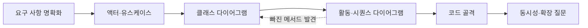

> GitHub 저장소 「[Grokking the Object Oriented Design Interview](https://github.com/tssovi/grokking-the-object-oriented-design-interview)」를 바탕으로 재구성한 노트다.

## 객체 지향 설계 면접이란

객체 지향 설계(OOD, Object-Oriented Design) 면접은 「주차장을 설계하라」, 「도서관 관리 시스템을 설계하라」처럼 하나의 시스템을 주고 **클래스, 책임, 관계**로 풀어 내게 하는 면접이다. 서버 몇 대, 샤딩, 캐시를 묻는 [[tech-interview-prep#시스템 디자인 면접 7단계|시스템 디자인 면접]]과 달리 한 프로세스 안의 객체 구조를 본다.

- **실행되는 완성 코드는 요구하지 않는다.** DB 저장, 결제 대행사 연동처럼 설계와 상관없는 부분은 「있다고 가정한다」고 말하고 넘어간다. 보는 것은 클래스 이름, 속성, 핵심 메서드, 관계다.
- 객체 지향 분석·설계(OOAD)는 네 단계로 요약된다. **시스템을 이루는 객체를 찾고 → 객체 사이 관계를 정하고 → 객체마다 인터페이스(공개 메서드)를 정하고 → 객체 지향 언어로 옮길 수 있는 설계로 만든다.** 이 과정을 기록하는 표준 표기가 UML이다. UML 표기와 다이어그램을 그리는 순서는 [[software-engineering#UML로 하는 객체지향 분석·설계|소프트웨어 설계와 공학]]에 있다.

## 풀이 순서



| 단계 | 할 일 | 예 |
| --- | --- | --- |
| 1. 요구 사항 명확화 | **면접 첫머리에 범위부터 묻는다.** 면접관이 머릿속에 둔 범위를 질문으로 확인하고, 합의한 요구를 번호 붙인 목록으로 적는다. 숫자로 된 규칙(한도, 기한, 요금)을 끌어낸다 | 도서관: 한 사람당 최대 5권, 최대 10일, 연체료 부과. 주차장: 첫 시간 4달러, 2~3시간째 3.5달러, 그 뒤 2.5달러 |
| 2. 액터·유스케이스 | 시스템 바깥의 역할(사람, 외부 시스템, 시간·알림을 맡는 `System`)과 역할별 기능을 뽑는다. 작성법은 [[use-case-diagram\|유스케이스 다이어그램]] | 도서관: 사서·회원·시스템 / 대출·예약·연장·반납 |
| 3. 클래스 다이어그램 | 명사에서 클래스 후보를 뽑고 책임과 관계(상속, 합성, 연관, 다중성)를 정한다. 책임을 고르는 기준은 [[responsibility-driven-design\|책임 주도 설계]] | `Book`과 `BookItem`, `BookLending`, `Fine` |
| 4. 활동·시퀀스 | 핵심 유스케이스 한두 개의 흐름을 그린다. 활동 다이어그램은 분기와 반복이 많은 업무 흐름, 시퀀스 다이어그램은 객체 사이 메시지 순서에 쓴다 | 대출 흐름, ATM 잔액 조회 메시지 |
| 5. 코드 골격 | enum과 상수 → 사람·계정 계층 → 핵심 엔티티 → 핵심 유스케이스 메서드 순으로 쓴다. 메서드 본문은 핵심 규칙만 채운다 | `Member.checkout_book_item()`에 한도·예약 검사만 넣는다 |
| 6. 동시성·확장 | 「두 사람이 같은 좌석을 동시에 잡으면?」, 「차종이 늘면?」 같은 후속 질문에 답한다 | 좌석 예약 트랜잭션, 새 하위 클래스 추가 |

예외 상황(재고 없음, 결제 실패, 한도 초과)은 3~5단계를 오가며 빠짐없이 짚는다. 활동 다이어그램을 그리다 클래스에 없던 메서드가 나오면 클래스 다이어그램으로 돌아가 고친다.

- **숫자 규칙은 상수로 두고, 그 규칙을 검사하는 책임은 판단에 필요한 정보를 가진 객체에 준다.** 도서관에서 권수 한도와 예약 검사는 빌린 권수를 아는 `Member`가, 참고 도서 여부와 상태 변경은 `BookItem`이 맡는다.
- 게임처럼 규칙이 곧 도메인인 문제는 **규칙을 숫자와 조건으로 끝까지 적어 두는 것**이 설계의 절반이다(블랙잭 딜러는 16 이하면 히트, 17 이상이면 스탠드, 블랙잭 3:2, 보험은 앤티의 절반). 표로 먼저 정리한 규칙은 그대로 데이터나 하위 클래스로 옮겨진다.

## 문제 유형별 출발점

| 유형 | 사례 | 설계의 출발점 |
| --- | --- | --- |
| 예약·대여 | 도서관, 영화, 항공, 호텔, 식당, 렌터카 | 흐름이 거의 같다. 예약은 「검색 → 대상(회차 좌석, 객실, 테이블, 차량) 고르기 → 기존 고객 찾기 또는 신규 등록 → 결제 → 확인서 인쇄·이메일」, 취소는 「예약 번호로 찾기 → 취소하고 남은 수량 되돌리기 → 환불 기간이면 환불 → 취소 내역 발송」이다. 사례마다 다른 것은 **예약 대상의 계층, 환불 규칙, 부가 요금**뿐이고, 예약 대상은 언제나 인스턴스다 |
| 시설·장치 | 주차장, ATM | **하드웨어 부품 하나를 클래스 하나로**(입구·출구 패널, 표시판, 카드 리더, 키패드, 현금 인출기, 입금구) 옮기고, 부품을 소유하는 상위 객체(`ParkingLot`, `ATM`)를 둔다. 여러 부품이 공유하는 상태는 한곳에서 관리한다 |
| 게임 | 블랙잭, 체스 | 규칙 표가 먼저다. 말·카드마다 다른 규칙은 다형성으로 나눠 분기문을 없앤다. 수를 둘 때는 **복사본에서 먼저 둬 보고** 결과 상태가 규칙을 어기는지(체스에서 자기 킹이 위협받는지) 확인한 뒤 진짜 상태에 반영한다 |
| 커머스·커뮤니티·플랫폼 | 쇼핑몰, Stack Overflow, 증권, LinkedIn, Facebook, Cricinfo, Uber | 사용자끼리 상호작용하는 서비스라 **역할 계층**(손님 → 회원 → 운영자·관리자), **콘텐츠 객체**(상품, 질문·답변·댓글, 글·메시지), 검색 색인, 알림이 뼈대다. 외부 시스템(거래소, 결제)과의 경계는 싱글턴 창구 하나와 콜백으로 감싼다 |

## 사례에 되풀이해 나오는 설계 부품

17개 사례를 나란히 놓으면 같은 모양이 반복된다. 이 부품을 먼저 익혀 두면 처음 보는 문제도 절반은 조립으로 끝난다.

### 계정과 사람

| 부품 | 모양 | 쓰인 곳 |
| --- | --- | --- |
| `Account` | 로그인 정보와 상태: `id`, `password`, `status`, `reset_password()` | 거의 모든 사례 |
| `Person` | 연락처: `name`, `address`, `email`, `phone` | 거의 모든 사례 |
| `Address` | 거리·도시·주·우편번호·국가를 묶은 값 객체 | 모든 사례 |
| 역할 하위 클래스 | 역할마다 할 수 있는 일이 다르면 하위 클래스로 나눈다 | `Librarian`·`Member`, `Admin`·`ParkingAttendant`, `Receptionist`·`Chef` |
| `Guest` | 계정 없이 검색·조회만 한다. 구매·예약·글쓰기는 회원 등록 뒤에 된다 | 쇼핑몰, Stack Overflow, 영화 예매 |

역할 계층을 잇는 방식은 세 가지다.

| 방식 | 구조 | 쓰인 곳 |
| --- | --- | --- |
| 계정 상속 | `Account` ← `Librarian`, `Member`. 계정 자체가 역할이다 | 도서관, 주차장, 렌터카, 증권 |
| 사람 상속 + 계정 보유 | `Person` ← `Customer`, `Admin`이고 `Person`이 `Account`를 필드로 갖는다 | 영화 예매, 항공, 호텔, LinkedIn, Facebook |
| 역할이 계정을 감쌈 | `Member`가 `Account`를 갖고, `Admin`·`Moderator`가 `Member`를 상속한다 | Stack Overflow |

로그인 정보와 사람 정보를 나누면 한 사람이 여러 역할을 갖거나, 계정 없는 사람(항공의 `Passenger`, 렌터카의 `AdditionalDriver`)을 같은 `Person`으로 다룰 수 있다.

`AccountStatus`는 사례마다 값이 조금씩 다르다. `ACTIVE, BLOCKED, BANNED, COMPROMISED, ARCHIVED, UNKNOWN`(주차장·LinkedIn)과 `ACTIVE, CLOSED, CANCELED, BLACKLISTED, BLOCKED`(Stack Overflow)가 대표적이다.

### 정의와 인스턴스 분리

**「무엇인가」와 「실제 한 개」를 다른 클래스로 둔다.** 예약·대여·재고는 늘 인스턴스를 대상으로 한다.

| 정의(종류) | 인스턴스(실물·회차) | 나누는 이유 |
| --- | --- | --- |
| `Book` (ISBN, 제목, 저자) | `BookItem` (바코드, 상태, 반납일, 서가) | 같은 책이 여러 권 있고 대출은 한 권 단위다 |
| `Product` (이름, 가격, 분류) | `Item` (수량) | 펜이라는 상품과 재고 펜 10개는 다르다 |
| `Flight` (편명 BA212, 출발·도착 공항) | `FlightInstance` (출발 시각, 게이트, 상태, 기체) | 주 2회 운항하면 회차마다 좌석과 상태가 따로다 |
| `CinemaHallSeat` (상영관 좌석) | `ShowSeat` (회차별 좌석, 예약 여부, 가격) | 같은 좌석도 회차마다 팔린다 |
| `Seat` (좌석 번호, 종류, 등급) | `FlightSeat` (운임) | 운임은 회차마다 다르다 |
| `MenuItem` (메뉴, 가격) | `MealItem` (수량) | 주문은 메뉴를 참조하는 수량이다 |
| `Stock` (종목) | `StockLot` (언제 몇 주 샀나) | 판매할 때 어떤 묶음을 팔지 고른다 |

### 상태 enum과 이력 로그

엔티티마다 `status` 필드와 enum을 둔다. 매직 넘버·문자열 대신 이름 붙은 상태를 쓰면 허용 값이 코드에 드러난다.

| enum | 값 | 쓰인 곳 |
| --- | --- | --- |
| `PaymentStatus` | `UNPAID, PENDING, COMPLETED, FILLED, DECLINED, CANCELLED, ABANDONED, SETTLING, SETTLED, REFUNDED` | 쇼핑몰, 영화, 항공, 호텔, 식당, 렌터카 |
| 예약 상태 | `REQUESTED, PENDING, CONFIRMED, CHECKED_IN, CANCELED, ABANDONED` (호텔은 `CHECKED_OUT` 추가) | 영화, 항공, 호텔, 식당 |
| 물건 상태 | `AVAILABLE, RESERVED, LOANED, LOST` (렌터카는 `BEING_SERVICED`, `OTHER` 추가) | 도서관, 렌터카 |

상태가 바뀐 기록은 별도 로그 클래스로 남긴다. `OrderLog`·`ShipmentLog`(쇼핑몰), `VehicleLog`(렌터카), `RoomHouseKeeping`(호텔), 게임의 수 기록이 그렇다.

**아직 확정되지 않은 값은 확정된 값과 따로 둔다.** ATM 입금은 수표 확인과 은행 승인을 거쳐야 하므로 계좌가 총잔액(`total_balance`)과 인출 가능 잔액(`available_balance`)을 따로 갖고, 증권 계좌도 총자금과 거래 가능 자금을 나눈다.

### 검색: Search 인터페이스와 색인

검색 기준을 메서드로 모은 `Search` 인터페이스를 두고, 카탈로그·색인 클래스가 **기준별 해시맵**(제목 → 책 목록)으로 구현한다.

| 사례 | 구현 클래스 | 검색 기준 |
| --- | --- | --- |
| 도서관 | `Catalog` | 제목, 저자, 주제, 출판일 |
| 쇼핑몰 | `Catalog` | 상품명, 분류 |
| 영화 예매 | `Catalog` | 제목, 언어, 장르, 개봉일, 도시 |
| 렌터카 | `VehicleInventory` | 차종, 모델 |
| LinkedIn | `SearchIndex` | 회원 이름, 회사 이름, 채용 공고 제목 |
| Facebook | `SearchIndex` | 회원·그룹·페이지 이름, 게시물 단어 |
| 호텔·식당 | `Room.search(style, start_date, duration)`, `Table.search(capacity, start_time)` | 객실 종류·기간, 인원·시각 |

### 알림, 결제, 청구, 조직

| 부품 | 모양 | 쓰인 곳 |
| --- | --- | --- |
| `Notification` | `System` 액터의 일을 맡는다. 이메일·SMS·푸시 같은 채널은 하위 클래스(`EmailNotification`, `SMSNotification`) | 예약 확정·취소, 연체, 배송, 새 메시지 |
| `Payment` | 금액, 거래 ID, 상태. 수단은 하위 클래스(`CreditCardPayment`, `CashPayment`, 수표, 계좌 이체) | 결제가 있는 모든 사례 |
| 청구서 | `Bill`·`Invoice`가 항목(`BillItem`)을 모은다. 렌터카는 `BillItemType`(`BASE_CHARGE, ADDITIONAL_SERVICE, FINE, OTHER`)으로 항목을 나눈다 | 식당, 호텔, 렌터카 |
| 최상위 조직 + 지점 | 회사 클래스가 지점 목록을 갖는다 | `Hotel`·`HotelLocation`, `Restaurant`·`Branch`, `CarRentalSystem`·`CarRentalLocation`, `City`·`Cinema` |
| 상수 | 한도와 기한을 상수로 모은다 | `MAX_BOOKS_ISSUED_TO_A_USER = 5`, `MAX_LENDING_DAYS = 10`, `MONEY_TRANSFER_LIMIT = 100000` |
| 값의 단일 출처 | 외부에서 오는 값을 한 클래스가 받아 보관하고, 다른 구성 요소는 거기서만 읽는다 | 증권의 `StockInventory`(시세), `StockExchange`(거래소 창구) |

### 동시성

| 문제 | 해법 | 사례 |
| --- | --- | --- |
| 두 고객이 같은 좌석을 잡는다 | 트랜잭션 안에서 빈 좌석을 확인하고 갱신한다 | 영화 예매 |
| 여러 입구가 동시에 티켓을 발급한다 | 만차 판정부터 발급까지를 락으로 감싼다 | 주차장 |
| 한 기사가 두 호출에 배정된다 | 매칭 구간에 락, 위치 갱신은 큐로 받는다 | Uber |

공통점은 **「확인하고 나서 바꾸기(check-then-act)」를 한 덩어리로 만든다**는 것이다. 확인과 변경 사이에 틈이 있으면 두 요청이 같은 마지막 자원을 함께 빈 것으로 보고 둘 다 가져간다. 동시 예약은 객체 설계만으로 막지 못하므로, 프로세스 안이면 락, 여러 서버가 DB를 공유하면 DB 트랜잭션과 잠금까지 말해야 답이 끝난다.

## 사례로 보는 패턴

사례마다 요구 사항·클래스 전체를 외울 필요는 없다. 어떤 설계 결정을 보여 주는 사례인지만 잡아 두고, 면접에서는 위의 부품으로 다시 조립한다.

| 사례 | 핵심 엔티티 | 드러나는 설계 포인트 |
| --- | --- | --- |
| 도서관 | `Book`·`BookItem`, `BookLending`, `BookReservation`, `Fine` | 정의와 인스턴스 분리의 기본형. 5권·10일 한도는 `Member`, 참고 도서 검사는 `BookItem`이 맡는다. 다른 회원의 예약이 있으면 연장할 수 없고, 반납 때 대기 예약자에게 알린다(옵저버) |
| 영화 예매 | `City` → `Cinema` → `CinemaHall`, `Show`, `ShowSeat`, `Booking` | 회차 × 좌석(`ShowSeat`)이 예약 단위다. 같은 좌석 중복 예매는 트랜잭션으로 막는다. 아래 대표 사례 |
| 항공 | `Flight`·`FlightInstance`, `WeeklySchedule`, `FlightReservation`, `Itinerary` | 일정이 운항 회차를 만든다. 여정이 여러 구간 예약을 묶는다(컴포지트). 예약자(`Customer`)와 탑승자(`Passenger`)가 다를 수 있고, 예약이 승객 → 좌석 맵을 갖는다 |
| 호텔 | `Room`, `RoomBooking`, `RoomKey`, `RoomCharge` ← `Amenity`·`RoomService`, `Invoice` | 부가 요금을 하위 클래스로 쌓아 청구 항목에 더한다(데코레이터에 가깝다). 24시간 전 취소 전액 환불 같은 환불 규칙은 상수로 둔다 |
| 식당 | `Menu` → `MenuSection` → `MenuItem`, `Table`, `Order` → `Meal` → `MealItem` | 주문을 좌석별 식사로 쪼개는 계층. 직원은 식당의 합성 부분이라 식당이 비활성화되면 함께 비활성화된다 |
| 렌터카 | `Vehicle` ← 차종들, `VehicleReservation`, `VehicleLog`, 보험·장비·서비스 | 예약이 인수 지점과 반납 지점을 따로 가져 다른 지점 반납을 허용한다. 부가 서비스를 예약에 붙이고, 차량의 모든 사건(주유, 세차, 사고)을 로그로 남긴다 |
| 주차장 | `ParkingLot`, `ParkingFloor`, `ParkingSpot` ← 자리 종류, `ParkingTicket`, 입구·출구 패널 | 싱글턴, 차종별 자리 배정 규칙, 락으로 지키는 주차권 발급. 아래 대표 사례 |
| ATM | `ATM`, `CardReader`·`Keypad`·`CashDispenser`·`DepositSlot`, `Bank`, `Transaction` ← 조회·입금·인출·이체 | 하드웨어 부품마다 클래스. 거래를 객체로 만든 커맨드 계층, 실제 계좌를 가진 은행 앞에서 요청을 받는 프록시. 한 번에 한 세션, 카드는 세션 끝까지 보관, 입금은 확인 전까지 가용 잔액에 넣지 않는다 |
| 블랙잭 | `Card` ← `BlackjackCard`, `Deck`, `Shoe`, `Hand`, `Player`·`Dealer` | 게임 점수는 하위 카드 클래스가 정한다(그림 카드 10점). `Hand`는 에이스마다 1과 11로 갈라 가능한 합계를 모두 만든 뒤 21 이하 최댓값을 고른다. 셔플은 피셔-예이츠 |
| 체스 | `Board`, `Box`, `Piece` ← 말 여섯 종류, `Move`, `PieceFactory` | 말마다 이동 규칙을 하위 클래스로(전략·다형성). 직선으로 미끄러지는 말(퀸·룩·비숍)과 정해진 칸만 보는 말(킹·나이트·폰)로 탐색을 묶는다. 복사본에서 둬 보고 자기 킹이 위협받으면 불법 수다. 무르기 없음, 모든 수 기록 |
| 쇼핑몰 | `Product`·`Item`, `ShoppingCart`, `Order`, `OrderLog`, `Shipment`, `ShipmentLog` | 장바구니를 `Customer`에 둬서 손님도 쓸 수 있다. 발송 전 주문만 취소한다(상태). 주문·배송 이력은 로그 클래스로 |
| Stack Overflow | `Question`·`Answer`·`Comment`, `Tag`, `Bounty`, `Badge`, `Member` ← `Moderator` | 평판에 따라 권한(태그 생성 등)이 열린다. 질문 종료 사유를 enum으로, 태그는 일간·주간 사용 빈도를 들고 있어 인기 태그를 계산한다 |
| 온라인 증권 | `StockExchange`, `StockInventory`, `Order` ← 시장가·지정가·스톱 주문, `OrderPart`, `StockLot` | 거래소 창구는 싱글턴, 체결 결과는 거래소 콜백으로 받는다. 주문 하나가 여러 부분 체결(`OrderPart`)로 나뉜다. 주문 유효 기간을 enum으로 둔다(스톱 주문 동작은 [[backend-latency-optimization\|백엔드 지연 시간 최적화]]) |
| LinkedIn | `Member`, `Profile` → 경력·학력·기술, `Company`·`JobPosting`, `SearchIndex` | 프로필을 항목별 클래스로 쪼갠다. 검색 색인은 이름 → 목록 맵이라 동명이인을 덧붙인다 |
| Facebook | `Member`, `ConnectionInvitation`, `Page`, `PrivacyList`, `SearchIndex` | 공개 범위 목록을 글과 연결해 보이는 사람을 정한다. 연결 추천은 나에서 깊이 2까지 BFS를 돌며 친구의 친구를 공통 친구 수로 센다([[graph-basics\|그래프의 기본]]) |
| Cricinfo | `Tournament`, `Match` ← ODI·T20·Test, `Innings` → `Over` → `Ball`, `Run`, `Wicket` | 공 하나까지 내려가는 깊은 합성 계층. 경기 형식은 추상 `Match`의 하위 클래스로, 통계 질의는 별도 `StatQuery` 객체로 |
| Uber | `Rider`·`Driver`, `Ride`, `Location`, `UberSystem` | 운행 상태 기계(`REQUESTED → ACCEPTED → ARRIVED → STARTED → COMPLETED`, 취소 분기)와 기사 상태 가드(`AVAILABLE`일 때만 수락). 거리는 하버사인 공식, 근처 기사 찾기는 실제로는 공간 색인([[location-based-service\|위치 기반 서비스 설계]]) |

## 대표 사례 1: 주차장

싱글턴, 규칙 표에서 나온 전략, 락이 한 사례에 다 나온다.

**요구 사항 요지**: 여러 층과 여러 입구·출구, 입구에서 주차권 발급, 출구의 무인 정산 패널이나 주차 요원 또는 층별 안내 포털에서 정산, 최대 수용량 초과 금지(만차면 입구 패널과 표시판에 안내), 자리 종류(소형, 대형, 장애인, 오토바이, 전기차), 층별 표시판, 시간제 요금(첫 시간 4달러, 둘째·셋째 시간 3.5달러, 그 뒤 시간당 2.5달러. 5시간이면 4 + 3.5 × 2 + 2.5 × 2 = 16달러).

| 클래스 | 책임 |
| --- | --- |
| `ParkingLot` | **싱글턴.** 요금표, 종류별 현재·최대 자리 수, 입구·출구 패널, 층 목록, 활성 주차권(번호 → 티켓), 락 |
| `ParkingFloor` | 종류별 자리 맵, 표시판, 안내 포털. 차 배정과 자리 비우기 |
| `ParkingSpot` ← `CompactSpot`, `LargeSpot`, `HandicappedSpot`, `MotorbikeSpot`, `ElectricSpot` | 빈 자리 여부, 주차한 차. `assign_vehicle()`, `remove_vehicle()` |
| `Vehicle` ← `Car`, `Truck`, `Van`, `Motorcycle`, `Electric` | 차종과 받은 주차권 |
| `ParkingTicket`, `ParkingRate`, `Payment` | 주차권 / 시간대별 금액 / 카드·현금 결제 |
| `EntrancePanel`, `ExitPanel`, `ParkingDisplayBoard`, `CustomerInfoPortal`, `ElectricPanel` | 부품마다 클래스 하나: 발권, 정산, 빈 자리 표시, 층에서 미리 정산, 전기차 충전 |
| `Account` ← `Admin`, `ParkingAttendant` | 관리자는 층·자리·패널 추가, 요원은 주차권 처리 |

차종별 자리 배정 규칙은 트럭·밴은 대형만, 오토바이는 오토바이 자리만, 승용차는 소형 → 대형, 전기차는 전기차 → 소형 → 대형 순이다. 만차 판정도 같은 규칙을 따라, 승용차는 「소형 + 대형」이 모두 찼는지를 본다. 규칙을 표(데이터)로 두면 차종이 늘어도 발급 코드는 그대로다.

```python
import itertools
import threading
from dataclasses import dataclass
from enum import Enum


class VehicleType(Enum):
    CAR = "car"
    TRUCK = "truck"
    VAN = "van"
    MOTORBIKE = "motorbike"
    ELECTRIC = "electric"


class SpotType(Enum):
    COMPACT = "compact"
    LARGE = "large"
    MOTORBIKE = "motorbike"
    ELECTRIC = "electric"


# 차종별로 세울 수 있는 자리를 배정 순서대로 적는다. 규칙이 바뀌면 이 표만 고친다
ALLOWED_SPOTS = {
    VehicleType.TRUCK: [SpotType.LARGE],
    VehicleType.VAN: [SpotType.LARGE],
    VehicleType.MOTORBIKE: [SpotType.MOTORBIKE],
    VehicleType.CAR: [SpotType.COMPACT, SpotType.LARGE],
    VehicleType.ELECTRIC: [SpotType.ELECTRIC, SpotType.COMPACT, SpotType.LARGE],
}


class ParkingFullError(Exception):
    pass


@dataclass
class ParkingTicket:
    number: int
    vehicle_type: VehicleType
    spot_type: SpotType


class ParkingLot:
    _instance = None
    _instance_lock = threading.Lock()

    def __new__(cls, capacity=None):
        with cls._instance_lock:  # 싱글턴: 두 스레드가 동시에 처음 만들어도 하나만 생긴다
            if cls._instance is None:
                lot = super().__new__(cls)
                lot._capacity = dict(capacity)
                lot._used = {spot: 0 for spot in capacity}
                lot._active = {}
                lot._numbers = itertools.count(1)
                lot._lock = threading.Lock()
                cls._instance = lot
        return cls._instance

    def get_new_parking_ticket(self, vehicle_type):
        with self._lock:  # 만차 판정부터 발급까지 한 구간으로 묶는다
            for spot_type in ALLOWED_SPOTS[vehicle_type]:
                if self._used[spot_type] < self._capacity[spot_type]:
                    break
            else:
                raise ParkingFullError(vehicle_type.value)
            ticket = ParkingTicket(next(self._numbers), vehicle_type, spot_type)
            # 실제 구현은 여기서 DB에 저장하고, 저장이 성공한 뒤에만 자리 수를 늘린다
            self._used[spot_type] += 1
            self._active[ticket.number] = ticket
            return ticket


lot = ParkingLot({SpotType.COMPACT: 1, SpotType.LARGE: 1, SpotType.MOTORBIKE: 0, SpotType.ELECTRIC: 0})
print(lot.get_new_parking_ticket(VehicleType.CAR).spot_type)       # SpotType.COMPACT
print(lot.get_new_parking_ticket(VehicleType.ELECTRIC).spot_type)  # SpotType.LARGE
print(ParkingLot() is lot)                                          # True
```

- **입구 패널이 여럿이라 만차 판정부터 발급까지를 락 하나로 감싼다.** 락 밖에서 판정하면 두 패널이 마지막 한 자리를 함께 빈 자리로 보고 둘 다 발급한다.
- 싱글턴을 초기화할 때 DB에서 요금표, 층별 자리 수, 활성 주차권(현재 자리 수 복원), 패널 목록을 읽는다. 차를 배정한 자리가 표시판에 떠 있던 빈 자리면 같은 종류의 다른 빈 자리로 표시판을 갱신한다.
- 출구 정산은 「주차권 스캔 → 요금 계산과 표시 → 카드 결제 → 실패면 다시 요청, 성공이면 영수증 여부 → 차단기 열기」다.

## 대표 사례 2: 영화 예매

정의와 인스턴스 분리, 그리고 객체 설계 바깥(DB)에서 막아야 하는 예약 충돌을 보여 준다.

**요구 사항 요지**: 제휴 영화관이 있는 도시 목록, 영화관마다 상영관 여럿, 한 상영관은 한 번에 한 회차만 상영, 제목·언어·장르·개봉일·도시로 검색, 회차를 고르면 좌석 배치도, 좌석 여러 개 선택, 카드·현금 결제와 할인 쿠폰, 개봉·예매·취소 알림, **두 고객이 같은 좌석을 예매할 수 없다.**

| 클래스 | 책임 |
| --- | --- |
| `City` → `Cinema` → `CinemaHall` → `CinemaHallSeat` | 장소 계층. 상영관 좌석은 좌석 종류(`REGULAR, PREMIUM, ACCESSIBLE, EMERGENCY_EXIT` 등)를 갖는다 |
| `Movie`, `Show` | 영화와 회차(시작·종료 시각, 상영관) |
| `ShowSeat` | **회차 × 상영관 좌석.** 예약 여부, 가격. 예매는 이 객체를 대상으로 한다 |
| `Booking` | 예매 번호, 상태(`REQUESTED, PENDING, CONFIRMED, CHECKED_IN, CANCELED, ABANDONED`), 회차, 좌석 목록, 결제. `make_payment()`, `cancel()`, `assign_seats()` |
| `Catalog` (`Search` 구현) | 제목·언어·장르·개봉일·도시 색인 |
| `Person` ← `Customer`, `Admin`, `FrontDeskOfficer`, `Guest` | 사람이 `Account`를 갖는 구조. `Guest`는 검색과 `register_account()`만 한다 |

같은 좌석의 동시 예매는 DB 트랜잭션으로 막는다. 가장 높은 격리 수준인 `SERIALIZABLE`은 결과가 트랜잭션을 하나씩 차례로 실행한 것과 같음을 보장하지만, 구현은 DB마다 다르다. 잠금 기반 구현(SQL Server, MySQL InnoDB)은 읽은 행과 범위에 공유 잠금을 걸어 다른 트랜잭션의 갱신을 기다리게 한다. PostgreSQL은 잠그지 않고 충돌을 감지해 한쪽을 직렬화 실패로 중단시키므로 **재시도 경로가 있어야 한다.** 아래는 PostgreSQL 문법이다.

```sql
BEGIN TRANSACTION ISOLATION LEVEL SERIALIZABLE;

-- 회차 99의 좌석 54, 55, 56이 모두 비었는지 확인한다. 3행이 아니면 ROLLBACK
SELECT show_seat_id FROM show_seat
 WHERE show_id = 99 AND show_seat_id IN (54, 55, 56) AND is_reserved = false;

INSERT INTO booking (booking_id, show_id, status) VALUES (7001, 99, 'PENDING');
UPDATE show_seat SET is_reserved = true, booking_id = 7001
 WHERE show_id = 99 AND show_seat_id IN (54, 55, 56);

COMMIT;
```

커밋에 성공하면 그 좌석은 이 고객 것으로 확정된다. 격리 수준을 올리지 않고 `READ COMMITTED`에서 `SELECT ... FOR UPDATE`로 그 행들을 직접 잠그거나, `UPDATE ... WHERE is_reserved = false`의 갱신 행 수가 3인지 확인하는 방법도 같은 효과를 낸다. 격리 수준, 잠금, 낙관적·비관적 잠금은 [[transaction|트랜잭션과 회복]]에 있다.

## 사례별 디자인 패턴 지도

패턴 자체의 설명은 [[gof-design-patterns|GoF 디자인 패턴]]에 있다. 여기서는 사례 어디에 쓰이는지만 모은다.

| 패턴 | 쓰인 곳 | 이유 |
| --- | --- | --- |
| 싱글턴 | `ParkingLot`, `StockExchange`, `UberSystem` | 모든 입출구 패널이 같은 주차장 상태를 봐야 한다. 증권 거래소 연동 창구도 하나다 |
| 팩토리 | 체스 `PieceFactory.create(type, position, color)`, 차량·객실·책 생성 | 어떤 하위 클래스를 만들지 한곳에 가둔다 |
| 컴포지트 | 장바구니의 항목들, 여정(`Itinerary`)의 항공 예약들, 호텔의 지점·객실 | 묶음과 낱개를 같은 방식으로 합산·조회한다 |
| 데코레이터 | 객실에 어메니티·룸서비스 요금 덧붙이기 | 기본 요금에 부가 요금을 동적으로 더한다 |
| 전략 | 체스 말마다 다른 이동 규칙, 주차 자리 배정 규칙 | 규칙을 갈아 끼워도 게임 루프는 그대로다 |
| 커맨드 | ATM `Transaction` 계층, 체스 `MoveCommand` | 요청을 객체로 만들어 기록·감사·재시도한다 |
| 상태 | 주문·항공편·예약·거래·운행의 상태 | 상태에 따라 허용 동작이 달라진다(발송 전 주문만 취소) |
| 옵저버 | 예약 확정, 반납 알림, 새 답변, 친구 요청 알림 | 상태 변화를 구독자에게 알린다 |
| 템플릿 메서드 | `Account` 계층, `Transaction` 처리 흐름, 말 이동 검증 | 공통 뼈대는 상위, 세부는 하위 클래스 |
| 프록시 | ATM이 은행을 대신해 요청을 받는다 | 실제 계좌는 은행에 있다 |
| MVC | 체스 `GameController`·`GameView`, 콘솔 렌더러 | 화면을 바꿔도 게임 로직은 그대로다 |

패턴 이름은 느슨하게 붙는 경우가 많다. 「상태 패턴」이라 부르는 주문도 실제 골격은 enum 필드와 조건 검사다. 면접에서는 enum으로 시작하고, 상태별 행동이 커지면 상태 객체로 바꾼다고 설명하는 편이 정확하다.

## SOLID가 드러나는 곳

| 원칙 | 사례에서의 모습 |
| --- | --- |
| 단일 책임 | `BookLending`은 대출만, `Payment`는 결제만, `FlightReservation`은 항공 예약만 맡는다 |
| 개방·폐쇄 | 차종·체스 말·거래 종류를 늘려도 상위 클래스(`Vehicle`, `Piece`, `Transaction`)는 고치지 않는다 |
| 리스코프 치환 | `Vehicle`이 필요한 자리에 어떤 차종이 와도, `Piece` 자리에 어떤 말이 와도 동작한다 |
| 인터페이스 분리 | `Librarian`과 `Member`는 같은 `Account`를 물려받지만 공개 메서드가 다르다 |
| 의존성 역전 | 코드가 추상 `Account`, `Vehicle`, `Piece`에 기대고, 구체 클래스는 팩토리나 주입으로 들어온다 |

원칙 자체는 [[coding-principles|좋은 코드를 위한 열 가지 원칙]]과 [[frontend-solid|프론트엔드와 SOLID 원칙]]에 있다.

## 피해야 할 설계

| 안티패턴 | 증상 | 처방 |
| --- | --- | --- |
| 갓 객체(God Object) | `ParkingLot` 하나가 티켓·결제·표시판·요금을 모두 처리한다 | 책임별 작은 클래스로 쪼갠다(`ParkingTicket`, `Payment`, `ParkingDisplayBoard`, `ParkingRate`) |
| 강한 결합 | 클래스가 서로의 구체 타입과 내부를 직접 안다 | 인터페이스, 의존성 주입, 패턴으로 끊는다 |
| 이른 최적화 | 요구도 확정되기 전에 성능부터 손본다 | 깔끔한 설계를 먼저, 최적화는 필요해진 뒤에 한다 |
| 매직 넘버 | `if status == 3`처럼 뜻 없는 숫자를 쓴다 | 상수와 enum(`AccountStatus`, `VehicleType`)으로 이름을 붙인다([[code-cohesion\|응집도를 높이는 전략]]) |

## 면접에서 자주 받는 질문

| 질문 | 답의 뼈대 |
| --- | --- |
| 주차장을 왜 싱글턴으로 두나? | 입구·출구 패널이 모두 같은 자리 수와 활성 티켓을 봐야 일관된다. 층과 자리를 한곳에서 관리한다 |
| 싱글턴을 쓰지 말아야 할 때는? | 인스턴스가 여럿 필요할 때, 테스트마다 다른 인스턴스가 필요할 때, 전역 결합이 생길 때. 의존성 주입으로 대신한다([[singleton-pattern\|싱글턴 패턴]]) |
| 체스 말에 왜 전략(다형성)을 쓰나? | 말마다 이동 규칙이 다르다. 규칙을 말 클래스에 가두면 게임 로직을 고치지 않고 말을 추가한다 |
| ATM 거래를 왜 커맨드로 두나? | 거래 하나를 객체로 만들면 큐에 넣고, 기록하고, 되돌리고, 감사하기 쉽다. 새 거래 종류는 하위 클래스 추가로 끝난다 |
| 같은 좌석을 두 사람이 동시에 잡으면? | 확인과 갱신을 한 트랜잭션(또는 행 잠금, 조건부 갱신)으로 묶는다. 직렬화 실패나 갱신 0행이면 실패를 돌려주고 다시 고르게 한다 |

면접관이 보는 것은 클래스 책임이 분명한가, 상속과 합성을 알맞게 골랐나, 패턴과 SOLID를 아는가, 규모가 커지면 어떻게 되나, 대안과 트레이드오프를 말하나다. 패턴을 말할 때는 **패턴이 푸는 문제를 먼저 말하고**, 장단점과 다른 선택지를 함께 꺼낸다. 세부 코드에 들어가기 전에 클래스 다이어그램으로 전체 구조부터 보여 준다.

공부 순서는 도서관(기본 부품이 다 나오는 가장 단순한 사례) → 주차장(싱글턴과 자리 배정 규칙) → 체스(말별 이동 규칙의 다형성) → ATM(거래 커맨드) → 나머지(앞의 조합) 순이 무난하다.

## 정리

- OOD 면접은 요구 사항을 숫자 규칙까지 확정한 뒤 유스케이스 → 클래스 → 흐름 → 코드 골격 순으로 푼다.
- 계정과 사람 분리, 정의와 인스턴스 분리, 상태 enum과 로그, Search 인터페이스와 색인, 알림·결제·청구서는 거의 모든 사례에 다시 나온다.
- 동시성 질문은 「확인하고 나서 바꾸기」를 락이나 트랜잭션으로 한 덩어리로 만드는 것으로 답한다.
- 패턴은 문제에서 출발해 이름을 붙이고, 쓰는 이유와 대안을 함께 말한다.

관련 노트: [[software-engineering|소프트웨어 설계와 공학]], [[use-case-diagram|유스케이스 다이어그램]], [[responsibility-driven-design|책임 주도 설계]], [[gof-design-patterns|GoF 디자인 패턴]], [[singleton-pattern|싱글턴 패턴]], [[transaction|트랜잭션과 회복]], [[tech-interview-prep|기술 면접 준비]], [[location-based-service|위치 기반 서비스 설계: 지오해시, 쿼드트리, 지도]]
