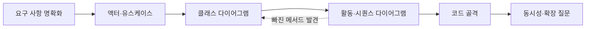

> GitHub 저장소 「[Grokking the Object Oriented Design Interview](https://github.com/tssovi/grokking-the-object-oriented-design-interview)」를 바탕으로 재구성한 노트다.

## 객체 지향 설계 면접이란

객체 지향 설계(OOD, Object-Oriented Design) 면접은 「주차장을 설계하라」, 「도서관 관리 시스템을 설계하라」처럼 하나의 시스템을 주고 **클래스, 책임, 관계**로 풀어 내게 하는 면접이다. 서버 몇 대, 샤딩, 캐시를 묻는 [[tech-interview-prep#시스템 디자인 면접 7단계|시스템 디자인 면접]]과 달리 한 프로세스 안의 객체 구조를 본다.

- **실행되는 완성 코드는 요구하지 않는다.** DB 저장, 결제 대행사 연동처럼 설계와 상관없는 부분은 「있다고 가정한다」고 말하고 넘어간다. 보는 것은 클래스 이름, 속성, 핵심 메서드, 관계다.
- 객체 지향 분석·설계(OOAD)는 네 단계로 요약된다. **시스템을 이루는 객체를 찾고 → 객체 사이 관계를 정하고 → 객체마다 인터페이스(공개 메서드)를 정하고 → 객체 지향 언어로 옮길 수 있는 설계로 만든다.** 이 과정을 기록하는 표준 표기가 UML이다. UML 표기와 다이어그램을 그리는 순서는 [[software-engineering#UML로 하는 객체지향 분석·설계|소프트웨어 설계와 공학]]에 있다.

## 풀이 순서

| 단계 | 할 일 | 예 |
| --- | --- | --- |
| 1. 요구 사항 명확화 | **면접 첫머리에 범위부터 묻는다.** 면접관이 머릿속에 둔 범위를 질문으로 확인하고, 합의한 요구를 번호 붙인 목록으로 적는다. 숫자로 된 규칙(한도, 기한, 요금)을 끌어낸다 | 도서관: 한 사람당 최대 5권, 최대 10일, 연체료 부과. 주차장: 첫 시간 4달러, 2~3시간째 3.5달러, 그 뒤 2.5달러 |
| 2. 액터·유스케이스 | 시스템 바깥의 역할(사람, 외부 시스템, 시간·알림을 맡는 `System`)과 역할별 기능을 뽑는다. 작성법은 [[use-case-diagram\|유스케이스 다이어그램]] | 도서관: 사서·회원·시스템 / 대출·예약·연장·반납 |
| 3. 클래스 다이어그램 | 명사에서 클래스 후보를 뽑고 책임과 관계(상속, 합성, 연관, 다중성)를 정한다. 책임을 고르는 기준은 [[responsibility-driven-design\|책임 주도 설계]] | `Book`과 `BookItem`, `BookLending`, `Fine` |
| 4. 활동·시퀀스 | 핵심 유스케이스 한두 개의 흐름을 그린다. 활동 다이어그램은 분기와 반복이 많은 업무 흐름, 시퀀스 다이어그램은 객체 사이 메시지 순서에 쓴다 | 대출 흐름, ATM 잔액 조회 메시지 |
| 5. 코드 골격 | enum과 상수 → 사람·계정 계층 → 핵심 엔티티 → 핵심 유스케이스 메서드 순으로 쓴다. 메서드 본문은 핵심 규칙만 채운다 | `Member.checkout_book_item()`에 한도·예약 검사만 넣는다 |
| 6. 동시성·확장 | 「두 사람이 같은 좌석을 동시에 잡으면?」, 「차종이 늘면?」 같은 후속 질문에 답한다 | 좌석 예약 트랜잭션, 새 하위 클래스 추가 |

예외 상황(재고 없음, 결제 실패, 한도 초과)은 3~5단계를 오가며 빠짐없이 짚는다. 활동 다이어그램을 그리다 클래스에 없던 메서드가 나오면 클래스 다이어그램으로 돌아가 고친다.

## 사례에 되풀이해 나오는 설계 부품

17개 사례를 나란히 놓으면 같은 모양이 반복된다. 이 부품을 먼저 익혀 두면 처음 보는 문제도 절반은 조립으로 끝난다.

### 계정과 사람

| 부품 | 모양 | 쓰인 곳 |
| --- | --- | --- |
| `Account` | 로그인 정보와 상태: `id`, `password`, `status`, `reset_password()` | 거의 모든 사례 |
| `Person` | 연락처: `name`, `address`, `email`, `phone` | 거의 모든 사례 |
| `Address` | 거리·도시·주·우편번호·국가를 묶은 값 객체 | 모든 사례 |
| 역할 하위 클래스 | 역할마다 할 수 있는 일이 다르면 하위 클래스로 나눈다 | `Librarian`·`Member`, `Admin`·`ParkingAttendant`, `Receptionist`·`Chef` |
| `Guest` | 계정 없이 검색·조회만 한다. 구매·예약·글쓰기는 회원 등록 뒤에 된다 | 쇼핑몰, Stack Overflow, 영화 예매 |

역할 계층을 잇는 방식은 두 가지다.

| 방식 | 구조 | 쓰인 곳 |
| --- | --- | --- |
| 계정 상속 | `Account` ← `Librarian`, `Member`. 계정 자체가 역할이다 | 도서관, 주차장, 렌터카, 증권 |
| 사람 상속 + 계정 보유 | `Person` ← `Customer`, `Admin`이고 `Person`이 `Account`를 필드로 갖는다 | 영화 예매, 항공, 호텔, LinkedIn, Facebook |
| 역할이 계정을 감쌈 | `Member`가 `Account`를 갖고, `Admin`·`Moderator`가 `Member`를 상속한다 | Stack Overflow |

로그인 정보와 사람 정보를 나누면 한 사람이 여러 역할을 갖거나, 계정 없는 사람(항공의 `Passenger`, 렌터카의 `AdditionalDriver`)을 같은 `Person`으로 다룰 수 있다.

`AccountStatus`는 사례마다 값이 조금씩 다르다. `ACTIVE, BLOCKED, BANNED, COMPROMISED, ARCHIVED, UNKNOWN`(주차장·쇼핑몰·영화·LinkedIn)과 `ACTIVE, CLOSED, CANCELED, BLACKLISTED, BLOCKED`(Stack Overflow·항공·호텔·식당·렌터카)가 대표적이다.

### 정의와 인스턴스 분리

**「무엇인가」와 「실제 한 개」를 다른 클래스로 둔다.** 예약·대여·재고는 늘 인스턴스를 대상으로 한다.

| 정의(종류) | 인스턴스(실물·회차) | 나누는 이유 |
| --- | --- | --- |
| `Book` (ISBN, 제목, 저자) | `BookItem` (바코드, 상태, 반납일, 서가) | 같은 책이 여러 권 있고 대출은 한 권 단위다 |
| `Product` (이름, 가격, 분류) | `Item` (수량) | 펜이라는 상품과 재고 펜 10개는 다르다 |
| `Flight` (편명 BA212, 출발·도착 공항) | `FlightInstance` (출발 시각, 게이트, 상태, 기체) | 주 2회 운항하면 회차마다 좌석과 상태가 따로다 |
| `CinemaHallSeat` (상영관 좌석) | `ShowSeat` (회차별 좌석, 예약 여부, 가격) | 같은 좌석도 회차마다 팔린다 |
| `Seat` (좌석 번호, 종류, 등급) | `FlightSeat` (운임) | 운임은 회차마다 다르다 |
| `MenuItem` (메뉴, 가격) | `MealItem` (수량) | 주문은 메뉴를 참조하는 수량이다 |
| `Stock` (종목) | `StockLot` (언제 몇 주 샀나) | 판매할 때 어떤 묶음을 팔지 고른다 |

### 상태 enum과 이력 로그

엔티티마다 `status` 필드와 enum을 둔다. 매직 넘버·문자열 대신 이름 붙은 상태를 쓰면 허용 값이 코드에 드러난다.

| enum | 값 | 쓰인 곳 |
| --- | --- | --- |
| `PaymentStatus` | `UNPAID, PENDING, COMPLETED, FILLED, DECLINED, CANCELLED, ABANDONED, SETTLING, SETTLED, REFUNDED` | 쇼핑몰, 영화, 항공, 호텔, 식당, 렌터카 |
| 예약 상태 | `REQUESTED, PENDING, CONFIRMED, CHECKED_IN, CANCELED, ABANDONED` (호텔은 `CHECKED_OUT` 추가) | 영화, 항공, 호텔, 식당 |
| 물건 상태 | `AVAILABLE, RESERVED, LOANED, LOST` (렌터카는 `BEING_SERVICED`, `OTHER` 추가) | 도서관, 렌터카 |

상태가 바뀐 기록은 별도 로그 클래스로 남긴다. `OrderLog`·`ShipmentLog`(쇼핑몰), `VehicleLog`(렌터카), `RoomHouseKeeping`(호텔), 게임의 수 기록이 그렇다.

### 검색: Search 인터페이스와 색인

검색 기준을 메서드로 모은 `Search` 인터페이스를 두고, 카탈로그·색인 클래스가 **기준별 해시맵**(제목 → 책 목록)으로 구현한다.

| 사례 | 구현 클래스 | 검색 기준 |
| --- | --- | --- |
| 도서관 | `Catalog` | 제목, 저자, 주제, 출판일 |
| 쇼핑몰 | `Catalog` | 상품명, 분류 |
| 영화 예매 | `Catalog` | 제목, 언어, 장르, 개봉일, 도시 |
| 렌터카 | `VehicleInventory` | 차종, 모델 |
| LinkedIn | `SearchIndex` | 회원 이름, 회사 이름, 채용 공고 제목 |
| Facebook | `SearchIndex` | 회원·그룹·페이지 이름, 게시물 단어 |
| 호텔·식당 | `Room.search(style, start_date, duration)`, `Table.search(capacity, start_time)` | 객실 종류·기간, 인원·시각 |

### 알림, 결제, 청구, 조직

| 부품 | 모양 | 쓰인 곳 |
| --- | --- | --- |
| `Notification` | `System` 액터의 일을 맡는다. 이메일·SMS·푸시 같은 채널은 하위 클래스(`EmailNotification`, `SMSNotification`) | 예약 확정·취소, 연체, 배송, 새 메시지 |
| `Payment` | 금액, 거래 ID, 상태. 수단은 하위 클래스(`CreditCardPayment`, `CashPayment`, 수표, 계좌 이체) | 결제가 있는 모든 사례 |
| 청구서 | `Bill`·`Invoice`가 항목(`BillItem`)을 모은다. 렌터카는 `BillItemType`(`BASE_CHARGE, ADDITIONAL_SERVICE, FINE, OTHER`)으로 항목을 나눈다 | 식당, 호텔, 렌터카 |
| 최상위 조직 + 지점 | 회사 클래스가 지점 목록을 갖는다 | `Hotel`·`HotelLocation`, `Restaurant`·`Branch`, `CarRentalSystem`·`CarRentalLocation`, `City`·`Cinema` |
| 상수 | 한도와 기한을 상수로 모은다 | `MAX_BOOKS_ISSUED_TO_A_USER = 5`, `MAX_LENDING_DAYS = 10`, `MONEY_TRANSFER_LIMIT = 100000` |

### 동시성

| 문제 | 해법 | 사례 |
| --- | --- | --- |
| 두 고객이 같은 좌석을 잡는다 | `SERIALIZABLE` 트랜잭션 안에서 빈 좌석을 읽고 갱신한다 | 영화 예매 |
| 여러 입구가 동시에 티켓을 발급한다 | 발급 구간을 락으로 감싼다 | 주차장 |
| 한 기사가 두 호출에 배정된다 | 매칭 구간에 락, 위치 갱신은 큐로 받는다 | Uber |

## 사례별 디자인 패턴 지도

패턴 자체의 설명은 [[gof-design-patterns|GoF 디자인 패턴]]에 있다. 여기서는 사례 어디에 쓰이는지만 모은다.

| 패턴 | 쓰인 곳 | 이유 |
| --- | --- | --- |
| 싱글턴 | `ParkingLot`, `StockExchange`, `UberSystem` | 모든 입출구 패널이 같은 주차장 상태를 봐야 한다. 증권 거래소 연동 창구도 하나다 |
| 팩토리 | 체스 `PieceFactory.create(type, position, color)`, 차량·객실·책 생성 | 어떤 하위 클래스를 만들지 한곳에 가둔다 |
| 컴포지트 | 장바구니의 항목들, 여정(`Itinerary`)의 항공 예약들, 호텔의 지점·객실 | 묶음과 낱개를 같은 방식으로 합산·조회한다 |
| 데코레이터 | 객실에 어메니티·룸서비스 요금 덧붙이기 | 기본 요금에 부가 요금을 동적으로 더한다 |
| 전략 | 체스 말마다 다른 이동 규칙, 주차 자리 배정 규칙 | 규칙을 갈아 끼워도 게임 루프는 그대로다 |
| 커맨드 | ATM `Transaction` 계층, 체스 `MoveCommand` | 요청을 객체로 만들어 기록·감사·재시도한다 |
| 상태 | 주문·항공편·예약·거래의 상태 | 상태에 따라 허용 동작이 달라진다(발송 전 주문만 취소) |
| 옵저버 | 예약 확정, 반납 알림, 새 답변, 친구 요청 알림 | 상태 변화를 구독자에게 알린다 |
| 템플릿 메서드 | `Account` 계층, `Transaction` 처리 흐름, 말 이동 검증 | 공통 뼈대는 상위, 세부는 하위 클래스 |
| 프록시 | ATM이 은행을 대신해 요청을 받는다 | 실제 계좌는 은행에 있다 |

패턴 이름은 느슨하게 붙는 경우가 많다. 「상태 패턴」이라 부르는 주문도 실제 골격은 enum 필드와 조건 검사다. 면접에서는 enum으로 시작하고, 상태별 행동이 커지면 상태 객체로 바꾼다고 설명하는 편이 정확하다.

## SOLID가 드러나는 곳

| 원칙 | 사례에서의 모습 |
| --- | --- |
| 단일 책임 | `BookLending`은 대출만, `Payment`는 결제만, `FlightReservation`은 항공 예약만 맡는다 |
| 개방·폐쇄 | 차종·체스 말·거래 종류를 늘려도 상위 클래스(`Vehicle`, `Piece`, `Transaction`)는 고치지 않는다 |
| 리스코프 치환 | `Vehicle`이 필요한 자리에 어떤 차종이 와도, `Piece` 자리에 어떤 말이 와도 동작한다 |
| 인터페이스 분리 | `Librarian`과 `Member`는 같은 `Account`를 물려받지만 공개 메서드가 다르다 |
| 의존성 역전 | 코드가 추상 `Account`, `Vehicle`, `Piece`에 기대고, 구체 클래스는 팩토리나 주입으로 들어온다 |

원칙 자체는 [[coding-principles|좋은 코드를 위한 열 가지 원칙]]과 [[frontend-solid|프론트엔드와 SOLID 원칙]]에 있다.

## 피해야 할 설계

| 안티패턴 | 증상 | 처방 |
| --- | --- | --- |
| 갓 객체(God Object) | `ParkingLot` 하나가 티켓·결제·표시판·요금을 모두 처리한다 | 책임별 작은 클래스로 쪼갠다(`ParkingTicket`, `Payment`, `ParkingDisplayBoard`, `ParkingRate`) |
| 강한 결합 | 클래스가 서로의 구체 타입과 내부를 직접 안다 | 인터페이스, 의존성 주입, 패턴으로 끊는다 |
| 이른 최적화 | 요구도 확정되기 전에 성능부터 손본다 | 깔끔한 설계를 먼저, 최적화는 필요해진 뒤에 한다 |
| 매직 넘버 | `if status == 3`처럼 뜻 없는 숫자를 쓴다 | 상수와 enum(`AccountStatus`, `VehicleType`)으로 이름을 붙인다([[code-cohesion\|응집도를 높이는 전략]]) |

## 면접에서 자주 받는 질문

| 질문 | 답의 뼈대 |
| --- | --- |
| 주차장을 왜 싱글턴으로 두나? | 입구·출구 패널이 모두 같은 자리 수와 활성 티켓을 봐야 일관된다. 층과 자리를 한곳에서 관리한다 |
| 싱글턴을 쓰지 말아야 할 때는? | 인스턴스가 여럿 필요할 때, 테스트마다 다른 인스턴스가 필요할 때, 전역 결합이 생길 때. 의존성 주입으로 대신한다([[singleton-pattern\|싱글턴 패턴]]) |
| 체스 말에 왜 전략(다형성)을 쓰나? | 말마다 이동 규칙이 다르다. 규칙을 말 클래스에 가두면 게임 로직을 고치지 않고 말을 추가한다 |
| ATM 거래를 왜 커맨드로 두나? | 거래 하나를 객체로 만들면 큐에 넣고, 기록하고, 되돌리고, 감사하기 쉽다. 새 거래 종류는 하위 클래스 추가로 끝난다 |

면접관이 보는 것은 클래스 책임이 분명한가, 상속과 합성을 알맞게 골랐나, 패턴과 SOLID를 아는가, 규모가 커지면 어떻게 되나, 대안과 트레이드오프를 말하나다. 패턴을 말할 때는 **패턴이 푸는 문제를 먼저 말하고**, 장단점과 다른 선택지를 함께 꺼낸다. 세부 코드에 들어가기 전에 클래스 다이어그램으로 전체 구조부터 보여 준다.

## 사례 목록과 공부 순서

| 묶음 | 사례 | 노트 |
| --- | --- | --- |
| 예약·대여 | 도서관, 영화 예매, 항공, 호텔, 식당, 렌터카 | [[ood-booking-rental-systems\|객체 지향 설계 사례: 예약·대여 시스템]] |
| 시설·장치와 게임 | 주차장, ATM, 블랙잭과 카드 덱, 체스 | [[ood-machines-and-games\|객체 지향 설계 사례: 주차장·ATM과 카드·보드 게임]] |
| 커머스·커뮤니티·플랫폼 | 아마존 쇼핑몰, Stack Overflow, 온라인 증권, LinkedIn, Facebook, Cricinfo, Uber | [[ood-platform-systems\|객체 지향 설계 사례: 커머스·커뮤니티·플랫폼]] |

공부 순서는 도서관(기본 부품이 다 나오는 가장 단순한 사례) → 주차장(싱글턴과 자리 배정 규칙) → 체스(말별 이동 규칙의 다형성) → ATM(거래 커맨드) → 나머지(앞의 조합) 순이 무난하다.

## 정리

- OOD 면접은 요구 사항을 숫자 규칙까지 확정한 뒤 유스케이스 → 클래스 → 흐름 → 코드 골격 순으로 푼다.
- 계정과 사람 분리, 정의와 인스턴스 분리, 상태 enum과 로그, Search 인터페이스와 색인, 알림·결제·청구서는 거의 모든 사례에 다시 나온다.
- 패턴은 문제에서 출발해 이름을 붙이고, 쓰는 이유와 대안을 함께 말한다.
- 결국 보는 것은 책임이 잘 나뉜 클래스와 그 관계다.

관련 노트: [[software-engineering|소프트웨어 설계와 공학]], [[use-case-diagram|유스케이스 다이어그램]], [[responsibility-driven-design|책임 주도 설계]], [[gof-design-patterns|GoF 디자인 패턴]], [[tech-interview-prep|기술 면접 준비]], [[ood-booking-rental-systems|객체 지향 설계 사례: 예약·대여 시스템]], [[ood-machines-and-games|객체 지향 설계 사례: 주차장·ATM과 카드·보드 게임]], [[ood-platform-systems|객체 지향 설계 사례: 커머스·커뮤니티·플랫폼]]
