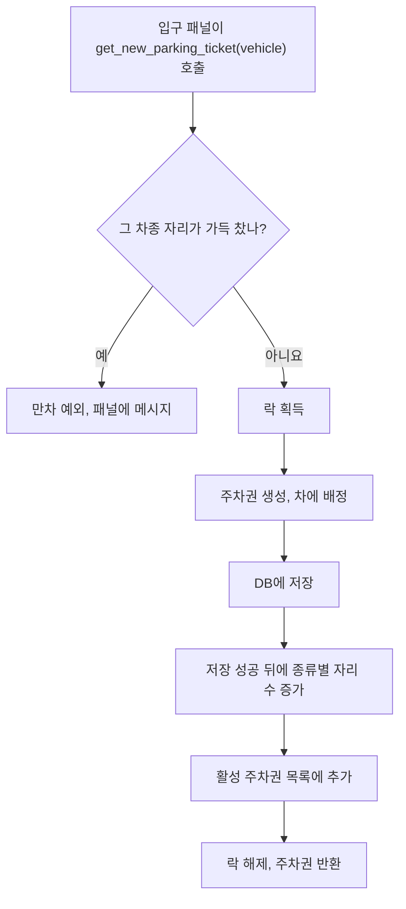
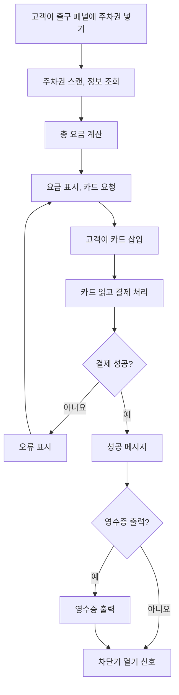
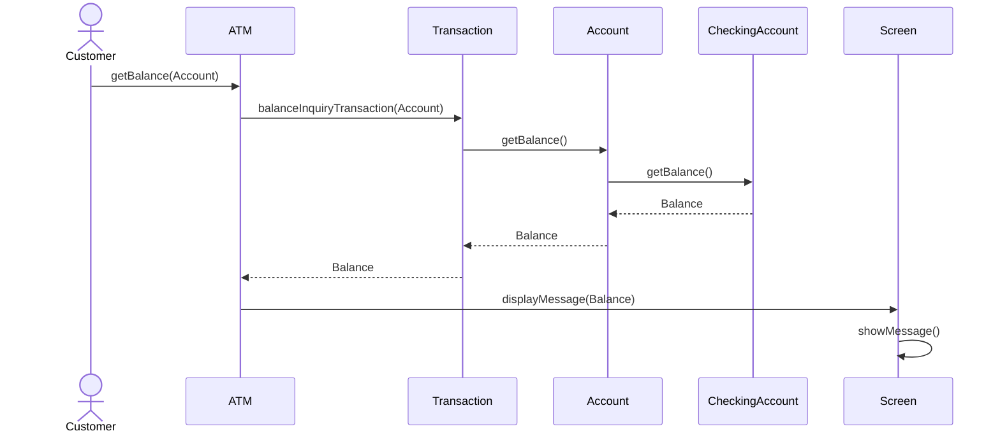
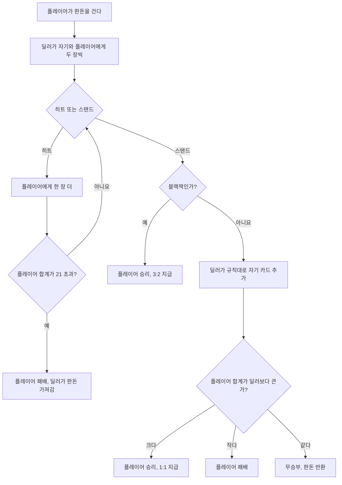
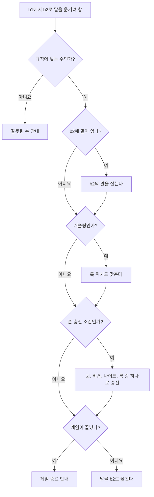

> GitHub 저장소 「[Grokking the Object Oriented Design Interview](https://github.com/tssovi/grokking-the-object-oriented-design-interview)」를 바탕으로 재구성한 노트다.

풀이 순서와 공통 부품은 [[ood-interview-approach|객체 지향 설계 면접: 풀이 순서와 반복되는 설계 부품]]에 있다. 이 계열은 예약 시스템과 달리 **물리 장치(패널, 카드 리더, 현금 인출기)나 게임 규칙을 객체로 옮기는 것**이 핵심이다.

## 주차장

### 요구 사항

1. 여러 층에 주차한다. 입구와 출구가 여러 개다.
2. 입구에서 주차권을 받고, 나갈 때 출구에서 요금을 낸다. 출구의 **무인 정산 패널**이나 **주차 요원**에게 낸다.
3. 현금과 신용카드를 받는다. 층마다 있는 **고객 안내 포털**에서 미리 내면 출구에서 다시 내지 않는다.
4. 최대 수용량을 넘겨 받지 않는다. 가득 차면 입구 패널과 1층 표시판에 만차 메시지를 띄운다.
5. 층마다 자리가 많고, 자리 종류는 소형(Compact), 대형(Large), 장애인(Handicapped), 오토바이(Motorcycle) 등이다.
6. **전기차 전용 자리**에는 전기 패널이 있어 거기서 충전하고 요금을 낸다.
7. 승용차, 트럭, 밴, 오토바이 같은 여러 차종을 받는다.
8. 층마다 표시판이 자리 종류별 빈 자리를 보여 준다.
9. 시간제 요금: **첫 시간 4달러, 둘째·셋째 시간 3.5달러, 그 뒤로 시간당 2.5달러.** 5시간이면 4 + 3.5 × 2 + 2.5 × 2 = 16달러다.

### 액터와 유스케이스

| 액터 | 하는 일 |
| --- | --- |
| 관리자 | 층, 자리, 입구·출구 패널 추가·수정, 주차 요원 추가·삭제 |
| 고객 | 주차권 받기, 요금 내기 |
| 주차 요원 | 고객 대신 모든 일을 하고, 현금을 받는다 |
| 시스템 | 각 패널에 메시지 표시, 자리에 차 배정·해제 |

유스케이스: 층 추가·삭제·수정(층마다 표시판), 자리 추가·삭제·수정, 주차 요원 추가·삭제, 주차권 받기, 주차권 스캔(요금 확인), 카드 결제, 현금 결제, 시간 요금 추가·수정.

### 핵심 클래스

| 클래스 | 책임과 속성 |
| --- | --- |
| `ParkingLot` | 이름, 주소, 요금표, 종류별 현재·최대 자리 수, 입구·출구 패널, 층 목록, **활성 주차권**(번호 → 티켓), 락. **싱글턴**으로 하나만 둔다 |
| `ParkingFloor` | 이름, 종류별 자리 맵, 안내 포털, 표시판. 자리 추가, 차 배정, 표시판 갱신, 자리 비우기 |
| `ParkingSpot` ← `HandicappedSpot`, `CompactSpot`, `LargeSpot`, `MotorbikeSpot`, `ElectricSpot` | 번호, 빈 자리 여부, 주차한 차, 종류. `assign_vehicle()`, `remove_vehicle()` |
| `Vehicle` ← `Car`, `Truck`, `Electric`, `Van`, `Motorcycle` | 차종과 받은 주차권 |
| `ParkingTicket` | 입차 때 발급하는 주차권 |
| `EntrancePanel` / `ExitPanel` | 주차권 출력 / 요금 정산 |
| `Payment` | 카드·현금 결제 |
| `ParkingRate` | 시간마다 금액을 정한다. 2시간짜리 주차권이면 첫 시간과 둘째 시간 요금을 각각 갖는다 |
| `ParkingDisplayBoard` | 종류별 빈 자리 번호, 없으면 「Compact is full」 같은 만차 문구 |
| `ParkingAttendantPortal` | 요원이 하는 일(주차권 스캔, 결제 처리)을 감싼다 |
| `CustomerInfoPortal` | 고객이 층에서 요금을 내면 주차권에 결제를 기록한다 |
| `ElectricPanel` | 전기차 충전과 결제 |
| `Account` ← `Admin`, `ParkingAttendant` | 관리자는 층·자리·표시판·안내 패널·입출구 패널 추가, 요원은 `process_ticket()` |

| enum | 값 |
| --- | --- |
| `VehicleType` | `CAR, TRUCK, ELECTRIC, VAN, MOTORBIKE` |
| `ParkingSpotType` | `HANDICAPPED, COMPACT, LARGE, MOTORBIKE, ELECTRIC` |
| `ParkingTicketStatus` | `ACTIVE, PAID, LOST` |
| `AccountStatus` | `ACTIVE, BLOCKED, BANNED, COMPROMISED, ARCHIVED, UNKNOWN` |

### 자리 배정 규칙과 주차권 발급

| 차종 | 세울 수 있는 자리 | 배정 순서 |
| --- | --- | --- |
| 트럭, 밴 | 대형만 | - |
| 오토바이 | 오토바이 자리만 | - |
| 승용차 | 소형, 대형 | 소형이 남으면 소형, 아니면 대형 |
| 전기차 | 전기차, 소형, 대형 | 전기차 → 소형 → 대형 |

만차 판정(`is_full(type)`)도 이 표를 따른다. 승용차는 「소형 + 대형」 현재 수가 최대 수에 닿았는지, 전기차는 「전기 + 소형 + 대형」을 본다.

- **입구 패널이 여럿이라 동시에 발급해도 서로 간섭하지 않게 발급 구간을 락으로 감싼다.** 자리 수는 DB 저장이 성공한 다음에만 늘린다.
- 싱글턴 초기화 때 DB에서 이름·주소·요금표, 층 지도(층마다 자리 수와 최대 수), 활성 주차권(현재 자리 수 복원), 입구·출구 패널을 읽는다.
- 차를 자리에 배정했는데 그 자리가 마침 표시판에 떠 있던 빈 자리면, 같은 종류의 다른 빈 자리를 찾아 표시판을 갱신한다.

### 출구 정산 흐름

## ATM

### 구성 요소와 거래

ATM과 사용자의 상호작용을 결정하는 하드웨어는 카드 리더, 키패드(PIN·금액 입력), 화면, 현금 인출기, 입금구(현금·수표), 영수증 프린터, 은행과 통신하는 네트워크다. 계좌는 **입출금(Checking)** 과 **저축(Savings)** 두 종류이고, 거래는 다섯 가지다.

| 거래 | 내용 |
| --- | --- |
| 잔액 조회 | 계좌별 잔액 보기 |
| 현금 입금 | 현금을 넣는다 |
| 수표 입금 | 수표를 넣는다 |
| 현금 인출 | 입출금 계좌에서 현금을 뺀다 |
| 이체 | 다른 계좌로 보낸다 |

### 동작 방식과 가정

- 운영자(operator)가 ATM을 켜고 끄고, 현금과 영수증 용지를 채운다. ATM은 **한 번에 한 고객만** 받고, 고객을 받는 중에는 꺼지지 않는다.
- 카드를 넣고 PIN을 입력하면 ATM이 은행에 인증을 요청한다. 인증 없이는 어떤 거래도 못 한다.
- **카드는 세션이 끝날 때까지 ATM 안에 둔다.** 취소 버튼을 누르면 세션이 끝나고 카드가 나온다.
- ATM은 하드웨어 고장 정보를 담은 내부 거래 로그를 남기고, 운영자가 문제를 풀 때 쓴다.
- 입금액은 **바로 계좌에 더하지 않는다.** 수표는 수동 확인과 은행 승인을, 현금도 은행 확인을 거친다. 그래서 계좌에 총잔액(`total_balance`)과 인출 가능 잔액(`available_balance`)을 따로 둔다.
- 은행 매니저는 은행 DB에 저장된 ATM 정보를 볼 수 있다. 보안의 중심은 직불 카드와 PIN이다.

### 액터와 클래스

| 액터 | 하는 일 |
| --- | --- |
| 운영자 | 키 스위치로 ATM 켜고 끄기, 현금·영수증 용지·잉크 보충, 입금된 현금과 수표 꺼내기 |
| 고객 | 잔액 조회, 현금 인출, 입금(현금·수표), 이체 |
| 은행 매니저 | 총 입금·총 인출 보고서 생성과 출력, ATM 잔여 현금 확인 |

| 클래스 | 책임과 속성 |
| --- | --- |
| `ATM` | ATM ID, 위치, 부품들(현금 인출기, 키패드, 화면, 프린터, 입금구). `authenticate_user()`, `make_transaction(customer, transaction)` |
| `CardReader`, `Keypad`, `Screen`, `Printer` | 카드 읽기 / 입력 / 메시지 표시와 터치 입력 / 영수증 출력 |
| `CashDispenser` | 권종별 지폐 수(5달러, 20달러). `dispense_cash(amount)`, `can_dispense_cash()` |
| `DepositSlot` ← `CheckDepositSlot`, `CashDepositSlot` | 넣은 총액 / 수표 금액 읽기 / 지폐 받기 |
| `Bank` | 이름, 은행 코드, ATM 등록. 모든 계좌 정보를 갖고 ATM이 거래마다 은행과 통신한다 |
| `Account` ← `SavingAccount`, `CheckingAccount` | 계좌 번호, 총잔액, 가용 잔액 / 인출 한도 / 직불 카드 번호 |
| `Customer` | 이름, 주소, 이메일, 전화, 상태, 카드, 계좌. 고객 한 명에 카드 하나 |
| `Card` | 카드 번호, 고객 이름, 만료일, PIN |
| `Transaction` ← `BalanceInquiry`, `Deposit`, `Withdraw`, `Transfer` | 거래 ID, 생성 시각, 상태, `make_transaction()`. 조회는 계좌 ID, 입금·인출은 금액, 이체는 받는 계좌 번호 |
| `Deposit` ← `CheckDeposit`, `CashDeposit` | 수표 번호와 은행 코드 / 현금 입금 한도 |

| enum | 값 |
| --- | --- |
| `TransactionType` | `BALANCE_INQUIRY, DEPOSIT_CASH, DEPOSIT_CHECK, WITHDRAW, TRANSFER` |
| `TransactionStatus` | `SUCCESS, FAILURE, BLOCKED, FULL, PARTIAL, NONE` |
| `CustomerStatus` | `ACTIVE, BLOCKED, BANNED, COMPROMISED, ARCHIVED, CLOSED, UNKNOWN` |

거래를 `Transaction` 하위 클래스로 둔 것이 **커맨드 패턴**이고, ATM이 실제 계좌를 가진 은행 앞에서 요청을 받는 구조는 **프록시**에 가깝다.

### 흐름

| 흐름 | 단계 |
| --- | --- |
| 인증 | 카드 삽입 → PIN 요청 → PIN 입력 → 맞으면 메뉴(입금, 인출, 이체, 잔액 조회), 틀리면 오류 후 재시도 여부 |
| 인출 | 인출 선택 → 금액 선택지(20달러, 40달러, 100달러, 직접 입력, 취소) → 잔액 확인 → 부족하면 알림 → 거래 수행 → 현금 지급 → 영수증 출력 여부 → 카드 반환 |
| 수표 입금 | 수표 입금 선택 → 계좌 선택(입출금·저축) → 입금구에 수표 넣기 → 스캔 → 금액 표시 → 금액이 틀리면 고객이 바른 금액 입력 → 잔액에 반영 → 성공 메시지 → 영수증 여부 → 카드 반환 |
| 이체 | 금액 입력 → 잔액 부족이면 안내 후 재시도 여부 → 받는 계좌 번호 입력 → 검증, 잘못된 번호면 재시도 여부 → 거래 수행과 계좌 갱신 → 성공 메시지 → 영수증 여부 → 카드 반환 |

잔액 조회 시퀀스는 다음과 같다.

## 블랙잭과 카드 덱

### 규칙

| 항목 | 규칙 |
| --- | --- |
| 덱 | 표준 52장 덱 하나 이상. 13개 끗수 × 4개 무늬 |
| 시작 | 플레이어와 딜러가 각각 두 장. 플레이어 카드는 모두 앞면, 딜러는 한 장만 보이고(up card) 한 장은 숨긴다(hole card) |
| 목표 | 21점을 넘지 않으면서 딜러보다 높은 점수 |
| 점수 | 2~10은 숫자대로, J·Q·K는 10점, 에이스는 1점 또는 11점. **에이스 + 10점 카드 두 장으로 21이면 블랙잭** |
| 소프트·하드 | 에이스를 11로 센 합이 소프트 합계, 1로 센 합이 하드 합계다. A + 5는 소프트 16, 하드 6 |
| 딜러 규칙 | **16 이하면 한 장 더(hit), 17 이상이면 멈춘다(stand)** |
| 플레이어 선택 | 히트(한 장 더), 스탠드(멈춤), 더블(판돈을 두 배로 하고 딱 한 장만 더), 스플릿(같은 끗수 두 장을 두 패로 나눔) |
| 버스트 | 21을 넘으면 그 자리에서 진다 |
| 정산 | 높은 쪽이 이기고 비기면 판돈을 돌려받는다. **블랙잭은 3:2, 나머지 승리는 1:1**. 딜러가 버스트하면 플레이어가 이긴다 |

| 베팅 | 조건과 금액 |
| --- | --- |
| 앤티(Ante) | 처음 거는 필수 판돈 |
| 보험(Insurance) | 딜러의 보이는 카드가 에이스일 때만. 앤티의 절반. 딜러가 정확히 21이면 2:1로 받아 원래 판돈 손실을 메운다 |
| 스플릿 | 두 장의 끗수가 같을 때만. 앤티와 같은 금액. 패마다 한 장씩 더 받아 따로 진행하고, 다시 나누지는 않는다 |
| 더블 | 일반 히트 대신. 앤티와 같은 금액 |

딜러가 에이스를 보이면 보험을 제안한 뒤 숨긴 카드를 확인한다. 10점 카드면 블랙잭이니 카드를 공개하고 보험금을 준다. 아니면 보험은 지고 카드는 공개하지 않은 채 계속한다. 플레이어가 블랙잭(소프트 21)이면 먼저 **이븐 머니**를 제안한다. 받아들이면 앤티를 1:1로 받고 그 판이 끝나며, 거절하면 보험을 제안한다.

### 액터와 클래스

| 액터 | 하는 일 |
| --- | --- |
| 딜러 | 카드 돌리기, 승패 정산 |
| 플레이어 | 앤티 걸기, 보험 등 추가 베팅 수락·거절, 스플릿, 이븐 머니 수락·거절, 히트·더블·스탠드 선택 |

| 클래스 | 책임과 속성 |
| --- | --- |
| `Card` | 무늬와 끗수(1~13) |
| `BlackjackCard` (`Card` 상속) | 게임 점수: 끗수가 10을 넘으면 10. 에이스는 1 또는 11 |
| `Deck` | 52장, 생성일. 끗수 1~13 × 무늬 4개로 만든다 |
| `Shoe` | 덱 여러 개를 담는 카지노 장비. 덱 수, `create_shoe()`, `shuffle()`, `deal_card()`(다 쓰면 새로 채운다) |
| `Hand` | 카드 목록. `get_scores()`는 에이스를 만날 때마다 1과 11 두 갈래로 가능한 합계를 모두 만들고, `resolve_score()`는 그중 21 이하 최댓값을 고른다 |
| `BasePlayer` ← `Player`, `Dealer` | ID, 비밀번호, 잔액, 상태, `Person`, 패 목록 / 판돈, 보유 현금 |
| `Game` | 플레이어, 딜러, 슈(덱 최대 3개). 게임 진행, 베팅 제안, 카드 배분, 승패 정산, 스플릿, 히트·더블·스탠드 처리 |

`SUIT` enum은 `HEART, SPADE, CLUB, DIAMOND`다. 셔플은 앞에서부터 각 자리와 남은 범위의 임의 자리를 바꾸는 피셔-예이츠(Fisher-Yates) 방식이다. 스플릿은 원래 패를 지우고, 두 카드에 새 카드를 한 장씩 붙인 패 두 개를 플레이어에게 더한다.

## 체스

### 요구 사항

- 온라인 플레이어 두 명이 국제 체스 규칙으로 둔다. 흑백은 무작위로 정하고, **백이 먼저** 둔 뒤 번갈아 둔다.
- **수를 무르거나 되돌릴 수 없다.** 양쪽의 모든 수를 기록한다.
- 각자 폰 8, 룩 2, 비숍 2, 나이트 2, 퀸 1, 킹 1로 시작한다.
- 체크메이트, 몰수패(forfeit), 스테일메이트(무승부), 기권으로 끝난다.

| 액터 | 하는 일 |
| --- | --- |
| 플레이어 | 가입된 계정. 말을 움직인다 |
| 관리자 | 플레이어 정지·수정 |

유스케이스: 말 움직이기(규칙에 맞는 수), 기권·몰수, 가입·탈퇴, 게임 기록에 수 추가.

### 설계 클래스

| 클래스 | 책임과 속성 |
| --- | --- |
| `Player` | 어느 편(흑·백)인지 기록한다 |
| `Account` | 플레이어와 관리자 두 종류 |
| `Game` | 게임 흐름. 모든 수, 지금 누구 차례인지, 최종 결과 |
| `Box` | 8×8 칸 하나와 그 위의 말(없을 수 있음) |
| `Board` | 8×8 칸 묶음과 살아 있는 말 전부 |
| `Piece` (추상) ← `King`, `Queen`, `Rook`, `Bishop`, `Knight`, `Pawn` | 색과 상태(잡혔는지). 모든 말이 상속한다 |
| `Move` | 출발 칸과 도착 칸, 둔 사람, 캐슬링 여부, 잡은 말 |
| `GameController` / `GameView` | 플레이어는 컨트롤러로 수를 두고, 게임은 뷰를 갱신해 변화를 보여 준다. MVC 구조다 |

### 말별 이동 규칙

예제 구현은 칸 객체 대신 좌표(`ChessPosition`)와 말 목록으로 보드를 표현하고, 말마다 「위협하는 칸」과 「갈 수 있는 칸」을 계산하게 한다.

| 탐색 | 동작 | 쓰는 말 |
| --- | --- | --- |
| 광선 탐색(`beam_search_threat`) | 한 방향으로 한 칸씩 나아가다 말을 만나면 멈춘다. 적 말이면 그 칸까지 포함한다 | 퀸(8방향), 룩(상하좌우 4방향), 비숍(대각 4방향) |
| 점 탐색(`spot_search_threat`) | 정해진 오프셋 한 칸만 본다. 빈 칸만 허용(`free_only`)하거나 적이 있는 칸만 허용(`threat_only`)하는 옵션이 있다 | 킹(주변 8칸), 나이트((2,1), (1,2) 등 L자 8칸), 폰 |

폰만 이동과 공격이 다르다. **앞으로 한 칸(처음에는 두 칸까지)은 빈 칸일 때만**, **대각선 앞 한 칸은 적 말이 있을 때만** 갈 수 있고, 흑은 방향을 뒤집는다. 말 생성은 `PieceFactory.create(type, position, color)`가 맡는다.

| 보조 개념 | 내용 |
| --- | --- |
| `ChessPosition` | (x, y) 좌표와 기보 표기 변환. x는 a~h, y는 1~8이라 (4, 1)은 `e2` |
| `MoveCommand` | 출발·도착 좌표. `"e2 e4"` 같은 문자열에서 만든다 |
| 게임 상태 | `STATUS_WHITE_MOVE`, `STATUS_BLACK_MOVE`, `STATUS_WHITE_VICTORY`, `STATUS_BLACK_VICTORY` |
| 렌더러 | `InputRender` 인터페이스(`render`, `print_line`)와 ANSI 색으로 판을 그리는 `ConsoleRender`. 화면을 바꿔도 게임 로직은 그대로다 |
| 초기 배치 | 백의 배치 목록 하나로 흑까지 만든다. 다만 (x, y)를 (7-x, 7-y)로 **점대칭**하면 흑의 킹과 퀸 자리가 바뀐다. 실제 배치는 y만 뒤집는 선대칭이다 |

### 수 검증

수를 둘 때 진짜 보드가 아니라 **복사본에서 먼저 둬 본다.**

1. 출발 칸에 말이 있고, 그 말이 지금 차례의 색인지 확인한다.
2. 도착 칸이 그 말의 「갈 수 있는 칸」이나 「위협하는 칸」에 있는지 확인한다.
3. 복사본에서 수를 실행한다(도착 칸의 적 말은 잡혀 사라진다).
4. 복사본의 어떤 말이든 **자기 킹의 위치를 위협하면 불법 수**다. 킹 위치는 킹이 움직일 때마다 보드에 등록한다.
5. 통과하면 진짜 보드에 실행하고 차례를 넘긴다.

설계 문서의 활동 다이어그램은 여기에 특수 규칙을 더한다.

## 정리

- 장치형 문제는 **하드웨어 부품 하나를 클래스 하나**(패널, 카드 리더, 인출기, 표시판)로 옮기고, 부품을 소유하는 상위 객체(주차장, ATM)를 둔다.
- 여러 입구가 공유하는 상태는 싱글턴과 락으로, 차종별 자리 규칙은 표로 먼저 정리한 뒤 코드로 옮긴다.
- 게임은 규칙을 숫자와 조건으로 끝까지 적어 두는 것이 설계의 절반이다(딜러 16·17, 3:2와 1:1, 보험 절반).
- 다형성(말마다 다른 이동, 거래마다 다른 처리)이 분기문을 없애는 핵심 도구다.

관련 노트: [[ood-interview-approach|객체 지향 설계 면접: 풀이 순서와 반복되는 설계 부품]], [[ood-booking-rental-systems|객체 지향 설계 사례: 예약·대여 시스템]], [[ood-platform-systems|객체 지향 설계 사례: 커머스·커뮤니티·플랫폼]], [[singleton-pattern|싱글턴 패턴]], [[gof-design-patterns|GoF 디자인 패턴]]
