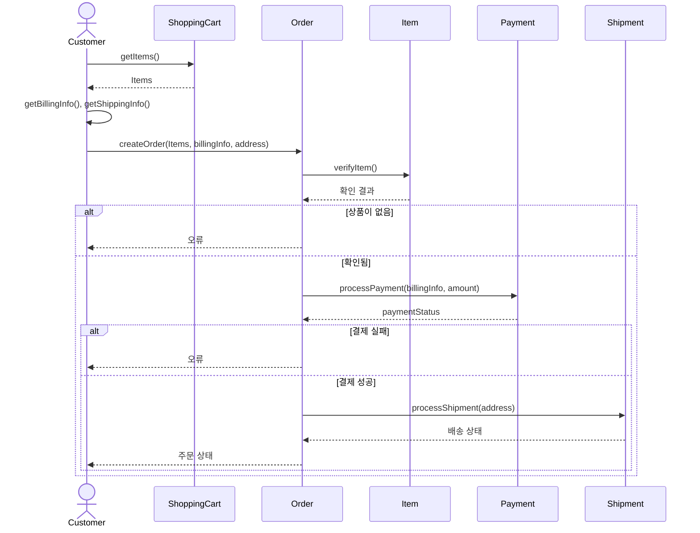
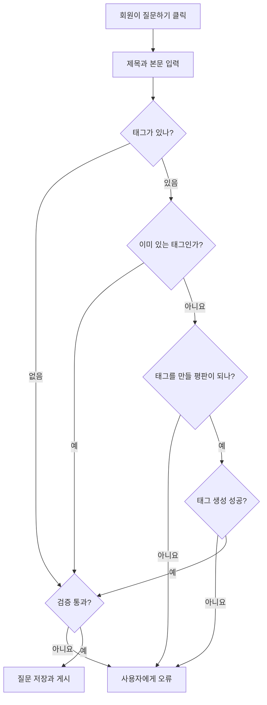
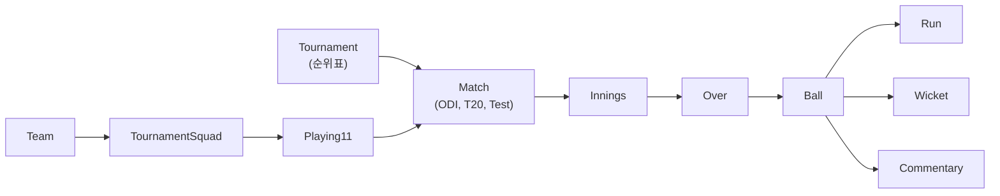
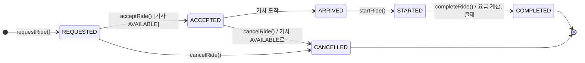

> GitHub 저장소 「[Grokking the Object Oriented Design Interview](https://github.com/tssovi/grokking-the-object-oriented-design-interview)」를 바탕으로 재구성한 노트다.

풀이 순서와 공통 부품은 [[ood-interview-approach|객체 지향 설계 면접: 풀이 순서와 반복되는 설계 부품]]에 있다. 이 계열은 **사용자끼리 상호작용**(사고팔기, 묻고 답하기, 연결, 호출과 배차)하는 서비스라 회원 역할 계층, 콘텐츠 객체(글, 댓글, 메시지), 검색 색인, 알림이 중심이다.

## 아마존 온라인 쇼핑몰

### 요구 사항

- 사용자는 팔 상품을 등록하고, 이름이나 분류로 검색한다. 검색과 조회는 누구나 하지만 **사려면 회원 등록**이 필요하다.
- 장바구니에 상품을 추가·삭제·수정하고, 결제해 산다. 상품에 별점과 리뷰를 단다.
- 배송지를 지정한다. **발송 전이면 주문을 취소**한다.
- 주문·배송 상태가 바뀌면 알림을 받는다. 신용카드나 계좌 이체로 결제한다. 배송 추적으로 주문의 현재 상태를 본다.

### 액터와 클래스

| 액터 | 하는 일 |
| --- | --- |
| 관리자 | 계정 관리, 상품 분류 추가·수정, 회원 정지·해제 |
| 손님(Guest) | 카탈로그 검색, 장바구니 담기·빼기, 회원 가입 |
| 회원(Member) | 손님이 하는 일 + 주문, 판매 상품 등록 |
| 시스템 | 주문·배송 알림 |

유스케이스: 상품 추가·수정(카탈로그 갱신), 이름·분류 검색, 장바구니 담기·빼기, 결제해 사기, 결제해 주문하기, 상품 분류 추가, 배송 알림.

| 클래스 | 책임과 속성 |
| --- | --- |
| `Account` | 사용자 이름, 비밀번호, 이름, 이메일, 전화, 배송지, 상태, 신용카드·은행 계좌 목록. `add_product()`, `add_product_review()` |
| `Customer` (추상) ← `Guest`, `Member` | 장바구니와 주문을 가진 역할. 손님은 `register_account()`, 회원은 계정을 갖고 `place_order()`. **장바구니는 계정 없이도 쓸 수 있게 `Customer`에 둔다** |
| `Catalog` (`Search` 구현) | 빠른 검색을 위한 상품명·분류 색인 |
| `ProductCategory` | 이름, 설명(책, 전자 기기 등) |
| `Product` | ID, 이름, 설명, 가격, 분류, **판매 가능 수량**, 판매자 계정. `update_price()` |
| `ProductReview` | 별점, 리뷰, 작성자 |
| `ShoppingCart` | 항목 목록. 추가, 삭제, 수량 변경, `checkout()` |
| `Item` | 상품 ID, 수량, 가격. 펜이 상품이면 재고 펜 10개가 각각 상품 항목이다 |
| `Order` | 주문 번호, 상태, 주문일, 주문 로그. `send_for_shipment()`, `make_payment()`, `add_order_log()` |
| `OrderLog` / `ShipmentLog` | 주문 상태 이력 / 배송 상태 이력 |
| `Shipment` | 배송 번호, 발송일, 도착 예정일, 배송 방법, 배송 로그 |
| `Notification` | 계정에 알림 전송 |
| `Payment` | 신용카드, 전자 계좌 이체 |

| enum | 값 |
| --- | --- |
| `OrderStatus` | `UNSHIPPED, PENDING, SHIPPED, COMPLETED, CANCELED, REFUND_APPLIED` |
| `ShipmentStatus` | `PENDING, SHIPPED, DELIVERED, ON_HOLD` |
| `PaymentStatus` | `UNPAID, PENDING, COMPLETED, FILLED, DECLINED, CANCELLED, ABANDONED, SETTLING, SETTLED, REFUNDED` |

### 흐름

쇼핑 활동은 「사이트 접속 → 둘러보기 또는 검색 → 찾으면 상품 보기 → 장바구니 담기 → 더 쇼핑하거나 장바구니 보기·수정 → 결제」의 반복이다. 시퀀스는 세 개로 나눈다.

| 시퀀스 | 메시지 |
| --- | --- |
| 카탈로그 검색 | `Customer` → `Catalog.searchProducts(string)` → `Product.getInfo(string)` → 상품 정보 → 일치하는 상품 목록 |
| 장바구니 담기 | `Customer` → `ShoppingCart.addItem(productId, quantity)` → `Item.verifyItem()` → 품절이면 오류, 아니면 성공 |
| 결제와 주문 | 아래 그림 |



## Stack Overflow

### 배경과 요구 사항

개발자가 묻고 답하는 커뮤니티다. 답변이 추천을 받으면 **평판 10점**, 질문이 추천을 받으면 **5점**을 얻고, 기여에 따라 배지를 받는다. 평판이 높아지면 투표, 댓글, 남의 글 편집 같은 권한이 열린다. 글은 위키처럼 고칠 수 있다.

- 손님은 질문을 검색·조회만 한다. 질문하거나 추천하려면 회원이 된다.
- 회원은 질문을 올리고, 열린 질문에 답하고, 질문·답변에 댓글을 단다. 질문·답변·댓글을 추천하고, 심각한 문제나 운영자 확인이 필요하면 신고(flag)한다.
- 자기 질문에 **현상금(bounty)** 을 걸어 주목을 끈다. 도움이 되면 배지를 받는다.
- 회원은 질문 종료와 (주제에서 크게 벗어나거나 질이 낮은) 질문 삭제에 투표한다. 운영자는 어떤 질문이든 종료·재개하고 삭제를 되돌린다.
- 질문에 태그를 단다. 가장 자주 쓰인 태그를 알아낸다.

### 액터와 클래스

| 액터 | 하는 일 |
| --- | --- |
| 관리자 | 회원 정지·해제 |
| 손님 | 질문 검색·조회 |
| 회원 | 손님이 하는 일 + 질문·답변·댓글 추가·삭제, 자기 글 삭제·복구 |
| 운영자(Moderator) | 회원이 하는 일 + 모든 질문 종료·삭제·복구 |
| 시스템 | 알림 전송, 배지 부여 |

유스케이스: 질문 검색, 현상금과 태그를 붙인 질문 만들기, 답변 추가·수정, 질문·답변에 댓글, 운영자의 질문 종료·삭제·복구.

| 클래스 | 책임과 속성 |
| --- | --- |
| `Question` (`Search` 구현) | 제목, 설명, 조회 수, 추천 수, 작성·수정 시각, 상태, **종료 사유**, 현상금, 작성자, 사진·댓글·답변 목록. `close()`, `undelete()`, `add_comment()`, `add_bounty()`, `search(query)` |
| `Answer` | 본문, **채택 여부**, 추천·신고 수, 작성 시각, 작성자, 사진 |
| `Comment` | 본문, 작성 시각, 신고·추천 수, 작성자 |
| `Tag` | 이름, 설명, **일간·주간 사용 빈도**(가장 많이 쓴 태그 계산용) |
| `Badge` | 이름, 설명 |
| `Photo` | ID, 경로, 생성일, 올린 회원 |
| `Bounty` | 평판 점수와 만료일 |
| `Account` | ID, 비밀번호, 이름, 주소, 이메일, 전화, 상태, **평판** |
| `Member` ← `Admin`, `Moderator` | 회원은 계정을 감싸고 배지를 갖는다(`create_question()`, `create_tag()`). 관리자는 정지·해제, 운영자는 `close_question()`, `undelete_question()` |
| `Notification` | 알림 전송과 평판에 따른 배지 부여 |

| enum | 값 |
| --- | --- |
| `QuestionStatus` | `OPEN, CLOSED, ON_HOLD, DELETED` |
| `QuestionClosingRemark` | `DUPLICATE, OFF_TOPIC, TOO_BROAD, NOT_CONSTRUCTIVE, NOT_A_REAL_QUESTION, PRIMARILY_OPINION_BASED` |
| `AccountStatus` | `ACTIVE, CLOSED, CANCELED, BLACKLISTED, BLOCKED` |

### 질문 올리기



시퀀스로 보면 `Member`가 `Question.setTitle()`, `setBody()`를 부르고, `Tag.getTags(tagText)`로 태그 ID를 받거나 없으면 `createTag(tagText, tagDescription)`, `addTag(tag)`를 거친다. 이어서 `createQuestion(questionText, tagId, bountyValue)`가 `Bounty.createBounty(bountyValue)`로 현상금을 만들고 `publishQuestion()`으로 게시한다.

## 온라인 증권 거래 시스템

### 요구 사항

- 사용자는 주식을 사고판다. 종목 시세를 담은 **관심 목록(watchlist)** 을 여러 개 둔다.
- 주문 종류는 **시장가, 지정가, 스톱 로스, 스톱 리밋** 네 가지다.
- 같은 종목을 여러 번 사면 **묶음(lot)** 을 구분한다.
- 분기 보고서와 연간 세금 명세서를 만든다. 수표, 전신 송금, 전자 계좌 이체로 입출금한다.
- 주문이 체결되면 알림을 보낸다.

### 액터와 클래스

| 액터 | 하는 일 |
| --- | --- |
| 관리자 | 회원 정지·해제 같은 관리 |
| 회원 | 종목 검색, 매수·매도, 관심 목록 관리 |
| 시스템 | 주문 알림, 거래소에서 시세를 주기적으로 가져오기 |

유스케이스: 가입·탈퇴, 관심 목록 추가·삭제·수정, 종목 코드로 검색, 매수·매도 주문, 주문 취소, 입출금.

| 클래스 | 책임과 속성 |
| --- | --- |
| `Account` ← `Member`, `Admin` | 이름, 주소, 이메일, 전화, 총자금, **거래 가능 자금**, 보유 종목. 회원은 가입일, 종목 포지션, 활성 주문을 갖는다 |
| `StockExchange` | **싱글턴.** 거래소와의 모든 상호작용(시세 가져오기, 주문 넣기)을 감싼다 |
| `Stock` | 종목 코드, 현재가 |
| `StockInventory` | 거래소에서 최신 시세를 가져와 보관한다. **모든 구성 요소는 이 클래스에서 시세를 읽는다** |
| `Watchlist` | 따라가고 싶은 종목 목록 |
| `Order` (추상) ← `MarketOrder`, `LimitOrder`, `StopLossOrder`, `StopLimitOrder` | 주문 ID, 매수 여부, 상태, 유효 기간 조건, 생성 시각, 체결 부분들. 지정가 주문은 가격 한도를 갖는다 |
| `OrderPart` | 부분 체결 하나. 100주 시장가 매수가 10달러에 70주, 10.05달러에 30주로 나눠 체결될 수 있다 |
| `StockLot` | 산 시점별 묶음. 어제 AAPL 100주, 오늘 50주를 샀으면 묶음 두 개이고, 팔 때 어느 묶음부터 팔지 고른다 |
| `StockPosition` | 사용자가 가진 모든 주식 |
| `Statement` | 분기 보고서, 연간 세금 명세서 |
| `DepositMoney` / `WithdrawMoney` | 수표, 전신 송금, 전자 이체로 돈 옮기기. 이체 한도 `MONEY_TRANSFER_LIMIT = 100000` |
| `Notification` | 회원 알림 |

| 주문 종류 | 동작 |
| --- | --- |
| 시장가(Market) | 지금 시장 가격으로 바로 사거나 판다 |
| 지정가(Limit) | 사거나 팔 가격을 정해 둔다 |
| 스톱 로스(Stop Loss) | 주가가 정한 가격에 닿으면 사거나 판다 |
| 스톱 리밋(Stop Limit) | 스톱 가격에 닿으면 지정가 주문으로 바뀌어 지정 가격이나 그보다 나은 가격에 체결된다 |

| enum | 값 |
| --- | --- |
| `OrderStatus` | `OPEN, FILLED, PARTIALLY_FILLED, CANCELLED` |
| `ReturnStatus` | `SUCCESS, FAIL, INSUFFICIENT_FUNDS, INSUFFICIENT_QUANTITY, NO_STOCK_POSITION` |
| `TimeEnforcementType` | `GOOD_TILL_CANCELLED`(취소할 때까지 유효), `FILL_OR_KILL`(전량 즉시 체결 아니면 취소), `IMMEDIATE_OR_CANCEL`(즉시 체결되는 만큼만 체결하고 나머지 취소), `ON_THE_OPEN`(장 시작에), `ON_THE_CLOSE`(장 마감에) |

### 주문 흐름

| 흐름 | 단계 |
| --- | --- |
| 지정가 매도 | 그 종목 포지션이 없으면 `NO_STOCK_POSITION` → 보유 수량이 모자라면 `INSUFFICIENT_QUANTITY` → 주문 생성·저장 → 거래소에 제출 → 실패면 상태를 실패로 저장, 성공이면 활성 주문에 추가 |
| 지정가 매수 | 거래 가능 자금이 수량 × 지정가보다 적으면 `INSUFFICIENT_FUNDS` → 이후는 매도와 같다 |
| 거래소 콜백 | `callback_stock_exchange(order_id, order_parts, status)`: 체결 부분을 붙이고 상태를 바꿔 저장한다. `FILLED`나 `CANCELLED`면 활성 주문에서 뺀다 |

활동 다이어그램으로는 「종목 검색·선택(매도는 보유 종목과 팔 묶음 선택) → 주문 종류 선택 → 수량, 가격 한도, 유효 기간 입력 → 예치금(매도는 보유 주식)이 충분한가 → 자금(주식)을 차감하고 거래소로 전송 → 거래소 확인 수신 → 주문 접수 안내 → 주문 수정 여부」다.

## LinkedIn

### 요구 사항

1. 회원은 기본 프로필, 경력, 학력, 기술, 성과를 추가한다.
2. 이름으로 회원이나 회사를 검색한다.
3. 다른 회원에게 연결 요청을 보내고 받아들인다. 다른 회원에게 **추천서**를 요청한다.
4. 프로필 통계(프로필 조회 수, 연결 수, 검색 노출 수)를 보여 준다.
5. 연결에게 공유할 글을 쓰고, 글에 댓글을 달고, 글이나 댓글에 좋아요·공유를 한다.
6. 다른 회원에게 메시지를 보낸다. 새 메시지, 연결 초대, 내 글의 댓글이 생기면 알림을 받는다.
7. 회사 페이지를 만들고 채용 공고를 올린다. 그룹을 만들고 가입한다. 다른 회원이나 회사를 팔로한다.

### 액터와 클래스

| 액터 | 하는 일 |
| --- | --- |
| 회원 | 회원·회사·채용 검색, 연결 요청, 글쓰기 등 |
| 관리자 | 회원 정지·해제 |
| 시스템 | 새 메시지, 연결 초대 알림 |

유스케이스: 프로필 추가·수정, 검색(회원에게 연결 요청 포함), 회원·회사 팔로·언팔로, 연결에게 메시지, 글쓰기(좋아요, 댓글), 알림.

| 클래스 | 책임과 속성 |
| --- | --- |
| `Member` (`Person` 상속) | 가입일, 헤드라인, 사진, **연결 추천 목록**, 팔로하는 회원·회사·그룹, 연결 목록, 프로필. `send_message()`, `create_post()`, `send_connection_invitation()` |
| `Admin` | `block_user()`, `unblock_user()` |
| `Profile` | 요약, 경력, 학력, 기술, 성과, 추천서, 통계. 항목마다 `add_*()` |
| `Experience` | 직함, 회사, 위치, 시작일, 종료일, 설명 |
| `Company` / `JobPosting` | 이름, 설명, 유형, 규모, 진행 중인 채용 공고 / 게시일, 설명, 고용 형태, 위치, 채용 완료 여부 |
| `Group` | 이름, 설명, 회원 수, 회원 목록 |
| `Post` / `Comment` | 본문, 좋아요 수, 공유 수, 작성자 / 글에 다는 댓글, 좋아요 |
| `Message` | 받는 사람, 본문, 첨부 미디어 |
| `Search` ← `SearchIndex` | 회원 이름, 회사 이름, 채용 공고 제목 맵. 같은 이름이 있으면 목록에 덧붙인다 |
| `Notification` | 회원 알림 |

| enum | 값 |
| --- | --- |
| `ConnectionInvitationStatus` | `PENDING, ACCEPTED, CONFIRMED, REJECTED, CANCELED` |
| `AccountStatus` | `ACTIVE, BLOCKED, BANNED, COMPROMISED, ARCHIVED, UNKNOWN` |

| 흐름 | 단계 |
| --- | --- |
| 경력 추가 | 경력 추가 화면 열기 → 직함, 회사, 위치, 기간, 설명 입력 → 문서·사진을 붙이면 미디어 고르기, 설명 달기, 저장 → 저장 클릭 → 시스템 검증 → 빠진 정보가 있으면 알리고, 없으면 경력 저장 |
| 메시지 보내기 | 새 메시지 화면 열기 → 받을 회원 검색·선택 → 본문 입력 → 문서·사진을 붙이면 업로드 → 보내기 → 검증 → 빠진 정보가 있으면 알림 → 받는 모든 회원에게 전송 → 이메일과 푸시 알림 |

## Facebook

LinkedIn과 뼈대가 같고, 친구 관계와 공개 범위, 페이지가 더해진다.

### 요구 사항

- 기본 프로필, 경력, 학력을 추가한다. 이름으로 회원, 그룹, 페이지를 검색하고, **게시물 안의 단어**로도 검색한다.
- 친구 요청을 보내고 수락·거절한다. **친구가 되지 않고도 팔로**한다.
- 그룹과 페이지를 만들고, 그룹에 가입하고 페이지를 팔로한다. 페이지에 **추천(recommendation)** 을 남긴다.
- 친구에게 공유할 글을 쓰고, 댓글·좋아요·공유를 한다.
- 친구로 이뤄진 **공개 범위 목록(privacy list)** 을 만들고, 글을 목록에 연결하면 그 목록의 회원에게만 보인다.
- 메시지를 보내고, 새 메시지·친구 요청·댓글 알림을 받는다.
- 확장 요구: 회원에게 **연결 추천**을 찾는 함수를 작성한다.

### 액터와 클래스

액터와 유스케이스는 LinkedIn과 같다(회원, 관리자, 시스템 / 프로필, 검색, 팔로, 메시지, 글, 알림). 차이 나는 클래스만 적는다.

| 클래스 | 책임과 속성 |
| --- | --- |
| `Member` | 회원 ID, 가입일, 이름, 프로필, 팔로하는 회원·페이지·그룹, 연결, 연결 추천, **받은 연결 요청 목록**. `search_member_suggestions()` |
| `Admin` | 정지·해제와 **페이지 활성화·비활성화** |
| `ConnectionInvitation` | 초대받은 회원, 상태, 생성·수정일. `accept_connection()`, `reject_connection()` |
| `Profile` / `Work` | 프로필 사진, 커버 사진, 성별, 경력, 학력, 장소, 통계 / 직함, 회사, 위치, 기간, 설명 |
| `Page` / `Recommendation` | ID, 이름, 설명, 유형, 회원 수, 추천 목록 / 별점, 설명, 작성일 |
| `PrivacyList` | 친구 목록. 글과 연결해 공개 범위를 정한다 |
| `Post`, `Comment`, `Message`, `Group` | 텍스트·사진·동영상, 좋아요·공유 수. 메시지는 `add_member()`로 받는 사람을 늘린다 |
| `SearchIndex` | 회원 이름, 그룹 이름, 페이지 제목, **게시물 단어** 맵 |
| `Notification` | 푸시 알림이나 이메일 |

| enum | 값 |
| --- | --- |
| `ConnectionInvitationStatus` | `PENDING, ACCEPTED, REJECTED, CANCELED` |
| `AccountStatus` | `ACTIVE, CLOSED, CANCELED, BLACKLISTED, DISABLED` |

새 글 흐름은 「새 글 화면 → 공개 범위 목록 지정 → 본문 입력 → 사진·동영상을 붙이면 업로드 → 게시 클릭 → 검증 → 빠진 정보가 있으면 알림 → 요청한 회원들에게 게시 → 이메일·푸시 알림」이다. 프로필에 경력을 더하는 흐름은 직책, 회사, 위치, 기간, 설명을 입력하고 검증한 뒤 저장한다.

### 연결 추천: 2단계 BFS

**친구의 친구 가운데 나와 공통 연결이 많은 사람**이 좋은 추천 후보다. 나에서 시작해 깊이 2까지 너비 우선 탐색(BFS)을 하면서, 깊이 2에서 만난 사람마다 몇 번 만났는지(= 공통 친구 수)를 센다.

```python
from collections import Counter

def connection_suggestions(member, top_n=10):
    friends = set(member.connections)
    counts = Counter()
    for friend in friends:                     # 깊이 1
        for candidate in friend.connections:   # 깊이 2
            if candidate is not member and candidate not in friends:
                counts[candidate] += 1          # 공통 친구 한 명 추가
    return [m for m, _ in counts.most_common(top_n)]
```

그래프 탐색 자체는 [[graph-basics|그래프의 기본과 표현 방법]]에 있다.

## Cricinfo

크리켓 전문 스포츠 뉴스 사이트다. 경기를 공 하나 단위(ball-by-ball) 해설로 생중계하고, 역대 경기 DB와 기사를 제공한다.

### 요구 사항

- 크리켓 팀과 경기를 모두 기록한다. 국제 규칙을 따른다. ODI, 테스트, T20 경기를 모두 다룬다.
- 경기를 공 하나 단위 해설로 보여 준다.
- 토너먼트에 나가는 팀은 **스쿼드**(선수 명단)를 발표하고, 경기마다 그중 **플레잉 일레븐**(11명)을 고른다.
- 선수, 경기, 토너먼트 통계를 기록하고 「역대 최다 위켓은 누구인가」, 「테스트 경기 100점 이상 최다 기록은 누구인가」 같은 전체 통계 질의에 답한다.

### 액터와 클래스

| 액터 | 하는 일 |
| --- | --- |
| 관리자 | 선수·팀·토너먼트·경기 추가와 수정, 공 하나 단위 기록 |
| 해설자 | 공 하나 단위 해설 추가 |

유스케이스: 팀과 선수 추가·수정, 토너먼트와 경기 추가, 공 기록, 경기장·심판·매치 레프리 추가, 통계 추가·갱신(일부는 시스템이 생성), 해설 추가.



| 클래스 | 책임과 속성 |
| --- | --- |
| `Player` | `Person`과 계약 목록 |
| `Team` | 이름, 선수, 뉴스, 코치. 토너먼트 스쿼드 추가 |
| `Tournament` | 토너먼트와 참가 팀의 순위표 |
| `TournamentSquad` / `Playing11` | 토너먼트 선수 명단과 토너먼트 통계 / 경기 출전 11명과 **12번째 선수** |
| `Match` (추상) ← `ODI`, `T20`, `Test` | 번호, 시작 시각, 결과, 팀, 이닝, 심판, 매치 레프리, 해설자, 경기 통계. `assign_stadium()`, `assign_referee()` |
| `Innings` → `Over` → `Ball` | 이닝 번호와 시작 시각, 오버 목록 / 오버 번호와 공 목록 / 투구자, 타자, 공 종류, 위켓, 득점, 해설 |
| `Run` | 공 하나의 득점 수와 종류 |
| `Wicket` | 아웃 종류, 아웃된 선수, 잡은 선수, 런아웃시킨 선수, 스텀핑한 선수 |
| `Commentator` / `Commentary` | 해설자 / 본문, 작성 시각, 작성자 |
| `Umpire`, `Referee`, `Stadium` | 심판, 매치 레프리(`assign_match()`), 경기장 |
| `Stat` / `StatQuery` | 선수·경기·토너먼트별 통계 / 「ODI 최다 100점」 같은 일반 통계 질의와 답 |

| enum | 값 |
| --- | --- |
| `MatchFormat` | `ODI, T20, TEST` |
| `MatchResult` | `LIVE, FINISHED, DRAWN, CANCELLED` |
| `UmpireType` | `FIELD, RESERVED, TV` |
| `WicketType` | `BOLD`(볼드), `CAUGHT, STUMPED, RUN_OUT, LBW, RETIRED_HURT, HIT_WICKET, OBSTRUCTING` |
| `BallType` | `NORMAL, WIDE, WICKET, NO_BALL` |
| `RunType` | `NORMAL, FOUR, SIX, LEG_BYE, BYE, NO_BALL, OVERTHROW` |

공 기록 흐름은 「공 추가 화면 → 공 종류 선택(일반, 와이드, 노볼, 위켓) → 위켓이면 위켓 정보 입력 → 득점 종류마다 `Run` 기록 추가 → 해설 추가 → 공 저장」이다.

## Uber

### 요구 사항

1. 사용자는 승객(Rider)과 기사(Driver) 두 종류다.
2. 승객은 출발지와 도착지를 정해 호출한다. 기사는 호출을 수락하거나 거절한다.
3. 시스템이 승객을 근처의 빈 기사와 이어 준다.
4. **거리와 시간**으로 요금을 계산한다. 차량 등급(UberX, UberXL, UberBlack 등)을 지원한다.
5. 승객과 기사가 서로 평가한다.
6. 운행 상태(호출, 수락, 출발, 완료, 취소)를 추적한다. 기사는 자기 운행 가능 상태를 바꾼다. 결제를 처리한다.

### 액터와 클래스

| 액터 | 하는 일 |
| --- | --- |
| 승객 | 호출, 빈 기사 보기, 결제, 기사 평가 |
| 기사 | 호출 수락·거절, 운행 가능 상태 변경, 운행 시작·완료, 승객 평가 |
| 시스템 | 매칭, 요금 계산, 결제, 운행 생명주기 관리 |

유스케이스: 호출, 수락, 운행 시작(승객 탑승), 운행 완료(도착지), 취소(승객이나 기사), 서로 평가, 결제, 위치 갱신(기사가 계속 보낸다), 요금 계산.

| 클래스 | 책임과 속성 |
| --- | --- |
| `User` (추상) ← `Rider`, `Driver` | ID, 이름, 이메일, 전화, 평점(처음 5.0), 평가 수. `updateRating()`은 **누적 평균**: (평점 × 평가 수 + 새 점수) / (평가 수 + 1) |
| `Rider` | 운행 이력, 결제 수단. `requestRide(pickup, dropoff, type)`, `rateDriver()` |
| `Driver` | 차량, 현재 위치, 상태(처음 `OFFLINE`), 운행 이력. `acceptRide()`는 `AVAILABLE`일 때만 성공하고 자기를 `BUSY`로 바꾼다. `completeRide()`가 다시 `AVAILABLE`로 돌린다 |
| `Ride` | UUID, 승객, 기사, 출발·도착 위치, 등급, 상태, 요금, 거리(생성 때 계산), 호출·출발·도착 시각, 결제. 상태를 `STARTED`·`COMPLETED`로 바꿀 때 시각을 기록한다 |
| `Location` | 위도, 경도. `distanceTo()`는 하버사인(Haversine) 공식, 지구 반지름 6371km |
| `Vehicle` | 번호판, 제조사, 모델, 연식, 등급, 정원 |
| `Payment` | 금액, 상태, 수단, 시각. `processPayment()`, `refund()` |
| `Rating` | 승객과 기사가 준 평가 |
| `UberSystem` | **싱글턴**(`synchronized getInstance()`). 기사·승객·운행 맵, 매칭, 요금 계산 |

| enum | 값 |
| --- | --- |
| `RideStatus` | `REQUESTED, ACCEPTED, ARRIVED, STARTED, COMPLETED, CANCELLED` |
| `RideType` | `UBER_X(1.0), UBER_XL(1.5), UBER_BLACK(2.0), UBER_POOL(0.8)`: 괄호 안은 요금 배수 |
| `DriverStatus` | `AVAILABLE, BUSY, OFFLINE` |
| `PaymentStatus` | `PENDING, COMPLETED, FAILED, REFUNDED` |



### 매칭과 요금

- **매칭(`findNearestDriver`)**: 모든 기사를 훑어 `AVAILABLE`이고 차량 등급이 요청과 같은 기사 가운데 출발지와의 거리가 가장 짧은 기사를 고른다. 실제 서비스는 전체를 훑지 않고 지오해시·쿼드트리 같은 공간 색인을 쓴다([[location-based-service|위치 기반 서비스 설계]]).
- **요금(`calculateFare`)**: `(기본 2.0 + 거리(km) × 1.5 + 시간(분) × 0.3) × 등급 배수`를 소수 둘째 자리로 반올림한다. 시간은 출발·도착 시각이 있으면 그 차이, 없으면 평균 시속 30km로 추정한다. 10km를 UberX로 가면 추정 20분이라 2 + 15 + 6 = 23달러, UberXL이면 34.5달러다.
- **완료(`completeRide`)**: 요금 계산 → 결제 생성·처리 → 운행에 결제 연결 → 기사가 운행 완료. **취소**는 상태를 `CANCELLED`로 바꾸고 배정된 기사를 `AVAILABLE`로 되돌린다.

| 동시성 문제 | 대응 |
| --- | --- |
| 여러 승객이 동시에 호출 | 스레드 안전한 컬렉션과 동기화 |
| 기사 위치가 쉴 새 없이 갱신 | 위치 갱신 큐로 경쟁 상태를 피한다 |
| 한 기사가 두 호출에 배정 | 매칭 구간에 락을 걸어 한 번에 한 운행만 배정한다 |
| 결제 | 원자적 결제 트랜잭션 |

확장 질문으로는 수요·공급에 따른 **할증 요금**, 여러 승객이 함께 타는 합승(UberPool), 기사 수익 집계와 분석, 실시간 운행 알림, 지도 서비스를 이용한 경로 최적화, 안전 기능(긴급 버튼, 지인과 운행 공유, 기사 신원 확인), 예약 호출, 프로모션 코드와 할인이 나온다.

## 정리

- 플랫폼 계열은 역할 계층(손님 → 회원 → 운영자·관리자)과 콘텐츠 객체(상품, 질문·답변·댓글, 글·메시지, 공·해설)가 뼈대다.
- 상태 이력이 중요한 곳(주문, 배송, 운행)은 상태 enum과 로그를 함께 두고, 외부 시스템(거래소, 결제)과의 경계는 싱글턴 창구나 콜백으로 감싼다.
- 검색은 기준별 색인 클래스로, 추천은 그래프 탐색으로, 매칭과 요금은 명시적인 공식으로 설명한다.
- 규모가 커질 때의 질문(공간 색인, 동시성, 할증)은 시스템 디자인 쪽 노트로 이어진다.

관련 노트: [[ood-interview-approach|객체 지향 설계 면접: 풀이 순서와 반복되는 설계 부품]], [[ood-booking-rental-systems|객체 지향 설계 사례: 예약·대여 시스템]], [[ood-machines-and-games|객체 지향 설계 사례: 주차장·ATM과 카드·보드 게임]], [[location-based-service|위치 기반 서비스 설계: 지오해시, 쿼드트리, 지도]], [[graph-basics|그래프의 기본과 표현 방법]]
