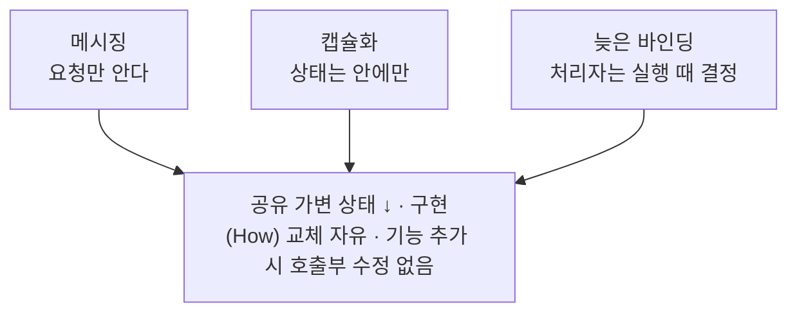

> Eddy의 「[창시자 앨런 케이가 말하는, 객체 지향 프로그래밍의 본질](https://velog.io/@eddy_song/alan-kay-OOP)」(2022.01)을 바탕으로 재구성한 노트다. 원 자료는 앨런 케이가 Stefan Ram에게 보낸 [OOP 정의 메일](https://www.purl.org/stefan_ram/pub/doc_kay_oop_en)(2003)이다.

## 메시징 관점의 객체 지향이란

객체 지향 프로그래밍(Object-Oriented Programming)이라는 말은 1960년대 후반 앨런 케이(Alan Kay)가 만들었고, Xerox PARC의 Smalltalk로 구체화됐다. 이 관점에서 프로그램은 **자기 상태를 숨긴 독립된 개체들이 메시지를 주고받으며 협력하는 시스템**이다. 흔히 OOP의 정의로 배우는 「클래스·상속·다형성」과는 출발점이 다르다.

케이가 남긴 정의는 한 문장이다.

> OOP to me means only messaging, local retention and protection and hiding of state-process, and extreme late-binding of all things.

## 무엇을 풀려고 했나

행동(프로시저)을 기준으로 코드를 묶으면 데이터는 전역에 놓이고 여러 함수가 그것을 직접 고친다. 이 방식을 프로시저 추상화라고 한다.

| 문제 | 결과 |
| --- | --- |
| 여러 함수가 공유 가변 데이터를 건드린다 | 값이 어디서 바뀌었는지 추적하기 어렵다 |
| 데이터 구조가 함수 곳곳에 퍼져 있다 | 구조를 바꾸면 관련 함수를 모두 고쳐야 한다 |
| 코드가 커질수록 의존이 얽힌다 | 수정이 두렵고 버그가 는다 |

대안의 영감은 두 곳에서 왔다.

- **세포**: 단순한 세포가 막으로 내부를 보호한 채 화학 신호로 협력해 복잡한 생명체를 이룬다.
- **네트워크(ARPANET)**: 독립된 컴퓨터가 약속된 형식의 메시지만 주고받아 큰 시스템을 이룬다.

즉 **관련된 데이터와 프로시저를 작은 컴퓨터 하나처럼 묶고, 바깥과는 메시지로만 소통**하게 하자는 것이다. 절차적 프로그래밍에서 클래스까지의 단계별 흐름은 [[oop-and-javascript|객체 지향 프로그래밍과 JavaScript]]에 있다.

## 세 가지 본질

| 요소 | 뜻 | 얻는 것 |
| --- | --- | --- |
| 메시징(Messaging) | 다른 객체의 데이터를 직접 고치지 않고 「이 일을 해 달라」고 요청한다 | 객체 사이 결합이 요청 형식(인터페이스)으로만 남는다 |
| 캡슐화(local retention, protection, hiding of state-process) | 상태와 그 상태를 바꾸는 과정을 객체 안에 가둔다 | 공유 가변 데이터가 줄고, 변경의 영향 범위가 객체 하나로 좁아진다 |
| 늦은 바인딩(Extreme late-binding) | 어떤 코드가 메시지를 처리할지 실행 시점에 정한다 | 호출하는 쪽을 고치지 않고 처리하는 객체를 갈아 끼운다 |

메시지는 겉으로는 함수 호출과 비슷하다. 차이는 **처리 방식을 받는 쪽이 정한다**는 점이다. 보내는 쪽은 무엇(What)을 원하는지만 말하고, 어떻게(How)는 모른다.

```ts
class Seller {
  #tickets = 10;
  #cash = 0;

  sell(customer: Customer) {          // 메시지를 받으면 처리 방식은 Seller가 정한다
    if (this.#tickets === 0) return null;
    this.#cash += customer.pay(10_000); // 고객의 지갑을 열지 않고 「지불해 달라」고 요청한다
    this.#tickets -= 1;
    return new Ticket();
  }
}
```

판매자는 고객의 돈을 직접 빼지 않는다. 고객이 현금 대신 카드로 내도록 바뀌어도 `pay` 메시지만 유지되면 `Seller`는 그대로다. 같은 메시지를 다른 객체가 다르게 처리하는 것은 늦은 바인딩 덕분이고, 다형성은 그 결과다.

## 세 요소가 합쳐질 때



비유하면 비트만 바꿔 끼우는 다용도 드라이버다. 손잡이(메시지)는 그대로 두고 끝(구현)만 상황에 맞게 바꾼다.

## 본질이 아닌 것

케이는 「객체」라는 이름이 사람들을 작은 아이디어에 묶어 두었다고 아쉬워하며 **큰 아이디어는 메시징**이라고 강조했다. 이 관점에서 다음 개념은 객체 지향을 구현하는 한 방식이지 필수 조건이 아니다.

| 개념 | 위치 |
| --- | --- |
| 클래스 | 객체를 찍어 내는 수단 중 하나. JavaScript는 프로토타입으로 시작했고 `class`는 나중에 얹은 문법이다 |
| 상속 | 재사용 수단 중 하나. 결합이 강해 지금은 조합(composition)을 먼저 권한다 |
| 다형성 | 메시징과 늦은 바인딩이 있으면 자연히 따라오는 결과 |

이 개념들이 쓸모없다는 뜻은 아니다. 다만 객체 지향을 처음 배울 때 클래스 문법부터 보면 **객체 사이의 협력**이라는 핵심을 놓치기 쉽다. 같은 이유로 「메시지 지향 프로그래밍」이라는 이름이 더 정확하다는 주장도 있다.

## 정리

- 객체 지향의 출발점은 공유 가변 데이터 때문에 바꾸기 어려워진 프로시저 중심 코드였다.
- 해법은 세포와 네트워크처럼 **상태를 숨긴 독립 개체가 메시지로 협력**하는 구조다.
- 본질은 메시징, 캡슐화, 늦은 바인딩이다. 클래스·상속은 구현 수단이다.
- 객체를 설계할 때는 「어떤 데이터를 가지나」보다 **「어떤 메시지를 주고받나」**를 먼저 정한다.

관련 노트: [[oop-and-javascript|객체 지향 프로그래밍과 JavaScript]], [[frontend-solid|프론트엔드와 SOLID 원칙]], [[functional-programming|함수형 프로그래밍]], [[class|class 문법]], [[abstract-class-vs-interface|추상 클래스와 인터페이스]], [[responsibility-driven-design|책임 주도 설계]]
