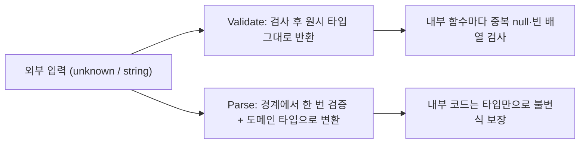

> Alexis King의 「[Parse, don't validate](https://lexi-lambda.github.io/blog/2019/11/05/parse-don-t-validate/)」와 emewjin의 「[Parse, don't validate in TypeScript](https://emewjin.github.io/parse-dont-validate-typescript)」(2026.05)를 바탕으로 재구성한 노트다.

## Validate와 Parse의 차이

**"검증하지 말고 파싱하라(Parse, don't validate)"** 는 외부에서 들어온 느슨한 데이터를 검사할 때 `boolean`이나 `void`만 돌려주고 원래 타입을 그대로 두지 말고, **검사를 통과했다는 증거를 더 좁은 출력 타입으로 돌려주라**는 타입 주도 설계(Type-Driven Design) 원칙이다.

| 구분 | Validate (검증) | Parse (파싱) |
| --- | --- | --- |
| 함수 시그니처 예시 | `(input: string[]) => void` (실패 시 throw) | `(input: string[]) => NonEmptyArray<string> \| Error` |
| 검사 뒤 남는 정보 | 타입 시스템에 **아무것도 남지 않음** | **불변식(invariant)이 반환 타입에 인코딩됨** |
| 후속 코드의 부담 | 호출자마다 `if (arr.length === 0)`을 반복 검사하거나 `!` 단언 | 반환 타입만 받으면 이미 유효함이 컴파일 타임에 보장됨 |

검증 함수는 검사를 마친 순간 그 사실을 **버린다**. 결국 코드베이스 곳곳에서 같은 검사를 중복하거나("이 값은 앞에서 검증했을 테지"라는 암묵적 가정), 방어 코드가 여기저기 흩어지는 **산탄총 파싱(Shotgun Parsing)** 으로 이어진다.



## TypeScript에서의 구현 패턴

### 1. 경계에서 `unknown`을 도메인 타입으로 파싱

API 응답, 폼 입력, URL 쿼리, 로컬 스토리지 값은 모두 런타임에 모양이 바뀔 수 있는 외부 입력이다. `as User` 같은 타입 단언은 컴파일러만 속이고 런타임 보장이 없다.

```ts
import { z } from "zod";

const EmailSchema = z.string().email().brand<"Email">();
type Email = z.infer<typeof EmailSchema>;

function parseEmail(raw: unknown): Email {
  return EmailSchema.parse(raw);
}

// 내부 도메인 함수는 이미 검증된 Email만 받는다.
function sendWelcomeMail(to: Email) {
  // 이메일 형식 재검증이 필요 없다.
}
```

### 2. 브랜디드 타입(Branded Type)으로 원시 타입 구분

TypeScript는 **구조적 타이핑(Structural Typing)** 을 쓰므로 `type UserId = string`과 `type OrderId = string`을 서로 바꿔 넣어도 컴파일 에러가 나지 않는다. 교차 타입으로 브랜드 태그를 붙이면 파싱 함수를 거친 값만 해당 타입으로 인정된다.

```ts
type NonEmptyString = string & { readonly __brand: "NonEmptyString" };

function parseNonEmpty(value: string): NonEmptyString | null {
  const trimmed = value.trim();
  return trimmed.length > 0 ? (trimmed as NonEmptyString) : null;
}
```

### 3. 판별 유니온(Discriminated Union)으로 불가능한 상태 배제

선택적 필드를 여러 개 두면 `isLoading: true`이면서 `data`와 `error`가 동시에 있는 모순 상태가 허용된다. 파싱 결과나 상태를 판별 유니온으로 좁히면 불가능한 조합 자체를 표현할 수 없다.

```ts
type FetchState<T> =
  | { status: "loading" }
  | { status: "success"; data: T }
  | { status: "error"; error: Error };
```

### 4. 타입 가드(`is`)와 어서션 함수(`asserts`)

새 래퍼 타입을 만들기 부담스러운 경계에서는 TypeScript의 타입 술어(`value is T`)로 검사 결과와 타입 좁히기를 묶는다.

```ts
function isNonEmptyArray<T>(arr: readonly T[]): arr is readonly [T, ...T[]] {
  return arr.length > 0;
}
```

## 비용과 주의할 점

- **과도한 파서 남용 금지**: 시스템 경계(HTTP 요청·응답, 폼, 환경변수, 파일 읽기)에서 이미 신뢰 가능한 도메인 타입으로 파싱했다면, 내부 헬퍼 함수마다 또 스키마 파서를 돌릴 필요는 없다.
- **부분 변경 시 타입 재확인**: 파싱한 뒤 객체를 풀어서(`{ ...user, email: rawInput }`) 다시 조합하면 불변식이 깨질 수 있으므로, 도메인 생성·변경 함수도 같은 파서나 생성자를 통하게 만든다.
- **런타임 오버헤드**: 대용량 배열(수만 건 이상)을 매 프레임 `zod.parse`로 검증하면 병목이 될 수 있어, 핫 패스에서는 얇은 타입 가드나 경계 1회 파싱으로 제한한다.

## 정리

- 검증(`validate`)은 사실을 확인한 뒤 타입 정보를 버리고, 파싱(`parse`)은 그 사실을 **반환 타입에 고정**한다.
- 시스템의 바깥 경계에서 `unknown`을 브랜디드 타입·판별 유니온·스키마 파서로 한 번 파싱하면, 내부 도메인 로직에서 방어적 중복 검사와 `as` 단언을 걷어낼 수 있다.

관련 노트: [[typescript-practical-patterns|TypeScript 실전 패턴]], [[typescript-advanced-types|TypeScript 고급 타입]], [[type-systems|타입 시스템]]
