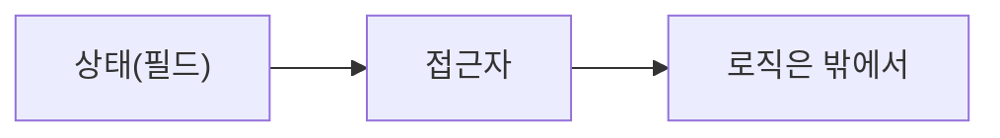
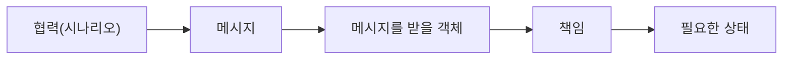

> 「[생각하라, 객체지향처럼](https://techblog.woowahan.com/2502/)」을 바탕으로 재구성한 노트다. 의존성 관리 쪽 이야기는 조영호의 「우아한 객체지향」([슬라이드](https://www.slideshare.net/baejjae93/ss-150432699), [발표 영상](https://youtu.be/dJ5C4qRqAgA), 2019)을 더 읽을거리로 둔다. 짧은 시간에 객체 설계 문제를 푸는 순서는 「[checkcheckzz/system-design-interview](https://github.com/checkcheckzz/system-design-interview)」의 Object Oriented Design 팁으로 보강했다.

## 책임 주도 설계란

**책임 주도 설계(Responsibility-Driven Design)**는 객체를 데이터 묶음이 아니라 **책임을 가진 자율적인 존재**로 보고, 객체 사이의 협력에서 출발해 설계하는 방법이다.

데이터 중심으로 설계하면 테이블을 먼저 그리고 그 컬럼을 클래스 필드로 옮긴 뒤 getter·setter를 단다. 그러면 로직이 객체 밖(서비스 계층)으로 새고 객체는 수동적인 자료구조가 된다. 책임 주도 설계는 순서를 뒤집는다.

데이터 중심:

책임 주도:

## 핵심 개념

| 개념 | 뜻 |
| --- | --- |
| **협력** | 객체들이 메시지를 주고받으며 하나의 기능을 완성하는 과정. 설계의 첫 목표는 훌륭한 객체가 아니라 **훌륭한 협력**이다 |
| **메시지** | 객체에게 보내는 요청. 협력을 설계할 때 객체보다 **메시지를 먼저** 정한다 |
| **책임** | 객체가 협력 안에서 맡는 일. 아는 것(상태)과 하는 것(행동)으로 나뉜다. 스스로 못 하는 일은 다른 객체에 메시지를 보내 맡긴다 |
| **인터페이스** | 객체가 **받을 수 있는 메시지의 집합**. 밖에 드러나는 것은 이것뿐이다 |
| **타입과 클래스** | 타입은 받을 수 있는 요청의 집합, 클래스는 그 구현이다. 서로 다른 클래스의 객체가 같은 타입일 수 있다 |
| **자율성** | 객체는 자기 상태를 스스로 관리한다. 설계할 때는 무생물도 능동적인 주체처럼 의인화해서 생각한다 |

## 설계 순서

1. **시나리오를 적는다.** 사용자가 원하는 기능을 문장으로 쓴다.
2. **필요한 메시지를 뽑는다.** 「주문 금액을 계산하라」처럼 무엇을 요청할지 정한다.
3. **메시지를 받을 객체를 고른다.** 그 일에 필요한 정보를 가장 많이 아는 객체(정보 전문가)가 후보다.
4. **책임에 필요한 상태를 정한다.** 속성은 내부 구현이다. 인터페이스를 정할 때 내부 자료구조를 가정하지 않는다.
5. **협력 대상의 참조를 받는다.** 생성자나 메서드 인자로 넘겨받는다(의존성 주입).
6. **구현해서 설계를 검증한다.** 설계는 구현을 위한 스케치다. 코드와 테스트로 피드백을 받아 고친다.

도메인 모델은 이 과정의 지도 역할을 한다. 도메인을 이루는 타입과 그 관계를 파악하면 메시지를 받을 객체 후보가 보인다.

### 짧은 시간에 객체 설계 문제를 풀 때

「주차장을 설계하라」, 「엘리베이터를 설계하라」 같은 객체 설계 문제도 같은 순서를 압축해 쓴다.

| 단계 | 할 일 |
| --- | --- |
| 1. 시나리오와 사용 사례 | 누가, 어떤 순서의 사건으로 시스템에서 무엇을 얻나를 적는다. 다중 스레드 여부, 읽기 위주인지 쓰기 위주인지 같은 특수 요구도 묻는다 |
| 2. 객체 정의 | 시나리오의 핵심 개념마다 클래스 후보를 둔다. 명사는 속성·클래스, 동사는 메서드 후보다. 다만 위 원칙대로 속성보다 메시지(책임)를 먼저 정한다 |
| 3. 관계 | 유일해야 하는 인스턴스(싱글턴), 하나가 여럿을 가진다(합성), 하나가 다른 것의 한 종류다(상속, 대개는 인터페이스와 합성이 낫다) |
| 4. 패턴 적용 | 바뀔 부분이 보이면 [[gof-design-patterns\|디자인 패턴]]으로 감싸 재사용과 확장에 대비한다 |

## 의존성으로 이어지는 문제

협력을 설계하면 객체 사이에 **의존성**이 생긴다. 책임 배치가 끝난 다음 단계의 질문은 의존성을 어떻게 관리하느냐다.

| 문제 | 방향 |
| --- | --- |
| 패키지 사이 의존성 사이클 | 중간 객체·인터페이스를 두어 의존 방향을 한쪽으로 돌린다(의존성 역전) |
| 객체 참조로 모든 것이 이어짐 | 경계를 넘는 관계는 객체 참조 대신 **ID로 참조**해 결합을 끊는다 |
| 한 트랜잭션에서 너무 많은 일 | 후속 처리를 **도메인 이벤트**로 분리한다 |

자세한 경계 설계는 [[domain-driven-design|DDD]]의 애그리거트와 이어진다.

## 정리

- 객체가 아니라 협력에서 시작한다.
- 메시지가 객체를 고른다. 객체가 메시지를 고르지 않는다.
- 인터페이스는 받는 메시지의 집합이고, 상태는 책임을 따라온다.
- 설계는 구현으로 검증한다.

관련 노트: [[oop-messaging|객체 지향의 본질: 메시징]], [[abstract-class-vs-interface|추상 클래스와 인터페이스]], [[gof-design-patterns|GoF 디자인 패턴]], [[domain-driven-design|도메인 주도 설계(DDD)]], [[programming-paradigms|프로그래밍 패러다임]]
