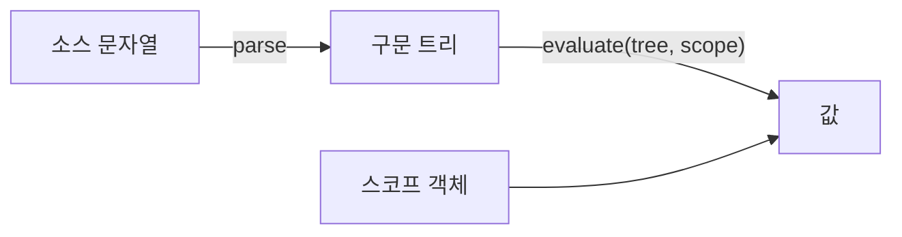

> Marijn Haverbeke의 『[Eloquent JavaScript](https://eloquentjavascript.net/)』(4판, 2024) 12장 「Project: A Programming Language」를 바탕으로 재구성한 노트다.

## 인터프리터는 그냥 프로그램이다

프로그래밍 언어를 구현하는 데 마법은 없다. **파서(parser)** 가 소스 문자열을 프로그램 구조를 담은 자료 구조로 바꾸고, **평가기(evaluator)** 가 그 구조를 읽어 값을 계산한다. 둘 다 평범한 함수다. 목표를 낮게 잡으면 함수 정의와 재귀까지 되는(즉 어떤 계산이든 표현할 수 있는) 언어를 150줄 안팎으로 만들 수 있다.

이 노트의 예제 언어는 Egg다. 문법이 극단적으로 균일하다.

```text
do(define(x, 10),
   if(>(x, 5),
      print("large"),
      print("small")))
```

- **모든 것이 식이다.** 식은 바인딩 이름(word), 숫자·문자열(value), 적용(apply) 셋 중 하나다.
- 적용은 `f(a, b)`처럼 괄호로 쓴다. 함수 호출뿐 아니라 `if`, `while`, `do`, 그리고 JavaScript에서는 연산자인 `>`·`+`도 모두 적용이다.
- 블록 문법이 없으므로 여러 식을 차례로 실행하는 `do`가 따로 있다.



## 파서: 문자열 → 구문 트리

`>(x, 5)`는 다음 객체가 된다. 식이 식을 품고 그 식이 또 식을 품는 모양이라 **구문 트리(syntax tree)** 라 부른다(구체 구문과 추상 구문 트리의 구분은 [[programming-language-semantics|프로그래밍 언어 의미론]]).

```javascript
{
  type: "apply",
  operator: { type: "word", name: ">" },
  args: [
    { type: "word", name: "x" },
    { type: "value", value: 5 }
  ]
}
```

줄 단위로 끊어 읽으면 되는 INI 파일과 달리, 프로그램은 식 안에 식이 들어가는 **재귀 구조**다. 그래서 파서도 언어의 재귀를 그대로 닮은 재귀 함수로 짠다(재귀 하강 파싱).

```javascript
function parseExpression(program) {
  program = skipSpace(program)
  let match, expr
  if ((match = /^"([^"]*)"/.exec(program))) {
    expr = { type: "value", value: match[1] }          // 문자열
  } else if ((match = /^\d+\b/.exec(program))) {
    expr = { type: "value", value: Number(match[0]) }  // 숫자
  } else if ((match = /^[^\s(),#"]+/.exec(program))) {
    expr = { type: "word", name: match[0] }            // 이름
  } else {
    throw new SyntaxError("Unexpected syntax: " + program)
  }
  return parseApply(expr, program.slice(match[0].length))
}

function parseApply(expr, program) {
  program = skipSpace(program)
  if (program[0] != "(") return { expr, rest: program }  // 적용이 아니면 그대로
  program = skipSpace(program.slice(1))
  expr = { type: "apply", operator: expr, args: [] }
  while (program[0] != ")") {
    const arg = parseExpression(program)                 // 인자마다 재귀
    expr.args.push(arg.expr)
    program = skipSpace(arg.rest)
    if (program[0] == ",") program = skipSpace(program.slice(1))
    else if (program[0] != ")") throw new SyntaxError("Expected ',' or ')'")
  }
  return parseApply(expr, program.slice(1))              // f(1)(2) 처리
}

function parse(program) {
  const { expr, rest } = parseExpression(program)
  if (skipSpace(rest).length > 0) throw new SyntaxError("Unexpected text after program")
  return expr
}
```

- 각 함수는 **파싱한 식과 남은 문자열**을 함께 돌려준다. 호출한 쪽이 남은 문자열로 다음 조각을 이어 읽는다.
- `parseExpression`과 `parseApply`가 서로를 부르는 **간접 재귀**다.
- 적용 결과에 또 괄호가 올 수 있으므로(`multiplier(2)(1)`) `parseApply`는 끝에서 자신을 다시 부른다.
- 원자 요소 셋(문자열, 숫자, 이름)은 정규식으로 알아본다. 맞는 것이 없으면 표준 에러 클래스인 `SyntaxError`를 던진다.
- 실제 언어라면 각 식의 줄·열 위치를 노드에 저장해 에러 메시지에 쓴다.

## 평가기: 트리를 걸으며 값 만들기

```javascript
const specialForms = Object.create(null)

function evaluate(expr, scope) {
  if (expr.type == "value") return expr.value
  if (expr.type == "word") {
    if (expr.name in scope) return scope[expr.name]
    throw new ReferenceError(`Undefined binding: ${expr.name}`)
  }
  // apply
  const { operator, args } = expr
  if (operator.type == "word" && operator.name in specialForms) {
    return specialForms[operator.name](args, scope)      // 인자를 평가하지 않고 넘긴다
  }
  const op = evaluate(operator, scope)
  if (typeof op != "function") throw new TypeError("Applying a non-function.")
  return op(...args.map((arg) => evaluate(arg, scope)))  // 인자를 먼저 평가하고 호출
}
```

평가기의 재귀 구조는 파서와 같고, 둘 다 언어 구조를 닮았다. 파싱하면서 바로 평가할 수도 있지만 둘을 나눠 두면 각각을 바꾸고 재사용하기 쉽다. 이렇게 **구문 트리를 직접 걸으며 실행하는 방식**을 트리 순회 인터프리터(tree-walking interpreter)라 한다.

## 특수 형식: 인자를 먼저 평가하면 안 되는 것

일반 함수 호출은 **모든 인자를 먼저 평가한 뒤** 함수를 부른다(적극적 평가). `if`를 함수로 만들면 참일 때 실행할 식과 거짓일 때 실행할 식이 둘 다 먼저 실행된다. 그래서 `if`·`while`처럼 평가 순서를 스스로 정해야 하는 구문은 **특수 형식(special form)** 으로 두고, 평가되지 않은 인자 트리와 스코프를 받아 필요한 것만 평가한다. 평가 전략의 이론은 [[programming-language-semantics|프로그래밍 언어 의미론]]의 「평가 전략」에 있다.

| 특수 형식 | 하는 일 | 돌려주는 값 |
| --- | --- | --- |
| `if(조건, 그러면, 아니면)` | 조건이 `false`가 아니면 둘째, 맞으면 셋째 인자만 평가 | 평가한 쪽의 값. 문이 아니라 식이라 JavaScript의 `?:`에 가깝다 |
| `while(조건, 몸)` | 조건이 `false`가 될 때까지 몸을 반복 평가 | `false` (Egg에는 `undefined`가 없다) |
| `do(식...)` | 인자를 위에서 아래로 차례로 평가 | 마지막 식의 값 |
| `define(이름, 식)` | 식을 평가해 현재 스코프에 바인딩 | 대입한 값 (JavaScript의 `=`처럼) |
| `fun(매개변수..., 몸)` | 함수 값을 만든다 | JavaScript 함수 |

Egg의 `if`는 오직 `false`만 거짓으로 친다. `0`이나 빈 문자열은 참이다. 언어마다 무엇을 거짓으로 볼지(truthiness)는 설계 선택이다.

```javascript
specialForms.if = (args, scope) => {
  if (args.length != 3) throw new SyntaxError("Wrong number of args to if")
  return evaluate(args[0], scope) !== false
    ? evaluate(args[1], scope)
    : evaluate(args[2], scope)
}
```

## 환경: 스코프는 객체, 중첩은 프로토타입 체인

평가기가 받는 `scope`는 **이름 → 값** 대응을 담은 객체다. 전역 스코프에 불리언과 연산자, 출력 함수를 넣어 두면 문법을 늘리지 않고도 기능이 생긴다. 불리언도 특별한 문법 없이 `true`·`false`라는 이름에 값을 묶을 뿐이다.

```javascript
const topScope = Object.create(null)
topScope.true = true
topScope.false = false
for (const op of ["+", "-", "*", "/", "==", "<", ">"]) {
  topScope[op] = Function("a, b", `return a ${op} b;`)   // 연산자 함수를 문자열로 합성
}
topScope.print = (value) => { console.log(value); return value }

function run(program) {
  return evaluate(parse(program), Object.create(topScope)) // 전역을 원형으로 둔 새 스코프
}
```

**중첩 스코프를 프로토타입 체인으로 표현한다.** `Object.create(바깥 스코프)`로 만든 안쪽 스코프는 자기 바인딩을 따로 가지면서, 없는 이름은 `in` 연산자와 속성 조회가 체인을 따라 바깥에서 찾는다. 프로그램이 지역 바인딩을 추가해도 전역은 바뀌지 않는다([[prototype-and-inheritance|프로토타입과 상속]]).

### 함수와 클로저

```javascript
specialForms.fun = (args, scope) => {
  if (!args.length) throw new SyntaxError("Functions need a body")
  const body = args[args.length - 1]
  const params = args.slice(0, -1).map((expr) => {
    if (expr.type != "word") throw new SyntaxError("Parameter names must be words")
    return expr.name
  })
  return function (...argValues) {
    if (argValues.length != params.length) throw new TypeError("Wrong number of arguments")
    const localScope = Object.create(scope)   // 함수가 "정의된" 스코프를 원형으로
    params.forEach((name, i) => (localScope[name] = argValues[i]))
    return evaluate(body, localScope)
  }
}
```

호출할 때마다 새 지역 스코프를 만들고, 그 원형을 **함수가 만들어진 스코프**로 둔다. 이것만으로 렉시컬 스코프와 클로저가 생긴다. `fun(a, fun(b, +(a, b)))`에서 안쪽 함수는 바깥 호출의 지역 스코프를 원형으로 가지므로 바깥이 끝난 뒤에도 `a`를 읽는다([[scope-and-closures|스코프와 클로저]]). 원형을 호출한 쪽의 스코프로 두면 동적 스코프가 된다.

### define과 set: 새로 만들기와 바꾸기

`define`은 늘 **현재** 스코프에 쓴다. 그래서 함수 안에서 바깥 변수에 새 값을 주려 하면 같은 이름의 지역 바인딩이 새로 생기고 바깥은 그대로다. 이 모호함을 없애려면 "바꾸기" 전용 형식 `set`을 따로 둔다.

```javascript
specialForms.set = (args, scope) => {
  const name = args[0].name
  const value = evaluate(args[1], scope)
  for (let s = scope; s; s = Object.getPrototypeOf(s)) {   // 안쪽부터 바깥으로
    if (Object.hasOwn(s, name)) { s[name] = value; return value }
  }
  throw new ReferenceError(`Setting undefined binding: ${name}`)
}
```

JavaScript의 `let`(선언)과 `=`(대입)의 구분이 바로 이것이다. 선언 없이 대입하면 어디에 쓸지가 모호해진다.

## 인터프리터와 컴파일

| | 인터프리터 | 컴파일 |
| --- | --- | --- |
| 실행 방식 | 파서가 만든 표현을 실행 중에 직접 해석한다 | 파싱과 실행 사이에 한 단계를 더 두어, 더 효율적으로 실행할 표현으로 미리 바꾼다 |
| 바인딩 조회 | 접근할 때마다 이름으로 찾는다 | 어느 바인딩인지 미리 정해 정해진 위치에서 바로 꺼낸다 |
| 결과물 | 없음 | 전통적으로 기계어. 하지만 **다른 표현으로 바꾸는 과정은 모두 컴파일**이다 |

Egg 프로그램을 JavaScript 코드 문자열로 바꾼 뒤 `Function`으로 JavaScript 엔진에 넘기면, 구현은 단순하면서도 JIT의 이득을 받는 컴파일러가 된다. 실제 언어들이 소스를 어떻게 기계어·바이트코드로 바꾸는지는 [[how-programs-run|프로그램은 어떻게 실행되나]]와 [[js-engine-v8|V8 파이프라인]]에 있다.

이 구현은 사실 **JavaScript에 얹혀 간다.** Egg의 `if`·`while`은 JavaScript의 `if`·`while`을 얇게 감쌌고, Egg 값은 JavaScript 값이며, 클로저와 스코프도 JavaScript의 함수와 프로토타입을 빌렸다. 기계어처럼 더 원시적인 대상으로 옮기면 할 일이 늘지만 원리는 같다.

## 작은 언어가 쓸모 있는 곳: DSL

범용 언어보다 좁은 영역만 정확히 표현하도록 만든 언어를 **도메인 특화 언어(Domain-Specific Language, DSL)** 라 한다. 그 영역에서는 범용 언어보다 표현력이 좋다.

- 정규식이 언어에 없다면 정규식용 파서와 평가기를 직접 만들 수 있다. 정규식 자체가 DSL이다.
- 문법을 아래처럼 선언적으로 적으면 그 문법의 파서를 생성하는 도구(파서 생성기)도 DSL이다.

```text
expr = number | string | name | application
number = digit+
name = letter+
string = '"' (! '"')* '"'
application = expr '(' (expr (',' expr)*)? ')'
```

설정 파일 형식, 템플릿 언어, 쿼리 언어, 빌드 규칙처럼 "작은 규칙 언어"가 필요한 곳에서 같은 파서 → 평가기 구조를 쓴다.

## 정리

- 언어 구현 = **파서**(문자열 → 구문 트리) + **평가기**(트리 + 스코프 → 값). 둘 다 언어의 재귀 구조를 닮은 재귀 함수다.
- 인자를 먼저 평가하면 안 되는 구문(`if`, `while`, `define`, `fun`)은 평가되지 않은 트리를 받는 **특수 형식**으로 둔다.
- 스코프는 이름 → 값 객체이고, 중첩은 프로토타입 체인으로 표현한다. 함수의 지역 스코프 원형을 **정의된 곳**의 스코프로 두면 클로저가 된다.
- "새 바인딩 만들기"와 "기존 바인딩 바꾸기"를 한 형식으로 겸하면 바깥 변수를 바꿀 수 없다. 선언과 대입을 나눈다.
- 실행 전에 다른 표현으로 바꾸는 단계를 넣으면 컴파일이다. 작은 언어 구조는 DSL을 만들 때 그대로 쓰인다.

관련 노트: [[programming-language-semantics|프로그래밍 언어 의미론]], [[pratt-parsing|프랫 파싱]], [[how-programs-run|프로그램은 어떻게 실행되나]], [[scope-and-closures|스코프와 클로저]], [[prototype-and-inheritance|프로토타입과 상속]], [[typescript-compiler-internals|TypeScript 컴파일러 내부 구조]], [[regular-expressions|정규 표현식]]
