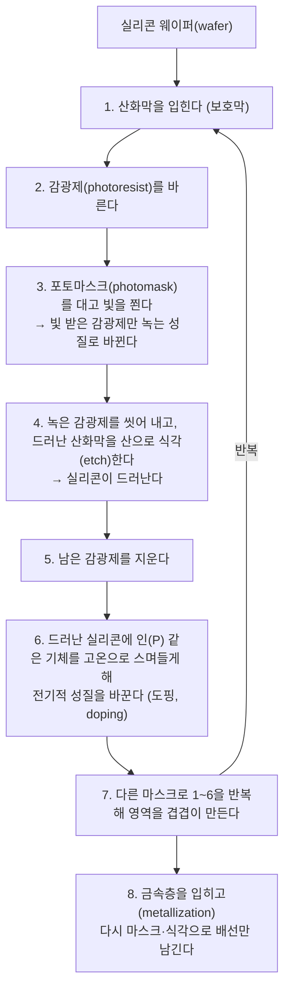
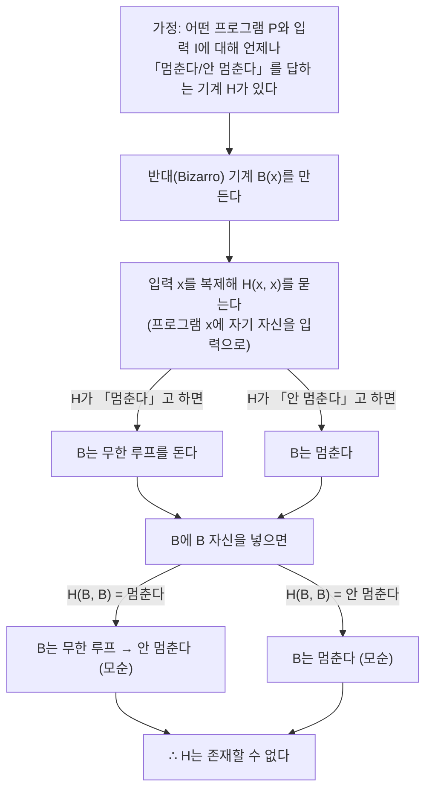

> CrashCourse의 「[Crash Course Computer Science](https://www.youtube.com/playlist?list=PL8dPuuaLjXtNlUrzyH5r6jN9ulIgZBpdo)」(2017~2018) 강의 중 컴퓨팅의 역사를 다룬 편을 바탕으로 재구성한 노트다. 반도체 공정의 현황은 2026년 기준으로 고쳐 썼다.

컴퓨터의 역사는 연표보다 **병목의 교체**로 읽는 편이 이해가 빠르다. 사회가 다루는 수(인구, 무역, 탄도, 암호)가 한 사람의 머리로 감당할 수 있는 규모를 넘을 때마다 새 도구가 나왔고, 새 도구는 앞 도구의 가장 큰 약점(느림, 고장, 배선의 수, 가격, 프로그래밍의 어려움)을 하나씩 풀었다. 각 단계는 아래층의 복잡함을 감추고 한 층 위의 추상화를 얹는 일이기도 했다.

## 계산 도구에서 범용 기계로

| 도구 | 무엇을 자동화했나 | 남은 한계 |
| --- | --- | --- |
| 주판(abacus, 기원전 2500년경 메소포타미아) | 자릿수별 덧셈·뺄셈. **계산의 중간 상태를 기억**한다 | 사람이 한 단계씩 조작한다 |
| 아스트롤라베, 계산자(slide rule) | 위도 계산, 곱셈·나눗셈 같은 한 가지 일 | 용도가 하나로 고정된 특수 목적 도구 |
| 라이프니츠의 단계 계산기(Step Reckoner, 17세기 말) | 사칙연산 전부. 10개 이빨 톱니가 9를 넘으면 옆 톱니를 한 칸 돌리는 **자리올림**을 기계로 했다. 곱셈은 덧셈의 반복, 나눗셈은 뺄셈의 반복이다 | 실제 문제는 수많은 단계가 필요해 결과 하나에 몇 시간이 걸리고, 기계가 비싸다 |
| 미리 계산한 표(제곱근표, 포격 사거리표) | 「인간 계산수」가 계산해 둔 결과를 찾아보기만 한다 | 대포나 포탄 설계가 바뀌면 표 전체를 다시 계산해야 하고 오류가 섞인다 |
| 배비지의 차분 기관(Difference Engine, 1822년 제안) | 다항식 근사로 표를 기계가 만든다 | 당대에는 완성하지 못했다. 1991년 설계도대로 만든 기계는 작동했다 |
| 배비지의 해석 기관(Analytical Engine) | **범용 컴퓨터**의 첫 구상. 데이터를 받아 연산을 순서대로 실행하고 메모리와 출력 장치를 갖춘다 | 끝내 만들어지지 않았다. 에이다 러브레이스가 이 기계용 프로그램을 써서 첫 프로그래머로 불린다 |
| 홀러리스의 집계기(tabulating machine, 1890년 미국 인구조사) | 천공 카드의 구멍으로 핀이 통과해 회로가 닫히면 해당 항목의 카운터가 1 오른다. 수작업보다 약 10배 빨라 인구조사를 2년 반 만에 끝냈다 | 집계만 하는 **고정된 기계**라 프로그래밍할 수 없다 |

- 「컴퓨터」는 원래 **계산하는 사람**을 뜻하는 직업명이었다. 기록상 첫 용례는 1613년이고, 19세기 말부터 기계를 가리키기 시작했다.
- **특수 목적 기계**는 한 가지 계산만 하고, **범용 기계**는 주어진 명령의 순서에 따라 무엇이든 계산한다. 해석 기관의 의의는 기계를 만든 것이 아니라 이 구분을 처음 세운 데 있다.
- 홀러리스의 회사는 다른 업체와 합병한 뒤 1924년 IBM이 되었다. 회계·보험·재고처럼 데이터가 많은 업무에 「사무 기계」가 팔리면서 계산이 과학에서 기업과 정부로 넘어갔다.

## 스위치의 세대교체: 릴레이에서 집적회로까지

전자식 컴퓨터의 핵심 부품은 **제어 신호로 다른 회로를 열고 닫는 스위치**다. 스위치가 바뀔 때마다 속도·신뢰성·크기가 한 자릿수 이상 좋아졌다. 스위치 on/off로 논리 연산을 만드는 원리는 [[digital-logic-circuits|디지털 논리 회로와 부품]]에 있다.

| 스위치 | 원리 | 강점 | 대체된 이유 | 대표 기계 |
| --- | --- | --- | --- | --- |
| 릴레이(relay) | 코일에 전류가 흐르면 전자석이 금속 팔을 당겨 회로를 닫는다 | 전기로 제어하는 첫 스위치 | 팔에 **질량**이 있어 1940년대 좋은 릴레이도 초당 약 50번만 전환된다. 움직이는 부품이라 닳는다 | 하버드 마크 I(1944). 릴레이 약 3,500개, 초당 덧셈 3번 |
| 진공관(vacuum tube) | 가열한 전극이 전자를 내보내고(열전자 방출), 사이에 둔 제어 전극(그리드)의 전하로 흐름을 막거나 통과시킨다. 1904년 플레밍의 2극관에 1906년 드 포리스트가 제어 전극을 더한 3극관 | **움직이는 부품이 없어** 초당 수천 번 전환된다 | 유리 진공관은 깨지기 쉽고 전구처럼 타서 끊어진다. 비싸고 크며 열이 많다 | 콜로서스(1943, 첫 프로그래밍 가능한 전자식 컴퓨터), ENIAC(1946, 첫 범용 전자식 컴퓨터) |
| 트랜지스터(transistor) | 반도체(semiconductor)의 도전성을 게이트 전극의 전하로 바꿔 전류를 흘리거나 막는다. 1947년 벨 연구소 | 고체 부품(solid state)이라 작고 빠르고 오래간다 | 부품 하나하나를 손으로 이어야 해서 **배선 수**가 한계가 된다 | IBM 608(1957, 첫 상용 완전 트랜지스터 컴퓨터) |
| 집적회로(IC) | 트랜지스터·저항·커패시터와 배선을 실리콘 한 조각 위에 함께 만든다 | 배선 문제를 공정으로 풀었다 | 아직 대체되지 않았다. 대신 미세화 자체가 한계에 다가간다 | 아폴로 유도 컴퓨터, 인텔 4004(1971) |

- 스위치가 바뀌어도 하는 일은 같다. **제어 입력 하나로 전류를 흘리거나 막는다.** 그래서 위층의 논리 회로 설계는 그대로 두고 아래층 부품만 갈아 끼울 수 있었다.
- 부품 수가 늘면 고장 확률도 는다. 수명 10년인 릴레이 3,500개를 쓰면 평균 하루에 하나꼴로 고장 난다. ENIAC도 진공관 고장 때문에 한 번에 반나절쯤만 연속으로 돌았다. 신뢰성이 다음 스위치로 넘어가는 가장 큰 동기였다.
- 「버그」라는 말은 1947년 하버드 마크 II의 릴레이에서 나방을 꺼낸 일로 널리 퍼졌다. 기계 결함을 「bug」라 부르는 공학 은어는 그 전부터 있었다.
- 트랜지스터 산업이 실리콘을 주재료로 캘리포니아 산타클라라 계곡에 모여 **실리콘밸리**가 되었다. 쇼클리 반도체에서 나온 사람들이 페어차일드를 세우고, 페어차일드에서 나온 사람들이 인텔을 세웠다.

### 컴퓨터의 세대 구분

| 세대 | 스위치·부품 | 예 |
| --- | --- | --- |
| 1세대 | 진공관 | ENIAC, UNIVAC I |
| 2세대 | 개별 트랜지스터 | IBM 7090(1959). 진공관 기종 709를 트랜지스터로 바꿔 6배 빠르고 값은 절반 |
| 3세대 | 집적회로 | 1960년대 중반 이후의 IC 기반 컴퓨터 |
| 4세대 | 마이크로프로세서와 초대규모 집적(VLSI) | 1970년대 이후. 칩 설계를 사람이 아니라 소프트웨어가 자동으로 만든다 |

## 집적회로와 반도체 공정

### 숫자의 폭정과 집적

개별 부품(discrete component)으로 만든 컴퓨터는 성능을 높이려 부품을 늘릴수록 연결이 기하급수적으로 늘었다. ENIAC은 진공관 1만 7천여 개와 저항·커패시터·다이오드를 손땜질 연결 약 500만 곳으로 이었다. 이 문제를 **숫자의 폭정(Tyranny of Numbers)**이라 불렀다. 트랜지스터로 바꿔도 부품이 하나씩 따로인 것은 같아서 문제는 남았다.

| 해결책 | 내용 |
| --- | --- |
| 집적회로(Integrated Circuit) | 여러 부품을 **한 부품 안에** 넣는다. 1958년 텍사스 인스트루먼츠의 잭 킬비가 게르마늄으로 처음 시연했고, 1959년 페어차일드의 로버트 노이스가 흔하고 안정적인 **실리콘**으로 실용화했다 |
| 인쇄 회로 기판(PCB) | IC끼리 잇는 배선을 기판에 식각해 대량 생산한다. 전선 다발이 사라진다 |

### 포토리소그래피

초기 IC는 아주 작은 개별 부품을 한 패키지에 담은 것이라 트랜지스터를 5개 남짓밖에 넣지 못했다. 이를 넘어선 공정이 **빛으로 패턴을 옮기는 포토리소그래피(photolithography)**다. 기본 동작 몇 가지를 반복해 복잡한 회로를 만든다.

- 같은 공정으로 저항·커패시터도 만들고 배선까지 한 번에 그린다. 마스크 한 장이 수백만 개의 세부를 동시에 찍는다.
- 빛은 렌즈로 모을 수 있어, 마스크를 웨이퍼의 작은 영역에 **축소 투영**하면 마스크보다 훨씬 미세한 패턴이 나온다.
- 웨이퍼 한 장에서 칩 여러 개(다이)를 만든 뒤 잘라 패키지에 담는다. 전자 기기 속 검은 사각형 칩 안에는 이 실리콘 조각이 들어 있다.
- 칩의 집적 규모 구분(SSI·MSI·LSI·VLSI)은 [[digital-logic-circuits#집적회로 (IC)|디지털 논리 회로와 부품]]에 있다.

### 무어의 법칙

**무어의 법칙(Moore's Law)**은 같은 면적에 넣을 수 있는 트랜지스터 수가 일정 주기로 두 배가 된다는 관찰이다. 고든 무어가 1965년 처음 매년 두 배라고 했고, 1975년 **약 2년마다 두 배**로 고쳐 잡았다. 물리 법칙이 아니라 산업이 목표로 삼아 지켜 온 **추세**다.

| 해 | 대표 CPU 한 개의 트랜지스터 수 |
| --- | --- |
| 1971 | 약 2,300개 (인텔 4004, 칩 하나에 든 첫 상용 CPU = 마이크로프로세서) |
| 1980 무렵 | 수만 개 |
| 1990 무렵 | 100만 개를 넘음 |
| 2000 무렵 | 수천만 개 |
| 2010 무렵 | 10억 개 안팎 |
| 2020년대 중반 | 스마트폰 칩도 200억 개 안팎(Apple A17 Pro 190억 개). 대형 AI 가속기는 다이 두 개를 한 패키지에 묶어 2,000억 개를 넘음(NVIDIA Blackwell 2,080억 개) |

트랜지스터가 작아지면 개수만 느는 것이 아니다. 옮길 전하가 줄어 **더 빨리 전환되고 전력을 덜 쓰며**, 회로가 촘촘해져 신호 지연이 줄고 클럭을 올릴 수 있었다. IC 값도 1962년 평균 50달러에서 1968년 2달러 수준으로 떨어졌고, 같은 효과가 CPU뿐 아니라 RAM·그래픽 카드·SSD·카메라 센서에 두루 미쳤다. 수십억 개의 트랜지스터는 사람이 배치할 수 없어, 1970년대부터 높은 수준의 설계(예: 캐시 한 덩어리)를 회로로 바꿔 주는 **논리 합성(logic synthesis)** 같은 칩 설계 자동화 소프트웨어가 설계를 맡는다.

### 미세화의 한계와 2026년 현황

| 한계 | 원인 | 업계의 대응 |
| --- | --- | --- |
| 빛의 파장 | 포토마스크 패턴을 투영하는 빛의 파장보다 훨씬 작은 선은 그리기 어렵다 | 파장을 줄여 왔다. 첨단 공정은 파장 13.5nm의 **극자외선(EUV)** 노광을 쓰고, 렌즈 개구수를 0.33에서 0.55로 키운 High-NA EUV는 ASML이 2025년 양산용 장비(EXE:5200B)를 처음 출하해 도입 초기 단계다 |
| 양자 터널링(quantum tunneling) | 전극 사이가 원자 수십 개 거리로 좁아지면 전자가 장벽을 뚫고 새어 나간다. 전류가 새면 스위치로 제 역할을 못 한다 | 게이트가 채널을 감싸는 면을 늘렸다. 평면 → 핀펫(FinFET) → 채널 사방을 감싸는 **GAA(gate-all-around) 나노시트**. TSMC의 2nm(N2)가 2025년 4분기 GAA로 양산에 들어갔다 |
| 전력과 열 | 작아질수록 전력 밀도가 일정하게 유지된다는 데너드 스케일링이 2000년대 중반 깨졌다 | 클럭 대신 코어 수를 늘렸다([[computer-system-basics#클럭과 멀티코어\|클럭과 멀티코어]]) |

- 「3nm」, 「2nm」 같은 공정 이름은 이제 실제 게이트 길이가 아니라 **세대를 가리키는 이름**이다. 밀도 향상 폭도 세대마다 예전보다 작다.
- 그래서 밀도 증가의 상당 부분이 미세화가 아닌 곳에서 나온다. 칩을 기능별로 나눈 **칩렛(chiplet)**, 다이를 쌓거나 나란히 잇는 **첨단 패키징**, 전원 배선을 웨이퍼 뒷면으로 옮기는 기술이 그 예다.
- 무어의 법칙의 「종말」은 수십 년째 예고되어 왔다. 정확히는 **같은 비용으로 2년마다 두 배**라는 원래 형태는 느려졌고, 칩 하나·패키지 하나에 들어가는 트랜지스터 수는 다른 수단으로 계속 늘고 있다. 계산 방식 자체를 바꾸려는 시도는 [[quantum-computing|양자 컴퓨터의 원리]]에 있다.

## 프로그램을 넣는 수단의 변천

계산하는 기계가 생긴 뒤의 병목은 **명령을 어떻게 기계에 넣느냐**였다. 수단이 바뀔 때마다 프로그램을 바꾸는 비용이 줄었다.

| 수단 | 방식 | 한계 |
| --- | --- | --- |
| 자카르 직기의 천공 카드(1801) | 카드 한 장이 천 한 줄의 무늬를 정한다. 구멍 유무로 날실을 올리거나 내리고, 카드를 사슬로 이어 **명령의 순서**를 만든다. 프로그래밍의 초기 형태로 꼽힌다 | 직기 전용 |
| 집계기의 천공 카드(1890) | 카드 한 장이 사람 한 명의 데이터다 | 카드에 담긴 것은 **데이터**이지 프로그램이 아니다 |
| 플러그보드(plugboard, 제어판) | 소켓에 케이블을 꽂아 기계 부품 사이로 값과 신호를 보낸다. 1920년대에 보드를 갈아 끼울 수 있게 되어 세금 계산용·급여용 보드를 따로 두었다 | 배선이 복잡하다. ENIAC은 종이로 다 짠 프로그램을 배선하는 데 3주 넘게 걸리기도 했다 |
| 프로그램 내장(stored-program) | 1940년대 말 전자식 메모리가 싸지자 프로그램을 데이터와 함께 메모리에 둔다. 1948년 맨체스터 대학의 「Baby」가 첫 실행 사례다 | 메모리에 올릴 입력 수단이 여전히 필요하다 |
| 천공 카드 묶음·천공 테이프 | 카드 리더가 카드를 한 장씩 읽어 메모리에 차례로 쓴다. 1980년대 무렵까지 대형 컴퓨터에는 카드 리더가 흔했다. 결과도 카드에 뚫어 내보냈다 | 카드 순서가 섞이면 끝이다. 카드 묶음 옆면에 대각선을 그어(striping) 순서를 복구했다. 1950년대 SAGE 방공 시스템의 주 제어 프로그램은 카드 6만 2,500장(약 5MB)이었다 |
| 패널 스위치 | 스위치로 이진 명령을 한 주소씩 입력하고 「deposit」으로 메모리에 쓴 뒤, 주소 0으로 돌아가 「run」을 누른다 | 카드 리더를 살 수 없는 초기 가정용 컴퓨터(Altair 8800)가 이 방식을 썼다 |

프로그램 내장 방식과 폰 노이만 구조의 뜻은 [[computer-system-basics|컴퓨터 시스템의 기본 구성]]에 있다. 어떤 수단이든 프로그래머가 **옵코드와 레지스터를 외워야** 했다는 점은 같았고, 이 병목은 어셈블러와 고급 언어가 풀었다([[programming-language-evolution#어셈블러와 컴파일러가 바꾼 것|프로그래밍 언어의 계보와 선택]]).

## 튜링의 기여: 계산이란 무엇이고 어디까지 되는가

### 결정 문제와 두 가지 답

힐베르트의 **결정 문제(Entscheidungsproblem)**는 「형식 논리로 쓴 명제를 넣으면 참·거짓을 언제나 정확히 답하는 알고리즘이 있는가」를 물었다. 1935~1936년 두 사람이 서로 다른 수학으로 「없다」고 답했다.

| | 앨론조 처치(Alonzo Church) | 앨런 튜링(Alan Turing) |
| --- | --- | --- |
| 도구 | 람다 대수(lambda calculus) | 튜링 머신(Turing machine) |
| 성격 | 함수와 치환으로 계산을 표현한다. 적용하고 이해하기 어렵다 | 테이프와 규칙으로 계산을 표현한다. 단순해서 컴퓨터 과학의 표준 모델이 되었다 |
| 계산 능력 | 서로 **동등하다**. 한쪽으로 표현되는 계산은 다른 쪽으로도 표현된다 | |

람다 대수는 함수형 프로그래밍의 이론적 바탕이 되었다([[programming-paradigms|프로그래밍 패러다임]]).

### 튜링 머신

| 구성 요소 | 역할 |
| --- | --- |
| 무한한 테이프 | 기호를 저장하는 메모리 |
| 읽기/쓰기 헤드 | 현재 칸의 기호를 읽고 고쳐 쓴다 |
| 상태 | 기계가 지금 어떤 상태인지 담는 값 |
| 규칙 표 | (현재 상태, 읽은 기호) → 기호 쓰기 / 상태 바꾸기 / 헤드를 왼쪽·오른쪽으로 한 칸 이동 중 일부. 프로그램에 해당한다 |

예: 0으로 끝나는 1의 나열에서 1의 개수가 짝수인지 판정하는 기계. 시작 상태는 짝수다.

| 상태 | 읽은 기호 | 동작 |
| --- | --- | --- |
| 짝수 | 1 | 상태를 홀수로, 오른쪽 이동 |
| 짝수 | 0 | 1을 쓰고 정지 (짝수다) |
| 홀수 | 1 | 상태를 짝수로, 오른쪽 이동 |
| 홀수 | 0 | 0을 쓰고 정지 (홀수다) |

입력 `110`을 넣으면 짝수 → 홀수 → 짝수를 거쳐 0을 만나 1을 쓰고 멈춘다.

- 이 단순한 기계는 시간과 테이프만 충분하면 **어떤 계산이든** 할 수 있다. 웹 브라우저도 이론상 튜링 머신으로 만들 수 있다. 아주 비효율적일 뿐이다.
- 계산할 수 있는 범위에서 튜링 머신보다 강력한 컴퓨터는 없다. 튜링 머신과 같은 계산 능력을 가진 체계를 **튜링 완전(Turing complete)**하다고 한다. 노트북, 스마트폰, 전자레인지 속 마이크로컨트롤러가 모두 튜링 완전하다.

### 정지 문제

**정지 문제(halting problem)**는 「프로그램과 입력을 주면, 실행하지 않고도 그 프로그램이 멈출지 영원히 돌지 판정하는 알고리즘이 있는가」다. 튜링은 모순으로 「없다」를 보였다.

튜링 머신이 모든 계산을 표현하므로, 이 결과는 **시간과 메모리를 아무리 늘려도 계산으로 풀 수 없는 문제가 있다**는 뜻이다. 결정 문제의 답도 여기서 나온다.

### 암호 해독과 튜링 테스트

| 기여 | 내용 |
| --- | --- |
| 봄베(Bombe) | 2차 대전 중 블레츨리 파크에서 폴란드 암호 해독가들의 성과를 바탕으로 만든 **특수 목적 전기기계식** 기계. 독일 에니그마는 회전자와 플러그보드 설정이 수십억 가지였지만, **어떤 글자도 자기 자신으로 암호화되지 않는다**는 결함이 있었다. 봄베는 설정 후보를 돌려 보다 글자가 자기 자신으로 바뀌는 조합을 버려, 사람이 검토할 후보를 크게 줄였다 |
| 초기 컴퓨터 | 전후 맨체스터 마크 1 같은 프로그램 내장형 컴퓨터 개발에 참여했다 |
| 튜링 테스트(1950) | 글로만 대화해서 사람과 컴퓨터를 구별하지 못하면 그 컴퓨터를 지능적이라 부르자는 기준. 웹의 **CAPTCHA**(Completely Automated Public Turing test to tell Computers and Humans Apart)는 이 시험을 거꾸로 써서 봇을 걸러 낸다 |

컴퓨터 과학 최고 권위의 상인 **튜링상(Turing Award)**이 그의 이름을 땄다.

## 개인용 컴퓨터가 보급된 조건

컴퓨터가 정부의 방 하나짜리 기계에서 한 사람이 혼자 쓰는 도구가 되기까지는 **수요를 대는 쪽이 정부에서 소비자로 넘어가는 과정**이 있었다.

### 정부 수요가 기술을 키웠다

| 시기 | 수요처 | 남긴 것 |
| --- | --- | --- |
| 2차 대전~냉전 초 | 맨해튼 계획, 암호 해독, 방공 | ENIAC, EDVAC, Whirlwind 같은 대형 프로젝트. 판매로 개발비를 회수해야 하는 민간에서는 불가능한 규모였다 |
| 1950년대 | 정부 기관과 대기업 | 첫 상업적 성공작 UNIVAC I(1951). 한 대가 아니라 **기종**으로 수십 대가 팔렸다 |
| 1960년대 우주 경쟁 | NASA 아폴로 계획 | 빠르고 작고 가벼우며 진동·방사선·온도 변화를 견뎌야 해서 **IC를 초기에 대량으로 채택**했다(아폴로 유도 컴퓨터). 칩 하나에 50달러이던 시절이다 |
| 1960년대 이후 | 미닛맨·폴라리스 미사일, 국가 연구소의 슈퍼컴퓨터 | IC를 **대량 생산 품목**으로 만든 것은 생산량이 적은 아폴로가 아니라 군수였다 |

과학 연구에 대한 연방 지원 기관인 미국 국립과학재단(NSF, 1950)도 이 흐름에서 생겼다. 1945년 버니바 부시가 구상한 **메멕스(Memex)**는 개인의 책·기록·통신을 저장하고 연상 경로로 엮는 기계로, 하이퍼텍스트와 이후 대화형 컴퓨팅의 구상에 영향을 주었다.

### 소비자 시장이 값을 끌어내렸다

- 1950년대 **트랜지스터 라디오**가 휴대할 수 있는 첫 전자 소비재로 히트했다. 일본은 1952년 벨 연구소에서 트랜지스터 특허를 사용 허가받아 반도체·전자 산업을 시작했다(소니의 첫 제품 TR-55, 1955).
- 미국 반도체 업체가 이윤 높은 정부 계약에 기대는 동안, 일본 업체는 얇은 이윤으로 버티려 **규모의 경제, 수율, 자동화**에 투자했다. 메모리(DRAM)처럼 부품이 범용품(commodity)이 되자 가격 경쟁에서 일본이 앞섰고, 인텔은 1980년대 중반 메모리 사업에서 물러나 프로세서에 집중했다.
- 1970년대의 히트 상품은 **휴대용 전자계산기**였다. 일본 계산기 업체 비지콤(Busicom)의 주문으로 인텔이 만든 칩이 4004다. 싼 마이크로프로세서는 아케이드 게임(Pong, 1972)과 가정용 게임기(Atari 2600, 1977) 같은 새 제품을 낳았다.

### 개인용 컴퓨터의 네 가지 재료

1970년대 초에 다음 네 가지가 동시에 싸지면서, 한 사람만 쓰는 컴퓨터가 경제적으로 말이 되었다. 시분할도, 다중 사용자 로그인도 없는 **마이크로컴퓨터(microcomputer)**다.

| 재료 | 내용 |
| --- | --- |
| 단일 칩 CPU | 작고 싸지만 쓸 만한 마이크로프로세서 |
| 반도체 메모리 | IC로 만든 값싼 RAM·ROM. 컴퓨터 전체가 기판 한 장에 들어가 제조비가 줄었다 |
| 저장 장치 | 카세트테이프, 플로피 디스크 |
| 디스플레이 | 대개 가정용 TV를 그대로 썼다 |

### 취미에서 가정으로, 그리고 표준 싸움

| 연도 | 사건 | 의미 |
| --- | --- | --- |
| 1975 | Altair 8800. 439달러짜리 조립 키트 | 첫 상업적 성공을 거둔 개인용 컴퓨터. 프로그램은 패널 스위치로 기계어를 넣었다. 빌 게이츠와 폴 앨런이 만든 **BASIC 인터프리터**(Altair BASIC)가 마이크로소프트의 첫 제품이 되었다. 홈브루 컴퓨터 클럽 같은 동호회가 퍼졌다 |
| 1976 | Apple I | TV에 연결해 텍스트를 띄우는 기판. 키보드·전원·케이스는 사용자가 붙였다 |
| 1977 | Apple II, TRS-80, Commodore PET (「1977 트리니티」) | 상자에서 꺼내 바로 쓰는 완제품. BASIC 인터프리터를 기본으로 실어 비전문가도 프로그램을 짤 수 있었다. **처음으로 가정을 겨냥**해 팔렸다 |
| 1979 | VisiCalc | 첫 스프레드시트. 컴퓨터를 살 이유가 되는 **킬러 앱** |
| 1981 | IBM PC | 인텔 CPU와 마이크로소프트 DOS 등 외부 부품을 쓰고, 문서화가 잘된 **개방형 구조**와 확장 슬롯을 두었다 |
| 1984 | 매킨토시 | 명령줄 대신 그래픽 사용자 인터페이스로 부팅하는 일체형 컴퓨터 |

- **개방형 구조(open architecture)**는 제3자가 그래픽 카드·사운드 카드·주변기기를 만들게 했고, 경쟁사도 표준을 따라 **IBM 호환기**를 만들었다(컴팩, 델). 사용자가 많은 플랫폼에 개발자가 몰리고, 소프트웨어가 많은 플랫폼을 사용자가 고르는 **네트워크 효과**가 눈덩이처럼 커져, 사양이 더 좋아도 호환되지 않는 기종은 사라졌다. 마이크로소프트는 MS-DOS를 호환기 제조사에도 사용 허가해 표준 OS가 되었다([[os-overview|운영체제 개요]]).
- 애플은 반대로 하드웨어·OS·주변기기를 직접 만드는 **폐쇄형 구조(closed architecture)**를 택했다. 사용 경험과 신뢰성을 통제하는 대가로 확장성을 포기한 것이다. 「Mac 대 PC」 구도는 이 두 전략에서 나왔다.

## 정리

- 계산 도구는 **특수 목적 → 범용**으로, 범용 기계는 **고정 배선 → 프로그램 내장**으로 발전했다.
- 스위치는 릴레이(질량) → 진공관(고장·크기) → 트랜지스터(배선 수) → 집적회로로 바뀌었고, 매번 앞 세대의 병목 하나를 풀었다.
- 무어의 법칙은 법칙이 아니라 추세다. 2026년에는 EUV·GAA로 미세화를 이어 가면서, 늘어나는 트랜지스터의 상당 부분을 칩렛과 첨단 패키징이 맡는다.
- 튜링 머신은 「계산」의 정의를 주었고, 정지 문제는 계산으로 풀 수 없는 문제가 있음을 보였다.
- 개인용 컴퓨터는 정부 수요가 키운 기술을 소비자 시장이 싸게 만든 결과이고, 그 표준은 개방형 구조와 네트워크 효과가 정했다.

관련 노트: [[computer-system-basics|컴퓨터 시스템의 기본 구성]], [[digital-logic-circuits|디지털 논리 회로와 부품]], [[programming-language-evolution|프로그래밍 언어의 계보와 선택]], [[os-overview|운영체제 개요]], [[quantum-computing|양자 컴퓨터의 원리]]
