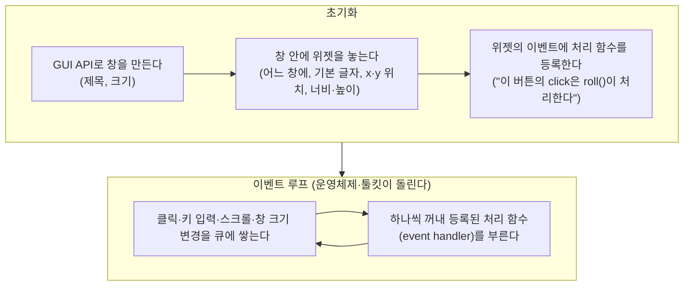

> CrashCourse의 「[Crash Course Computer Science](https://www.youtube.com/playlist?list=PL8dPuuaLjXtNlUrzyH5r6jN9ulIgZBpdo)」 강의 「Graphical User Interfaces」, 「Keyboards & Command Line Interfaces」 편을 바탕으로 재구성한 노트다.

## GUI란

**그래픽 사용자 인터페이스(GUI, graphical user interface)는 할 수 있는 동작을 그림(창, 아이콘, 버튼)으로 화면에 보여 주고, 사용자가 가리키고 눌러 조작하게 하는 인터페이스다.** 명령을 글자로 입력하는 명령줄 인터페이스(CLI)와 짝을 이룬다.

| | CLI(command line interface) | GUI |
| --- | --- | --- |
| 조작 | 명령과 인자(argument)를 입력하고 엔터, 결과가 글자로 돌아온다 | 화면에서 찾아 가리키고 누른다 |
| 사용자에게 요구하는 것 | 명령 이름을 **기억(recall)** 해야 한다 | 보이는 것 중에서 **알아보면(recognition)** 된다 |
| 배우기 | 어렵다. 무엇이 가능한지 화면이 알려 주지 않는다 | 쉽다. 훈련 없이 둘러보며 익힌다 |
| 강점 | 명령을 이어 붙여 조합하고([[shell-pipeline\|파이프라인]]), 스크립트로 반복을 자동화하고, 원격 서버에 글자만으로 접속한다([[ssh\|SSH]]) | 공간·시각 정보 다루기, 처음 쓰는 사람, 직접 조작 |

프로그래밍은 여전히 글을 쓰는 일이라 CLI가 자연스러운 도구로 남아 있다. 서버 관리와 개발 도구는 대부분 CLI로 쓰고, GUI는 그 위에 얹는 경우가 많다.

## WIMP

데스크톱 운영체제의 GUI는 대부분 같은 네 요소로 짜여 있다. 머리글자를 따 **WIMP**라 한다.

| 요소 | 하는 일 |
| --- | --- |
| 창(Window) | 프로그램 하나를 들여다보는 틀. 여러 개를 띄우고 겹치고 옮긴다 |
| 아이콘(Icon) | 파일·프로그램·동작을 작은 그림으로 나타낸다 |
| 메뉴(Menu) | 할 수 있는 명령의 목록을 펼쳐 보여 준다 |
| 포인터(Pointer) | 마우스 등으로 움직여 화면의 대상을 가리킨다 |

Windows, macOS, 리눅스 데스크톱 환경은 모두 WIMP를 다듬은 형태다. 스마트폰은 포인터 대신 손가락으로 직접 누르고 끄는 터치 인터페이스로 바뀌었지만, 아이콘·메뉴·위젯은 그대로 쓴다([[gesture-interface|제스처 기반 인터페이스]]).

## 메타포: 익숙한 것을 빌려 오기

처음 보는 사람이 바로 쓰려면, 이미 아는 무언가에 빗대야 한다. 데스크톱 GUI는 화면을 **책상 위**에 빗댄 **데스크톱 메타포(desktop metaphor)** 를 쓴다.

| 책상의 물건 | GUI |
| --- | --- |
| 책상 위에 펼쳐 둔 종이 여러 장 | 동시에 열린 여러 창. 겹치면 뒤의 것이 가려진다 |
| 종이 문서와 서류철 | 파일과 폴더 |
| 휴지통 | 지울 파일을 모아 두는 휴지통 |
| 계산기·시계 | 화면에 올려 두는 작은 도구 |
| 가위와 풀로 오려 붙이던 원고 편집 | 잘라내기·복사·붙여넣기 |

- 메타포는 **아래 계층을 감추는 추상화**다. 폴더와 종이 아이콘 아래에는 디렉터리 엔트리와 블록으로 된 [[file-system|파일 시스템]]이 있다. 사용자는 블록을 몰라도 파일을 옮긴다.
- 메타포는 정확한 복제가 아니라 **빗댐**이다. 화면 전체를 방과 가구로 그린 것처럼 현실을 너무 곧이곧대로 옮기면 오히려 쓰기 불편해 실패한다. 살아남은 GUI 요소는 많은 시도가 걸러진 결과다.

### 위젯

GUI 화면은 **위젯(widget)** 이라는 재사용 부품을 조립해 만든다. 버튼, 체크박스, 슬라이더, 탭, 텍스트 상자처럼 실제 물건(누르는 단추, 체크 표시, 미닫이 손잡이, 서류철 색인)을 본떠 쓰임을 짐작하게 한다. 운영체제와 GUI 툴킷이 위젯을 제공하므로 앱마다 버튼을 새로 그리지 않는다. 위젯별 이름과 쓰임은 [[ui-elements-glossary|UI 요소 용어집]]에 있다.

### WYSIWYG

**WYSIWYG(What You See Is What You Get)** 는 화면에 보이는 문서가 인쇄한 결과와 똑같이 보이게 하는 편집 방식이다. 워드프로세서와 디자인 도구가 기본으로 따른다. 반대편에는 소스를 쓰고 컴파일해 결과를 보는 방식이 있다([[latex|LaTeX]]).

## 이벤트 기반 프로그래밍

CLI 프로그램은 대체로 위에서 아래로 실행되고, 입력이 필요한 곳에서 기다린다. GUI 프로그램은 다르다. 사용자가 언제 어느 버튼을 누를지, 어떤 순서로 메뉴를 고를지 알 수 없다. 그래서 GUI는 **이벤트 기반 프로그래밍(event-driven programming)** 으로 짠다. 코드는 정해진 순서로 흐르지 않고, **사건(event)이 일어날 때마다 그 사건에 연결된 함수가 불린다.**



브라우저에서는 같은 구조가 DOM 이벤트로 나타난다.

```js
// 버튼을 누르면 1~20 사이 숫자를 굴려 표시하고, 20이면 배경을 빨갛게
const output = document.querySelector('#result');
const button = document.querySelector('#roll');

function roll() {
  const n = Math.floor(Math.random() * 20) + 1;
  output.value = n;
  document.body.style.background = n === 20 ? 'darkred' : '';
}

button.addEventListener('click', roll);   // click 이벤트의 처리 함수로 등록
```

- `roll`은 한 번도 직접 부르지 않는다. 등록만 해 두면 클릭이 일어날 때마다 루프가 부른다.
- 처리 함수가 오래 걸리면 그동안 다른 이벤트를 처리하지 못해 화면이 멈춘다. 무거운 일은 나눠서 하거나 다른 스레드로 보낸다. 브라우저의 루프는 [[event-loop|이벤트 루프]], 이벤트가 퍼지는 방식은 [[dom-events|DOM 이벤트]], C 그래픽 라이브러리의 루프는 [[c-2d-graphics|C로 하는 2D 그래픽 기초]]에 있다.
- 같은 생각이 서버 쪽에서는 메시지를 사건으로 다루는 구조가 된다([[event-driven-architecture|이벤트 기반 아키텍처]]).

## 정리

- CLI는 기억해서 입력하고, GUI는 보고 알아본다. CLI는 조합·자동화·원격에, GUI는 배우기 쉬움과 직접 조작에 강하다.
- 데스크톱 GUI는 창·아이콘·메뉴·포인터(WIMP)와, 화면을 책상에 빗댄 데스크톱 메타포로 짜인다. 메타포는 파일 시스템을 감추는 추상화다.
- 화면은 실제 물건을 본뜬 위젯을 조립해 만든다.
- GUI 프로그램은 이벤트 기반이다. 위젯의 이벤트에 처리 함수를 등록하면 이벤트 루프가 사건마다 그 함수를 부른다.

관련 노트: [[ui-elements-glossary|UI 요소 용어집]], [[event-loop|브라우저에서 JavaScript가 동작하는 원리: 이벤트 루프]], [[dom-events|DOM 이벤트: 전파, 위임, 커스텀 이벤트]], [[shell-pipeline|셸이 명령을 실행하는 방식]], [[graphics-rendering-basics|컴퓨터 그래픽스 렌더링 기초]], [[gesture-interface|제스처 기반 인터페이스]]
