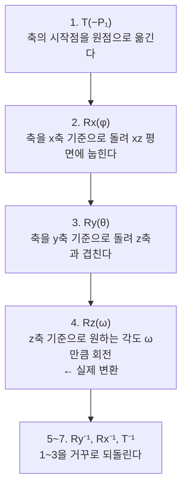

> 팔만코딩경(42Seoul 커뮤니티 위키)의 「행렬 연산과 물체의 이동」을 바탕으로 재구성한 노트다. 원 자료는 UC Davis 컴퓨터 그래픽스 강의 「Moving Objects in Space」이다.

## 왜 행렬인가

컴퓨터 그래픽스에서 물체는 꼭짓점(vertex)의 집합이다. 물체를 움직이려면 모든 꼭짓점에 같은 변환을 적용하면 된다. 크기 변경과 회전은 원래 **선형 변환이라 행렬 곱**으로 표현된다. 여러 변환을 행렬 하나로 미리 곱해 두면, 꼭짓점 수천 개에 곱셈 한 번씩만 하면 된다. GPU가 행렬 곱에 특화된 이유다.

## 동차 좌표: 이동도 행렬로

이동(translation) `(x, y) → (x + α, y + β)`는 선형 변환이 아니라서 2×2 행렬로는 표현할 수 없다. 그래서 좌표 끝에 1을 붙여 `(x, y, 1)`로 쓴다. 이것이 **동차 좌표(homogeneous coordinates)** 다. 차원을 하나 늘리면 이동도 행렬 곱이 된다.

```text
┌ 1  0  α ┐ ┌ x ┐   ┌ x + α ┐
│ 0  1  β │ │ y │ = │ y + β │
└ 0  0  1 ┘ └ 1 ┘   └   1   ┘
```

3D에서는 `(x, y, z, 1)`과 4×4 행렬을 쓴다. 마지막 성분이 0인 `(x, y, z, 0)`은 이동의 영향을 받지 않으므로 방향 벡터를 나타낸다.

## 기본 변환 행렬

### 2D (3×3)

| 변환 | 행렬 | 결과 |
| --- | --- | --- |
| 이동 T(α, β) | `[[1,0,α],[0,1,β],[0,0,1]]` | `(x+α, y+β)` |
| 크기 S(a, b) | `[[a,0,0],[0,b,0],[0,0,1]]` | `(ax, by)` |
| 회전 R(θ) | `[[cosθ,−sinθ,0],[sinθ,cosθ,0],[0,0,1]]` | 원점 기준 반시계 θ 회전 |

회전 행렬은 덧셈 정리에서 나온다. 점을 극좌표 `(r cosφ, r sinφ)`로 쓰고 각도에 θ를 더하면 이렇다.

```text
x' = r·cos(φ + θ) = x·cosθ − y·sinθ
y' = r·sin(φ + θ) = x·sinθ + y·cosθ
```

### 3D (4×4) 축 회전

어느 축을 기준으로 돌리면 **그 축의 좌표는 변하지 않는다.** 그래서 해당 행과 열은 단위 행렬 그대로다.

```text
Rx(θ)                     Ry(θ)                     Rz(θ)
┌ 1   0     0    0 ┐      ┌  cosθ  0  sinθ  0 ┐      ┌ cosθ −sinθ  0  0 ┐
│ 0  cosθ −sinθ  0 │      │   0    1   0    0 │      │ sinθ  cosθ  0  0 │
│ 0  sinθ  cosθ  0 │      │ −sinθ  0  cosθ  0 │      │  0     0    1  0 │
└ 0   0     0    1 ┘      └   0    0   0    1 ┘      └  0     0    0  1 ┘
```

Ry만 sin의 부호 위치가 반대인 이유는 오른손 좌표계에서 z → x 순서로 회전하기 때문이다.

## 합성: 원점이 아닌 점을 기준으로

크기·회전 행렬은 **원점 기준**이다. 중심이 (2, 2)인 사각형에 크기 2배를 그냥 곱하면 사각형이 커지면서 원점에서 멀어진다. 제자리에서 키우려면 세 단계를 합성한다.


```text
M = T(α, β) · S(a, b) · T(−α, −β)          ← 오른쪽부터 적용된다
```

| 꼭짓점 | 원점으로 이동 | 2배 | 되돌리기 |
| --- | --- | --- | --- |
| (1, 1) | (−1, −1) | (−2, −2) | (0, 0) |
| (3, 3) | (1, 1) | (2, 2) | (4, 4) |

**행렬 곱은 교환 법칙이 성립하지 않는다.** 열 벡터 규약(`M·v`)에서는 가장 오른쪽 행렬이 먼저 적용되므로, "먼저 할 일"을 오른쪽에 둔다. 이동 후 회전과 회전 후 이동은 결과가 다르다.

## 임의의 축을 기준으로 한 3D 회전

축이 두 점 P₁→P₂를 잇는 직선이라면, 축을 z축에 맞춘 뒤 돌리고 되돌린다.



```text
M = T⁻¹ · Rx⁻¹ · Ry⁻¹ · Rz(ω) · Ry · Rx · T
```

φ와 θ는 축 방향 벡터의 성분에서 arctan으로 구한다. 회전 행렬은 직교 행렬이라 역행렬이 전치 행렬과 같아 되돌리기가 싸다. 실무에서는 이 과정을 한 번에 계산하는 로드리게스 회전 공식이나, 짐벌 락이 없고 보간이 매끄러운 **쿼터니언(quaternion)** 을 주로 쓴다.

## 투영: 3D를 화면으로

변환을 마친 3D 좌표는 마지막에 2D 화면으로 투영한다.

| 투영 | 방식 | 느낌 |
| --- | --- | --- |
| 직교(orthographic) | z를 버리고 x, y만 쓴다 | 거리와 무관하게 크기 일정. 설계도, 아이소메트릭 게임 |
| 원근(perspective) | x, y를 깊이 z로 나눈다 `(x/z, y/z)` | 멀수록 작아진다. 사람 눈과 카메라 |

원근 투영도 4×4 행렬로 쓰는데, 곱한 뒤 동차 좌표의 마지막 성분 w로 나누는 **원근 나눗셈(perspective divide)** 이 z로 나누는 역할을 한다.

## 어디에 쓰이나

| 환경 | 형태 |
| --- | --- |
| CSS | `transform: translate() rotate() scale()`, `matrix()`, `matrix3d()`. 함수는 왼쪽부터 적힌 순서로 좌표계에 적용된다 |
| Canvas 2D | `ctx.translate/rotate/scale`, `ctx.setTransform(a, b, c, d, e, f)` |
| WebGL·three.js | 모델 → 뷰 → 투영 행렬(MVP)을 곱해 정점 셰이더에 넘긴다 |

## 정리

- 크기·회전은 행렬 곱이고, 동차 좌표를 쓰면 이동까지 행렬 하나로 합친다.
- 3D 축 회전은 그 축 좌표를 보존하는 4×4 행렬이다.
- 기준점·기준축 변환은 "원점으로 옮기기 → 변환 → 되돌리기"의 합성이다.
- 행렬 곱은 순서가 중요하며, 열 벡터 규약에서는 오른쪽 행렬이 먼저 적용된다.
- 변환을 미리 하나의 행렬로 곱해 두는 것이 그래픽스 성능의 기본이다.

관련 노트: [[bezier-curve|베지어 곡선]], [[webgl-shaders|WebGL과 셰이더]], [[graphics-rendering-basics|컴퓨터 그래픽스 렌더링 기초]]
