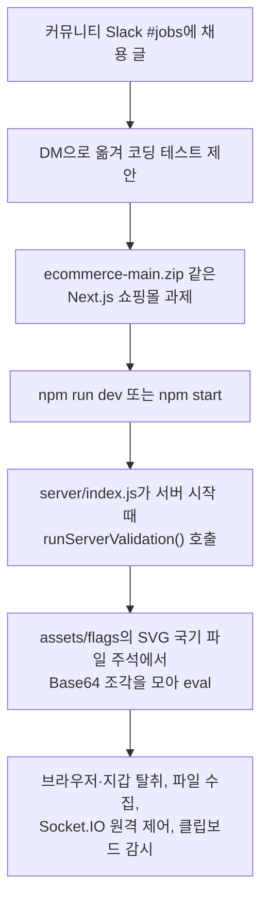

> Elastic Security Labs의 「[New North Korean campaign uses fake coding interviews to steal developer credentials](https://www.elastic.co/security-labs/contagious-interview-malware-svg-steganography)」(2026.07)과 Socket의 「[Attackers Are Hunting High-Impact Node.js Maintainers](https://socket.dev/blog/attackers-hunting-high-impact-nodejs-maintainers)」(2026.04), Axios의 「[Post Mortem](https://github.com/axios/axios/issues/10636)」(2026.04)을 Korean FE Article·JavaScript Weekly·Node Weekly 소개로 읽고 재구성한 노트다.

## 왜 개발자를 노리나

개발자 PC는 **조직의 열쇠 꾸러미**다. SSH 키, 클라우드 자격 증명, GitHub·npm 토큰, `.env`, 브라우저에 저장된 세션, 암호화폐 지갑이 한곳에 있다. 오픈소스 관리자라면 수백만 프로젝트가 설치하는 패키지의 게시 권한까지 있다. 그래서 공격자는 시스템을 뚫는 대신 **사람이 직접 코드를 실행하게** 만든다. 채용 과제, 오픈소스 라이브러리, npm 패키지처럼 「당연히 실행해 보는」 코드가 통로가 된다.

## 수법

| 수법 | 미끼 | 실행 방법 |
| --- | --- | --- |
| 가짜 채용 과제(Contagious Interview) | 외주·이직 제안, 유급 「코딩 사이드 잡」 | 과제 저장소를 받아 `npm install`·`npm run dev`를 돌리게 한다 |
| 관계 쌓기 + 가짜 회의 | 실제 회사 창업자·직원 사칭, 몇 주에 걸친 대화, Slack 초대·LinkedIn 메시지 | 화상 회의에서 오디오 오류를 연출하고 「수정 프로그램」이나 명령을 설치하게 한다 |
| 레지스트리·플랫폼 사칭 피싱 | 「2FA를 갱신하라」, 「계정이 잠긴다」 같은 공지 메일, 오타 도메인 | 가짜 로그인 페이지에서 비밀번호와 2FA 코드를 가로챈다 |
| 악성 공개 저장소 | 「Giveaway」, 인기 프로젝트 포크, 튜토리얼 | 받아서 실행하거나 IDE로 여는 순간 동작한다 |

북한 연계 그룹은 이 수법들을 이어 쓴다. 2026년 3월 Axios 수석 관리자는 가짜 Slack 워크스페이스와 가짜 Teams 회의를 거쳐 계정을 빼앗겼고, 그 계정으로 악성 버전이 게시됐다([[npm-publishing-security|npm 패키지 게시 보안]]). 같은 시기 수백 개 패키지를 관리하는 다른 Node.js 관리자들에게도 같은 각본(친분 → 화상 회의 → 오디오 오류 → 수정 프로그램 설치)이 시도됐다. 2025년 9월 chalk·debug 탈취는 npm을 사칭한 피싱 메일에서 시작됐다([[small-modules#깊은 의존성 트리 = 넓은 공격면|작은 모듈 철학]]).

## 사례 해부: 국기 이미지에 숨긴 과제

2026년 Elastic이 분석한 Contagious Interview 변종(REF9403)은 과제 코드가 **정상적으로 동작하고 백신에도 걸리지 않았다.**

- **설치 스크립트가 아니다.** 악성 코드는 `postinstall`이 아니라 서버 시작 코드에 있었다. 그래서 `--ignore-scripts`나 npm 12의 설치 스크립트 차단으로는 막히지 않는다. **앱을 실행하는 것 자체가 실행 경로다.**
- 훔친 것: Chrome·Edge·Brave의 `Login Data`·`Web Data`, 지갑 확장 25종의 데이터, macOS 키체인, 홈 디렉터리의 `.env*`·`.pem`·`.json` 같은 파일, 셸 기록, `.aws`·`.azure`·`.config`·`.ssh`.
- 난독화(obfuscator.io)와 이미지 속 은닉으로 정적 분석을 피했다. 코드 리뷰에서 `eval`과 큰 Base64 덩어리를 찾는 것이 단서다.

## 남이 준 코드를 돌리는 법

### 1. 실행 전에 읽는다

| 볼 곳 | 찾을 것 |
| --- | --- |
| `package.json`의 `scripts` | `dev`·`start`·`prepare`·`postinstall`이 실제로 무엇을 실행하는가 |
| 서버 진입점과 그 import | 과제와 무관한 「검증」, 「텔레메트리」 함수, 시작 시 호출되는 코드 |
| 코드 전체 검색 | `eval(`, `new Function(`, `child_process`, `require(` 동적 호출, 긴 Base64·16진 문자열, 원격 URL에서 코드 받기 |
| 정적 자산 폴더 | 이미지·폰트·SVG 안의 텍스트 주석, 크기가 이상한 파일 |
| `.vscode/tasks.json`·확장 권장 | 폴더를 열 때 자동 실행되는 작업(`runOn: folderOpen`). IDE의 작업 영역 신뢰(Workspace Trust)에서 「신뢰하지 않음」으로 연다 |
| 의존성 목록 | 처음 보는 이름, 오타 이름, 최근 생성된 패키지([[npm-package-evaluation\|npm 패키지를 고르는 기준]]) |

### 2. 격리해서 돌린다

**비밀이 없는 곳에서 돌린다**가 원칙이다. 격리 수준은 아래로 갈수록 강하다.

| 환경 | 주의 |
| --- | --- |
| 로컬 컨테이너(Dev Container, Docker) | 홈 디렉터리를 마운트하지 않는다. VS Code Dev Containers는 로컬 SSH 에이전트와 Git 자격 증명을 컨테이너에 자동으로 넘기므로, 남의 코드에는 이 전달을 끄거나 쓰지 않는다. 컨테이너는 커널을 공유한다([[vm-vs-container\|VM과 컨테이너]]) |
| 로컬 VM | 공유 폴더·클립보드 공유를 끈다. 스냅숏을 떠 두고 끝나면 되돌린다 |
| 일회용 클라우드 환경(Codespaces 같은 원격 개발 환경, 클라우드 VM) | 내 PC와 완전히 분리된다. 그 환경에 개인 토큰·비밀을 넣지 않고 끝나면 지운다 |

- 격리 환경에는 **아무 자격 증명도 두지 않는다**: SSH 키, 클라우드 CLI 로그인, `~/.npmrc` 토큰, 브라우저 프로필, 지갑.
- 가능하면 나가는 네트워크를 제한한다. 과제 앱이 레지스트리 말고 낯선 도메인으로 연결하면 그것이 증거다.
- AI 코딩 에이전트에게 남의 저장소를 맡길 때도 같다. 에이전트가 `npm run dev`를 돌리는 순간 같은 경로가 열린다.

### 3. 채용 과정에서 걸러 낸다

- 제안이 공식 채용 페이지·회사 도메인 메일로 확인되는가. 플랫폼 밖 DM, 개인 메신저로 서둘러 옮기려 하면 의심한다.
- 정상적인 과제는 「우리 저장소를 받아 당신 PC에서 서버를 띄우라」를 요구하지 않는 경우가 많다. 요구하면 위 격리 절차를 따른다.
- 화상 회의 중에 소프트웨어 설치나 터미널 명령 붙여 넣기를 요구하면 멈춘다. **회의 도구 오류를 고치는 「수정 프로그램」은 없다.**

## 관리자를 위한 추가 방어

| 방어 | 이유 |
| --- | --- |
| 피싱 내성 2FA(하드웨어 키, 패스키) | TOTP 코드는 가짜 로그인 페이지가 실시간으로 중계할 수 있다. 출처에 묶인 키는 그렇지 않다([[two-factor-totp-passkey\|2단계 인증]]) |
| 게시 권한을 사람에게서 떼기 | 신뢰된 게시 + 단계적 게시면 계정이 털려도 2FA 승인 없이 공개되지 않는다([[npm-publishing-security\|npm 패키지 게시 보안]]) |
| 신원은 다른 채널로 확인 | 회사 공식 사이트·알려진 동료를 통해 상대가 실제 인물인지 확인한다 |
| 개발 PC와 게시 환경 분리 | 일상 개발 PC에 장기 게시 토큰을 두지 않는다 |

## 감염이 의심되면

1. 그 PC를 네트워크에서 떼고, 증거(실행한 저장소, 로그)를 남긴다.
2. **깨끗한 다른 기기에서** 비밀번호를 바꾸고 모든 세션을 끊고, SSH 키·클라우드·GitHub·npm 토큰을 폐기·재발급한다([[secrets-management#유출된 뒤에|시크릿 관리]]).
3. 지갑은 새 시드로 옮긴다.
4. OS를 다시 설치한다.

자세한 순서는 [[devsecops#당한 쪽: 감염이 의심되는 PC|DevSecOps의 감염 대응]]에 있다.

## 정리

- 개발자 PC는 자격 증명과 게시 권한의 집합이라, 사람에게 코드를 실행시키는 것이 가장 싼 침투 경로다.
- 가짜 채용 과제는 설치 스크립트가 아니라 앱 실행 코드에 숨는다. 설치 스크립트 차단만으로는 못 막는다.
- 남이 준 코드는 읽고, 비밀이 없는 일회용 환경에서 돌린다. Dev Container는 자격 증명을 넘기는 기본 동작을 확인한다.
- 회의 중 「수정 프로그램」 설치와 플랫폼 밖 DM은 멈출 신호다.
- **낯선 코드를 실행하는 것은 그 작성자에게 내 PC의 권한을 빌려주는 것이다.**

관련 노트: [[npm-publishing-security|npm 패키지 게시 보안]], [[devsecops|DevSecOps와 클라우드 보안]], [[secrets-management|시크릿 관리]], [[what-npm-install-does|npm install이 하는 일]], [[tech-interview-prep|기술 면접 준비]], [[two-factor-totp-passkey|2단계 인증]], [[llm-security-attacks|LLM 보안 공격]]
