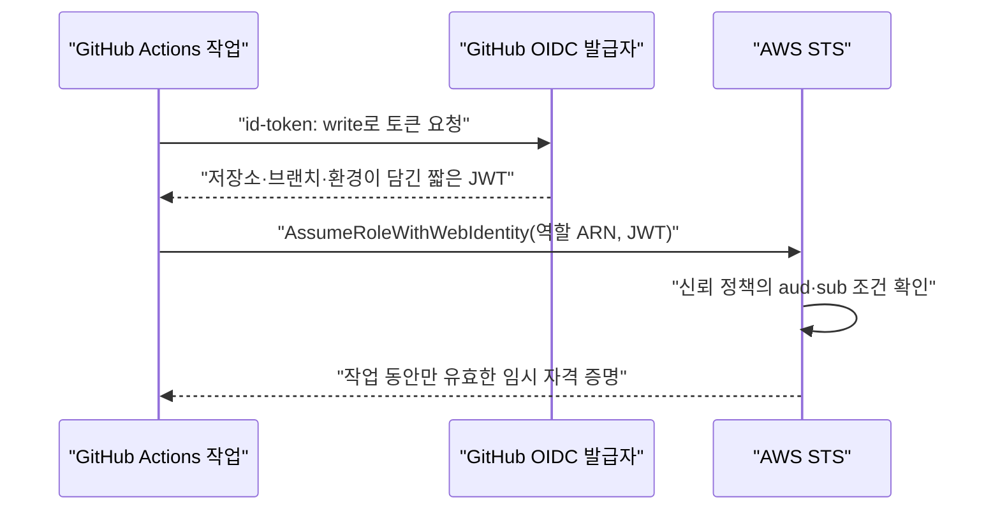
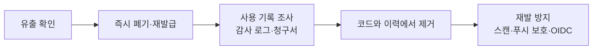

> Master.dev 뉴스레터의 「Stop storing API keys in your repo」(2026.07)를 바탕으로, OIDC·푸시 보호는 GitHub 공식 문서, 로컬 도구는 1Password CLI·dotenvx 문서로 확인해 재구성한 노트다.

## 시크릿이란

**시크릿(secret)** 은 가진 사람이 곧 권한을 갖게 되는 값이다. 클라우드 액세스 키, AI 제공자 API 키, DB 접속 문자열, 서드파티 토큰, 서명 키, 웹훅 URL이 모두 해당한다. 기계가 쓰는 자격 증명의 종류(SSH 키, OAuth 토큰, TLS 인증서, 접속 정보)는 [[devsecops#기계가 쓰는 자격 증명|DevSecOps]]에 정리돼 있다.

시크릿 관리는 결국 네 가지 질문이다. **어디에 두는가, 누가 언제 읽는가, 얼마나 오래 유효한가, 새면 어떻게 하는가.**

## 왜 저장소에 두면 안 되나

- **이력은 지워지지 않는다.** 한 번 커밋하면 다음 커밋에서 지워도 이력·포크·클론에 남는다. 비공개 저장소도 복제되거나 공개로 바뀌는 순간 퍼진다.
- **공개 저장소는 몇 분 안에 긁힌다.** 자동화된 수집기가 새 커밋에서 키 패턴을 찾는다.
- **새는 키는 남의 청구서가 된다.** 클라우드 키로는 채굴 인스턴스를, AI 키로는 대량 추론을 내 계정에 달아 돌린다.
- **CI의 장기 키도 저장소의 일부다.** 저장소 시크릿에 넣어 둔 영구 AWS 키는 워크플로 하나, 의존성 하나가 뚫리면 그대로 빠져나간다. npm 공급망 웜들은 정확히 CI·개발 PC의 환경 변수와 자격 증명 파일을 노렸다([[npm-publishing-security|npm 패키지 게시 보안]]).

## 원칙: 없애고, 좁히고, 짧게, 감지하고, 교체한다

| 순서 | 원칙 | 예 |
| --- | --- | --- |
| 1 | **없앤다** | CI가 클라우드에 접근할 때 저장된 키 대신 OIDC로 실행마다 임시 자격 증명을 받는다. npm 게시는 신뢰된 게시로 토큰을 없앤다 |
| 2 | **좁힌다** | 남는 시크릿은 최소 권한·최소 범위로 만든다. 읽기 전용, 특정 저장소·브랜치·환경, 특정 IP. AI 키는 프로젝트별로 나누고 사용 한도를 건다 |
| 3 | **짧게 쓴다** | 만료 기한을 두고, 정해진 주기로 교체한다 |
| 4 | **코드 밖에서 주입한다** | 시크릿 매니저에 두고 실행 시점에 환경 변수나 파일로 넣는다. 로그에 출력하지 않는다 |
| 5 | **감지한다** | 커밋 전·푸시 시점·저장소 전체에서 시크릿 스캔을 돌린다 |
| 6 | **새면 바로 교체한다** | 이력 정리보다 폐기·재발급이 먼저다(아래 「유출된 뒤에」) |

## OIDC로 장기 키 없애기

GitHub Actions와 클라우드 사이에 **신뢰 관계**를 맺으면 워크플로가 실행될 때 GitHub가 짧게 사는 OIDC 토큰을 발급하고, 클라우드는 그 토큰이 내 저장소에서 왔는지 검증한 뒤 작업이 끝나면 만료되는 임시 자격 증명을 준다. 저장소에는 아무 비밀도 없다.



AWS라면 세 단계다.

1. IAM에 GitHub 토큰 발급자(`token.actions.githubusercontent.com`)를 OIDC ID 공급자로 등록한다.
2. 역할을 만들고 신뢰 정책에서 `aud`가 `sts.amazonaws.com`이고 `sub`가 내 저장소(`repo:<조직>/<저장소>:ref:refs/heads/main`, 또는 `:environment:production`)인 토큰만 받게 한다. **`sub`를 와일드카드로 넓히면 다른 저장소도 그 역할을 쓸 수 있다.**
3. 워크플로에서 토큰을 요청하고 역할을 맡는다.

```yaml
permissions:
  id-token: write   # OIDC 토큰 요청
  contents: read
steps:
  - uses: aws-actions/configure-aws-credentials@<커밋-SHA>
    with:
      role-to-assume: arn:aws:iam::123456789012:role/deploy-site
      aws-region: ap-northeast-2
```

GCP(Workload Identity Federation), Azure(페더레이션 자격 증명), npm(신뢰된 게시)도 같은 구조다. `id-token: write`는 그 토큰이 필요한 작업에만 준다.

## 남는 시크릿을 두는 곳

| 단계 | 두는 곳 | 주의 |
| --- | --- | --- |
| 로컬 개발 | `.env`(커밋 금지) + `.env.example`(키 이름만 커밋), 또는 비밀번호 관리자 참조 | `.env`를 `.gitignore`에 넣는 것만으로는 부족하다. 이미 커밋된 적이 있는지 확인한다([[config-env\|NestJS 설정과 환경 변수]]) |
| CI | 저장소·조직 시크릿보다 **환경(environment) 시크릿**. 보호 규칙(승인자, 브랜치 제한)이 걸린 환경에만 운영 시크릿을 둔다 | 포크 PR에는 시크릿이 넘어가지 않게 한다. `echo`로 찍지 않는다 |
| 운영 | 클라우드 시크릿 매니저(AWS Secrets Manager, GCP Secret Manager, Azure Key Vault), HashiCorp Vault | 접근을 감사 로그로 남기고, 가능하면 동적 시크릿(요청마다 발급되는 DB 계정 등)을 쓴다 |
| 쿠버네티스 | `Secret` 객체는 기본으로 Base64 인코딩일 뿐이다 | etcd 암호화, 외부 시크릿 매니저 연동, RBAC로 읽기 제한([[kubernetes-security\|쿠버네티스 보안]]) |
| 사람끼리 | 팀 비밀번호 관리자의 공유 금고 | 메신저·메일·스프레드시트·AI 도구 설정 파일에 붙여 넣지 않는다([[devsecops#비밀 관리 원칙\|비밀 관리 원칙]]) |

### 로컬에서 평문 `.env` 줄이기

| 도구 | 방식 |
| --- | --- |
| 1Password CLI | `.env`에 값 대신 `op://<금고>/<항목>/<필드>` 참조를 적고 `op run --env-file="./app.env" -- npm start`로 실행한다. 실행 순간에만 값이 풀려 그 프로세스 환경에 들어가고, 출력에 찍힌 시크릿은 기본으로 가려진다 |
| dotenvx | `dotenvx encrypt`로 `.env` 값을 공개 키로 암호화한다. 암호화된 `.env`는 커밋하고, 복호화용 개인 키는 `.env.keys`(커밋 금지)나 CI의 `DOTENV_PRIVATE_KEY`(`.env.production`이면 `DOTENV_PRIVATE_KEY_PRODUCTION`)에 둔다. `dotenvx run -- npm start`가 실행 시 풀어서 주입한다 |

두 방식 모두 **디스크에 평문 시크릿 파일이 남지 않게** 해, 악성 의존성이 홈 디렉터리의 `.env`를 긁어 가는 공격([[developer-targeted-social-engineering|개발자를 노리는 사회공학 공격]])의 수확을 줄인다.

### 환경 변수도 완벽하지 않다

환경 변수는 코드 밖으로 빼는 표준 방법이지만([[twelve-factor-app|12요소 앱]]의 「설정」), 새는 길이 있다. 같은 사용자의 다른 프로세스가 읽을 수 있고, 자식 프로세스에 상속되고, 크래시 덤프·디버그 로그·`docker inspect` 출력에 찍힌다. 그래서 민감도가 높은 값은 파일(권한 `600`), 표준 입력, 시크릿 매니저 API로 읽게 하고, CLI는 시크릿을 **명령줄 플래그로 받지 않는다**(셸 기록과 프로세스 목록에 남는다 → [[cli-design-guidelines|CLI 설계 원칙]]).

## 시크릿 스캔과 푸시 보호

| 단계 | 도구 | 동작 |
| --- | --- | --- |
| 커밋 전 | gitleaks, TruffleHog 같은 스캐너를 pre-commit 훅으로 | 커밋 자체를 막는다. 개발자가 건너뛸 수 있으니 이것만 믿지 않는다 |
| 푸시 시점 | GitHub 푸시 보호(push protection) | 알려진 형식의 시크릿이 든 푸시를 거부한다 |
| 저장소 전체 | GitHub 시크릿 스캔(secret scanning) | 이력 전체를 훑어 경고를 띄운다. 일부 제공자는 자기 토큰이 발견되면 통보받아 폐기한다 |

- GitHub.com의 **계정 수준 푸시 보호**는 기본으로 켜져 있고, 내가 **공개 저장소**에 시크릿을 푸시하는 것을 막는다.
- **저장소 수준 푸시 보호**는 기본으로 꺼져 있어 관리자가 켜야 한다. 비공개 저장소는 GitHub Secret Protection이 필요하다.
- 막힌 푸시는 「테스트용이다」, 「오탐이다」, 「나중에 고치겠다」 중 하나를 골라 우회할 수 있고, 우회는 감사 로그와 메일 알림으로 남는다. 위임 우회(delegated bypass)로 우회할 수 있는 사람을 제한한다.
- 스캐너는 알려진 형식만 잡는다. 사내 토큰처럼 형식이 없는 값은 사용자 정의 패턴을 등록한다.

## 교체(rotation)

- **주기적 교체**: 만료 기한을 두면 교체가 습관이 된다. 사람이 기억해서 하는 교체는 결국 빠진다.
- **겹쳐서 교체한다**: 새 키 발급 → 모든 소비자에 배포 → 새 키로 동작 확인 → 옛 키 폐기. 키를 두 개까지 동시에 허용하는 시스템이면 무중단으로 바꾼다.
- **사람이 떠날 때**: 그 사람이 볼 수 있던 공용 시크릿을 교체한다. 개인 키는 회수한다.
- 교체가 어렵다는 것은 시크릿이 너무 많은 곳에 복사돼 있다는 신호다. 한 곳(시크릿 매니저)에서 주입하도록 모은다.

## 유출된 뒤에



1. **폐기와 재발급이 먼저다.** 공개 저장소에 올라간 순간 이미 수집됐다고 가정한다. 이력에서 지우는 것은 아무것도 되돌리지 못한다.
2. **사용 기록을 본다.** 클라우드 감사 로그(CloudTrail 등), API 제공자의 사용량·청구서, 그 키로 만들어진 리소스를 확인한다. 유출된 시점부터 폐기한 시점까지가 조사 범위다.
3. **코드와 이력에서 지운다.** 이력 재작성(`git filter-repo`)과 GitHub 캐시 정리 요청은 [[git-undo-and-rewrite|Git 되돌리기와 이력 다루기]]의 「민감 정보를 푸시했다면」에 있다. 키를 교체했다면 이력 정리는 선택이다.
4. **재발을 막는다.** 그 시크릿을 OIDC로 없앨 수 있었는지, 범위를 더 좁힐 수 있었는지, 스캔이 왜 놓쳤는지 본다([[incident-postmortem|포스트모템]]).

**PC가 악성 코드에 감염돼 새어 나간 경우는 순서가 다르다.** 일부 악성 코드는 훔친 토큰이 폐기되는지 감시하다가 폐기되면 파일을 지운다. 그 PC를 먼저 네트워크에서 떼고, **깨끗한 다른 기기에서** 폐기·재발급한다([[devsecops#당한 쪽: 감염이 의심되는 PC|감염 대응]]).

## 정리

- 가장 좋은 시크릿은 없는 시크릿이다. CI와 클라우드 사이, npm 게시는 OIDC로 장기 키를 없앤다.
- 남는 시크릿은 범위를 좁히고, 만료 기한을 두고, 시크릿 매니저에서 실행 시점에 주입한다.
- 로컬 평문 `.env`는 비밀번호 관리자 참조나 암호화로 줄이고, 환경 변수·명령줄 플래그도 새는 길이 있음을 안다.
- 커밋 전 훅, 푸시 보호, 저장소 스캔을 겹쳐 건다. 저장소 수준 푸시 보호는 직접 켠다.
- 새면 이력 정리보다 폐기·재발급이 먼저고, 감염된 PC라면 격리가 그보다 먼저다.

관련 노트: [[devsecops|DevSecOps와 클라우드 보안]], [[twelve-factor-app|12요소 앱]], [[ci-cd|CI/CD]], [[config-env|NestJS 설정과 환경 변수]], [[git-undo-and-rewrite|Git 되돌리기와 이력 다루기]], [[kubernetes-security|쿠버네티스 보안]], [[npm-publishing-security|npm 패키지 게시 보안]], [[developer-targeted-social-engineering|개발자를 노리는 사회공학 공격]]
