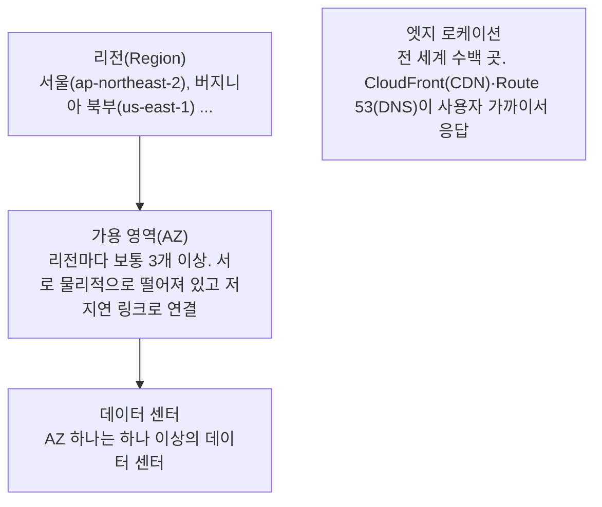
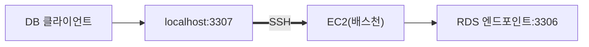

> 팔만코딩경(42Seoul 커뮤니티 위키)의 「AWSome day 2022 - AWS 클라우드」, 「AWSome day 2022 - AWS Computing」을 바탕으로 행사 내용이 아닌 개념만 재구성하고, 「보안 그룹과 RDS 접속」은 같은 위키의 「DB와 DataGrip 연결하기」로 보탠 노트다.
> 클라우드의 다섯 가지 특징과 배포 모델, IaaS·PaaS·SaaS의 책임 범위와 맞는 경우, 클라우드를 받치는 기술은 고려사이버대학교 「클라우드 컴퓨팅」(2023-2학기) 강의 내용으로 보강했다.

## 클라우드란

**온프레미스(on-premises)** 는 서버·네트워크·건물까지 회사가 직접 사서 운영하는 방식이다. 견적·구매 품의·입고·설치·네트워크 연결까지 몇 주에서 몇 달이 걸리므로 몇 년 뒤의 최대 수요를 예상해 미리 크게 산다. 덜 쓰면 장비가 놀고, 더 몰리면 그때 사도 늦다. **클라우드**는 클라우드 사업자가 소유한 자원을 인터넷으로 빌려 쓰고 쓴 만큼 돈을 내는 방식이다. 인프라를 하드웨어가 아니라 API로 만들고 지우는 소프트웨어처럼 다룰 수 있다는 점이 본질적인 차이다.

| 이점 | 설명 |
| --- | --- |
| 자본 비용 → 가변 비용 | 장비 구매(CAPEX, 감가상각) 대신 쓴 만큼 사용료(OPEX)를 낸다 |
| 규모의 경제 | 많은 고객이 자원을 나눠 써 단가가 낮고, 보안·신기술 투자도 사업자가 대신 한다 |
| 용량 추정 불필요 | 최대 트래픽을 예측해 과하게 사 두지 않고, 필요할 때 늘리고 줄인다 |
| 속도와 민첩성 | 주·월 단위 조달이 분 단위로 줄어 실험과 실패 비용이 작다 |
| 데이터 센터 운영 불필요 | 건물·전력·하드웨어 교체에 쓰던 노력을 서비스 개발에 돌린다 |
| 빠른 글로벌 배포 | 다른 대륙의 리전에 같은 구성을 바로 띄운다 |

바탕 기술은 **가상화**다. 물리 장비를 소프트웨어로 쪼개고 묶을 수 있게 되면서 자원을 잘게 나눠 팔 수 있게 됐다. 다만 가상화는 기술이고 클라우드는 그 위의 운영 방식이라, 사내 서버를 가상화했다고 클라우드가 되지는 않는다. 미국 국립표준기술연구소(NIST)의 정의가 그 차이를 다섯 가지 특징으로 보여 준다.

| 특징 | 뜻 | 없으면 |
| --- | --- | --- |
| 주문형 셀프서비스 | 사람에게 요청하지 않고 콘솔·API로 직접 자원을 만든다 | 티켓을 넣고 담당자를 기다리는 사내 가상화 |
| 광범위한 네트워크 접근 | 표준 프로토콜로 어디서나 접근한다 | 사내망에서만 쓰는 자원 |
| 자원 풀링 | 여러 고객이 물리 자원을 나눠 쓴다(멀티테넌시). 고객은 정확한 위치를 모른다 | 고객마다 전용 장비 |
| 빠른 탄력성 | 수요에 맞춰 금방 늘고 준다. 사용자 눈에는 무한해 보인다 | 증설 때마다 구매 |
| 측정되는 서비스 | 사용량을 재고 그만큼 과금한다 | 정액 임대 |

| 배포 모델 | 뜻 |
| --- | --- |
| 퍼블릭 | 여러 고객이 사업자의 자원을 공유한다. AWS, Azure, GCP, 네이버 클라우드 등 |
| 프라이빗 | 한 조직만 쓴다. 자체 데이터 센터에 OpenStack 같은 것으로 짓거나 사업자 안에 전용 구역을 받는다 |
| 하이브리드 | 온프레미스·프라이빗과 퍼블릭을 연결해 함께 쓴다. 민감한 데이터는 안에, 변동 큰 부하는 밖에 |
| 커뮤니티 | 같은 요구(규제, 보안 등급)를 가진 조직들이 공유한다. 공공·금융 전용 클라우드 |
| 멀티 클라우드 | 퍼블릭 사업자 여럿을 함께 쓴다 |
| 클라우드 올인 | 모든 자원을 클라우드에서 운영한다 |

## 서비스 모델: IaaS, PaaS, SaaS

클라우드 상품은 **제공자가 어디까지 관리해 주느냐**로 나뉜다.

```text
                       온프레미스  IaaS    PaaS    SaaS
애플리케이션             사용자     사용자  사용자  제공자
데이터                   사용자     사용자  사용자  사용자*
런타임·미들웨어          사용자     사용자  제공자  제공자
운영체제                 사용자     사용자  제공자  제공자
가상화                   사용자     제공자  제공자  제공자
서버·스토리지·네트워크   사용자     제공자  제공자  제공자
```

\* SaaS라도 데이터의 소유와 그 데이터에 누가 접근하는지(계정, 공유 설정)는 사용자 책임으로 남는다.

| 모델 | 빌리는 것 | 사용자가 하는 일 | 예 | 맞는 경우 |
| --- | --- | --- | --- | --- |
| IaaS (Infrastructure) | 가상 서버, 스토리지, 네트워크 | OS 설치·패치, 미들웨어, 앱, 확장 설정 | EC2, Compute Engine, Azure VM | OS·미들웨어를 직접 통제해야 할 때, 기존 시스템을 거의 그대로 옮길 때(리프트 앤 시프트), 장비를 살 돈과 시간이 아까운 작은 회사 |
| PaaS (Platform) | 앱을 올릴 실행 환경, 관리형 DB | 코드와 설정, 데이터 | Elastic Beanstalk, Heroku, App Service, RDS | 인프라보다 개발에 집중하고, 여러 개발자가 같은 환경에서 빠르게 배포해야 할 때 |
| SaaS (Software) | 완성된 소프트웨어 | 계정·데이터·설정 관리 | Google Workspace, Slack, Notion, Salesforce | 대부분의 업무 도구. 민감 정보를 다루면 데이터 위치와 보안 수준을 먼저 확인한다 |

IaaS에서 SaaS로 갈수록 운영 부담이 줄고 시작이 빠르지만, 바꿀 수 있는 것도 줄고 그 서비스에 묶인다(종속, lock-in). 서버리스와 컨테이너 서버리스는 PaaS와 SaaS 사이 어딘가에 있다([[serverless-architecture|서버리스 아키텍처]]). DaaS(가상 데스크톱), BPaaS(업무 프로세스)처럼 「무엇이든 서비스로(XaaS)」 이름이 더 붙기도 한다. 실무에서는 섞어 쓴다. 앱은 컨테이너(IaaS나 관리형 쿠버네티스)에, DB는 관리형(PaaS)에, 메일과 문서는 SaaS로.

**보안은 공동 책임 모델(shared responsibility model)을 따른다.** 물리 시설·하드웨어·가상화 계층은 사업자가 맡고, 그 위는 위 표의 경계에 따라 사용자 몫이 달라진다. IaaS라면 OS 패치, 네트워크·보안 그룹 설정, 계정과 권한, 데이터 암호화가 모두 사용자 책임이다. 클라우드 보안 사고 대부분이 해커보다 사용자의 설정 오류와 권한 관리 실수에서 나오는 이유다([[devsecops#클라우드의 보안 위협|클라우드의 보안 위협]]).

### 클라우드를 받치는 기술

| 층 | 기술 | 자세히 |
| --- | --- | --- |
| 서버 | 하이퍼바이저형(1형: Xen, KVM, Hyper-V, ESXi, 클라우드 데이터 센터의 기본)과 호스트형(2형: VirtualBox) 가상화, 호스트 커널을 공유하는 컨테이너 | [[virtualization\|가상화]], [[vm-vs-container\|VM과 컨테이너]] |
| 네트워크 | VLAN(스위치 하나를 여러 논리망으로), VPN(공용망 위의 암호화된 사설 통로), SDN(경로를 정하는 제어 평면을 장비에서 떼어 중앙 컨트롤러가 소프트웨어로 설정), NFV(방화벽·로드 밸런서·라우터 같은 전용 장비 기능을 일반 서버의 소프트웨어로) | [[network-layer#제어 평면과 데이터 평면, SDN\|SDN]], [[aws-vpc-networking\|AWS VPC]] |
| 스토리지 | 블록(디스크, DB용), 파일(공유 폴더), 오브젝트(키와 HTTP API, 백업·미디어) | [[block-file-object-storage\|블록·파일·오브젝트 스토리지]] |
| 데이터 | 설치·패치·백업·복제·장애 조치를 사업자가 맡는 관리형 DB. 여러 노드에 나눠 처리하도록 설계된 NoSQL은 수평 확장과 잘 맞는다. 큰 데이터는 평범한 서버 여럿을 묶은 클러스터(Hadoop·Spark)로 처리한다 | [[database-selection\|용도별 데이터베이스]], [[cloud-services-map#빅데이터 파이프라인\|빅데이터 파이프라인]] |
| SaaS | 한 소프트웨어를 여러 고객이 함께 쓰면서 데이터는 섞이지 않게 나누는 멀티테넌시 | - |

콘솔에서 클릭 몇 번으로 VPC·서브넷·보안 그룹·로드 밸런서가 생기는 것은 SDN과 NFV 덕분이다. 그리고 이 모든 자원을 **API로 만들 수 있다**는 것이 프로그램이 인프라를 조작하는 자동화와 코드형 인프라의 출발점이다([[cloud-native|클라우드 네이티브와 코드형 인프라]]).

## 글로벌 인프라



- 2026년 기준 39개 리전, 120여 개 AZ가 운영되며 계속 늘고 있다([AWS 공식 현황](https://aws.amazon.com/about-aws/global-infrastructure/regions_az/)).
- AZ 하나의 장애가 다른 AZ로 번지지 않게 설계되어 있으므로, 서비스는 여러 AZ에 나눠 배치해야 장애에 견딘다.
- 리전은 세 가지로 고른다: 데이터를 특정 국가에 둬야 하는 **규제**, 사용자와의 **지연 시간**, 리전마다 다른 **가격과 제공 서비스**.

## EC2: 가상 서버

Amazon EC2는 크기를 고를 수 있는 가상 서버(인스턴스)다. OS부터 그 위의 모든 것을 직접 제어한다.

- **AMI**(Amazon Machine Image)로 OS와 기본 소프트웨어가 담긴 상태에서 시작한다. AWS 제공, 마켓플레이스, 커뮤니티, 직접 만든 AMI가 있다.
- 인스턴스 패밀리는 용도별로 나뉜다: 범용(M, T), 컴퓨팅 최적화(C), 메모리 최적화(R, X), 가속 컴퓨팅(GPU, P·G), 스토리지 최적화(I). 각 패밀리 안에서 `large`, `xlarge`처럼 크기를 고르고, 운영 중에도 바꿀 수 있다.
- 서버를 언제든 버리고 새로 만들 수 있는 일회용 자원으로 다루는 것이 클라우드다운 사용법이다. 인스턴스에 상태를 두지 않으면(stateless) Auto Scaling으로 수를 자유롭게 늘리고 줄일 수 있다.

| 요금 모델 | 특징 | 맞는 경우 |
| --- | --- | --- |
| 온디맨드 | 약정 없이 초·시간 단위로 낸다 | 짧거나 예측하기 어려운 작업 |
| Savings Plans | 1·3년 동안 시간당 사용 금액을 약정하고 할인. 인스턴스 유형·리전 변경이 자유롭다 | 꾸준히 쓰지만 구성이 바뀌는 경우 |
| 예약 인스턴스 | 특정 인스턴스 구성을 1·3년 약정하고 할인 | 구성이 고정된 안정적 워크로드 |
| 스팟 | 남는 용량을 최대 90% 할인. 2분 예고 후 회수될 수 있다 | 중단돼도 되는 배치·CI 작업 |

## 관리형 서비스와 서버리스

| 구분 | 사용자가 관리 | 예 |
| --- | --- | --- |
| 비관리형 | 확장·장애 대응·가용성 | EC2에 DB를 직접 설치 |
| 관리형 | 설정과 사용만. 확장·백업·장애 조치가 내장 | RDS, ECS, EKS |
| 서버리스 | 코드만. 서버 프로비저닝 없음, 유휴 시간 비용 없음 | Lambda, Fargate |

- **ECS**는 AWS 고유의 관리형 컨테이너 오케스트레이션, **EKS**는 관리형 쿠버네티스다. 둘 다 컨테이너를 EC2 위에서 돌릴 수도, 서버 관리가 없는 **Fargate** 위에서 돌릴 수도 있다. 컨테이너가 많아질 때 오케스트레이션이 필요한 이유는 [[vm-vs-container|VM과 컨테이너]]에 있다.
- **Lambda**는 이벤트(HTTP 요청, 파일 업로드, 일정)가 올 때만 함수를 실행하고 실행 시간만큼 과금한다. 상태를 함수 밖(DB, S3)에 두는 짧은 작업에 맞는다.

## 보안 그룹과 RDS 접속

**보안 그룹(Security Group)** 은 EC2·RDS 앞에 놓인 가상 방화벽이다. 허용하지 않은 인바운드 트래픽은 모두 막으므로, 로컬 PC의 DB 클라이언트(DBeaver·DataGrip)에서 RDS에 직접 붙으려면 내 IP를 인바운드 규칙에 넣어야 한다.

1. RDS 콘솔 → **데이터베이스** → DB 식별자 → **연결 & 보안** 탭 → **VPC 보안 그룹** 링크
2. **인바운드 규칙 편집** → **규칙 추가**: 유형 `PostgreSQL`(5432) 또는 `MySQL/Aurora`(3306), 소스 **내 IP**

| 확인할 것 | 이유 |
| --- | --- |
| RDS의 **퍼블릭 액세스** 설정 | 꺼져 있으면 보안 그룹을 열어도 외부에서 닿지 않는다 |
| 소스를 `0.0.0.0/0`으로 열지 않는다 | DB 포트를 인터넷 전체에 노출하면 무차별 대입 공격의 표적이 된다 |
| 규칙에 설명을 적고, 쓰지 않는 규칙은 지운다 | 집·카페처럼 IP가 바뀌는 곳의 규칙이 쌓인다 |

운영 DB는 퍼블릭 액세스를 끄고 VPC 안에만 둔다. 이때는 같은 VPC의 EC2(배스천 호스트)를 거쳐 **SSH 터널**로 접속한다. RDS 보안 그룹의 인바운드 소스는 내 IP가 아니라 **배스천의 보안 그룹**으로 지정한다.



```bash
ssh -i key.pem -N -L 3307:mydb.xxxx.ap-northeast-2.rds.amazonaws.com:3306 ec2-user@<배스천 퍼블릭 DNS>
# 클라이언트에서 Host=127.0.0.1, Port=3307 로 접속
```

GUI 클라이언트는 연결 설정의 **SSH Tunnel** 탭에서 같은 일을 한다. 일반 탭에는 RDS 엔드포인트·포트·DB 계정을, SSH 탭에는 배스천 주소, 기본 사용자(Amazon Linux `ec2-user`, Ubuntu `ubuntu`), `.pem` 키 경로를 넣는다. 열어 둔 SSH 포트조차 없애려면 AWS Systems Manager **Session Manager 포트 포워딩**을 쓴다.

## AWS를 다루는 방법

| 도구 | 특징 |
| --- | --- |
| Management Console | 웹 화면. 탐색과 일회성 설정에 편하다 |
| AWS CLI | 터미널 명령. 스크립트로 반복 작업을 자동화 |
| SDK | 언어별 라이브러리. 애플리케이션 코드에서 AWS API 호출 |

콘솔과 CLI도 결국 같은 API를 부른다. 인프라 구성을 Terraform, AWS CloudFormation·CDK 같은 코드로 적어 두고 버전 관리하는 것을 **코드형 인프라(IaC, Infrastructure as Code)** 라고 한다. 손으로 클릭한 설정은 재현하기 어렵지만, 코드는 리뷰하고 되돌리고 다른 리전에 그대로 복제할 수 있다.

## 정리

- 클라우드는 인프라를 빌려 쓰고 API로 다루는 방식이다. NIST의 다섯 특징(셀프서비스, 네트워크 접근, 자원 풀링, 빠른 탄력성, 측정되는 서비스)이 사내 가상화와 가른다.
- IaaS → PaaS → SaaS로 갈수록 제공자가 더 많이 관리하고, 편해지는 만큼 통제와 이식성을 내준다. 보안은 그 경계를 따라 사업자와 사용자가 나눠 진다.
- 리전 > 가용 영역 > 데이터 센터. 장애에 견디려면 여러 AZ에 나눠 배치한다.
- EC2는 일회용 서버로 다루고, 사용 패턴에 따라 온디맨드·Savings Plans·스팟을 섞는다.
- 보안 그룹은 필요한 포트·소스만 연다. 운영 DB는 퍼블릭 액세스 없이 배스천 SSH 터널이나 Session Manager로 접속한다.
- 관리 부담을 줄이려면 관리형(RDS·ECS·EKS)과 서버리스(Lambda·Fargate)를 먼저 검토하고, 구성은 IaC로 남긴다.

관련 노트: [[startup-infra-decisions|스타트업 인프라 선택 원칙]], [[vm-vs-container|VM과 컨테이너]], [[disaster-recovery|고가용성과 재해 복구 설계]], [[dbeaver|DBeaver에서 SQL로 데이터 다루기]], [[serverless-architecture|서버리스 아키텍처]], [[virtualization|가상화]], [[cloud-sla-and-contract|클라우드 SLA·계약과 규제]]
