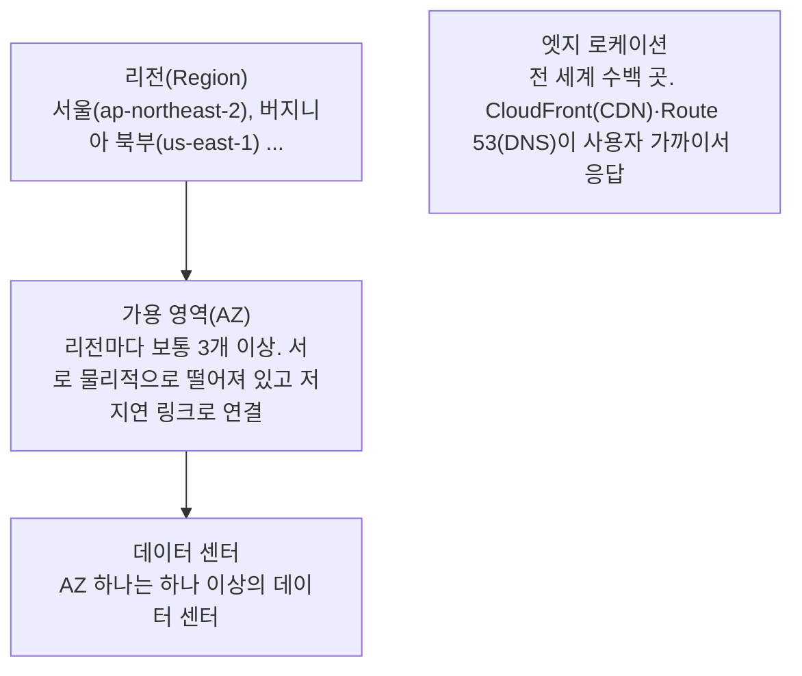
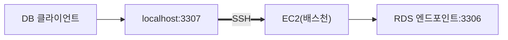

> 팔만코딩경(42Seoul 커뮤니티 위키)의 「AWSome day 2022 - AWS 클라우드」, 「AWSome day 2022 - AWS Computing」을 바탕으로 행사 내용이 아닌 개념만 재구성하고, 「보안 그룹과 RDS 접속」은 같은 위키의 「DB와 DataGrip 연결하기」로 보탠 노트다.

## 클라우드란

**온프레미스(on-premises)** 는 서버·네트워크·건물까지 회사가 직접 사서 운영하는 방식이다. **클라우드**는 클라우드 사업자가 소유한 자원을 인터넷으로 빌려 쓰고 쓴 만큼 돈을 내는 방식이다. 인프라를 하드웨어가 아니라 API로 만들고 지우는 소프트웨어처럼 다룰 수 있다는 점이 본질적인 차이다.

| 배포 모델 | 뜻 |
| --- | --- |
| 온프레미스(프라이빗) | 모든 자원을 자체 데이터 센터에 둔다 |
| 하이브리드 | 온프레미스와 클라우드를 연결해 함께 쓴다 |
| 클라우드 올인 | 모든 자원을 클라우드에서 운영한다 |

## 클라우드의 이점

| 이점 | 설명 |
| --- | --- |
| 자본 비용 → 가변 비용 | 서버를 미리 사는 대신 쓴 만큼 낸다 |
| 규모의 경제 | 많은 고객이 자원을 나눠 써 단가가 낮고, 보안·신기술 투자도 사업자가 대신 한다 |
| 용량 추정 불필요 | 최대 트래픽을 예측해 과하게 사 두지 않고, 필요할 때 늘리고 줄인다 |
| 속도와 민첩성 | 몇 분 만에 자원을 만들고 지워서 실험과 실패 비용이 작다 |
| 데이터 센터 운영 불필요 | 건물·전력·하드웨어 교체에 쓰던 노력을 서비스 개발에 돌린다 |
| 빠른 글로벌 배포 | 다른 대륙의 리전에 같은 구성을 바로 띄운다 |

대신 보안은 **공동 책임 모델**을 따른다. 물리 시설·하드웨어·가상화 계층은 AWS가, 그 위의 OS 패치·네트워크 설정·데이터·권한은 사용자가 책임진다.

## 글로벌 인프라



- 2026년 기준 39개 리전, 120여 개 AZ가 운영되며 계속 늘고 있다([AWS 공식 현황](https://aws.amazon.com/about-aws/global-infrastructure/regions_az/)).
- AZ 하나의 장애가 다른 AZ로 번지지 않게 설계되어 있으므로, 서비스는 여러 AZ에 나눠 배치해야 장애에 견딘다.
- 리전은 세 가지로 고른다: 데이터를 특정 국가에 둬야 하는 **규제**, 사용자와의 **지연 시간**, 리전마다 다른 **가격과 제공 서비스**.

## EC2: 가상 서버

Amazon EC2는 크기를 고를 수 있는 가상 서버(인스턴스)다. OS부터 그 위의 모든 것을 직접 제어한다.

- **AMI**(Amazon Machine Image)로 OS와 기본 소프트웨어가 담긴 상태에서 시작한다. AWS 제공, 마켓플레이스, 커뮤니티, 직접 만든 AMI가 있다.
- 인스턴스 패밀리는 용도별로 나뉜다: 범용(M, T), 컴퓨팅 최적화(C), 메모리 최적화(R, X), 가속 컴퓨팅(GPU, P·G), 스토리지 최적화(I). 각 패밀리 안에서 `large`, `xlarge`처럼 크기를 고르고, 운영 중에도 바꿀 수 있다.
- 서버를 언제든 버리고 새로 만들 수 있는 일회용 자원으로 다루는 것이 클라우드다운 사용법이다. 인스턴스에 상태를 두지 않으면(stateless) Auto Scaling으로 수를 자유롭게 늘리고 줄일 수 있다.

| 요금 모델 | 특징 | 맞는 경우 |
| --- | --- | --- |
| 온디맨드 | 약정 없이 초·시간 단위로 낸다 | 짧거나 예측하기 어려운 작업 |
| Savings Plans | 1·3년 동안 시간당 사용 금액을 약정하고 할인. 인스턴스 유형·리전 변경이 자유롭다 | 꾸준히 쓰지만 구성이 바뀌는 경우 |
| 예약 인스턴스 | 특정 인스턴스 구성을 1·3년 약정하고 할인 | 구성이 고정된 안정적 워크로드 |
| 스팟 | 남는 용량을 최대 90% 할인. 2분 예고 후 회수될 수 있다 | 중단돼도 되는 배치·CI 작업 |

## 관리형 서비스와 서버리스

| 구분 | 사용자가 관리 | 예 |
| --- | --- | --- |
| 비관리형 | 확장·장애 대응·가용성 | EC2에 DB를 직접 설치 |
| 관리형 | 설정과 사용만. 확장·백업·장애 조치가 내장 | RDS, ECS, EKS |
| 서버리스 | 코드만. 서버 프로비저닝 없음, 유휴 시간 비용 없음 | Lambda, Fargate |

- **ECS**는 AWS 고유의 관리형 컨테이너 오케스트레이션, **EKS**는 관리형 쿠버네티스다. 둘 다 컨테이너를 EC2 위에서 돌릴 수도, 서버 관리가 없는 **Fargate** 위에서 돌릴 수도 있다. 컨테이너가 많아질 때 오케스트레이션이 필요한 이유는 [[vm-vs-container|VM과 컨테이너]]에 있다.
- **Lambda**는 이벤트(HTTP 요청, 파일 업로드, 일정)가 올 때만 함수를 실행하고 실행 시간만큼 과금한다. 상태를 함수 밖(DB, S3)에 두는 짧은 작업에 맞는다.

## 보안 그룹과 RDS 접속

**보안 그룹(Security Group)** 은 EC2·RDS 앞에 놓인 가상 방화벽이다. 허용하지 않은 인바운드 트래픽은 모두 막으므로, 로컬 PC의 DB 클라이언트(DBeaver·DataGrip)에서 RDS에 직접 붙으려면 내 IP를 인바운드 규칙에 넣어야 한다.

1. RDS 콘솔 → **데이터베이스** → DB 식별자 → **연결 & 보안** 탭 → **VPC 보안 그룹** 링크
2. **인바운드 규칙 편집** → **규칙 추가**: 유형 `PostgreSQL`(5432) 또는 `MySQL/Aurora`(3306), 소스 **내 IP**

| 확인할 것 | 이유 |
| --- | --- |
| RDS의 **퍼블릭 액세스** 설정 | 꺼져 있으면 보안 그룹을 열어도 외부에서 닿지 않는다 |
| 소스를 `0.0.0.0/0`으로 열지 않는다 | DB 포트를 인터넷 전체에 노출하면 무차별 대입 공격의 표적이 된다 |
| 규칙에 설명을 적고, 쓰지 않는 규칙은 지운다 | 집·카페처럼 IP가 바뀌는 곳의 규칙이 쌓인다 |

운영 DB는 퍼블릭 액세스를 끄고 VPC 안에만 둔다. 이때는 같은 VPC의 EC2(배스천 호스트)를 거쳐 **SSH 터널**로 접속한다. RDS 보안 그룹의 인바운드 소스는 내 IP가 아니라 **배스천의 보안 그룹**으로 지정한다.



```bash
ssh -i key.pem -N -L 3307:mydb.xxxx.ap-northeast-2.rds.amazonaws.com:3306 ec2-user@<배스천 퍼블릭 DNS>
# 클라이언트에서 Host=127.0.0.1, Port=3307 로 접속
```

GUI 클라이언트는 연결 설정의 **SSH Tunnel** 탭에서 같은 일을 한다. 일반 탭에는 RDS 엔드포인트·포트·DB 계정을, SSH 탭에는 배스천 주소, 기본 사용자(Amazon Linux `ec2-user`, Ubuntu `ubuntu`), `.pem` 키 경로를 넣는다. 열어 둔 SSH 포트조차 없애려면 AWS Systems Manager **Session Manager 포트 포워딩**을 쓴다.

## AWS를 다루는 방법

| 도구 | 특징 |
| --- | --- |
| Management Console | 웹 화면. 탐색과 일회성 설정에 편하다 |
| AWS CLI | 터미널 명령. 스크립트로 반복 작업을 자동화 |
| SDK | 언어별 라이브러리. 애플리케이션 코드에서 AWS API 호출 |

콘솔과 CLI도 결국 같은 API를 부른다. 인프라 구성을 Terraform, AWS CloudFormation·CDK 같은 코드로 적어 두고 버전 관리하는 것을 **코드형 인프라(IaC, Infrastructure as Code)** 라고 한다. 손으로 클릭한 설정은 재현하기 어렵지만, 코드는 리뷰하고 되돌리고 다른 리전에 그대로 복제할 수 있다.

## 정리

- 클라우드는 인프라를 빌려 쓰고 API로 다루는 방식이다. 보안은 AWS와 사용자가 나눠 진다.
- 리전 > 가용 영역 > 데이터 센터. 장애에 견디려면 여러 AZ에 나눠 배치한다.
- EC2는 일회용 서버로 다루고, 사용 패턴에 따라 온디맨드·Savings Plans·스팟을 섞는다.
- 보안 그룹은 필요한 포트·소스만 연다. 운영 DB는 퍼블릭 액세스 없이 배스천 SSH 터널이나 Session Manager로 접속한다.
- 관리 부담을 줄이려면 관리형(RDS·ECS·EKS)과 서버리스(Lambda·Fargate)를 먼저 검토하고, 구성은 IaC로 남긴다.

관련 노트: [[startup-infra-decisions|스타트업 인프라 선택 원칙]], [[vm-vs-container|VM과 컨테이너]], [[disaster-recovery|고가용성과 재해 복구 설계]], [[dbeaver|DBeaver에서 SQL로 데이터 다루기]]
