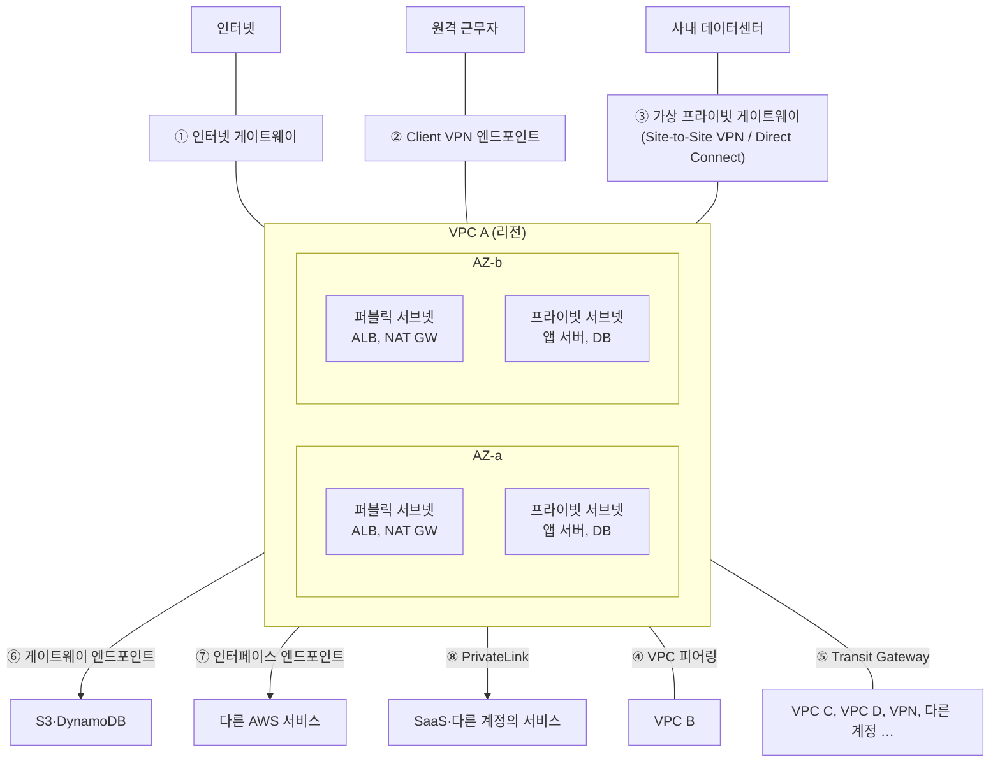

> ByteByteGo의 System Design 101 가이드 「[Typical AWS Network Architecture](https://bytebytego.com/guides/typical-aws-network-architecture-in-one-diagram)」를 바탕으로, [Amazon VPC](https://docs.aws.amazon.com/vpc/latest/userguide/what-is-amazon-vpc.html)·[PrivateLink](https://docs.aws.amazon.com/vpc/latest/privatelink/what-is-privatelink.html) 공식 문서로 확인해 재구성한 노트다.

## VPC란

**VPC(Virtual Private Cloud)** 는 AWS 클라우드 안에 논리적으로 격리된 나만의 가상 네트워크다. IP 대역(CIDR)을 정하고, 그 안을 서브넷으로 나누고, 라우팅 테이블로 트래픽이 어디로 갈지 정한다. EC2·RDS 같은 자원은 모두 어떤 VPC의 어떤 서브넷 안에 놓인다.

| 구성 요소 | 뜻 |
| --- | --- |
| 리전 | VPC 하나는 한 리전에 속한다 |
| 가용 영역(AZ) | 전원·네트워크가 독립된 하나 이상의 데이터센터. 서브넷 하나는 AZ 하나에 속한다 |
| 서브넷 | VPC 대역을 쪼갠 구간. 인터넷 게이트웨이로 가는 경로가 있으면 퍼블릭, 없으면 프라이빗이다 |
| 라우팅 테이블 | 목적지 대역별로 다음 홉(게이트웨이, 엔드포인트, 피어링)을 정한다 |
| 보안 그룹 | 인스턴스(네트워크 인터페이스) 단위의 상태 기반(stateful) 방화벽. 허용 규칙만 있다 |
| 네트워크 ACL | 서브넷 단위의 상태 없는(stateless) 방화벽. 허용·거부 규칙이 있다 |

서비스를 견고하게 하려면 서브넷을 여러 AZ에 하나씩 만들어 자원을 나눠 둔다. 보안 그룹으로 RDS 접속을 여는 실습은 [[aws-cloud-basics|AWS 클라우드 기초]]에 있다.

## 한 장의 구성도

## 연결 방법

| # | 연결 대상 | 수단 | 핵심 |
| --- | --- | --- | --- |
| ① | 인터넷 | 인터넷 게이트웨이(IGW) | VPC와 인터넷 사이의 양방향 관문. 퍼블릭 서브넷의 라우팅 테이블이 `0.0.0.0/0 → IGW`를 가진다. 프라이빗 서브넷이 밖으로 **나가기만** 할 때는 퍼블릭 서브넷의 NAT 게이트웨이를 거친다 |
| ② | 원격 근무자 | Client VPN 엔드포인트 | 개인 기기에서 인터넷을 거쳐 VPC·사내망에 안전하게 접속하는 관리형 VPN |
| ③ | 사내 데이터센터 | 가상 프라이빗 게이트웨이(VGW) + Site-to-Site VPN, 또는 Direct Connect | VGW는 VPN 연결의 AWS 쪽 끝이다. 인터넷 위의 암호화 터널(VPN) 대신 전용 회선(Direct Connect)을 쓰면 대역폭과 지연이 안정적이다 |
| ④ | 다른 VPC 하나 | VPC 피어링 | 두 VPC를 사설 IP로 직접 잇는다. **전이되지 않는다**(A–B, B–C가 이어져도 A–C는 안 된다). 대역이 겹치면 못 잇는다 |
| ⑤ | 여러 VPC·VPN·계정 | Transit Gateway | 허브 하나에 모두 붙이는 중앙 라우터. VPC가 많아지면 피어링을 N×(N−1)/2개 만드는 대신 이것을 쓴다 |
| ⑥ | S3, DynamoDB | 게이트웨이 엔드포인트 | 라우팅 테이블에 항목을 추가해 인터넷·NAT 없이 사설 경로로 간다. 추가 요금이 없다 |
| ⑦ | 그 밖의 AWS 서비스 | 인터페이스 엔드포인트(PrivateLink 기반) | 서브넷 안에 사설 IP를 가진 네트워크 인터페이스가 생기고, 서비스 호출이 그리로 간다. IGW·NAT·VGW가 필요 없다 |
| ⑧ | SaaS, 다른 계정의 서비스 | PrivateLink | 서비스 제공자가 NLB 뒤에 엔드포인트 서비스를 만들고, 소비자는 인터페이스 엔드포인트로 붙는다. 트래픽이 인터넷에 나가지 않고, VPC 전체가 아니라 **서비스 하나만** 노출된다 |

### 피어링과 Transit Gateway, PrivateLink 고르기

| 상황 | 고를 것 |
| --- | --- |
| VPC 두세 개를 서로 통째로 잇는다 | VPC 피어링 |
| VPC가 많고, VPN·Direct Connect까지 한 곳에서 라우팅한다 | Transit Gateway |
| 특정 서비스 하나만 다른 VPC·계정에 공개한다. 대역이 겹쳐도 된다 | PrivateLink |

## 비용과 보안에서 볼 것

- NAT 게이트웨이는 시간당 요금과 처리 데이터량 요금이 붙는다. 프라이빗 서브넷이 S3를 많이 읽으면 게이트웨이 엔드포인트로 NAT를 우회해 비용을 줄인다. [[cloud-cost-optimization|클라우드 비용 최적화와 숨은 비용]]
- AZ를 넘는 트래픽, 리전을 넘는 트래픽은 과금된다. 자주 통신하는 자원은 같은 AZ에 둘지 가용성과 비용을 견줘 정한다.
- DB와 앱 서버는 프라이빗 서브넷에 두고, 인터넷에서 들어오는 길은 ALB 하나로 좁힌다.
- NAT의 동작 원리는 [[network-layer|네트워크 계층 프로토콜]]에 있다.

## 정리

- VPC는 격리된 가상 네트워크다. 서브넷은 AZ에 묶이고, 퍼블릭·프라이빗은 IGW로 가는 경로가 있느냐로 갈린다.
- 인터넷은 IGW, 밖으로만 나갈 때는 NAT, 사내망은 VPN·Direct Connect로 잇는다.
- VPC끼리는 적으면 피어링, 많으면 Transit Gateway, 서비스 하나만 공개하면 PrivateLink.
- AWS 서비스는 VPC 엔드포인트로 인터넷을 거치지 않고 부른다.

관련 노트: [[aws-cloud-basics|AWS 클라우드 기초]], [[network-layer|네트워크 계층 프로토콜]], [[cloud-services-map|클라우드 서비스 지도: AWS·Azure·GCP 대응표]], [[kubernetes-request-path|쿠버네티스 위 웹 서비스의 요청 경로]]
