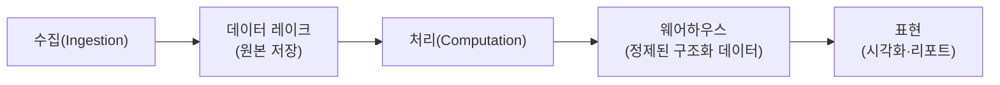

> ByteByteGo의 System Design 101 가이드 「[AWS Services Cheat Sheet](https://bytebytego.com/guides/aws-services-cheat-sheet)」, 「[Most Important AWS Services to Learn](https://bytebytego.com/guides/what-are-the-most-important-aws-services-to-learn)」, 「[AWS Services Evolution](https://bytebytego.com/guides/aws-services-evolution)」, 「[Azure Services Cheat Sheet](https://bytebytego.com/guides/azure-services-cheat-sheet)」, 「[Cloud Comparison Cheat Sheet](https://bytebytego.com/guides/cloud-comparison-cheat-sheet)」, 「[Cloud Load Balancer Cheat Sheet](https://bytebytego.com/guides/cloud-load-balancer-cheat-sheet)」, 「[Big Data Pipeline Cheatsheet](https://bytebytego.com/guides/big-data-pipeline-cheatsheet-for-aws-azure-and-google-cloud)」, 「[Cloud Monitoring Cheat Sheet](https://bytebytego.com/guides/cloud-monitoring-cheat-sheet)」을 바탕으로 재구성한 노트다. 서비스 이름은 바뀌는 일이 잦으므로 쓰기 전에 각 클라우드의 공식 문서로 확인한다.
> 분산 처리 엔진 비교는 고려사이버대학교 「클라우드 컴퓨팅」(2023-2학기) 강의 내용으로 보강했다.

## 왜 범주로 익히나

클라우드마다 서비스가 수백 개라 이름부터 외우면 끝이 없다. 그런데 범주는 거의 같다. 가상 서버, 객체 스토리지, 관리형 DB, 가상 네트워크, 큐는 어느 클라우드에나 있다. 범주와 각 범주의 역할을 먼저 익히고, 클라우드별 이름은 대응표로 찾는다. 클라우드의 기본 개념(리전·AZ, 요금 모델)은 [[aws-cloud-basics|클라우드 기초와 AWS]]에 있다.

## 범주별 대응표

| 범주 | AWS | Azure | Google Cloud |
| --- | --- | --- | --- |
| 가상 서버 | EC2 | Virtual Machines | Compute Engine |
| 관리형 Kubernetes | EKS | AKS | GKE |
| 서버리스 컨테이너 | ECS on Fargate(ECS Express Mode) | Container Apps | Cloud Run |
| 서버리스 함수 | Lambda | Functions | Cloud Run functions |
| 객체 스토리지 | S3 | Blob Storage | Cloud Storage |
| 블록 스토리지 | EBS | Managed Disks | Persistent Disk |
| 파일 스토리지 | EFS | Azure Files | Filestore |
| 관계형 DB | RDS, Aurora | Azure SQL Database, Azure Database for PostgreSQL·MySQL | Cloud SQL, AlloyDB, Spanner |
| NoSQL | DynamoDB | Cosmos DB | Firestore, Bigtable |
| 인메모리 캐시 | ElastiCache | Azure Managed Redis | Memorystore |
| 가상 네트워크 | VPC | Virtual Network(VNet) | VPC |
| DNS | Route 53 | Azure DNS | Cloud DNS |
| CDN | CloudFront | Front Door | Cloud CDN |
| 메시지 큐 | SQS | Service Bus, Queue Storage | Pub/Sub, Cloud Tasks |
| 발행-구독·이벤트 | SNS, EventBridge | Service Bus Topics, Event Grid | Pub/Sub, Eventarc |
| 스트리밍 수집 | Kinesis Data Streams, MSK | Event Hubs | Pub/Sub, Managed Service for Apache Kafka |
| 신원·권한 | IAM | Microsoft Entra ID, Azure RBAC | Cloud IAM |
| 비밀·키 관리 | Secrets Manager, KMS | Key Vault | Secret Manager, Cloud KMS |
| 모니터링·로그·트레이스 | CloudWatch, X-Ray | Azure Monitor, Application Insights | Cloud Monitoring, Cloud Logging, Cloud Trace |
| IaC | CloudFormation, CDK | ARM 템플릿, Bicep | Infrastructure Manager(Terraform 기반) |
| 관리형 ML 플랫폼 | SageMaker | Azure Machine Learning | Vertex AI |

AWS App Runner는 2026년 4월 30일부터 신규 고객을 받지 않는다. 컨테이너 이미지 하나로 Fargate 서비스·ALB·오토 스케일링을 한 번에 만들어 주는 ECS Express Mode가 후속 선택지다.

같은 범주라도 세부 기능과 한계는 다르다. 특히 NoSQL(DynamoDB·Cosmos DB·Firestore)은 데이터 모델과 일관성 옵션이 서로 많이 다르다.

## 처음 익힐 AWS 서비스

AWS에서 처음 배울 것은 대부분의 웹 서비스가 공통으로 쓰는 몇 가지다. 아래 순서로 익히면 앞의 것이 뒤의 것의 바탕이 된다.

| 단계 | 서비스 | 이유 |
| --- | --- | --- |
| 1. 계정과 권한 | IAM | 모든 자원 접근이 IAM 정책을 거친다. 최소 권한 원칙을 처음부터 익힌다 |
| 2. 네트워크 | VPC, 보안 그룹 | 모든 자원이 놓일 자리다. [[aws-vpc-networking\|AWS VPC 네트워크 구성]] |
| 3. 컴퓨팅 | EC2, Auto Scaling, ELB | 서버를 띄우고 늘리고 트래픽을 나누는 기본 |
| 4. 스토리지·DB | S3, RDS, DynamoDB | 파일, 관계형, 키-값 데이터의 기본 저장소 |
| 5. 서버리스·컨테이너 | Lambda, ECS·EKS | 서버 관리를 줄이는 실행 방식 |
| 6. 전달 | Route 53, CloudFront | 도메인과 엣지 캐싱 |
| 7. 연결 | SQS, SNS, EventBridge | 서비스 사이를 비동기로 잇는다 |
| 8. 운영 | CloudWatch, CloudFormation·CDK | 관측과 코드형 인프라 |

AWS는 2006년 S3·SQS·EC2 세 서비스로 시작해 관리형 DB, 서버리스(2014년 Lambda), 컨테이너, 머신러닝·생성형 AI로 범위를 넓혀 왔다. 서비스가 계속 늘고 바뀌므로 목록을 외우기보다 위의 범주와 핵심 서비스를 단단히 하는 편이 낫다.

## 클라우드 로드 밸런서 고르기

로드 밸런서는 **몇 계층에서 판단하나**와 **어디까지 퍼지나** 두 축으로 고른다. 로드 밸런서 자체의 역할과 분산 알고리즘은 [[load-balancer|로드 밸런서]]에 있다.

| 축 | 선택지 | 판단 |
| --- | --- | --- |
| 계층 | L4(TCP·UDP) | 연결 단위로 빠르게 나눈다. 게임·IoT·비HTTP 프로토콜, 고정 IP가 필요할 때 |
| | L7(HTTP·HTTPS) | 경로·헤더·호스트로 라우팅하고 TLS 종료·WAF를 붙인다. 웹·API |
| 범위 | 리전 | 한 리전 안의 서버들에 나눈다 |
| | 전역 | 애니캐스트 IP나 DNS로 가장 가까운·건강한 리전으로 보낸다. 다중 리전·DR |

| 용도 | AWS | Azure | Google Cloud |
| --- | --- | --- | --- |
| L7 리전 | Application Load Balancer | Application Gateway | 리전 Application Load Balancer |
| L4 리전 | Network Load Balancer | Azure Load Balancer | 리전 Network Load Balancer |
| 전역 L7 | CloudFront + ALB, Global Accelerator | Front Door | 전역 외부 Application Load Balancer |
| DNS 기반 전역 분산 | Route 53 라우팅 정책 | Traffic Manager | Cloud DNS 라우팅 정책 |
| 보안 장비 앞단 | Gateway Load Balancer | Gateway Load Balancer | - |

## 빅데이터 파이프라인

데이터 파이프라인은 어느 클라우드든 다섯 단계로 이뤄진다.

| 단계 | 하는 일 | AWS | Azure | Google Cloud |
| --- | --- | --- | --- | --- |
| 수집 | 여러 원천의 데이터를 실시간·배치로 받는다 | Kinesis, MSK | Event Hubs | Pub/Sub |
| 데이터 레이크 | 가공 전 원본을 싸게 쌓는다 | S3 | Data Lake Storage Gen2 | Cloud Storage |
| 처리 | 정제·변환·집계한다 | EMR, Glue | Azure Databricks, Microsoft Fabric | Dataproc, Dataflow |
| 웨어하우스 | 분석용으로 구조화해 SQL로 질의한다 | Redshift | Synapse Analytics, Microsoft Fabric | BigQuery |
| 표현 | 대시보드와 리포트를 만든다 | QuickSight | Power BI | Looker Studio |

처리 단계는 비싼 고성능 서버 한 대 대신 평범한 서버 여럿을 묶어(클러스터링) 일을 나눠 맡기고, 몇 대가 고장 나도 나머지가 이어받는 분산 처리다. 마스터가 작업을 나누고 워커가 계산하는 구조라 워커를 늘리면 처리량이 거의 비례해 는다. 클러스터를 필요할 때만 띄웠다 끄면 되므로 클라우드와 잘 맞는다(EMR, Dataproc).

| | Hadoop(MapReduce) | Spark |
| --- | --- | --- |
| 중간 결과 | 단계마다 디스크에 쓰고 읽는다 | 가능하면 메모리에 둔다 |
| 속도 | 상대적으로 느리다 | 반복 연산에서 훨씬 빠르다 |
| 맞는 일 | 한 번 훑는 대용량 일괄 처리 | 같은 데이터를 여러 번 도는 기계 학습, 대화형 분석 |

레이크와 웨어하우스를 하나로 합친 **레이크하우스**(Delta Lake·Apache Iceberg 같은 테이블 포맷 위에서 SQL 분석)도 흔하다. 배치·스트림, ETL·ELT, 레이크·웨어하우스 같은 용어는 [[data-pipeline-basics|데이터 파이프라인과 저장소 용어]]에 있다.

## 클라우드 모니터링이 갖출 것

| 기능 | 하는 일 |
| --- | --- |
| 수집 | 인프라 지표, 앱 로그, 트레이스, 이벤트를 여러 원천에서 모은다 |
| 저장 | 시계열·로그 저장소에 보관 기간을 정해 둔다 |
| 분석 | 질의·집계로 추세와 이상을 찾는다 |
| 알림 | 임계치나 이상 탐지로 사람·시스템에 알린다 |
| 시각화 | 대시보드로 상태를 한눈에 본다 |
| 보고·규정 준수 | 감사 로그와 가용성 보고서를 남긴다 |
| 자동화 | 알림에 맞춰 스케일링·재시작 같은 조치를 자동으로 한다 |
| 통합 | 다른 클라우드·서드파티 도구와 데이터를 주고받는다 |
| 피드백 루프 | 장애 회고로 알림 기준과 대시보드를 계속 고친다 |

클라우드 기본 도구(CloudWatch, Azure Monitor, Cloud Monitoring) 대신 Prometheus·Grafana·OpenTelemetry 같은 오픈소스 표준을 쓰면 여러 클라우드를 한 화면에서 본다. 로그·메트릭·트레이스의 차이는 [[observability|관측 가능성: 로그, 트레이스, 메트릭]]에 있다.

## 정리

- 클라우드는 이름이 아니라 범주로 익힌다. 범주는 세 클라우드가 거의 같다.
- AWS는 IAM → VPC → EC2·ELB → S3·RDS → Lambda·컨테이너 순으로 익히면 앞의 것이 뒤의 바탕이 된다.
- 로드 밸런서는 L4·L7과 리전·전역 두 축으로 고른다.
- 데이터 파이프라인은 수집 → 레이크 → 처리 → 웨어하우스 → 표현의 다섯 단계다.

관련 노트: [[aws-cloud-basics|AWS 클라우드 기초]], [[load-balancer|로드 밸런서]], [[data-pipeline-basics|데이터 파이프라인과 저장소 용어]], [[aws-vpc-networking|AWS VPC 네트워크 구성]], [[cloud-cost-optimization|클라우드 비용 최적화와 숨은 비용]], [[cloud-native|클라우드 네이티브와 코드형 인프라]], [[observability|관측 가능성: 로그, 트레이스, 메트릭]]
