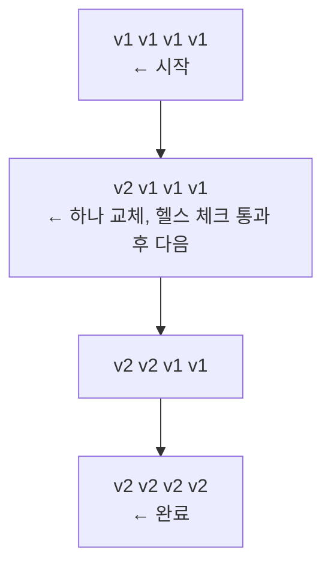
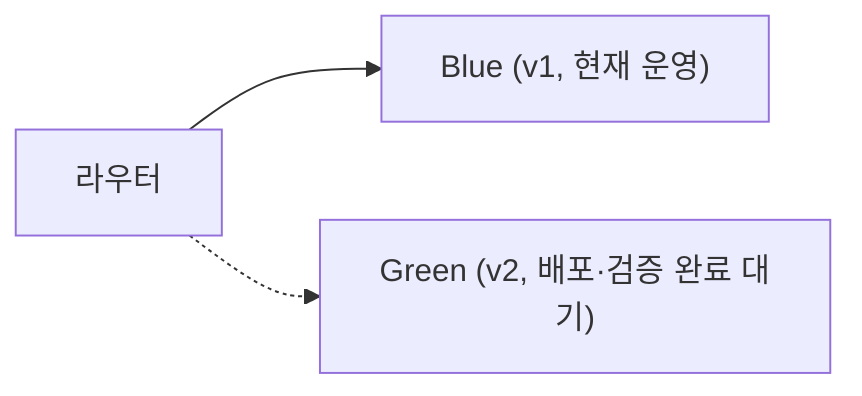
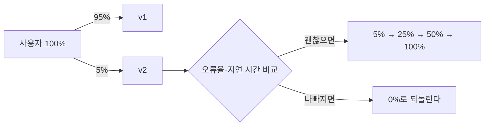
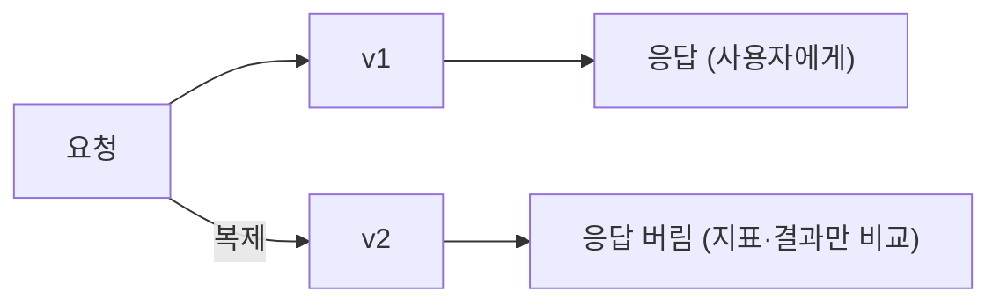

> ByteByteGo의 System Design 101 가이드 「[Deployment Strategies](https://bytebytego.com/guides/how-to-deploy-services)」, 「[Kubernetes Deployment Strategies](https://bytebytego.com/guides/kubernetes-deployment-strategies)」, 「[Top 5 Most-Used Deployment Strategies](https://bytebytego.com/guides/top-5-most-used-deployment-strategies)」, 「[Possible Experiment Platform Architecture](https://bytebytego.com/guides/possible-experiment-platform-architecture)」를 바탕으로 재구성한 노트다. 「[개발자를 위한 A/B 테스트 해시 샘플링](https://brunch.co.kr/@springboot/283)」의 내용을 더해 보강했다.

## 배포 전략이란

**배포 전략은 옛 버전을 새 버전으로 바꾸는 순서와 범위를 정하는 방법이다.** 배포 같은 변경은 장애가 자주 시작되는 지점이라(Google SRE는 장애의 약 70%가 운영 중인 시스템의 변경에서 온다고 본다, [SRE 책 서론](https://sre.google/sre-book/introduction/)), 전략은 결국 다음 네 가지를 어떻게 맞바꿀지의 선택이다.

| 기준 | 질문 |
| --- | --- |
| 다운타임 | 교체하는 동안 서비스가 멈추는가 |
| 노출 범위(blast radius) | 새 버전에 버그가 있으면 사용자 중 몇 %가 겪는가 |
| 롤백 속도 | 문제를 발견했을 때 몇 초 만에 되돌릴 수 있는가 |
| 비용·복잡도 | 서버를 두 벌 띄워야 하는가, 트래픽 분배 장치가 필요한가 |

## 한눈에 비교

| 전략 | 방식 | 다운타임 | 롤백 | 추가 비용 | 어울리는 곳 |
| --- | --- | --- | --- | --- | --- |
| 빅뱅(Recreate) | 옛 인스턴스를 모두 내리고 새 버전을 한꺼번에 올린다 | 있음 | 느림(다시 배포) | 없음 | 개발 초기, 점검 시간을 둘 수 있는 내부 시스템 |
| 롤링(Rolling) | 인스턴스를 몇 개씩 차례로 교체한다 | 없음 | 보통(역방향 롤링) | 거의 없음 | 대부분의 정기 배포. 쿠버네티스 기본값 |
| 블루-그린(Blue-Green) | 같은 환경을 두 벌 두고 트래픽 스위치를 한 번에 넘긴다 | 없음 | 매우 빠름(스위치 되돌리기) | 환경 두 벌 | 큰 변경, 되돌리기가 중요한 배포 |
| 카나리(Canary) | 일부 사용자·서버에만 새 버전을 열고 지표를 보며 비율을 늘린다 | 없음 | 빠름(비율 0으로) | 트래픽 분배·모니터링 | 영향 범위를 작게 시험하고 싶을 때 |
| 섀도(Shadow) | 실제 트래픽의 사본을 새 버전에 흘리고 응답은 버린다 | 없음 | 해당 없음(사용자 영향 없음) | 인프라 두 벌, 부수 효과 차단 | 성능·동작을 실 트래픽으로 검증 |
| 피처 토글(Feature Toggle) | 코드는 배포해 두고 기능을 설정으로 켜고 끈다 | 없음 | 즉시(토글 끄기) | 토글 관리 부담 | 배포와 출시를 분리할 때 |
| A/B 테스트 | 여러 버전을 사용자 집단별로 동시에 노출해 지표를 비교한다 | 없음 | 집단 비율 조정 | 실험 플랫폼 | 기능·UX 결정 |

여러 서비스를 한꺼번에 올리는 다중 서비스 동시 배포는 빅뱅을 서비스 단위로 넓힌 것이다. 구현은 쉽지만 서비스 간 의존성을 따로 시험할 수 없고 안전하게 되돌리기도 어렵다.

## 전략별 흐름

### 롤링



배포하는 동안 두 버전이 함께 응답한다. 그래서 API와 DB 스키마는 옛 버전과 새 버전이 동시에 읽고 써도 깨지지 않아야 한다.

### 블루-그린



전환: 라우터가 Green을 가리키게 바꾼다 → 문제가 생기면 Blue로 되돌린다

전환 직전까지 Green을 운영과 같은 조건에서 시험할 수 있고, 롤백은 스위치를 되돌리는 것뿐이다. 대신 운영급 환경을 두 벌 유지해야 하고, DB처럼 상태가 있는 계층은 두 환경이 공유하므로 스키마 호환 문제가 그대로 남는다.

### 카나리



별도 스테이징 대신 운영에서 작게 시험한다. 블루-그린보다 싸지만, 비율을 단계마다 올리면서 두 버전의 지표를 비교하는 감시 체계가 있어야 한다. 이 판단을 자동화한 것이 점진적 배포(progressive delivery) 도구다.

### 섀도



사용자에게 아무 영향 없이 실 트래픽으로 성능과 동작을 검증한다. 가장 복잡한 전략이다. 새 버전이 결제·메일 발송·DB 쓰기 같은 부수 효과를 두 번 일으키지 않도록 외부 의존성을 가짜(mock) 서비스로 막아야 한다.

### 피처 토글과 A/B 테스트

**배포(deploy)와 출시(release)는 다른 일이다.** 배포는 코드를 서버에 올리는 것이고, 출시는 사용자가 기능을 보게 하는 것이다. 피처 토글은 꺼진 채로 코드를 먼저 배포하고, 출시는 설정을 바꾸는 일로 만든다. 그래서 미완성 기능도 main에 자주 합칠 수 있고, 문제가 생기면 재배포 없이 끈다. 다 쓴 토글은 지우지 않으면 분기가 쌓여 코드가 읽기 어려워진다.

A/B 테스트는 토글 위에서 돌아가는 실험이다. 카나리가 "새 버전이 안전한가"를 무작위 일부로 확인한다면, A/B 테스트는 "어느 버전이 더 나은가"를 정해진 사용자 집단끼리 비교한다. 실험용 기능이 의도치 않게 전체에 노출되지 않도록 노출 대상을 통제해야 한다.

실험을 자주 돌리는 조직은 이를 **실험 플랫폼**으로 만든다. 구성 요소는 넷이다.

| 구성 요소 | 하는 일 |
| --- | --- |
| 실험 정의·관리 | UI에서 가설, 대상 집단, 변형(variant), 비율, 주 지표·가드레일 지표, 기간을 정하고 실험 설정 저장소에 둔다 |
| 실험 배포 | 서버와 클라이언트 양쪽에서 사용자를 변형에 배정하고(variant assignment), 변형별 설정값을 내려 준다(parameterization) |
| 계측(instrumentation) | 누가 어떤 변형에 노출됐는지와 이후 행동 이벤트를 기록한다 |
| 분석 | 변형별 지표를 비교하고 통계적 유의성을 판단한다 |

- 배정은 `hash(사용자 ID + 실험 ID) mod 100`처럼 **결정적**으로 한다. 같은 사용자는 늘 같은 변형을 보고, 실험마다 배정이 섞인다.
  - 0~99 버킷을 비율대로 자른다. 95:5면 0~94는 A, 95~99는 B다. 배정 결과를 DB에 저장할 필요가 없다.
  - 실험 ID(솔트)를 빼면 같은 사용자가 모든 실험에서 늘 같은 쪽에 몰린다. ID 끝자리 홀짝 같은 단순 분할도 같은 문제가 있고 비율을 자유롭게 정할 수 없다.
- 노출 로그와 행동 로그를 같은 사용자 키로 이어야 분석할 수 있다.
- 주 지표가 올라도 가드레일 지표(오류율, 지연, 이탈)가 나빠지면 출시하지 않는다.

## 쿠버네티스에서

| 전략 | 구현 |
| --- | --- |
| 롤링 | Deployment의 기본 `strategy.type: RollingUpdate`. `maxSurge`(추가로 띄울 수 있는 파드 수)와 `maxUnavailable`(동시에 내릴 수 있는 파드 수)로 속도를 정하고, readiness probe를 통과한 파드만 트래픽을 받는다. `kubectl rollout undo`로 되돌린다 |
| 빅뱅 | `strategy.type: Recreate`. 옛 파드를 모두 내린 뒤 새 파드를 띄운다 |
| 블루-그린 | Deployment를 두 개 두고 Service의 selector(라벨)를 새 쪽으로 바꾼다 |
| 카나리·섀도 | 기본 리소스만으로는 비율 제어가 거칠다. Gateway API의 가중치 라우팅, 서비스 메시의 트래픽 분할·미러링, Argo Rollouts·Flagger 같은 점진적 배포 컨트롤러를 쓴다 |

쿠버네티스 구조는 [[kubernetes-architecture|쿠버네티스 구조와 핵심 개념]], 트래픽이 지나는 게이트웨이·서비스 메시는 [[kubernetes-request-path|요청 경로 노트]]에 있다.

## 두 버전이 공존할 때의 DB

롤링·블루-그린·카나리는 모두 옛 버전과 새 버전이 같은 DB를 함께 쓰는 시간이 있다. 컬럼 이름을 바꾸는 식의 파괴적 변경은 한 번에 하지 않고 확장-축소(expand-contract) 순서로 나눈다.

```text
1. 확장: 새 컬럼 추가 (옛 코드는 모름, 새 코드는 둘 다 씀)
2. 배포: 새 코드로 전부 교체, 데이터 옮기기
3. 축소: 옛 컬럼을 읽는 코드가 사라진 뒤 옛 컬럼 삭제
```

## 정리

- 전략 선택은 다운타임, 노출 범위, 롤백 속도, 비용의 맞바꿈이다.
- 기본은 롤링이고, 되돌리기가 중요하면 블루-그린, 운영에서 작게 시험하려면 카나리, 사용자 영향 없이 검증하려면 섀도를 쓴다.
- 피처 토글은 배포와 출시를 떼어 내어 롤백을 설정 변경으로 만든다.
- 두 버전이 공존하는 전략은 API와 스키마의 하위 호환이 전제다.
- 배포 전략은 관측과 짝이다. 지표를 보지 못하면 카나리도 그냥 느린 빅뱅이다.

관련 노트: [[ci-cd|CI/CD]], [[kubernetes-architecture|쿠버네티스 구조와 핵심 개념]], [[observability|관측 가능성: 로그, 트레이스, 메트릭]], [[disaster-recovery|고가용성과 재해 복구 설계]], [[flyway|Flyway로 DB 마이그레이션 관리하기]]
