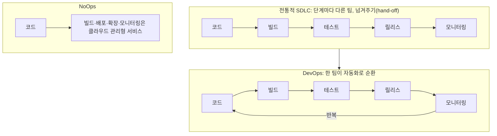

> ByteByteGo의 System Design 101 가이드 「[DevOps vs. SRE vs. Platform Engineering](https://bytebytego.com/guides/devops-vs-sre-vs-paltform-engg)」, 「[DevOps vs NoOps](https://bytebytego.com/guides/devops-vs-noops)」, 「[Paradigm Shift: Developer to Tester Ratio](https://bytebytego.com/guides/paradigm-shift-how-developer-to-tester-ratio-changed-from-11-to-1001)」, 「[Tools for Shipping Code to Production](https://bytebytego.com/guides/what-tools-does-your-team-use-to-ship-code-to-production-and-ensure-code-quality)」를 바탕으로, SRE는 Google SRE 책으로 확인해 재구성한 노트다. 「Paradigm Shift」의 원 자료는 Carlos Arguelles의 「The Paradigm Shifts with Different Dev:Test Ratios」다.

## 개발과 운영을 잇는 방식의 변화

전통적인 방식은 단계마다 담당 조직이 따로 있어 일이 벽을 넘을 때마다 기다리고 책임이 흩어진다. 아래 네 가지는 이 벽을 줄이는 서로 다른 접근이다. 서로 대체재가 아니라 층위가 다른 개념이라 함께 쓰인다.

## 네 가지 비교

| | DevOps | SRE | 플랫폼 엔지니어링 | NoOps |
| --- | --- | --- | --- | --- |
| 정체 | 문화·원칙 | 직무·실천 방법 | 팀·조직 방식 | 지향점 |
| 등장 | 2000년대 말 애자일 커뮤니티(Patrick Debois, Andrew Shafer 등). 2009년 DevOpsDays로 퍼졌다 | 2000년대 초 구글. Borg·Monarch 같은 대규모 운영 도구와 함께 발전 | 2020년대 들어 DevOps·SRE의 연장선에서 자리 잡았다 | 서버리스(FaaS·BaaS)의 확산 |
| 핵심 질문 | 개발과 운영이 어떻게 같이 일하나 | 신뢰성을 어떻게 숫자로 관리하나 | 개발자가 인프라를 몰라도 스스로 배포하게 하려면 | 운영 작업을 아예 없앨 수 있나 |
| 주요 수단 | 공동 책임, CI/CD, 자동화, 짧은 피드백 루프 | SLI·SLO, 에러 버짓, 토일(toil) 줄이기, 포스트모템 | 내부 개발자 플랫폼(IDP), 골든 패스, 셀프서비스 포털 | FaaS, 관리형 DB·인증·스토리지 |
| 산출물 | 일하는 방식 | 신뢰성 목표와 운영 자동화 | 플랫폼이라는 내부 제품 | 운영 인력 없이 도는 서비스 |

### DevOps

**DevOps는 개발과 운영이 소프트웨어 수명 주기 전체를 함께 책임지는 문화다.** 도구 이름이 아니라 원칙이다. 반복 작업을 자동화(CI/CD)하고, 작게 자주 배포하고, 운영에서 얻은 피드백을 개발로 빨리 돌린다. 기본 개념과 배경은 [[ci-cd|CI/CD]]와 DevOps 분야 머리말에 있다.

### SRE

**SRE(Site Reliability Engineering)는 운영을 소프트웨어 공학 문제로 다루는 실천이다.** "구현된 DevOps"라고도 부른다.

| 개념 | 뜻 |
| --- | --- |
| SLI | 사용자가 느끼는 품질을 재는 지표(성공 요청 비율, p99 지연 시간) |
| SLO | SLI의 목표치(예: 한 달 동안 99.9% 성공) |
| 에러 버짓 | 100% − SLO. 이만큼은 실패해도 된다. 남아 있으면 기능 배포를 밀고, 다 쓰면 배포를 멈추고 안정화에 쓴다 |
| 토일(toil) | 손으로 반복하는 운영 작업. 자동화로 줄이고, 엔지니어 시간의 절반 이상이 되지 않게 관리한다 |
| 비난 없는 포스트모템 | 사람이 아니라 시스템의 원인을 찾아 재발을 막는다 |

에러 버짓은 "빨리 배포하고 싶은 개발"과 "바꾸기 싫은 운영"의 갈등을 같은 숫자로 조정한다.

### 플랫폼 엔지니어링

팀마다 쿠버네티스·CI·관측 설정을 따로 익히면 인지 부담이 커진다. **플랫폼 엔지니어링은 이 공통 기반을 내부 개발자 플랫폼(IDP, Internal Developer Platform)으로 만들어 제품처럼 제공한다.** 개발자는 검증된 기본 경로(골든 패스)를 따라 템플릿으로 서비스를 만들고, 셀프서비스로 배포·환경 생성을 한다. IDP의 구성, 포털과 플랫폼의 차이, 골든 패스의 성질은 [[platform-engineering|플랫폼 엔지니어링]]에 있다.

### NoOps

**NoOps는 서버리스로 운영 작업 대부분을 클라우드 제공자에게 넘겨 개발자가 기능에만 집중하는 지향이다.** 함수 실행(FaaS)과 관리형 백엔드(BaaS: 인증, DB, 스토리지)로 시스템을 짜면 서버 관리·확장·패치가 사라진다. 작은 팀과 작은 서비스에서 수명 주기를 DevOps보다 더 줄인다.

다만 운영이 0이 되지는 않는다. 모니터링, 비용 관리, 권한 설정, 장애 대응은 여전히 남고, 제공자 종속(lock-in)과 콜드 스타트 같은 제약이 따른다. 서버리스의 쓰임은 [[aws-cloud-basics|AWS 클라우드 기초]]에 있다.

## 테스트는 개발자의 몫이 됐다

배포 주기가 짧아지면서 개발자 대 전담 테스터 비율이 크게 바뀌었다.

| 시기 | 개발자 : 테스터 | 배경 |
| --- | --- | --- |
| 1990년대 후반 | 약 1 : 1 | CD로 찍어 배포하던 패키지 소프트웨어. 폭포수 개발, 몇 년에 한 번 릴리스. 버그가 나가면 고칠 방법이 없어 출시 전 인증이 전부였다 |
| 2000년대 후반 | 약 10 : 1 | 웹 서비스와 애자일. 패치를 몇 주 안에 낼 수 있게 됐고, 개발자가 직접 테스트하고 운영 장애도 맡기 시작했다 |
| 2010년대 후반 이후 | 약 100 : 1 | 큰 기업들이 테스트 전담 직군(SDET)을 줄였다. 대신 표준화된 대규모 테스트 도구를 개발자가 직접 쓰고, 테스트 지식은 교육·컨설팅으로 퍼뜨린다 |

전담 테스터가 줄었다고 테스트가 줄어든 것은 아니다. 테스트 작성이 개발 과정 안으로 들어오고(시프트 레프트), 품질 전문가는 도구와 교육을 만드는 쪽으로 옮겨 갔다. 테스트를 언제 어디서 돌리는지는 [[test-run-stages|테스트를 돌리는 시점]]에 있다.

## 회사 규모에 따라 달라지는 배포·품질 도구

정답 하나는 없다. 회사가 무엇에 집중하는지에 따라 도구와 절차가 바뀐다.

| 규모 | 집중하는 것 | 배포·품질 방식 |
| --- | --- | --- |
| 1–10명 | 제품-시장 적합성(PMF) 찾기 | 무료·저가 도구, 개발자가 테스트와 배포를 직접. 고객 피드백을 가까이서 듣는다 |
| 10–100명 | 확장 | 핵심 기능의 품질에 투자. 정기 배포와 테스트 절차, 고객 지원과 선제적 알림 체계 |
| 100–1,000명 | 엔지니어링 효율 | 상용 도구 도입, 팀 간 도구 표준화, 자동화 확대 |
| 1,000명 이상 | 규모 있는 품질과 피드백 | 실험 플랫폼과 자체 자동화를 만든다. 운영에서 실험하며 검증(test in production)하기도 한다 |

작은 조직이 큰 조직의 절차를 그대로 들이면 속도만 잃는다. 단계에 맞는 만큼만 들인다는 점은 [[startup-infra-decisions|스타트업 인프라 선택 원칙]]과 같다.

## 정리

- DevOps는 문화, SRE는 그 문화를 숫자로 운영하는 방법, 플랫폼 엔지니어링은 그것을 내부 제품으로 만드는 조직 방식이다.
- SRE의 에러 버짓은 배포 속도와 안정성의 갈등을 하나의 숫자로 조정한다.
- NoOps는 운영을 없애는 게 아니라 클라우드에 넘기는 것이다. 관측·비용·권한은 남는다.
- 배포가 빨라질수록 테스트는 개발자의 일이 되고, 품질 조직은 도구를 만든다.
- 도구와 절차는 회사의 단계에 맞춰 늘린다.

관련 노트: [[platform-engineering|플랫폼 엔지니어링]], [[ci-cd|CI/CD]], [[deployment-strategies|배포 전략]], [[observability|관측 가능성: 로그, 트레이스, 메트릭]], [[disaster-recovery|고가용성과 재해 복구 설계]], [[test-run-stages|테스트를 돌리는 시점: 로컬, PR, CI]], [[incident-postmortem|장애 대응과 포스트모템]]
