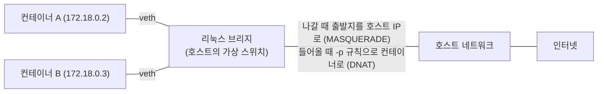

> fru1tworld/cs-basic 모의 면접 질문 목록의 「[Docker](https://github.com/fru1tworld/cs-basic/blob/main/interview/infrastructure/docker.md)」 항목이 묻는 개념을 Docker 공식 문서로 확인해 정리한 노트다. 링크·앰배서더·외부 KV 기반 overlay·CNM의 변천, 데이터 볼륨 컨테이너, 동적 포트와 자동 리버스 프록시는 「[도커 사용에 유용한 유틸리티와 팁](http://slides.com/anarcher/docker-2014-11-30-springsprout#/)」, 「[Docker Ambassador 패턴](http://slides.com/seapy/docker-ambassador#/)」, 「[Multi-Host networking with Docker](https://speakerdeck.com/anarcher/multi-host-networking-with-docker)」, 「[Docker 배포할 때 알면 좋은 팁](http://slides.com/subicura/docker-tip)」, 「[fig 사용기](http://slides.com/seapy/fig-use-story)」, 「[Graphite + Grafana 모니터링 구축 with Docker](http://blog.nacyot.com/articles/2014-07-17-graphite-with-dokcer/)」, 「[Docker 치트 시트](https://gist.github.com/nacyot/8366310)」, 「[본격적으로 쓰는 Docker](https://dayone.me/1agvzvw)」로 보강했다.

컨테이너는 기본적으로 네트워크와 파일 시스템이 격리되어 있다. 이 노트는 그 격리를 어떻게 열고 잇는가를 다룬다. Compose에서 이를 선언하는 방법은 [[docker-compose|Docker Compose: 여러 컨테이너 묶어 띄우기]]에, 이미지 층과 쓰기 층의 구조는 [[dockerfile|Dockerfile 작성과 컨테이너의 PID 1]]에 있다.

## 네트워크 드라이버

| 드라이버 | 범위 | 동작 | 쓰임 |
| --- | --- | --- | --- |
| `bridge` | 한 호스트 | 호스트 안의 가상 스위치에 컨테이너를 연결하고 NAT로 밖과 통신 | 기본값. 한 호스트의 컨테이너끼리 통신 |
| `host` | 한 호스트 | 네트워크 네임스페이스를 따로 만들지 않고 **호스트 네트워크를 그대로** 쓴다 | NAT 비용을 없애야 하는 고성능 네트워크 앱, 포트가 많은 앱 |
| `none` | - | 루프백만 있다 | 네트워크가 필요 없는 배치 작업, 완전 격리 |
| `overlay` | 여러 호스트 | 호스트 사이를 VXLAN 터널로 이어 하나의 가상 네트워크로 만든다 | Swarm 서비스, 여러 서버의 컨테이너 연결 |
| `macvlan` · `ipvlan` | 물리 네트워크 | 컨테이너가 물리 네트워크에 MAC·IP를 직접 가진 장비처럼 붙는다 | 레거시 장비처럼 네트워크에 바로 보여야 할 때 |

### bridge 네트워크의 동작



- 컨테이너마다 네트워크 네임스페이스가 있고, veth 쌍의 한쪽은 컨테이너 안 `eth0`, 다른 쪽은 호스트의 브리지에 꽂힌다. 기본 bridge 네트워크의 브리지가 `docker0`다.
- 같은 브리지의 컨테이너끼리는 L2로 바로 통신한다.
- 밖으로 나갈 때는 iptables 규칙이 출발지를 호스트 IP로 바꾸고(SNAT), 밖에서 들어올 때는 `-p`로 만든 규칙이 목적지를 컨테이너로 바꾼다(DNAT). Docker 29부터 nftables 백엔드를 실험적으로 지원한다.
- veth·브리지·NAT를 직접 만들어 보는 과정은 [[linux-network-namespace|리눅스 네트워크 네임스페이스와 ip 명령]]에 있다.

### host 모드의 주의점

| 장점 | 주의점 |
| --- | --- |
| NAT와 veth를 거치지 않아 지연·처리량 손실이 없다 | 네트워크 격리가 없다. 컨테이너가 호스트의 모든 인터페이스·포트를 본다 |
| 포트 매핑 없이 앱이 연 포트가 곧 호스트 포트다 | 같은 포트를 쓰는 컨테이너를 둘 띄울 수 없다. `-p`는 무시된다 |
| | 리눅스 호스트 기준 기능이다. Docker Desktop은 VM 안에서 돌아 동작이 다르다 |

### overlay 네트워크

overlay는 여러 Docker 호스트에 흩어진 컨테이너를 같은 L2 네트워크에 있는 것처럼 잇는다. 호스트 사이 패킷은 VXLAN으로 감싸 보내고, 옵션으로 암호화(IPsec)할 수 있다. Swarm 모드(`docker swarm init`)가 키·라우팅 정보를 관리하므로 Swarm에서 쓰며, 독립 컨테이너도 `--attachable`로 붙일 수 있다. 쿠버네티스에서는 이 역할을 CNI 플러그인이 맡는다([[kubernetes-networking|쿠버네티스 네트워킹]]).

overlay는 세 부분으로 이뤄진다. 호스트 사이를 잇는 **VXLAN**(IP/UDP 위에 논리적 L2를 만든다), 노드끼리 서로를 알아보는 gossip 프로토콜, 그리고 어떤 네트워크·서브넷·컨테이너가 어느 노드에 있는지 담는 **네트워크 상태 저장소**다. 과거(Docker 1.9 무렵)에는 이 상태를 외부 키-값 저장소(Consul·etcd·ZooKeeper)에 두고 데몬마다 `--cluster-store`로 가리켰다. Swarm 모드부터는 매니저의 내장 Raft 저장소가 이를 맡아 외부 저장소 없이 만들고, 외부 KV 방식은 제거됐다.

### CNM과 CNI

Docker의 네트워킹은 libnetwork 라이브러리가 **CNM(Container Network Model)** 으로 구현한다.

| CNM 개념 | 뜻 |
| --- | --- |
| 샌드박스(sandbox) | 컨테이너의 격리된 네트워크 스택(인터페이스, 라우팅 표, DNS 설정). 리눅스에서는 네트워크 네임스페이스 |
| 엔드포인트(endpoint) | 샌드박스를 한 네트워크에 붙이는 인터페이스(veth 한쪽). 엔드포인트 하나는 네트워크 하나에만 속한다 |
| 네트워크(network) | 서로 직접 통신할 수 있는 엔드포인트의 묶음. bridge·overlay 같은 드라이버가 구현한다 |

쿠버네티스는 CNM 대신 더 단순한 **CNI**(런타임이 파드를 만들 때 플러그인 실행 파일을 호출해 인터페이스와 IP를 받는 규약)를 택했다. 그래서 Docker의 네트워크 드라이버와 쿠버네티스의 CNI 플러그인은 서로 바꿔 끼울 수 없다.

## 사용자 정의 네트워크와 내장 DNS

```bash
docker network create app-net
docker run -d --name db  --network app-net postgres:17
docker run -d --name api --network app-net -e DB_HOST=db myapi:1.0   # "db"라는 이름으로 접속
```

| | 기본 bridge (`docker0`) | 사용자 정의 bridge |
| --- | --- | --- |
| 이름으로 찾기 | 안 된다. IP나 옛 `--link`를 써야 한다 | **내장 DNS로 컨테이너 이름·별칭이 풀린다** |
| 격리 | 옵션 없이 띄운 모든 컨테이너가 한 네트워크에 섞인다 | 같은 네트워크에 붙인 컨테이너끼리만 통신 |
| 연결 변경 | 컨테이너를 멈춰야 한다 | `docker network connect/disconnect`로 실행 중에 붙이고 뗀다 |
| 설정 | 데몬 전체 설정 | 네트워크마다 서브넷·MTU·옵션 |

**내장 DNS**: 사용자 정의 네트워크의 컨테이너는 `/etc/resolv.conf`에 `127.0.0.11`을 DNS 서버로 받는다. Docker 엔진이 이 주소에서 질의를 받아 같은 네트워크의 컨테이너 이름, `--network-alias`, Compose 서비스 이름을 IP로 풀고, 나머지 이름은 호스트의 DNS로 넘긴다. 같은 별칭을 여러 컨테이너에 주면 IP 여러 개를 돌려줘 간단한 라운드 로빈이 된다. 컨테이너가 다시 만들어져 IP가 바뀌어도 이름은 그대로라, 설정에 IP를 적지 않는다.

과거에는 `--link db:db`로 컨테이너를 이었다. 링크는 대상의 IP·포트를 `DB_PORT_5432_TCP_ADDR` 같은 환경 변수와 `/etc/hosts` 항목으로 주입했는데, 한 호스트 안에서만, 한 방향으로만 동작했고, 대상 컨테이너를 지우고 새로 만들면 옛 IP가 남아 깨졌다. 다른 호스트의 서비스에 닿으려면 **앰배서더(ambassador) 패턴**을 썼다. 앱 옆에 프록시 컨테이너(`socat TCP4-LISTEN:6379,fork TCP4:<원격 IP>:6379` 한 줄)를 두고 앱은 로컬의 앰배서더에만 붙어, 원격 위치는 앰배서더가 숨겼다. `--link`는 레거시가 되어 내장 DNS로 대체됐고, 앰배서더는 서비스 메시의 사이드카 프록시로 이어졌다.

## 포트 공개: `-p`와 EXPOSE

| | `EXPOSE` (Dockerfile) | `-p` / `--publish` (실행 시) |
| --- | --- | --- |
| 효과 | **문서용 메타데이터.** 실제로 포트를 열지 않는다 | 호스트 포트를 컨테이너 포트로 잇는 NAT 규칙을 만든다 |
| 접근 범위 | 같은 네트워크의 컨테이너는 EXPOSE와 무관하게 어느 포트로든 접근한다 | 호스트 밖에서도 접근 가능해진다 |
| 관계 | `-P`(대문자)는 EXPOSE한 포트를 모두 임의의 호스트 포트에 공개한다 | |

```bash
docker run -p 8080:80 nginx            # 호스트 모든 인터페이스의 8080 → 컨테이너 80
docker run -p 127.0.0.1:8080:80 nginx  # 호스트 로컬에서만 접근
docker port <컨테이너>                  # 공개된 포트 확인
```

`-p 8080:80`은 기본으로 `0.0.0.0`에 바인드되고, Docker가 iptables 규칙을 직접 넣기 때문에 **ufw 같은 호스트 방화벽 규칙을 우회한다.** 외부에 열 필요가 없는 DB·관리 포트는 `127.0.0.1`에만 바인드하거나 아예 공개하지 않는다. 컨테이너 안 서버는 `0.0.0.0`으로 들어야 포트 공개가 동작한다(`127.0.0.1`로 들면 컨테이너 밖에서 닿지 않는다).

호스트 포트를 고정하면(`-p 80:80`) 새 버전 컨테이너를 띄우기 전에 옛것을 먼저 멈춰야 해 순단이 생긴다. 그래서 앱 컨테이너는 호스트 포트를 정하지 않고(`-P` 또는 네트워크 안에서만 노출) 앞단 리버스 프록시가 새 컨테이너로 트래픽을 옮기게 한다. 이 갱신을 자동화한 것이 Docker 이벤트를 보고 설정을 다시 쓰는 프록시다. 과거의 nginx-proxy(docker-gen 템플릿, `VIRTUAL_HOST` 환경 변수)에서 지금의 Traefik(컨테이너·서비스 라벨, `--providers.docker`·`--providers.swarm`)으로 이어졌다. 이런 프록시는 Docker 소켓을 읽으므로 그 권한을 조심한다([[docker-container-operations|Docker 컨테이너 운영]]).

## 컨테이너 간 통신 제한

| 방법 | 효과 |
| --- | --- |
| 네트워크 분리 | 프런트 네트워크(웹·API)와 백엔드 네트워크(API·DB)를 나누고, API만 둘 다에 붙인다. 웹은 DB에 닿지 못한다 |
| `--internal` 네트워크 | 외부(인터넷)로 나가는 경로가 없는 네트워크. DB처럼 밖과 통신할 필요가 없는 것 |
| ICC 끄기 | 네트워크 옵션 `com.docker.network.bridge.enable_icc=false`(또는 데몬의 `--icc=false`)로 같은 브리지 안 컨테이너끼리의 통신을 막는다 |
| 포트 공개 최소화 | 외부 공개는 진입점 하나만, 나머지는 `127.0.0.1` 바인드나 공개 안 함 |
| `DOCKER-USER` 체인 | Docker가 건드리지 않는 iptables 체인에 호스트 방화벽 규칙을 넣는다 |

## 네트워크 문제 진단

```bash
docker network ls
docker network inspect app-net               # 붙은 컨테이너, IP, 서브넷
docker inspect -f '{{json .NetworkSettings.Networks}}' api
docker exec -it api getent hosts db          # 이름 해석 확인
docker run --rm -it --network container:api nicolaka/netshoot   # 대상 컨테이너의 네트워크 네임스페이스에 도구 컨테이너 붙이기
```

| 증상 | 원인 |
| --- | --- |
| 이름이 안 풀린다 | 기본 bridge에 있거나 서로 다른 네트워크에 있다 |
| 컨테이너끼리는 되는데 호스트에서 안 된다 | `-p`로 공개하지 않았다, 서버가 `127.0.0.1`에 바인드 |
| 호스트에서는 되는데 밖에서 안 된다 | 클라우드 보안 그룹, 호스트 방화벽, `127.0.0.1` 바인드 |
| 컨테이너에서 외부 도메인이 안 풀린다 | 호스트 DNS 설정, 사내 DNS, 데몬의 `dns` 설정 |
| 대역 충돌로 사내망·VPN에 닿지 않는다 | Docker 네트워크 서브넷이 사내 대역과 겹친다. 데몬의 `default-address-pools`로 바꾼다 |

## 데이터를 남기는 세 가지 방법

컨테이너 쓰기 층의 데이터는 컨테이너를 지우면 사라지고, copy-on-write라 쓰기 성능도 낮다. 남겨야 하거나 많이 쓰는 데이터는 마운트로 밖에 둔다.

| | 볼륨(named volume) | 바인드 마운트(bind mount) | tmpfs 마운트 |
| --- | --- | --- | --- |
| 위치 | Docker가 관리하는 영역(리눅스는 `/var/lib/docker/volumes/`) | 호스트의 **지정한 경로** | 호스트 **메모리** |
| 관리 | `docker volume` 명령, 드라이버 | 호스트 파일 시스템 그대로 | 컨테이너가 멈추면 사라짐 |
| 이식성 | 호스트 디렉터리 구조와 무관 | 호스트 경로에 묶인다 | - |
| 쓰임 | DB 데이터, 업로드 등 **운영 데이터** | 개발 중 소스 코드 실시간 반영, 설정 파일 주입 | 비밀 값·임시 파일처럼 디스크에 남기면 안 되는 것 |

### 볼륨을 권장하는 이유

- 호스트 경로에 의존하지 않아 어느 서버에서나 같은 설정으로 쓴다.
- 빈 볼륨을 컨테이너 디렉터리에 마운트하면 이미지의 그 디렉터리 내용이 볼륨으로 복사된다. 바인드 마운트는 이미지 내용을 가린다.
- `docker volume` 명령으로 만들고 지우고 백업한다. 드라이버로 원격 스토리지를 붙일 수 있다.
- Docker Desktop(macOS·Windows)에서는 VM 안에 있어 바인드 마운트보다 훨씬 빠르다.
- 호스트의 다른 프로세스가 실수로 건드릴 일이 적다.

### 바인드 마운트

```bash
docker run -d -v "$PWD/src:/app/src" -p 3000:3000 node:24-alpine npm run dev   # 코드 수정이 바로 반영
docker run --mount type=bind,src=/etc/myapp/config.yaml,dst=/app/config.yaml,readonly myapp:1.0
```

- 개발 중에는 소스를 바인드 마운트하고 앱의 핫 리로드를 켜 이미지를 다시 빌드하지 않는다.
- 컨테이너 안 프로세스의 UID와 호스트 파일 소유자가 달라 권한 오류가 잦다.
- `-v`는 호스트 경로가 없으면 디렉터리를 만들어 버리고, `--mount`는 오류를 낸다. 실수를 잡으려면 `--mount`가 낫다.
- 호스트의 민감한 경로(`/`, `/etc`, Docker 소켓)를 마운트하면 컨테이너가 호스트를 장악할 수 있다([[docker-container-operations|Docker 컨테이너 운영]]).

### tmpfs 마운트

```bash
docker run --tmpfs /app/tmp:size=64m myapp:1.0
docker run --mount type=tmpfs,dst=/run/secrets-cache,tmpfs-size=16m myapp:1.0
```

리눅스에서만 되고, 컨테이너끼리 공유할 수 없으며, 컨테이너가 멈추면 사라진다. 읽기 전용 루트 파일 시스템(`--read-only`)에서 앱이 써야 하는 임시 디렉터리를 주는 용도로도 쓴다.

## 볼륨의 수명

| 상황 | 볼륨 |
| --- | --- |
| 컨테이너 삭제 (`docker rm`) | **남는다.** 볼륨은 컨테이너와 수명이 분리되어 있다 |
| `docker rm -v` | 그 컨테이너의 **익명 볼륨**만 함께 지운다. 이름 붙은 볼륨은 남는다 |
| `docker compose down` | 남는다. `-v`를 주면 Compose가 정의한 볼륨까지 지운다 |
| `docker volume prune` | 어느 컨테이너도 쓰지 않는 익명 볼륨을 지운다. `-a`면 이름 붙은 볼륨까지 |

**익명 볼륨**은 Dockerfile의 `VOLUME` 지시어나 `-v /data`처럼 이름 없이 만든 볼륨이다. 무작위 이름이 붙어 찾기 어렵고 쌓이기 쉽다. 남길 데이터는 이름을 붙인다.

```bash
docker volume create pgdata
docker run -d -v pgdata:/var/lib/postgresql/data postgres:17
docker volume inspect pgdata
# 백업: 볼륨을 임시 컨테이너에 붙여 tar로 묶는다
docker run --rm -v pgdata:/data:ro -v "$PWD":/backup alpine:3.22 tar czf /backup/pgdata.tgz -C /data .
```

DB는 파일 복사보다 DB 자체의 덤프·백업 도구가 일관성을 보장한다.

과거에는 이름 있는 볼륨이 없어서 **데이터 볼륨 컨테이너**를 썼다. `busybox`에 `VOLUME /data`만 선언한 컨테이너를 만들어 두고 앱 컨테이너가 `--volumes-from appdata`로 그 볼륨을 공유해, 앱 컨테이너를 지워도 데이터가 남게 했다. 당시 Compose(fig)는 `up` 때 이 데이터 컨테이너까지 다시 만들어 DB가 날아가는 문제가 있어 호스트 경로 바인드로 피하곤 했다. Docker 1.9(2015)의 이름 있는 볼륨(`docker volume create`)이 이 패턴을 대체했다. `--volumes-from`은 아직 동작하지만 쓸 이유가 거의 없다.

### 볼륨 드라이버

볼륨 드라이버는 볼륨 데이터를 어디에 저장할지 정한다. 기본 `local` 드라이버는 호스트 디스크에 두지만, 옵션으로 NFS·CIFS 같은 네트워크 파일 시스템을 마운트할 수도 있다.

```bash
docker volume create --driver local \
  --opt type=nfs --opt o=addr=10.0.0.5,rw,nfsvers=4 --opt device=:/exports/shared \
  shared-data
```

스토리지 업체의 플러그인 드라이버를 설치하면 클라우드 블록 스토리지나 분산 스토리지를 볼륨으로 쓴다. 여러 호스트가 같은 데이터를 봐야 하거나, 호스트가 죽어도 데이터를 다른 호스트에서 이어 써야 할 때 쓴다. 쿠버네티스에서는 이 역할을 CSI 드라이버가 맡는다([[kubernetes-storage-config|쿠버네티스 저장소와 설정]]).

### 읽기 전용 마운트

```bash
docker run -v app-config:/etc/app:ro myapp:1.0
docker run --mount type=volume,src=app-config,dst=/etc/app,readonly myapp:1.0
docker run --read-only --tmpfs /tmp myapp:1.0     # 컨테이너 루트 파일 시스템 자체를 읽기 전용으로
```

| 시나리오 | 이유 |
| --- | --- |
| 설정 파일·인증서 주입 | 앱이 실수나 공격으로 설정을 바꾸지 못한다 |
| 한 컨테이너가 쓰고 여럿이 읽는 데이터 | 쓰는 쪽만 rw, 읽는 쪽은 ro로 책임을 나눈다 |
| 백업 컨테이너 | 원본을 건드리지 않고 읽기만 한다 |
| 운영 컨테이너의 루트 파일 시스템 | 침입자가 도구를 내려받거나 바이너리를 바꾸지 못한다 |

## 스토리지 드라이버

볼륨이 컨테이너 **밖** 데이터를 다룬다면, 스토리지 드라이버는 이미지 층과 컨테이너 쓰기 층, 즉 컨테이너 **안** 파일 시스템을 어떻게 겹쳐 저장할지 정한다. 원리(유니온 마운트, copy-on-write)는 [[dockerfile|Dockerfile 노트]]의 「층과 OverlayFS」에 있다.

| 드라이버 | 상태 | 특징 |
| --- | --- | --- |
| `overlay2` | 기존 이미지 저장소의 기본값 | 리눅스 커널의 OverlayFS. 대부분의 배포판에서 가장 안정적이고 빠르다 |
| containerd 스냅숏터 (`overlayfs` 등) | Docker 29부터 새로 설치하면 기본 | containerd 이미지 저장소를 쓴다. 멀티 플랫폼 이미지와 이미지 증명(attestation)을 로컬에 그대로 보관한다. 옛 그래프 드라이버 방식은 폐기 예정이다 |
| `btrfs` · `zfs` | 해당 파일 시스템 위에서만 | 파일 시스템의 스냅숏 기능을 쓴다. 그 파일 시스템을 이미 운영할 때 |
| `vfs` | 테스트용 | copy-on-write 없이 층마다 전체 복사. 느리고 디스크를 많이 쓴다 |
| `devicemapper` | 폐기 예정(deprecated) | 과거 RHEL·CentOS의 기본값. 블록 장치 위 씬 프로비저닝 |
| `aufs` | 제거됨 | 초기 Docker와 과거 Ubuntu의 기본값. 커널 본선에 들어가지 못했다 |

특별한 이유가 없으면 기본값을 쓴다. 쓰기가 많은 데이터는 어떤 스토리지 드라이버를 써도 copy-on-write 비용이 있으므로 볼륨에 둔다.

## 정리

- 기본은 bridge이고, host는 격리를 버리고 성능을 얻으며, overlay는 여러 호스트를 잇는다.
- 사용자 정의 네트워크를 만들어야 내장 DNS(`127.0.0.11`)로 이름 통신이 되고 격리 단위가 생긴다.
- EXPOSE는 문서, `-p`는 실제 공개다. `-p`는 호스트 방화벽을 우회하므로 내부용 포트는 `127.0.0.1`에 묶는다.
- 운영 데이터는 이름 붙은 볼륨, 개발 중 코드는 바인드 마운트, 남기면 안 되는 것은 tmpfs다. 볼륨은 컨테이너를 지워도 남는다.
- 스토리지 드라이버는 컨테이너 안 층을 다루며, 기본값(overlay2, Docker 29부터는 containerd 스냅숏터)을 쓴다.

관련 노트: [[docker-compose|Docker Compose: 여러 컨테이너 묶어 띄우기]], [[dockerfile|Dockerfile 작성과 컨테이너의 PID 1]], [[docker-container-operations|Docker 컨테이너 운영]], [[vm-vs-container|VM과 컨테이너]], [[linux-network-namespace|리눅스 네트워크 네임스페이스와 ip 명령]], [[kubernetes-networking|쿠버네티스 네트워킹]]
