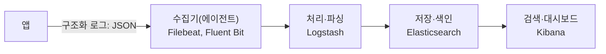
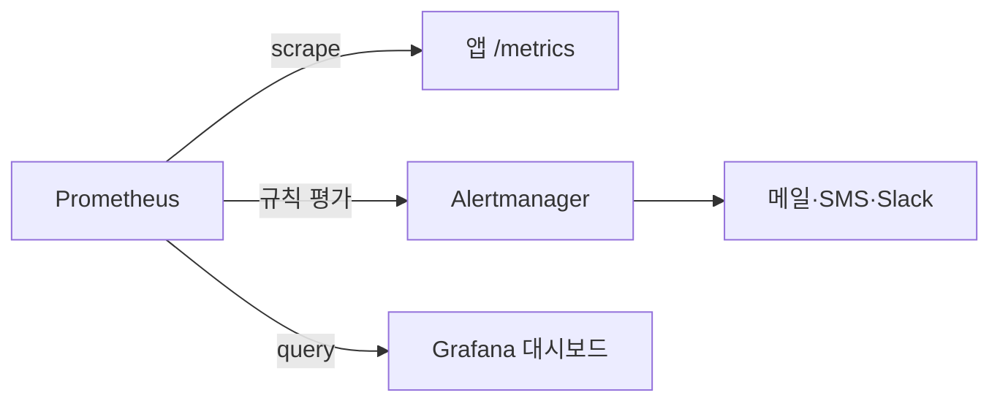
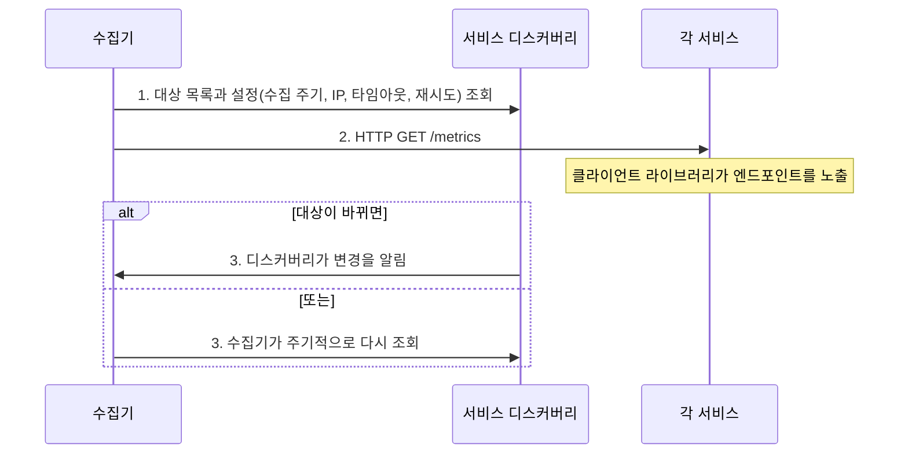

> ByteByteGo의 System Design 101 가이드 「[Logging, Tracing, and Metrics](https://bytebytego.com/guides/logging-tracing-metrics)」, 「[Push vs Pull in Metrics Collection Systems](https://bytebytego.com/guides/push-vs-pull-in-metrics-collecting-systems)」, 「[Choose the Right Database for Metric Collection](https://bytebytego.com/guides/choose-the-right-database-for-metric-collecting-system)」를 바탕으로, OpenTelemetry·Prometheus 공식 문서로 확인해 재구성한 노트다. 합성 모니터링은 「[매출 손실을 줄여주는 외부링크 관제 Bot, URL Checker 개발기](https://blog.banksalad.com/tech/url-status-checker)」로 보강했다. 로그 작성 규칙과 런타임 지표는 Loggly의 「[Node.js Logging: The Ultimate Guide](https://www.loggly.com/ultimate-guide/category/node/)」, RisingStack의 「[The Definitive Guide for Monitoring Node.js Applications](https://blog.risingstack.com/monitoring-nodejs-applications-nodejs-at-scale/)」, Microsoft의 「[Monitoring and diagnostics guidance](https://learn.microsoft.com/en-us/azure/architecture/best-practices/monitoring)」를 바탕으로 보강했다.

## 관측 가능성이란

**관측 가능성(observability)은 시스템이 밖으로 내보내는 신호만으로 내부 상태를 추론할 수 있는 정도다.** 모니터링이 "미리 정한 지표가 정상인가"를 본다면, 관측 가능성은 "처음 보는 장애가 왜 일어났는가"에 답할 수 있게 한다. 그 신호의 세 기둥이 로그, 트레이스, 메트릭이다.

## 세 기둥 비교

| | 로그(Logging) | 트레이스(Tracing) | 메트릭(Metrics) |
| --- | --- | --- | --- |
| 기록 대상 | 개별 사건 하나하나 | 요청 하나가 여러 서비스를 지난 경로와 구간별 시간 | 시간에 따라 집계할 수 있는 수치 |
| 예 | "주문 42 결제 실패: 카드 거절" | 게이트웨이 → 로드 밸런서 → 서비스 A → 서비스 B → DB, 각 구간 ms | QPS, 지연 시간 p99, 오류율, CPU 사용률 |
| 데이터 양 | 가장 많다 | 중간(보통 샘플링) | 가장 적다(숫자의 시계열) |
| 답하는 질문 | 무슨 일이 있었나 | 어디서 느려졌나 | 지금 정상인가, 추세는 어떤가 |
| 대표 구성 | ELK(Elasticsearch·Logstash·Kibana), Loki | Jaeger, Tempo, Zipkin | Prometheus + Grafana, InfluxDB |

세 신호는 따로 볼 때보다 이어질 때 힘이 크다. 메트릭 알림으로 이상을 알아채고, 트레이스로 느린 구간을 찾고, 그 구간의 로그로 원인을 읽는다. 이를 위해 로그에 트레이스 ID를 함께 남긴다.

## 각 신호의 수집 구조

### 로그

- 팀마다 형식이 다르면 수많은 로그에서 키워드로 찾을 수 없다. **표준 로그 형식**(타임스탬프, 레벨, 서비스 이름, 트레이스 ID, 메시지)을 정해 모든 팀이 따른다.
- 양이 가장 많으므로 보존 기간과 레벨을 정해 비용을 관리한다.
- 서버 한 대의 로그를 셸 명령으로 훑는 법은 [[linux-commands|자주 쓰는 리눅스 명령어 지도]]에 있다.

#### 로그를 쓰는 규칙

| 규칙 | 내용 |
| --- | --- |
| 레벨을 나눈다 | `fatal`(프로세스가 죽는다) · `error`(요청 하나가 실패) · `warn`(이상하지만 처리됨) · `info`(업무 사건: 주문 생성, 배포) · `debug`·`trace`(개발용). 운영 기본은 `info`, 장애 때만 일시적으로 낮춘다 |
| 문장 대신 필드 | `"user 42 paid 9900"`이 아니라 `{"msg":"payment","userId":42,"amount":9900}`. 필드로 검색·집계한다 |
| 요청을 잇는 ID | 요청 ID·트레이스 ID를 모든 로그 줄에 넣는다. 비동기 콜백을 건너도 유지되게 Node.js는 `AsyncLocalStorage`로 문맥을 들고 다닌다 |
| 표준 출력으로 | 앱은 파일 회전·전송을 하지 않고 stdout에 쓴다. 수집은 플랫폼(에이전트, 컨테이너 런타임)이 맡는다([[twelve-factor-app\|12요소 앱]]) |
| 비밀은 남기지 않는다 | 비밀번호, 토큰, 카드 번호, 개인 정보는 로거 단계에서 가린다(redact) |
| 비싸지 않게 | 동기 파일 쓰기나 `console.log` 남발은 이벤트 루프를 막는다. Node.js에서는 JSON을 빠르게 비동기로 쓰는 pino가 흔하고, winston은 전송 대상(transport) 설정이 유연하다. HTTP 접근 로그는 미들웨어(pino-http, morgan)로 남긴다 |

### 트레이스

트레이스는 **스팬(span)** 의 트리다. 스팬 하나가 "서비스 B의 DB 조회, 120ms" 같은 한 구간이고, 요청이 서비스 경계를 넘을 때 트레이스 ID를 헤더(W3C `traceparent`)로 넘겨 같은 트레이스로 묶는다. 요청이 많은 서비스는 일부만 저장하는 샘플링을 쓴다.

### 메트릭

메트릭 하나는 **이름 + 라벨 + (시각, 값) 목록**이다. `http_requests_total{service="order", status="500"}`처럼 라벨 조합마다 별도 시계열이 생기므로, 사용자 ID처럼 값이 무한한 것을 라벨에 넣으면 시계열 수(카디널리티)가 폭발한다.

무엇을 잴지는 층마다 다르다. 서비스 층은 요청 수·오류율·지연(RED: Rate, Errors, Duration), 자원 층은 사용률·포화·오류(USE)를 기본으로 본다. 런타임 층은 언어마다 고유한 지표가 있다. Node.js라면 다음이다.

| 지표 | 왜 보나 | 얻는 법 |
| --- | --- | --- |
| 이벤트 루프 지연·사용률 | 단일 스레드라 동기 작업 하나가 모든 요청을 늦춘다 | `perf_hooks.monitorEventLoopDelay()`, `performance.eventLoopUtilization()` |
| 힙 사용량과 GC 시간 | 메모리 누수는 힙이 계단식으로 계속 늘고 GC 시간도 함께 늘다가 한도에 닿아 프로세스가 죽는 모양으로 나타난다 | `process.memoryUsage()`, 힙 스냅숏 두 개(`v8.writeHeapSnapshot()`)를 Chrome DevTools 비교 모드로 열어 늘어난 객체를 찾는다 |
| CPU 프로파일 | 느려진 원인 함수 찾기 | `node --cpu-prof`, APM의 연속 프로파일링 |
| 의존성 취약점 | npm 패키지가 공격 경로가 된다 | `npm audit`, Dependabot([[devsecops\|DevSecOps]]) |

프로세스 지표만으로는 사용자가 실제로 접속되는지 모르므로, 여러 지역에서 외부 검사(아래 합성 모니터링)를 함께 둔다.

## OpenTelemetry: 세 신호를 한 표준으로

**OpenTelemetry(OTel)는 로그·트레이스·메트릭을 수집하는 벤더 중립 표준이다.** 앱은 OTel SDK로 계측하고, OTel Collector가 받아 가공한 뒤 원하는 백엔드(Prometheus, Jaeger, 상용 APM)로 보낸다. 백엔드를 바꿔도 앱 계측 코드는 그대로라서, 처음부터 들일수록 이득이다([[startup-infra-decisions|스타트업 인프라 선택 원칙]]).

## 메트릭 수집: 풀 vs 푸시

| | 풀(Pull) | 푸시(Push) |
| --- | --- | --- |
| 방식 | 수집기가 주기적으로 각 서비스의 `/metrics` 엔드포인트를 긁어 간다 | 각 서비스(또는 에이전트)가 수집기로 보낸다 |
| 대표 | Prometheus | StatsD, Graphite, OTLP 내보내기, CloudWatch 에이전트 |
| 장점 | 수집기가 속도를 통제한다. 긁기 실패 자체가 "대상이 죽었다"는 신호다. 엔드포인트를 브라우저로 열어 바로 확인할 수 있다 | 방화벽·NAT 뒤나 수명이 짧은 작업도 보낼 수 있다. 수집기가 대상 목록을 몰라도 된다 |
| 약점 | 수집기가 모든 대상의 주소를 알아야 한다. 금방 끝나는 배치 작업은 긁기 전에 사라진다 | 수집기가 몰려드는 쓰기를 감당해야 하고, 데이터가 안 오면 죽은 건지 조용한 건지 구분이 어렵다 |

어느 쪽이 정답인지는 정해져 있지 않다. 풀 모델에서 짧은 배치 작업은 Pushgateway에 결과를 밀어 넣고 Prometheus가 그곳을 긁는 식으로 섞어 쓴다.

### 풀 모델과 서비스 디스커버리

서버가 수시로 늘고 줄면 수집 대상 목록을 파일로 관리할 수 없다. 서비스가 자신을 **서비스 디스커버리**(쿠버네티스 API, Consul, ZooKeeper 등)에 등록하면 수집기가 목록을 받아 온다.

## 메트릭 저장소: 왜 시계열 DB인가

메트릭 데이터의 접근 패턴은 일반 업무 데이터와 다르다.

| 특징 | 내용 |
| --- | --- |
| 쓰기 위주 | 수많은 시계열에 데이터 점이 끊임없이 들어온다. 수정은 거의 없고 덧붙이기만 한다 |
| 읽기는 몰려서 | 대시보드와 알림 규칙이 질의를 보내므로, 장애 때처럼 사람이 몰려 볼 때 읽기가 치솟는다 |
| 시간 범위 질의 | "최근 5분 이동 평균", "1시간 단위 p99"처럼 시간 창으로 집계한다 |
| 오래된 데이터는 덜 중요 | 최근 것은 촘촘히, 오래된 것은 뭉뚱그려(다운샘플링) 보관하거나 지운다 |

| 저장소 | 판단 |
| --- | --- |
| 범용 관계형 DB | 끊임없는 대량 쓰기에 약하고, 라벨마다 인덱스가 필요하며, 이동 평균 같은 시간 창 집계 SQL이 복잡하다. 이 규모에 맞추려면 전문가 수준의 튜닝이 든다 |
| 범용 NoSQL(Cassandra, Bigtable) | 시계열을 담을 수는 있지만, 확장 가능한 스키마를 직접 설계하려면 내부 구조를 깊이 알아야 한다([[wide-column-database\|와이드 컬럼 DB]]) |
| **시계열 DB** | 시간순 압축, 라벨 색인, 다운샘플링·보존 정책, 시간 창 질의 언어(PromQL 등)를 기본으로 갖는다. Prometheus TSDB, InfluxDB, TimescaleDB, VictoriaMetrics 등 |

검증된 시계열 DB가 많으므로 저장소를 직접 만들거나 범용 DB를 억지로 맞추지 않는다.

## 합성 모니터링: 사용자 화면으로 확인하기

로그·메트릭·트레이스는 내 시스템 안의 신호다. 결제 대행 페이지, 제휴사 이벤트 페이지처럼 남이 운영하는 외부 링크가 깨져도 사용자에게는 내 서비스의 장애로 보인다. 이런 곳은 **합성 모니터링(synthetic monitoring)**, 곧 스크립트가 사용자처럼 주기적으로 접속해 결과를 확인하는 방식으로 지킨다.

| 결정 | 방법 |
| --- | --- |
| 무엇을 비교하나 | HTML·DOM을 비교하면 타임스탬프·문구 같은 무의미한 변화에도 울린다. 헤드리스 브라우저로 찍은 스크린샷을 기준 이미지와 픽셀 비교하고, 차이 비율이 임계값을 넘을 때만 이상으로 본다(시각적 회귀 감지) |
| 동적 콘텐츠 | 자동 회전 배너처럼 매번 바뀌는 요소가 있으면 허용 오차를 넉넉히 잡거나 그 영역을 가린다 |
| 캡처 시점 | 로딩이 끝나기 전에 찍으면 거짓 경보가 난다. 네트워크 유휴 같은 명확한 대기 조건을 둔다 |
| 신호 구분 | 연결 차단·타임아웃은 화면 변화와 다른 종류의 이상이므로 따로 분류해 알린다 |
| 실행 환경 | CI 러너·데이터센터 IP는 대상 사이트가 막을 수 있어 실제 사용자 환경과 결과가 다를 수 있다. 헤드리스 브라우저는 CPU·메모리를 많이 쓰므로 자원 상한을 정해 둔다 |
| 기준 데이터 | 대상별 기준 이미지를 오브젝트 스토리지에 식별자 단위로 저장한다 |
| 알림 | 팀이 이미 쓰는 채팅 도구로 바로 보낸다 |

해결 비용이 영향보다 큰 특정 대상은 감시에서 잠시 빼는 판단도 필요하다. 한 브라우저 엔진만 쓰면 다른 엔진 사용자의 문제를 놓치므로 여러 엔진(Playwright의 Chromium·WebKit·Firefox)으로 넓힐 수 있다.

## 정리

- 메트릭으로 알아채고, 트레이스로 위치를 찾고, 로그로 원인을 읽는다. 셋을 트레이스 ID로 잇는다.
- 로그는 표준 형식, 메트릭은 라벨 카디널리티, 트레이스는 샘플링이 비용의 핵심이다.
- 계측은 OpenTelemetry 같은 표준에 붙여 백엔드를 바꿀 수 있게 둔다.
- 메트릭 수집은 풀과 푸시 중 하나를 고르되 짧은 작업처럼 맞지 않는 경우를 섞어 처리하고, 대상 목록은 서비스 디스커버리에 맡긴다.
- 쓰기 위주·시간 창 질의라는 접근 패턴 때문에 메트릭은 시계열 DB에 둔다.

관련 노트: [[kubernetes-request-path|쿠버네티스 위 웹 서비스의 요청 경로와 구성 요소]], [[startup-infra-decisions|스타트업 인프라 선택 원칙]], [[deployment-strategies|배포 전략]], [[high-traffic-resilience|대규모 트래픽에서 서비스를 지키는 설계]], [[linux-commands|자주 쓰는 리눅스 명령어 지도]], [[server-incident-diagnosis|서버 장애 진단 패턴]]
