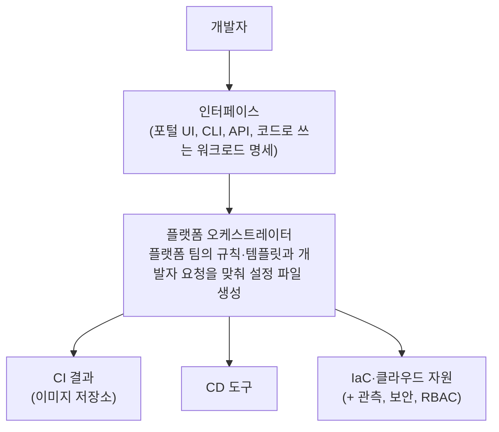

> Microsoft Learn의 「[What is platform engineering?](https://learn.microsoft.com/en-us/platform-engineering/what-is-platform-engineering)」, Atlassian의 「[What is Platform Engineering?](https://www.atlassian.com/developer-experience/platform-engineering)」·「[Internal Developer Platform Guide](https://www.atlassian.com/developer-experience/internal-developer-platform)」, internaldeveloperplatform.org의 「[What is an Internal Developer Platform?](https://internaldeveloperplatform.org/what-is-an-internal-developer-platform/)」, Spotify Backstage의 「[Software Templates at Spotify](https://backstage.spotify.com/learn/onboarding-software-to-backstage/setting-up-software-templates/11-spotify-templates/)」, Red Hat의 「[What is a golden path for software development?](https://www.redhat.com/en/topics/devops/golden-paths)」을 바탕으로 재구성한 노트다. 작은 규모의 자체 호스팅 PaaS는 「[도쿠(Dokku)로 만드는 미니 히로쿠(Heroku)](http://blog.nacyot.com/articles/2014-01-30-deploying-application-with-dokku/)」를 Dokku 공식 문서로 최신화해 보강했다.

## 플랫폼 엔지니어링이란

DevOps는 「만든 팀이 운영까지 한다」를 퍼뜨렸다. 그 결과 모든 개발팀이 쿠버네티스, IaC, CI/CD, 관측, 보안 스캔을 각자 익히고 각자 설정하게 됐다. 팀이 감당할 수 있는 복잡성에는 한계(complexity limit)가 있고, 넘으면 품질과 속도와 만족도가 함께 떨어진다.

**플랫폼 엔지니어링은 이 공통 작업을 내부 개발자 플랫폼(IDP, Internal Developer Platform)으로 묶어, 개발자가 운영팀에 요청하지 않고 스스로 쓰게(셀프서비스) 만드는 일이다.** 보안·규정 준수·비용 통제는 플랫폼 안에 미리 넣어 둔다. 개발자가 옳은 길로 「자연스럽게 빠지게」 하는 것(pit of success)이 목표다.

DevOps·SRE와의 관계는 [[devops-sre-platform-engineering|DevOps, SRE, 플랫폼 엔지니어링, NoOps]]에 있다. 한 줄로 줄이면 DevOps는 문화, 플랫폼 엔지니어링은 그 문화를 확장 가능한 내부 제품으로 만드는 조직 방식이다.

### 플랫폼을 제품으로 만든다

가장 중요한 원칙은 **개발자(데이터 과학자, ML 엔지니어 포함)를 고객으로 보는 제품 관점**이다.

- 사용자 조사와 피드백 루프로 무엇을 만들지 정하고 계속 개선한다.
- 위에서 내려꽂는 빅뱅 도입을 피한다. **최소 실행 가능 플랫폼(thinnest viable platform, MVP)** 에서 시작해 가치를 증명하며 넓힌다. 개발팀이 스스로 쓰고 싶어 하고 옹호하게 되는 것이 성공 신호다.
- 개발자만이 아니라 인프라·운영, 아키텍트, 보안, 경영진도 이해관계자다. 이들의 기준(규정 준수, 비용)을 플랫폼의 기본 설정으로 강제한다.
- 모든 것을 직접 만들지 않는다. 오픈소스와 상용 도구를 조합하고, 회사에 고유한 접착 부분에만 투자한다.
- 잘 되면 20명이 안 되는 플랫폼 팀이 개발자 수천 명과 프로젝트 수백 개를 지원한다.

## 내부 개발자 플랫폼(IDP)의 구성

IDP는 도구 하나가 아니라 여러 도구를 하나의 셀프서비스 층으로 엮은 것이다. 복잡성을 가리되 맥락까지 숨기지는 않는다.

| 구성 요소 | 하는 일 | 주로 쓰는 쪽 |
| --- | --- | --- |
| 애플리케이션 설정 관리 | 기본 설정 템플릿을 정하고, 앱별로 차이만 덮어쓴다 | 플랫폼 팀이 만들고 개발자가 매일 쓴다 |
| 인프라 오케스트레이션 | 요청에 맞춰 DB·큐·클러스터 같은 자원을 IaC로 만든다 | 플랫폼 팀 |
| 환경 관리 | 개발·스테이징·미리보기 환경을 필요할 때 띄우고 지운다 | 개발자 |
| 배포 관리 | 배포·롤백·배포 자동화를 개발자가 직접 실행한다 | 개발자 |
| 역할 기반 접근 제어(RBAC) | 누가 어떤 환경과 자원을 바꿀 수 있는지 정한다 | 플랫폼 팀 |

그 위에 운영에 필요한 기능이 붙는다.

| 기능 | 내용 |
| --- | --- |
| 소프트웨어 카탈로그 | 모든 서비스·라이브러리·인프라의 소유 팀, 설명, 문서·코드 링크, 의존 관계를 한 URL에서 본다. 저장소, CI/CD, 장애 관리, 관측 도구와 연결돼 늘 최신이다 |
| 헬스 스코어카드 | 테스트 커버리지, 취약점, 성능, 문서화 같은 품질 지표를 서비스마다 실시간으로 보여 준다 |
| 관측·보안 연동 | 모니터링·로그·보안 스캔을 워크플로에 끼워 넣는다 |



**포털은 플랫폼이 아니다.** Backstage 같은 개발자 포털은 플랫폼 기능을 찾아 쓰는 UI 인터페이스 하나일 뿐이다. IDP라고 하면 그 아래 플랫폼 층 전체를 가리킨다. 개발자가 익숙한 방식으로 쓰도록 UI, CLI, API, 코드 기반 명세(예: Score)처럼 인터페이스를 여러 개 열어 둔다.

### 작은 규모의 선택지: 자체 호스팅 PaaS

플랫폼 팀을 둘 규모가 아니면 Heroku식 `git push` 배포를 서버 한두 대에 직접 차리는 방법이 있다. **Dokku**가 대표적이다.

```bash
dokku apps:create shop                          # 서버에서
dokku domains:set shop shop.example.com
git remote add dokku dokku@server:shop           # 개발 머신에서
git push dokku main                              # 빌드팩·Dockerfile로 빌드 → 컨테이너 실행 → nginx 라우팅
```

push하면 Procfile로 프로세스 유형을 알아내 빌드하고 컨테이너를 띄운 뒤 nginx가 `앱이름.도메인`으로 라우팅한다(와일드카드 DNS가 필요하다). Let's Encrypt 같은 기능은 플러그인으로 붙인다. 같은 계열로 CapRover, Coolify, Kamal이 있다. 서버 한 대에 묶이는 한계가 있으므로 팀과 서비스가 늘면 위의 IDP로 옮겨 간다.

## 골든 패스: 포장된 길

**골든 패스(golden path)는 조직 안에서 무언가를 만들고 배포하는 「의견이 담긴(opinionated), 문서화되고 지원되는」 길이다.** 포장된 길(paved path, paved road)이라고도 한다. 사람이 많이 다니는 흙길을 나중에 포장하듯, 이미 검증된 방법을 플랫폼으로 포장한다.

Spotify는 수많은 팀이 제각각 프레임워크를 골라 생긴 파편화를 줄이려고 이 개념을 만들었다. 백엔드·프런트엔드·데이터 파이프라인 같은 분야별로 소프트웨어 템플릿 수십 개를 두고, 분야 전문가가 유지·리뷰한다. 기술 아키텍처 그룹(TAG)이 어떤 프레임워크를 쓸지 정하므로 완전히 새로운 프레임워크의 템플릿은 신중하게 검토된다. 골든 패스에 오른 도구는 Backstage에서 보인다.

| 골든 패스의 예 | 내용 |
| --- | --- |
| 소프트웨어 템플릿 | Docker와 CI/CD가 설정된 Python FastAPI 마이크로서비스 뼈대 |
| 인프라 프로비저닝 | 미리 만든 Terraform·Pulumi 모듈 |
| 빌드·배포 파이프라인 | 미리 설정된 GitHub Actions 워크플로 |
| 보안 기준 | 처음부터 적용된 정책과 스캔 |

### 좋은 골든 패스의 네 가지 성질

| 성질 | 뜻 |
| --- | --- |
| 선택 가능(optional) | 강제하지 않는다. 벗어날 자유가 혁신을 만든다. 많은 팀이 벗어나는 곳은 새 골든 패스가 필요한 곳이다 |
| 투명(transparent) | 밑의 기술을 몰라도 쓸 수 있지만, 뒤에서 무엇이 일어나는지 들여다볼 수 있다 |
| 확장 가능(extensible) | 특정 경우에 필요한 기능을 더할 여지가 있다 |
| 조정 가능(customizable) | 템플릿이므로 팀 상황에 맞춰 바꾼다 |

**길을 포장하는 순서**: 사용자를 정한다 → 목적(기존 실천의 자동화)을 정한다 → 단계별로 길을 놓는다 → 문서와 도구를 붙인다 → IDP에 올려 셀프서비스로 쓰게 한다 → DORA 지표, SPACE 프레임워크 같은 지표와 사용자 피드백으로 재고 고친다.

얻는 것은 인지 부담 감소, 빠른 시작, 프로젝트 간 일관성, 자동화 확대, 쉬운 온보딩, 내장된 보안(감사가 쉬워짐)이다.

## 한계

- 플랫폼도 제품이라 안 쓰이면 실패다. 필요 조사 없이 만든 플랫폼은 우회로만 늘린다.
- 추상화를 너무 세게 하면 개발자가 문제를 디버깅할 맥락을 잃는다. 숨기되 들여다볼 수 있어야 한다.
- 골든 패스를 강제하면 표준화는 얻지만 새로운 시도가 막힌다.
- 플랫폼 팀이 모든 요청을 받는 병목이 되면 예전 운영팀의 티켓 대기로 되돌아간다. 셀프서비스가 핵심이다.

## 정리

- 플랫폼 엔지니어링은 팀마다 반복되는 운영 작업을 셀프서비스 내부 제품(IDP)으로 묶는다.
- 개발자를 고객으로 보고, 최소 실행 가능 플랫폼에서 시작해 피드백으로 키운다.
- IDP는 설정·인프라·환경·배포·권한을 오케스트레이터로 엮고, 포털은 그 위의 인터페이스 하나다.
- 골든 패스는 선택 가능하고 투명하고 확장·조정 가능한, 검증된 기본 길이다.

관련 노트: [[devops-sre-platform-engineering|DevOps, SRE, 플랫폼 엔지니어링, NoOps]], [[ci-cd|CI/CD]], [[terraform-workflow|Terraform 워크플로]], [[kubernetes-architecture|쿠버네티스 아키텍처]], [[devsecops|DevSecOps]], [[spotify-model|스포티파이 모델]]
