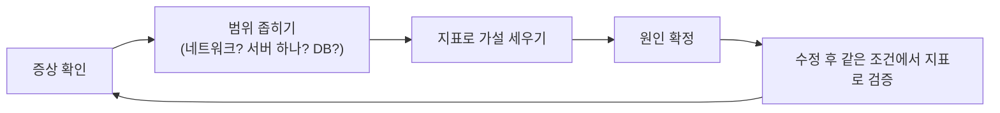

> 「[서버에 걸리는 부하, 추측하지 말고 계측하자](https://injae-kim.github.io/dev/2020/07/09/how-to-check-single-server-load-average.html)」, 「[푸시 데몬 메모리 누수 디버깅하기](https://mingrammer.com/debug-memory-leak-with-node-heapdump/)」, 「[빌링 시스템 장애, 이러지 말란 Maria~](https://techblog.woowahan.com/2517/)」, 「[인프런 2022년 1월 100% 할인 이벤트 장애 부검](https://tech.inflab.com/202201-event-postmortem)」, 「[레디스 사망일기](https://perfectacle.github.io/2019/05/29/redis-monitoring/)」, 「[콘퍼런스 참가 신청 기능 개발기](https://d2.naver.com/helloworld/5048491)」, 「[LINE 메시징 서버가 새해 트래픽을 대비하는 과정](https://engineering.linecorp.com/ko/blog/how-line-messaging-servers-prepare-for-new-year-traffic/)」을 바탕으로 재구성한 노트다.

## 원칙: 추측하지 말고 계측한다

장애 대응의 첫 단계는 **원인을 재는 것**이다. 서버를 늘리거나 메모리를 증설하는 것은 원인을 모르는 채 하는 임시방편이다. 증설로 증상이 사라져도 원인이 남아 있으면 같은 장애가 다시 난다.

- 서버를 늘리기 전에 **서버 한 대가 제 성능을 내고 있는지** 먼저 본다. 한 대가 비효율적이면 열 대도 비효율적이다.
- 가설은 **설정·배포 전후의 로그와 그래프를 비교**해 검증한다.
- 라이브러리 문제가 의심되면 그 프로젝트의 이슈 트래커와 변경 로그에서 같은 증상을 찾는다. 의존성 관리 도구가 자동으로 고른 오래된 버전이 원인일 수 있다.

## 서버 한 대의 부하 읽기

### load average

`top`, `uptime`이 보여 주는 **load average는 실행 중이거나 실행을 기다리는 태스크 수의 1·5·15분 평균**이다. 리눅스는 디스크 I/O를 기다리는 중단 불가 상태(`D`, `TASK_UNINTERRUPTIBLE`) 태스크도 센다. 그래서 load average가 높다는 것만으로는 **CPU 때문인지 I/O 때문인지 알 수 없다.** 코어 수와 비교해서 읽는다(코어 4개에 load 4면 꽉 찬 상태).

### CPU 바운드와 I/O 바운드 가르기

`sar`, `vmstat`, `iostat`, `mpstat -P ALL`로 시간대별 CPU 사용 내역을 본다.

| 지표 | 높으면 |
| --- | --- |
| `%user` | 애플리케이션 코드가 CPU를 쓴다. load도 높으면 **CPU 바운드** |
| `%system` | 커널 모드 시간. 시스템 호출·컨텍스트 스위칭이 많다 |
| `%iowait` | CPU가 I/O 완료를 기다리며 논다. **I/O 바운드**. 메모리 부족으로 스왑이 일어나는지도 확인한다 |
| `%steal` | 가상 머신에서 다른 VM에 CPU를 빼앗긴 시간 |

멀티코어에서는 **코어별로** 본다. 저장 장치가 하나면 I/O 처리가 특정 코어에 몰릴 수 있다.

| 진단 | 대응 방향 |
| --- | --- |
| CPU 바운드 | 핫스팟 프로파일링, 알고리즘 개선, 불필요한 연산 제거 |
| I/O 바운드 | 메모리 증설(페이지 캐시), 캐시 서버 도입, 쿼리·인덱스 개선, 샤딩·파티셔닝 |

## 메모리 누수 찾기

OOM이 반복되면 우연이 아니라 구조적 문제다.

1. 대상 프로세스가 무엇을 하는지(주기 작업, 연결 생성, 재귀 처리) 흐름부터 정리한다.
2. **힙 스냅샷을 여러 시점에** 뜬다. 특정 작업 직후, 그리고 시그널로 임의 시점에.
3. 스냅샷 크기를 시간 순으로 비교해 **일시적 증가(작업 중에만 늘었다 해제)** 인지 **계속 누적** 인지 가린다.
4. 두 스냅샷을 비교(diff)해 계속 늘어나는 객체 타입을 찾는다. 큰 문자열·버퍼처럼 곧 해제되는 것은 걸러 낸다.
5. 그 객체의 **retained size와 참조 경로(retainers)** 를 따라 올라가 붙잡고 있는 원인 객체를 찾는다. shallow size는 객체 자신의 크기, retained size는 그 객체가 사라지면 함께 해제될 크기다.
6. OS 수준 자원(열린 TCP 연결 수, 파일 디스크립터 수)과 객체 수를 교차 확인해 확정한다.
7. 고친 뒤 같은 조건에서 스냅샷 크기가 일정하게 유지되는지 검증한다.

흔한 원인은 **닫히지 않는 외부 연결**, 끝없이 커지는 캐시·맵, 해제되지 않는 이벤트 리스너, 커넥션 풀 라이브러리의 버그다. 힙 덤프는 프로세스 메모리를 더 쓰므로, 메모리가 이미 절반 넘게 찬 상태에서는 덤프 자체가 실패할 수 있다. JVM이라면 MAT 같은 분석 도구를 쓴다([[jvm-internals|JVM 내부 구조]]).

## 자주 반복되는 장애 유형

### DB 커넥션을 얻지 못한다

| 증상 | 원인 | 해결 |
| --- | --- | --- |
| 커넥션 풀이 연결을 못 얻는다는 예외가 간헐적으로 난다. DB 로그에는 `Aborted connection` | 연결 수립 단계에서 DNS 조회가 느려진다. MySQL·MariaDB는 새 연결마다 클라이언트 IP의 호스트 이름을 역조회하고, 드라이버도 로컬 호스트 이름을 조회할 수 있다. 이 지연이 서버의 `connect_timeout`을 넘는다 | DB에 `skip-name-resolve`(호스트 기반 권한을 IP로 바꿔야 하므로 사전 검증), `/etc/hosts` 매핑, 드라이버 버전 업, 클라이언트·서버 타임아웃 정합성 맞추기 |

외부 결제 연동이 걸린 기능이라면 **요청 전 실패와 승인 후 실패를 구분**한다. 승인된 뒤에 내부 처리가 실패하면 돈은 빠졌는데 주문이 없는 상태가 된다.

### 트래픽이 몰리자 DB가 무너진다

| 원인 | 왜 문제인가 | 해결 |
| --- | --- | --- |
| 인덱스를 타지 못하는 쿼리 | 컬럼에 함수를 씌우거나 부정 조건(`!=`, `NOT IN`)을 쓰면 풀 스캔이 된다. 느린 쿼리가 커넥션을 오래 잡아 풀이 고갈되고, 앱 프로세스가 연쇄로 죽는다 | 실행 계획 확인, 조건을 인덱스 친화적으로 재작성 |
| 너무 큰 `IN` 목록 | 옵티마이저가 인덱스를 포기할 수 있다 | 일정 크기로 나눠 여러 번 조회 |
| `SELECT *` | 쓰지 않는 큰 컬럼까지 읽어 I/O가 쌓인다 | 필요한 컬럼만 |
| 자주 바뀌는 값과 큰 컬럼이 한 행에 | 카운터 하나 갱신에도 큰 행 전체를 새로 쓴다. 행 락 경합과 데드락이 생긴다 | **자주 갱신되는 값(카운터)을 별도 테이블로 분리** |
| PostgreSQL의 죽은 튜플 폭증 | MVCC는 UPDATE마다 새 행 버전을 쓰고 옛 버전(dead tuple)을 남긴다. 큰 행을 자주 갱신하면 autovacuum이 못 따라가 모든 쿼리가 느려진다 | 위와 같이 갱신 대상 분리, autovacuum 튜닝 |
| 끝나지 않는 쿼리 | 장시간 실행 쿼리가 자원을 독점한다 | **쿼리 타임아웃**(`statement_timeout` 등) 설정 |

읽기 DB만 모니터링하면 쓰기 DB의 병목을 놓친다. 둘 다 본다. 스케일업과 인덱스 추가 같은 **임시 조치**와 구조적 원인 제거를 구분해서 기록한다. 하나의 DB를 모든 기능이 공유하면 한 기능의 장애가 전체 장애가 되므로, 전파 범위가 큰 영역부터 분리한다([[database-internals|DB 내부 구조]], [[transaction|트랜잭션과 회복]]).

### 선착순 신청에서 카운터가 병목이 된다

정원이 정해진 선착순 신청을 `UPDATE ... SET 신청자수 = 신청자수 + 1 WHERE 신청자수 < 정원`처럼 DB 한 행으로 세면, 모든 요청이 그 행의 락을 기다린다.

- 트랜잭션이 길어지면 격리 수준(READ COMMITTED)에 따라 다른 트랜잭션이 현재 인원을 정확히 보지 못해 **정원 초과**가 생긴다. `WHERE`에 복잡한 조건을 넣으면 데드락도 난다.
- 해결은 **바뀌는 값(현재 인원)은 원자적 증가를 지원하는 공유 저장소**(Redis `INCR` 등)로, **바뀌지 않는 값(정원, 신청 기간)은 로컬 캐시**로 옮기는 것이다.
- 「정원이 찼다」와 「오류가 났다」는 사용자에게 다른 메시지로 보여 준다.

수요가 처리량을 크게 넘는 행사라면 앞단에 [[virtual-waiting-room|대기열 시스템(가상 대기실) 설계]]을 두는 방법도 있다.

### 세션이 Redis 메모리를 고갈시킨다

| 증상 | 원인 | 해결 |
| --- | --- | --- |
| Redis 명령이 타임아웃되고, Redis에 의존하는 서버들이 함께 멈춘다 | 로그인하지 않은 요청(헬스 체크, 모니터링 수집기)도 세션을 만들고, 세션 TTL이 사실상 무기한이라 쓰레기 세션이 쌓인다. 잘못된 서비스 디스커버리 설정으로 수집기가 엉뚱한 경로를 계속 호출하기도 한다 | 헬스 체크 경로는 세션을 만들지 않게 하고, 세션 TTL을 업무에 맞게 줄이고, 접근 로그의 User-Agent로 비정상 호출 출처를 찾는다 |

메모리 증설은 시간을 벌 뿐이다. **데이터가 어떤 조건에서 생기고 언제 사라지는지**에서 원인을 찾는다. Redis는 키 수·메모리·명령 수를 꾸준히 수집해 정상 기준선을 정해 둔다([[redis|Redis]]).

## 피크 트래픽 대비

예정된 피크(연말연시, 할인 이벤트, 선착순 오픈)는 미리 준비할 수 있다.

| 단계 | 할 일 |
| --- | --- |
| 예측 | 해마다 피크 패턴과 특이 사항을 기록해 다음 예측의 근거로 쓴다 |
| 용량 산정 | 캐시는 초당 요청 수와 메모리, DB는 과거 데이터, 앱 서버는 부하 테스트로 잰다 |
| 부하 테스트 | 대시보드를 보며 트래픽을 단계적으로 올린다. 평소엔 안 보이던 문제(연결 폭증, GC 부담)는 **급증 시나리오**에서만 드러나므로 따로 시험한다 |
| 부족할 때 | 클러스터 분리, 애플리케이션의 요청 최적화, 노드 증설을 장단점으로 비교한다. TTL과 축출 정책으로 메모리 증가를 조절한다 |
| 격리 | 큐를 역할별로 나누고, 서킷 브레이커로 응답 없는 구성 요소를 끊고, 커넥션 수에 상한을 두고 재사용한다 |
| 방어 | 행동 패턴으로 비정상 요청을 걸러 순간 부하를 줄인다 |
| 당일 | APM으로 오류율과 응답 지연을 실시간으로 본다. 이상 징후가 보이는 노드는 즉시 트래픽을 줄인다 |

라이브러리·클라이언트 버전을 올렸다면 피크 전에 성능 회귀를 확인한다. 서킷 브레이커와 폴백 같은 방어 설계는 [[high-traffic-resilience|대규모 트래픽에서 서비스를 지키는 설계]]에 있다.

## 사후 분석

장애가 끝나면 **책임 추궁이 아니라 재발 방지**를 목표로 사후 분석(postmortem)을 쓴다. 타임라인, 영향, 근본 원인, 임시 조치, 재발 방지 대책을 남기고 팀 밖에도 공유한다. 테스트와 타입이 부족한 코드는 장애 중에 고치기가 두려워 복구가 늦어지므로, 평소의 테스트 기반도 장애 대응 역량이다.

## 정리

- 증설 전에 계측한다. load average는 CPU와 I/O를 구분하지 못하니 `%user`·`%iowait`를 함께 본다.
- 메모리 누수는 여러 시점의 힙 스냅샷을 비교하고 참조 경로를 따라가 찾는다.
- DB 장애는 대개 인덱스를 못 타는 쿼리, 한 행에 몰리는 갱신, 끝나지 않는 쿼리에서 시작한다.
- 공유 저장소의 메모리 고갈은 데이터의 생성 조건과 만료 정책에서 원인을 찾는다.
- 예정된 피크는 기록·용량 산정·급증 시나리오 테스트로 대비하고, 장애 뒤에는 사후 분석을 공유한다.

더 읽을거리: 「[선착순 이벤트 서버 생존기! 47만 RPM에서 살아남다?!](https://www.youtube.com/watch?v=MTSn93rNPPE)」(우아한테크 영상)

관련 노트: [[observability|관측 가능성: 로그, 트레이스, 메트릭]], [[high-traffic-resilience|대규모 트래픽에서 서비스를 지키는 설계]], [[virtual-waiting-room|대기열 시스템(가상 대기실) 설계]], [[redis|Redis]], [[database-internals|DB 내부 구조: 쿼리 실행과 인덱스 자료 구조]], [[jvm-internals|JVM 내부 구조: 컴파일, 클래스 로딩, 메모리 영역, GC 튜닝]]
