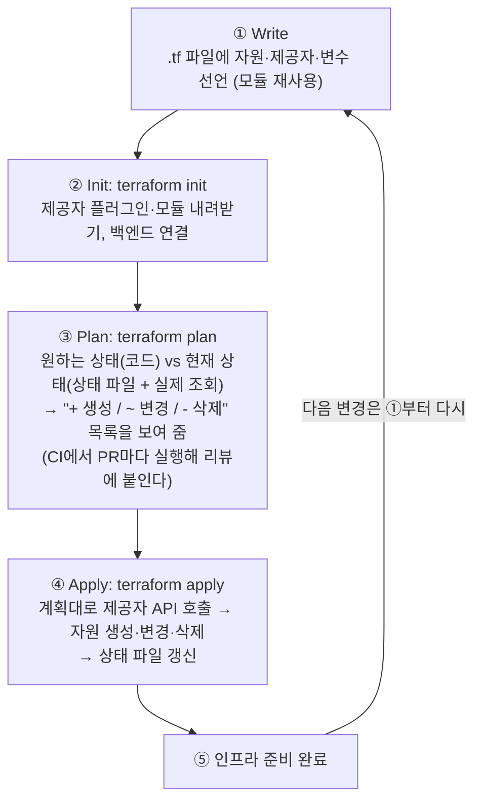
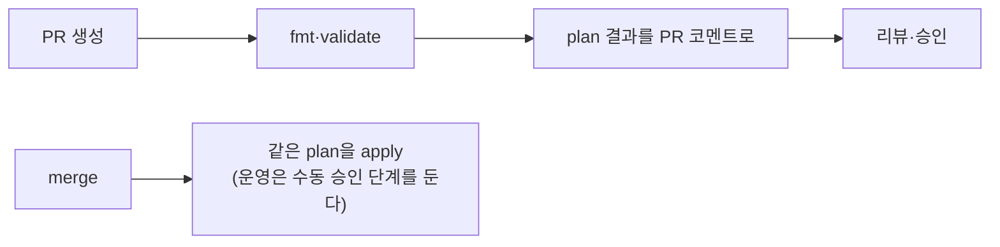

> ByteByteGo의 System Design 101 가이드 「[How does Terraform turn Code into Cloud?](https://bytebytego.com/guides/how-does-terraform-turn-code-into-cloud)」를 바탕으로, HashiCorp 공식 문서로 확인해 재구성한 노트다. HCL 파일 규칙, 데이터 소스, import·graph·destroy는 AppContainer Korea 인프라스트럭처 스터디의 「[Hashicorp Terraform](https://github.com/remotty/documents.docker.co.kr)」 발표 자료로 보강했다.

## Terraform이란

**Terraform은 클라우드 자원을 코드로 선언하고, 그 선언대로 만들고 고치고 지우는 코드형 인프라(IaC, Infrastructure as Code) 도구다.** 콘솔에서 손으로 누르던 일을 코드로 남기면 리뷰·버전 관리·재현이 가능해진다. HCL이라는 선언형 언어를 쓰고, **제공자(provider)** 플러그인을 통해 AWS·GCP·Azure·쿠버네티스·DNS 서비스 등 API가 있는 거의 모든 대상을 다룬다.

Terraform은 선언형이다. "서버를 하나 만들어라"가 아니라 "서버가 하나 있어야 한다"고 쓰면, Terraform이 지금 상태와의 차이를 계산해 필요한 생성·변경·삭제만 한다.

## 흐름: write → plan → apply



```hcl
provider "aws" {
  region = var.region
}

resource "aws_s3_bucket" "assets" {
  bucket = "my-app-assets"
  tags   = { env = var.env }
}
```

| 구성 요소 | 역할 |
| --- | --- |
| provider | 대상 플랫폼의 API를 호출하는 플러그인 |
| resource | 만들 자원 하나(버킷, VM, DNS 레코드) |
| data | 이미 있는 자원을 읽기만 한다 |
| variable / output | 입력값과 다른 모듈에 넘길 출력값 |
| module | 자원 묶음을 함수처럼 재사용하는 단위. 공개 레지스트리에서 가져다 쓸 수 있다 |

자원 이름의 접두사가 제공자를 정한다. `aws_instance`는 `aws` 제공자가 관리한다. 자원끼리는 `aws_subnet.a.id`처럼 속성을 참조하면 Terraform이 의존 관계를 알아내 순서를 정한다. 참조로 드러나지 않는 의존만 `depends_on`으로 적는다.

### HCL 파일 규칙

- Terraform은 디렉터리의 `*.tf`(HCL)와 `*.tf.json`(JSON)을 모두 읽어 하나의 설정으로 합친다. 파일 이름과 블록 순서는 결과에 영향이 없다.
- 이름이 `override.tf`이거나 `_override.tf`로 끝나는 파일은 나머지를 다 읽은 뒤 같은 블록의 값을 덮어쓴다. 남용하면 읽기 어려워 거의 쓰지 않는다.
- 주석은 `#`·`//`, 여러 줄은 `/* */`. 여러 줄 문자열은 `<<EOF ... EOF` 히어독으로 쓴다.
- 변수 값은 `-var`, `*.tfvars` 파일, `TF_VAR_<이름>` 환경 변수로 덮는다.

```hcl
# 데이터 소스: 이미 있는 자원을 조회만 한다 (태그로 최신 AMI 찾기)
data "aws_ami" "web" {
  most_recent = true
  owners      = ["self"]
  filter {
    name   = "tag:Component"
    values = ["web"]
  }
}

resource "aws_instance" "web" {
  ami           = data.aws_ami.web.id
  instance_type = "t3.micro"
  count         = 3
}
```

AMI를 [[packer-machine-image|Packer]]로 굽고 Terraform이 데이터 소스로 최신 이미지를 찾아 서버를 띄우는 조합이 흔하다.

제공자 자격 증명은 코드에 쓰지 않는다. `provider "aws"` 블록에 `access_key`를 적으면 Git에 키가 남는다. 환경 변수, 프로필, IAM 역할, CI의 OIDC 연동으로 넘긴다.

### 자주 쓰는 명령

| 명령 | 하는 일 |
| --- | --- |
| `terraform fmt` · `validate` | 서식 정리, 문법·참조 검사 |
| `terraform show` | 상태 파일이나 저장한 plan의 내용을 사람이 읽게 보여 준다 |
| `terraform output` | 출력값을 읽는다. 다른 스크립트가 값을 가져갈 때 |
| `terraform graph` | 자원 의존 그래프를 DOT 형식으로 출력한다. Graphviz로 그린다 |
| `terraform plan -destroy` | 무엇이 지워질지 미리 본다 |
| `terraform destroy` | 이 설정이 관리하는 자원을 모두 지운다 |
| `terraform import` · `import` 블록 | 콘솔에서 만든 기존 자원을 상태 파일에 들인다 |

**import는 상태만 들이고 설정 코드는 만들지 않는다.** 들인 뒤 코드를 실제와 맞게 써야 plan이 빈다. 지금은 CLI 명령보다 `import` 블록을 쓰는 편이 낫다. 블록은 리뷰할 수 있고 plan에서 미리 보이며, `terraform plan -generate-config-out=generated.tf`로 설정 초안도 만들어 준다.

```hcl
import {
  to = aws_key_pair.deployer
  id = "deployer"
}
```

## 상태 파일: 단일 진실 공급원

**상태 파일(`terraform.tfstate`)은 코드의 자원과 실제 클라우드 자원의 ID를 잇는 장부다.** Terraform은 이 장부를 보고 무엇이 이미 있는지 판단하므로, 상태 파일이 인프라의 단일 진실 공급원이 된다.

| 원칙 | 이유 |
| --- | --- |
| 원격 백엔드에 둔다 (S3, GCS, HCP Terraform 등) | 팀원 모두가 같은 장부를 봐야 한다. 로컬 파일은 사람마다 갈라진다 |
| 잠금(locking)을 켠다 | 두 사람이 동시에 apply하면 장부가 깨진다 |
| Git에 커밋하지 않는다 | 비밀번호 같은 민감한 값이 평문으로 들어 있을 수 있다. 백엔드 저장소를 암호화하고 접근을 제한한다 |
| 손으로 고치지 않는다 | 옮기거나 떼어 낼 때는 `terraform state mv`·`import`·`moved` 블록을 쓴다 |
| 환경·서비스별로 나눈다 | 장부 하나가 크면 plan이 느리고, 실수 하나의 영향 범위가 커진다 |

## 드리프트와 불변 인프라

콘솔에서 누군가 설정을 직접 바꾸면 코드·상태 파일과 실제가 어긋난다. 이를 **구성 드리프트(configuration drift)** 라 한다. `terraform plan`을 주기적으로 돌리면 드리프트가 변경 목록으로 드러난다.

드리프트를 근본적으로 줄이는 원칙이 **불변 인프라(immutable infrastructure)** 다. 서버에 접속해 설정을 고치지 않고, 바뀐 이미지·설정으로 **새 자원을 만들어 교체**한 뒤 옛것을 버린다. 자원을 일회용으로 다루면 "이 서버만 이상한" 상태가 생기지 않는다. 컨테이너 이미지 교체와 같은 발상이다.

## CI에서 운영하기



- 사람의 노트북이 아니라 **파이프라인만 apply 권한**을 갖게 하면 누가 언제 무엇을 바꿨는지 Git 이력에 남는다.
- `plan`에 삭제(`-`)나 교체(`-/+`)가 보이면 멈추고 본다. DB 같은 자원은 `prevent_destroy`로 지키는 편이 안전하다.

## 역사

| 시기 | 변화 |
| --- | --- |
| 2019 | 0.12에서 HCL2가 들어왔다. 그 전에는 모든 참조를 `"${var.ami}"`처럼 문자열 보간으로 썼고, 지금은 `var.ami`로 바로 쓴다 |
| 2023 | 1.5에서 `import` 블록과 설정 생성(`-generate-config-out`)이 들어왔다 |
| 2023.08 | 라이선스가 오픈소스(MPL 2.0)에서 BSL로 바뀌었다. 그 직전 버전에서 갈라진 오픈소스 포크 **OpenTofu**가 리눅스 재단에서 이어진다. 둘은 같은 HCL과 write → plan → apply 워크플로를 쓴다 |
| 2024 | 관리형 실행 서비스 Terraform Cloud의 이름이 **HCP Terraform**으로 바뀌었다 |
| 2025.02 | IBM이 HashiCorp 인수를 마쳤다. Terraform은 IBM 소프트웨어 제품군 안에서 이어진다 |

## 정리

- Terraform은 선언한 상태와 현재 상태의 차이를 계산해 그만큼만 바꾼다.
- 흐름은 write → init → plan → apply이고, plan은 리뷰용 변경 목록이다.
- 상태 파일은 인프라의 장부다. 원격 백엔드, 잠금, 접근 제한이 기본이다.
- 손으로 고치면 드리프트가 생긴다. 고치지 말고 새로 만들어 교체한다(불변 인프라).
- apply는 사람이 아니라 파이프라인이 한다.

관련 노트: [[aws-cloud-basics|AWS 클라우드 기초]], [[packer-machine-image|Packer와 머신 이미지 굽기]], [[kubernetes-request-path|쿠버네티스 위 웹 서비스의 요청 경로와 구성 요소]], [[ci-cd|CI/CD]], [[startup-infra-decisions|스타트업 인프라 선택 원칙]], [[disaster-recovery|고가용성과 재해 복구 설계]]
