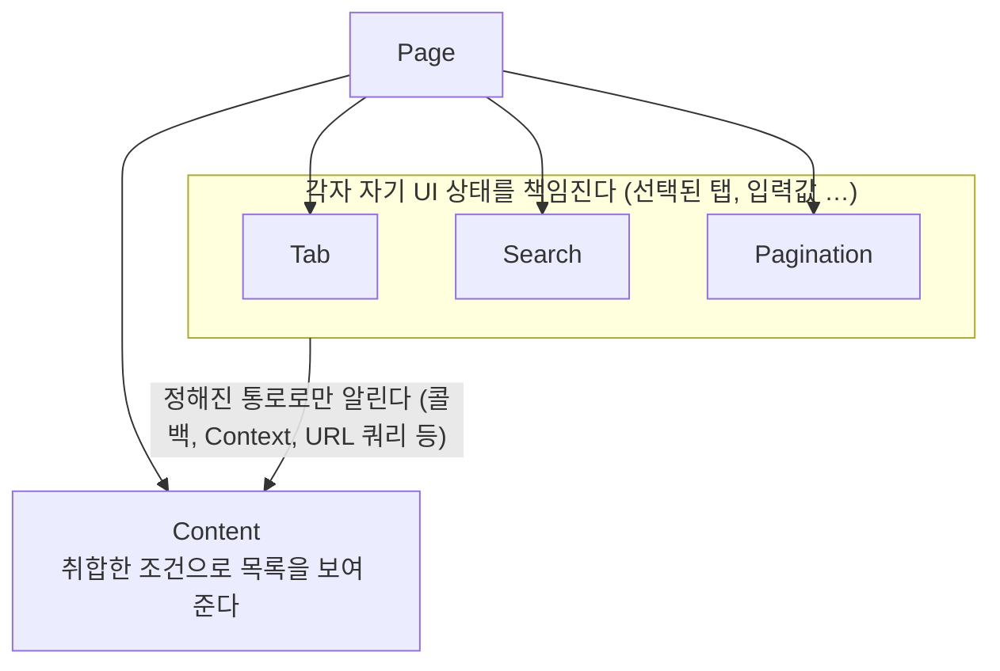

> 이문기의 글 「[프론트엔드 아키텍처: 컴포넌트를 분리하는 기준과 방법](https://medium.com/@junep/%ED%94%84%EB%A1%A0%ED%8A%B8%EC%97%94%EB%93%9C-%EC%95%84%ED%82%A4%ED%85%8D%EC%B2%98-%EC%BB%B4%ED%8F%AC%EB%84%8C%ED%8A%B8%EB%A5%BC-%EB%B6%84%EB%A6%AC%ED%95%98%EB%8A%94-%EA%B8%B0%EC%A4%80%EA%B3%BC-%EB%B0%A9%EB%B2%95-e7cf16bb157a)」(Medium, 2023.02)을 바탕으로 재구성한 노트다. 코드는 설명용으로 줄여 다시 썼다.

## 컴포넌트 분리란

React에서 컴포넌트는 페이지부터 버튼까지 화면을 이루는 **가장 작은 설계 단위**다. 그래서 "언제, 어떻게 더 작게 나눌까"가 계속 문제가 된다. Container–Presentational, [[atomic-design|Atomic Design]] 같은 기준은 이해하기 쉽지만 예외가 많아 적용이 흔들리고, 일관성이 깨진 앱은 금방 유지보수하기 어려워진다.

분리의 이유는 세 가지로 모인다.

| 이유 | 신호 | 분리 방법 |
| --- | --- | --- |
| 재사용 | 같은 UI가 여러 곳에 쓰인다 | 일반적인 부분만 남기고 고유한 부분은 props로 받는다 |
| 복잡성 | 한 컴포넌트가 여러 책임을 지거나 비즈니스 로직을 품는다 | 책임과 변경 빈도를 기준으로 나눈다 |
| 렌더링 범위 | 서로 무관한 상태가 한 컴포넌트에 모여 있다 | 상태를 쓰는 컴포넌트로 내린다 |

## 1. 재사용: 일반적일수록 재사용된다

**재사용할 수 있다는 것은 일반적이라는 뜻이다.** 「탈것」이 「자동차」, 「자전거」보다 넓은 범위를 포함하고 더 보편적인 속성만 갖듯, `<button>`은 `Button`과 `ButtonWithIcon`을 모두 포함한다. 재사용 컴포넌트를 만들 때 따질 것은 **다른 컴포넌트가 가져다 쓸 만큼 속성이 보편적인가**다.

### HTML 문맥에 기대지 않게

컴포넌트도 결국 HTML을 반환한다. 리스트 항목을 떼어 낼 때 `<li>`까지 함께 가져가면 그 컴포넌트는 `<ul>` 안에서만 쓸 수 있다.

```tsx
// 리스트 안에서만 쓸 수 있다
function Item() {
  return <li><h3>…</h3><p>…</p></li>;
}

// 어디서든 쓸 수 있다
function Summary() {
  return <section><h3>…</h3><p>…</p></section>;
}

<ul>
  <li><Summary /></li>
</ul>
```

`<li>`는 바깥(리스트)이 맡고, 안쪽은 독립된 블록 요소로 감싼다. BEM([[oocss|OOCSS]] 계열 CSS 방법론)의 Block처럼 **주변 문맥 없이도 성립하는 단위**로 자르면 재사용 범위가 넓어진다. 제목 수준(`h3`)도 문맥을 타므로, 필요하면 heading 수준을 props로 받는다.

### 모양이 같다고 중복은 아니다

두 페이지에 비슷한 카드가 있으면 `Card`로 추출하고 싶어진다. 처음에는 `showSummary` 같은 플래그 하나로 시작하지만, 시간이 지나면 상태와 조건이 쌓인다.

```tsx
function Card({ a, b, foo, bar, showSummary }) {
  const [mode, setMode] = useState(a ? foo : bar);
  const showExtra = a && !b;
  return (
    <section>
      <h3>…</h3>
      <p>가격…</p>
      <button>{mode ? 'foo' : 'bar'}</button>
      {showSummary && <p>요약…</p>}
      {showExtra && <div>…</div>}
    </section>
  );
}
```

이렇게 커지는 이유는 쓰는 쪽과 `Card`가 강하게 결합했기 때문이다. 결합이 강하면 `Card`를 다른 컴포넌트로 바꾸거나 props 이름을 바꾸기 어렵고, `Page1`의 요구로 `Card`를 고치면 `Page2`까지 확인해야 한다. 쓰는 곳이 늘수록 변경 비용이 커진다.

원인은 겉모습으로 중복을 판단한 것이다. DRY 원칙에서 중복은 **같은 이유로 함께 바뀌는 코드**다. 모양이 같아도 바뀌는 이유가 다르면 중복이 아니다. 추출한 컴포넌트에 쓰는 곳별 조건문이 들어가기 시작했다면, 이미 수정 이유가 갈라졌다는 신호다.

**데이터가 다르면 UI도 결국 달라진다.** 알바 공고 카드와 중고차 카드를 `ItemCard` 하나로 묶고 `if (알바) <Badge />`, `if (중고차) price * 0.1`을 붙이기 시작하면 결합도만 오른다. 공지·문의·방명록을 `BoardList` 하나로 묶어도 요구사항은 화면이 아니라 도메인을 따라 갈라진다(공지의 중요 배지, 문의의 비밀글, 방명록의 미리보기). 공통으로 둘 것은 Title, Card, Price처럼 **도메인을 모르는 UI 조각**뿐이고, 도메인 컴포넌트는 그것을 조합해 따로 만든다.

반대로 관리자 콘솔의 만능 게시판처럼 정말로 같은 화면을 여러 데이터가 쓰는 경우도 있다. 이때도 게시판 안에 데이터별 분기를 넣지 않는다. 의존 방향은 데이터 → 화면이므로, 데이터 쪽에 어댑터를 두어 게시판이 받는 모양으로 바꿔 넘긴다.

```ts
interface BoardItem { id: number; label: string; status: 'Complete' | 'Incomplete' }

const taskToBoardItem = (task: Task): BoardItem => ({
  id: task.id,
  label: task.title,
  status: task.isComplete ? 'Complete' : 'Incomplete',
});

<Board items={tasks.map(taskToBoardItem)} />;
```

### 고유한 부분은 props로 넘긴다

재사용 컴포넌트에는 정말 공통인 것만 남기고, 쓰는 쪽의 고유한 부분은 **JSX를 props로 넘긴다.**

```tsx
function Card({ summary }: { summary?: React.ReactNode }) {
  return (
    <section>
      <h3>…</h3>
      <p>가격…</p>
      {summary}
    </section>
  );
}

// Page1만의 요약은 Page1이 관리한다
<Card summary={<p>요약…</p>} />
// Page2는 요약 없이 쓴다
<Card />
```

이제 `Page1`의 요약을 고쳐도 `Page2`를 볼 필요가 없다. 위치·스타일의 상호 의존은 남을 수 있지만, 상태와 조건문의 결합이 사라지는 것만으로 신경 쓸 범위가 줄어든다. 같은 방식은 props drilling을 줄이고 제어를 바깥으로 넘기는 데에도 쓰인다. `children`·슬롯 props·`as` prop 같은 패턴은 [[composition|합성]]에, 이를 확장한 Compound Components·제어 역전(Inversion of Control)도 같은 원리다.

## 2. 복잡성: 책임과 변경 빈도로 나눈다

### 여러 책임을 지는 컴포넌트

탭 전환, 검색, 검색 조건 토글, 페이징, 결과 목록을 모두 한 `Page`가 다루면 기능끼리 서로 직접 얽힌다. 상호작용하는 기능이 늘수록 복잡도는 기능 수보다 빠르게 커진다.



각 컴포넌트는 자기 UI에 관한 변경을 안에 감추고, 다른 컴포넌트와는 잘 바뀌지 않는 정해진 통로로만 이야기한다. `Tab`과 `Search`가 서로를 직접 건드리는 경로는 없앤다. 이것이 컴포넌트 수준의 캡슐화다. 책임의 단위를 어떻게 잡는지는 [[frontend-solid|SRP]]를 따른다.

### 비즈니스 로직을 품은 컴포넌트

UI와 비즈니스 로직은 **변경 빈도가 다르다.** 상품 카드에 환불 가능 여부를 빨간 배지로 보일지 회색 글씨로 보일지는 자주 바뀌지만, 환불 가능 조건 자체는 거의 바뀌지 않는다. 둘이 한 컴포넌트에 섞여 있으면 잦은 UI 수정이 드문 규칙 코드까지 건드린다.

공용 로직을 함수로 빼도 문제는 남는다. 쓰는 컴포넌트마다 원하는 반환 모양이 달라지면 `isRefundable`, `getRefundableWithType`처럼 같은 규칙을 이름만 바꿔 복제하게 된다. 규칙 판단은 한 곳에 두고, 화면별로 필요한 모양은 쓰는 쪽에서 조합한다. 의존 방향을 잡는 방법은 [[frontend-dependency|프론트엔드에서 의존성 관리하기]], 계층을 나누는 기준은 [[separation-of-concerns|관심사의 분리]]에 있다.

## 3. 렌더링 범위: 무관한 상태는 따로 둔다

한 컴포넌트가 서로 영향을 주지 않는 상태를 여럿 들고 있으면, 하나가 바뀔 때 전부 다시 렌더링된다.

```tsx
// 탭에 호버하면 카드 목록이, 카드에 호버하면 탭이 다시 그려진다
function Page() {
  const [tabHover, setTabHover] = useState<string | null>(null);
  const [cardHover, setCardHover] = useState(false);
  return <>{/* 탭 … 카드 목록 … */}</>;
}

// 상태를 쓰는 컴포넌트로 내린다
function Page() {
  return (
    <>
      <Tab />
      <ul>{items.map((item) => <li key={item.id}><Card item={item} /></li>)}</ul>
    </>
  );
}
function Tab() { const [hover, setHover] = useState<string | null>(null); /* … */ }
function Card({ item }) { const [hover, setHover] = useState(false); /* … */ }
```

카드끼리도 호버 상태가 서로 무관하므로 카드마다 자기 상태를 갖게 한다. 특히 입력값(`input`)처럼 자주 바뀌는 상태가 위에 있으면 갱신이 넓게 퍼지니 주의한다.

React Compiler를 켜면 바뀌지 않은 하위 JSX는 자동으로 메모이제이션되어 이런 낭비가 상당 부분 줄어든다. 그래도 **상태를 쓰는 곳 가까이에 두는 것(state colocation)** 은 렌더링 범위뿐 아니라 읽기 쉬운 구조를 위해서도 기본값이다. 원인 추적과 `React.memo`가 듣지 않는 경우는 [[re-rendering|리렌더링 원인과 추적]]에 있다.

## 한계

- 이 기준들은 정답표가 아니다. 프로젝트 단계, 팀의 합의, 디자인 시스템 유무에 따라 같은 화면도 다르게 나눌 수 있다.
- 너무 잘게 쪼개면 흐름을 따라가기 어려워지고 props 전달만 늘어난다. 나눌 이유(재사용·책임·렌더링)가 없으면 나누지 않는다.
- 조건문이 전혀 없는 재사용 컴포넌트는 드물다. 조건문을 넣을 때마다 쓰는 쪽과의 결합이 강해지는지 따져 본다.

## 정리

- 컴포넌트를 나누는 이유는 재사용, 복잡성, 렌더링 범위다.
- 재사용 컴포넌트는 주변 HTML 문맥(`li`, heading 수준)에 기대지 않는 일반적인 블록으로 자른다.
- 모양이 같아도 바뀌는 이유가 다르면 중복이 아니다. 쓰는 곳별 조건문이 생기면 고유한 부분을 props(JSX)로 넘기고, 정말 같은 화면을 공유해야 하면 데이터 쪽 어댑터로 모양을 맞춘다.
- 여러 책임은 각자 상태를 감춘 컴포넌트로 나누고 정해진 통로로만 소통시키며, 비즈니스 로직은 변경 빈도가 다른 UI에서 떼어 낸다.
- 서로 무관한 상태는 그 상태를 쓰는 컴포넌트로 내린다.

나눌지 말지는 "이 코드는 무엇 때문에, 얼마나 자주 바뀌는가"로 정한다.

관련 노트: [[composition|합성: 상속 대신 Composition]], [[frontend-solid|프론트엔드와 SOLID 원칙]], [[frontend-dependency|프론트엔드에서 의존성 관리하기]], [[separation-of-concerns|프론트엔드에서 관심사의 분리]], [[atomic-design|Atomic Design과 컴포넌트 폴더 구조]], [[re-rendering|리렌더링 원인과 추적]], [[code-coupling|결합도를 낮추는 전략]]
