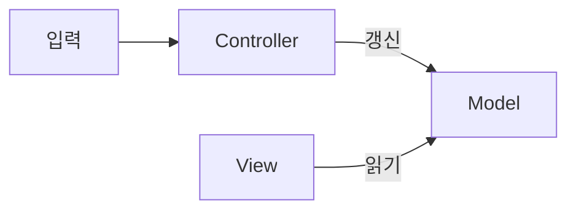
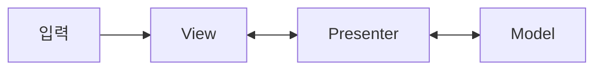
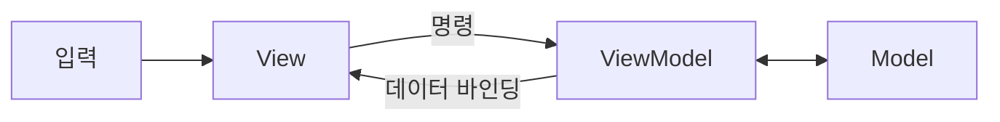
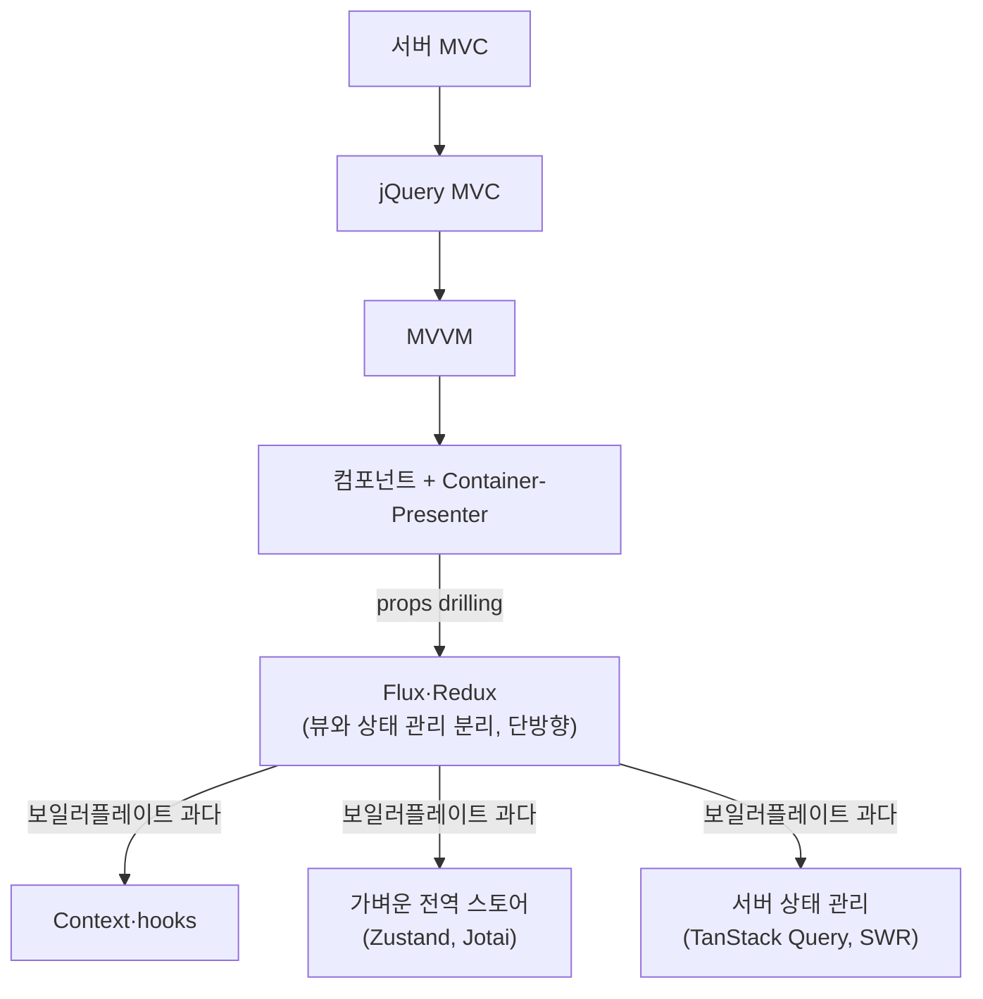
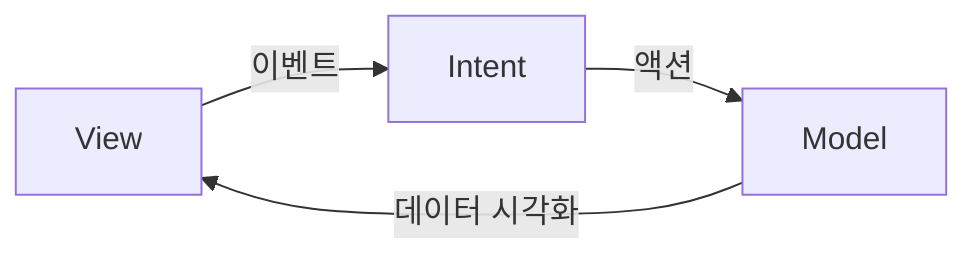

> 테오(teo)의 「[프론트엔드에서 MV* 아키텍쳐란 무엇인가요?](https://velog.io/@teo/프론트엔드에서-MV-아키텍쳐란-무엇인가요)」(2021.12)와 「[프론트엔드에서 비즈니스 로직과 뷰 로직 분리하기 (feat. MVI 아키텍쳐)](https://velog.io/@teo/MVI-Architecture)」(2022.08, 요즘IT 재게재)를 바탕으로 재구성하고, MVVM-C·VIPER는 ByteByteGo의 System Design 101 가이드 「[MVC, MVP, MVVM, VIPER Patterns](https://bytebytego.com/guides/mvc-mvp-mvvm-viper-patterns)」로, 「MVC·MVP·MVVM 비교」는 beomy의 「[MVC, MVP, MVVM 비교](https://beomy.tistory.com/43)」(2018.09)로 보강한 노트다. 단방향 아키텍처의 변형은 「[단방향 사용자 인터페이스 아키텍쳐](https://pilgwon.github.io/blog/2018/12/12/Unidirectional-User-Interface-Architectures.html)」(André Staltz 글의 번역)로 보강했다. MVP의 변형과 Model 2는 Nodejitsu의 「[Scaling Isomorphic Javascript Code](https://blog.nodejitsu.com/scaling-isomorphic-javascript-code/)」(2011)와 Addy Osmani의 「[Understanding MVC And MVP](https://addyosmani.com/blog/understanding-mvc-and-mvp-for-javascript-and-backbone-developers/)」·「[Understanding MVVM](https://addyosmani.com/blog/understanding-mvvm-a-guide-for-javascript-developers/)」로, Flux에서 Redux로의 과정은 Flux 저장소의 「[Flux Concepts](https://github.com/facebook/flux/tree/master/examples/flux-concepts)」와 「[Redux - Reinventing Flux](https://survivejs.com/blog/redux-interview/)」(Dan Abramov 인터뷰, 2015)로 더했다.

## 아키텍처란

불편을 없애려고 만든 규칙이 반복되면 패턴이 되고, **모두가 이해하고 따를 수 있게 굳힌 구조가 아키텍처**다. 모듈은 서로 데이터를 주고받으므로 아키텍처는 **분류**(무엇을 어디에 두나)와 **인터페이스**(어떻게 주고받나) 두 관점으로 본다.

## MVC·MVP·MVVM 비교

UI 소프트웨어의 본질은 데이터를 화면에 그리고, 사용자가 동작하면 데이터가 바뀌고, 다시 화면이 바뀌는 것이다. 화면 문제와 데이터 문제는 성격이 다르므로 둘을 나눠 한쪽 수정이 다른 쪽으로 번지지 않게 한다. 세 패턴 모두 Model(화면이 아닌 데이터: JS 객체, API 응답, 서버 DB)과 View(최종 HTML·CSS)는 같고, 둘 사이를 잇는 세 번째 역할과 의존 방향이 다르다.

MVC (Controller는 View를 고르기만 한다)



MVP (View와 Model은 서로 모른다)



MVVM (ViewModel은 View를 모른다)



| | MVC | MVP | MVVM |
| --- | --- | --- | --- |
| 세 번째 역할 | Controller: 입력을 받아 Model을 바꾸고 보여 줄 View를 고른다 | Presenter: View의 요청으로 Model을 가공해 View에 직접 넘긴다 | ViewModel: View에 보여 줄 상태와 동작만 모은 "View를 위한 Model" |
| 입력이 들어오는 곳 | Controller | View | View (명령으로 ViewModel에 전달) |
| View 갱신 | View가 Model을 직접 읽거나, Model이 알리거나(Observer), View가 주기적으로 확인 | Presenter가 View 인터페이스를 호출 | 바인딩이 ViewModel 변경을 자동 반영 |
| 관계 | Controller : View = 1 : n | Presenter : View = 1 : 1 | ViewModel : View = 1 : n |
| 장점 | 가장 단순하다 | View와 Model의 의존이 끊긴다. View를 가짜로 바꿔 Presenter를 테스트하기 쉽다 | View와 ViewModel까지 느슨해져 각 부분을 따로 개발·테스트할 수 있다 |
| 약점 | View가 Model에 기대므로 앱이 커질수록 얽힌다 | View와 Presenter가 1:1로 단단히 묶이고 Presenter가 비대해진다 | ViewModel 설계가 어렵고, 바인딩이 많으면 흐름을 추적하기 어렵다 |

MVVM은 명령(Command) 패턴과 데이터 바인딩이라는 두 장치로 의존을 끊는다. 웹에서는 Knockout·AngularJS가 시작이었고 Vue의 반응형 템플릿이 같은 모양이다. 모바일에서는 Android Jetpack의 ViewModel, SwiftUI의 `@Observable` 객체가 MVVM 구조로 쓰인다. MVP는 Android가 공식 ViewModel을 내기 전에 많이 쓰였다.

### 같은 이름 아래의 변형들

MVC와 MVP는 하나의 정해진 구조가 아니라 여러 변형을 묶는 이름이다. 마틴 파울러가 정리한 GUI 패턴 분류가 기준이 된다.

| 변형 | 핵심 | 언제 맞나 |
| --- | --- | --- |
| MVP: 수동적 뷰(Passive View) | View는 위젯만 두고 표시 로직까지 전부 Presenter가 한다. Presenter가 View의 setter를 하나하나 호출한다 | View를 테스트할 수 없는 환경에서 테스트 범위를 최대로 넓힐 때 |
| MVP: 감독 컨트롤러(Supervising Controller) | 단순한 표시는 View가 선언적 바인딩으로 직접 하고, 바인딩으로 안 되는 복잡한 로직만 Presenter가 맡는다 | 바인딩 기능이 있는 UI 툴킷 |
| 프레젠테이션 모델(Presentation Model) | View의 상태와 동작을 View와 무관한 클래스에 모으고 View가 그것과 동기화한다 | MVVM의 원형. MVVM은 이 동기화를 바인딩 엔진이 자동으로 한다 |
| Model 2 (서버 MVC) | 요청마다 Controller가 Model을 부르고 View 템플릿을 한 번 그려 응답한다. View는 요청이 끝나면 사라진다 | Rails·Spring MVC·Django 같은 서버 프레임워크. 상태는 세션·DB에 둔다 |

원래 MVC(Smalltalk)는 **오래 살아 있는 View**를 가정하고 사용자 입력도 View로 들어온다. 서버의 Model 2는 HTTP가 상태 없는 프로토콜이라 View가 매 요청마다 새로 만들어지는 **일회용 View**이고, Controller → View 한 방향만 있다. 같은 MVC라는 이름이지만 브라우저(오래 사는 View)와 서버(일회용 View)에서 요구가 정반대라, 같은 코드를 양쪽에서 돌리는 동형(isomorphic) JavaScript에서는 MVC를 그대로 옮기기 어려웠다. View가 Model을 직접 참조하지 않는 MVP·MVVM 계열이 양쪽에 맞추기 쉬웠다. 실제 라이브러리도 정의와 다르다. Backbone은 MVC를 표방했지만 View가 Model을 직접 바꿨다.

### 모바일에서 더 나눈 변형: MVVM-C와 VIPER

모든 패턴에 View가 있고 대부분 Model이 있다. 차이는 둘 사이의 **번역자**(Controller, Presenter, ViewModel)를 어떻게 나누느냐다. 번역자가 커지면 다루기 어려워지므로, 모바일(특히 iOS)에서는 역할을 더 잘게 쪼갠 변형이 나왔다.

| 패턴 | 더한 것 | 푸는 문제 |
| --- | --- | --- |
| MVVM-C | **Coordinator**: 화면 전환(내비게이션)만 맡는 객체 | ViewModel이나 ViewController가 다음 화면을 직접 만들고 띄우느라 서로 얽히는 것 |
| VIPER | View, **Interactor**(유스케이스·비즈니스 로직), Presenter(표시 로직), **Entity**(데이터 모델), **Router**(화면 전환) | Massive View Controller. 책임을 다섯으로 나눠 각각 따로 테스트한다 |

쪼갤수록 테스트와 분업은 쉬워지지만 파일과 보일러플레이트가 늘어난다. 작은 화면에 VIPER는 과하다.

## 웹 프론트엔드 아키텍처의 변천



| 단계 | Model / View / Controller | 바뀐 점과 남은 불편 |
| --- | --- | --- |
| 서버 MVC (Rails, PHP, JSP) | DB / 클라이언트 전체 / 서버 라우터 | 프론트엔드라는 개념이 없던 시절 |
| jQuery | Ajax 데이터 / HTML·CSS / JS(jQuery) | 핵심은 DOM 탐색·조작, 이벤트, Ajax. 바뀐 곳을 일일이 찾아 고쳐야 했다 |
| MVVM (Knockout, AngularJS → React, Vue, Svelte) | 같음 / 템플릿 / **바인딩** | 서버 템플릿처럼 선언적으로 쓰고 DOM 조작은 프레임워크가 맡는다. 화면을 그리기 위한 모델만 다룬다는 뜻에서 ViewModel |
| 컴포넌트, Container-Presenter | 로직은 Container, 표시는 Presenter | 재사용을 위해 로직을 위로 모으자 중간 컴포넌트가 쓰지도 않는 props를 나르게 됐다(**props drilling**) |
| Flux·Redux | Store / 하나의 큰 View / Action·Dispatch·Reducer | 비즈니스 로직을 컴포넌트 계층에서 떼어 냈다. 이때부터 **상태 관리**라고 부른다. 대신 학습 곡선과 장황한 문법 |
| Context·hooks | 공통 조상이 데이터를 제공 | 새 개념 없이 props drilling만 막는다 |
| 가벼운 전역 스토어 (Zustand, Jotai, Svelte store) | 컴포넌트 밖 공용 데이터에 간단히 get/set | 중간 과정은 자율, 파생 값(computed·selector)과 동기화를 제공 |
| 시그널 (Vue 반응성, Svelte 5 runes, Angular Signals, Solid) | 값 단위로 의존을 추적해 바뀐 곳만 갱신 | 반응형 상태가 프레임워크 기본 기능으로 들어왔다 |
| 서버 상태 (TanStack Query, SWR, RTK Query) | 서버 fetch가 Model, query·mutation이 Controller | 전역 상태의 대부분은 결국 API 데이터라는 관찰. 캐싱·무효화·재요청을 맡긴다 |
| 서버로 이동 (서버 컴포넌트, 라우터 loader) | 데이터 로딩이 서버 컴포넌트·loader로 옮겨 간다 | 클라이언트에 남는 상태가 더 줄었다([[react-server-components\|React Server Components]]) |

Redux 이후 진영마다 비슷한 도구가 나왔다. Vue의 Vuex(지금은 [[vuex|Pinia]]), 데코레이터로 반응성을 쓰는 MobX, Angular의 RxJS 기반 NgRx와 그것을 간소화한 NGXS, 유한 상태 기계를 쓰는 XState, Effector 등이다. Flux의 세부 구성은 [[redux|Redux와 react-redux]]에 있다.

### props drilling이 드러낸 문제

**컴포넌트 계층과 데이터 계층은 모양이 다르다.** 독립과 재사용을 위해 컴포넌트를 나눴는데, 데이터를 나르려고 중간 컴포넌트에 props를 뚫다 보니 오히려 위아래 컴포넌트가 더 단단히 묶였다. Facebook이 Flux를 발표하며 "MVC의 양방향이 문제"라고 한 것도, 정확히는 MVC 자체가 아니라 컴포넌트 단위로 모델이 파편화되는 경계 문제였다.

## MVI: 흐름을 아키텍처로 정리하기

MVI(Model-View-Intent)는 웹의 cycle.js에서 먼저 나온 개념이 Android·iOS 쪽에서 아키텍처 이름으로 정리된 것이다. Jetpack Compose·SwiftUI 같은 선언형 UI의 단방향 데이터 흐름(UDF) 권장 구조와 같은 모양이다. Flux, Redux, 상태 관리가 줄곧 해 오던 일을 하나의 그림으로 설명한다.

### Intent를 왜 따로 두나

"+" 버튼 클릭과 위쪽 화살표 키는 다른 행동이지만 데이터 입장에서는 같은 "1 증가"다. 그래서 비즈니스 로직은 두 층으로 나뉜다.

| 층 | 하는 일 |
| --- | --- |
| Intent | 사용자 이벤트를 **어떤 데이터 변화인지**로 해석해 전달 |
| Model | 전달받은 요청대로 데이터를 바꾸고, 변화를 감지해 전파 |



### 특징

| 특징 | 효과 |
| --- | --- |
| 컴포넌트 하나가 아니라 **앱 전체**에 적용, 데이터는 전역 | 컴포넌트 간 통신에 기대지 않아 상태가 일관된다 |
| 데이터가 **한 방향으로 순환** | 흐름을 이해하고 디버깅하기 쉽다 |
| 비즈니스 로직이 뷰에 의존하지 않는다 | UI 요구 변화에 유연하고 따로 테스트하기 쉽다 |
| 상태가 뷰 생명주기와 무관 | 마운트·언마운트에 따른 동기화 문제가 없다 |

뷰는 모델에서 읽는 Query와 모델을 바꾸는 Command를 필요한 대로 조립한다. 뷰는 비즈니스 로직에 의존하지만 뷰끼리는 느슨하게 묶인다.

```tsx
// Model: 데이터 변화는 여기서만
const store = createStore({ count: 0 }, (state) => {
  on(INCREASE, (n) => (state.count += n));
  on(RESET, () => (state.count = 0));
});

// View: 읽고(Query), 의도만 보낸다(Intent)
const Counter = () => {
  const count = select(store.count);
  const doubled = count * 2;                 // 파생 값은 읽은 데이터에서 계산
  const onClick = () => dispatch(INCREASE(1));
  return <button onClick={onClick}>{count}</button>;
};
```

위 코드는 흐름을 보여 주는 의사 코드다.

### Reducer가 필요한 이유

이벤트 핸들러 안에서 `setVisible`, `setCount`, `setTodos`를 줄줄이 부르면 쓰기는 쉽다. 그런데 디버깅은 결과에서 원인으로 거꾸로 추적하는 일이다. 데이터를 바꾸는 코드가 뷰 곳곳에 흩어져 있으면 추적이 어렵고, 모델이 뷰에 묶인다. 뷰는 의도만 보내고 변환은 모델에 모으면 응집도가 올라가고 뷰와 로직이 느슨해진다.

### 재사용 컴포넌트는 여전히 유효하다

계층 맨 아래의 독립적인 UI 컴포넌트를 조립하는 전략은 그대로다. 문제는 중간 계층이다. 중간 컴포넌트는 대개 재사용되지도 않으면서 비즈니스 로직을 떠안아 거대해진다. 어차피 재사용하지 못할 컴포넌트라면 비즈니스 모듈에 의존하더라도 언제든 갈아 끼울 수 있게 만드는 편이 변화에 강하다.

## 단방향 아키텍처의 변형들

Flux 이후 나온 단방향 UI 아키텍처들은 모두 사용자 이벤트 → 상태 변경 → 렌더링이라는 같은 순환을 갖고, 그 순환을 어떻게 쪼개느냐만 다르다. 여기서 「View」는 화면 출력에만 쓰는 말이고, 이벤트에서 렌더링까지의 전체를 UI 프로그램이라 부른다.

| 아키텍처 | 구성 | 특징 |
| --- | --- | --- |
| Flux | Action · Dispatcher · Store · View | 계층 구조는 View 쪽에만 있고, Store와 Dispatcher가 전체를 조율한다 |
| Redux | 단일 Store · Reducer · Middleware | 상태 변경을 「이전 상태 + 액션 → 새 상태」인 순수 함수로 제한한다. 미들웨어로 dispatch를 확장한다 |
| BEST | Behavior · Event · State · Tree | 렌더링 트리, 상태, 이벤트 리스너, 상태에 따라 달라지는 동작을 나눠 이벤트 처리를 렌더링에서 떼어 낸다 |
| MVU (Elm) | Model · view 함수 · update 함수 | 모두 순수 함수다. 각 부분을 그대로 중첩할 수 있어 컴포넌트를 조각으로 떼어 내기 쉽다 |
| MVI (Cycle.js) | Intent · Model · View, 모두 스트림 | 입력·모델·렌더링을 Observable 스트림으로 이어 흐름이 코드에 드러난다. 스트림 라이브러리에 강하게 의존한다 |

Flux에서 Redux로 줄어든 과정은 이렇다. Flux에서 Store는 액션에만 반응해 바뀌고 공개 setter 없이 getter만 둔다. 액션은 `{ type: 'delete-todo', todoID }`처럼 구현 단계가 아니라 일어난 일을 의미 있게 이름 붙인다(`delete-user`를 `clear-user-data`, `refresh-credentials`로 쪼개지 않는다). Redux는 핫 리로딩과 시간 여행 디버깅을 하려고 Store에서 구독·등록 같은 부수 효과를 빼냈다. 남은 Store의 핵심은 `(state, action) => newState`라는 순수 함수, 곧 **reducer**다. reducer들을 루트 reducer 하나로 합치자 액션을 Store마다 나눠 주던 Dispatcher가 필요 없어졌다. 컴포넌트 트리에 루트가 하나인 것처럼 상태 트리에도 루트가 하나가 됐고, 이 모양은 Elm Architecture(Model·view·update)와 같다. 상태가 불변이고 갱신이 순수 함수라 액션 기록을 다시 재생하면 어느 시점의 상태든 재현된다.

- **프랙탈 구조**: 하위 컴포넌트가 앱 전체와 같은 모양(MVU 안의 MVU)이면, 앱을 통째로 더 큰 앱의 컴포넌트로 재사용할 수 있다.
- **드라이버**: Cycle.js는 DOM뿐 아니라 HTTP 같은 바깥 세계도 입력·출력 스트림으로 맞춰 UI 프로그램에 연결한다. 부수 효과를 프로그램 밖 드라이버로 밀어내 본체를 순수하게 유지한다.
- 입력과 출력의 모양만 정해 두고 내부 구조(Flux든 MVU든)는 자유롭게 두면 여러 아키텍처를 섞어 쓸 수 있지만, 팀에 줄 구조 지침이 사라져 일관성이 떨어질 수 있다.

## 정리

- 아키텍처는 불편에서 나온 규칙이 굳은 것이다. **분류**와 **인터페이스**를 함께 본다.
- 웹 프론트엔드는 DOM 조작 자동화(MVVM) → 컴포넌트 → 상태 관리 분리(Flux) → 가벼운 스토어·시그널·서버 상태로 움직였다. 원동력은 컴포넌트 계층과 데이터 계층이 다르다는 문제였다.
- MVI는 그 흐름의 요약이다. 뷰는 의도를 보내고, 모델만 데이터를 바꾸고, 변화는 한 방향으로 돈다.
- 실제 라이브러리는 어느 이름에도 딱 맞지 않는다(AngularJS는 아예 MVW, Model-View-Whatever라 불렀다). MV* 계열이 수렴해 온 방향은 단방향 데이터 흐름, 선언적으로 바뀐 Controller, 뷰와 비즈니스 로직의 분리, 반응형 변화 전파, 서버 연동 자체를 상태로 다루기, 작게 시작해 필요할 때 복잡해지는 도구다.
- 새 라이브러리를 볼 때는 이름이 아니라 어떤 불편을 풀었는지로 판단한다.

관련 노트: [[redux|Redux와 react-redux]], [[getting-started-mtv|Django 시작하기와 MTV 패턴]], [[context|Context와 전역 상태]], [[tanstack-query|TanStack Query(React Query)]], [[react-state-management|리액트 상태 관리의 흐름과 고르는 기준]], [[frontend-folder-structure|프론트엔드 폴더 구조의 진화]], [[feature-sliced-design|Feature-Sliced Design]], [[ui-change-detection|UI 변경 감지]]
