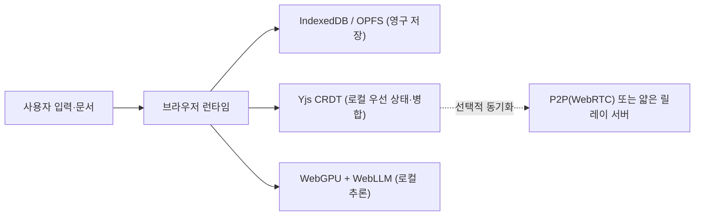

> 김민규(tap_kim)의 「[The Zero-Marginal-Cost Architecture](https://velog.io/@tap_kim/the-zero-marginal-cost-architecture)」(2026.01)와 Ink & Switch의 「[Local-First Software](https://www.inkandswitch.com/local-first/)」를 바탕으로 재구성한 노트다.

## 로컬 우선·제로 한계 비용 아키텍처란

**로컬 우선(Local-First) 아키텍처**는 애플리케이션의 기본 데이터 저장소와 연산 주체를 원격 서버가 아니라 **사용자 기기(브라우저·로컬 스토리지)** 에 두는 설계다. 네트워크가 끊겨도 앱이 즉시 읽고 쓰며, 서버는 선택적 동기화·백업이나 정적 번들 서빙만 맡는다.

여기에 **WebGPU** 기반 브라우저 내 LLM 추론(WebLLM)이 결합되면 **제로 한계 비용(Zero-Marginal-Cost) 아키텍처**로 확장된다. 사용자가 늘어도 백엔드 DB·API 서버·GPU 추론 비용이 사용자 수에 비례해 커지지 않고, 정적 파일 호스팅 비용만 남는다.

## 핵심 기술 스택과 역할

| 계층 | 브라우저 표준·도구 | 기존 서버 아키텍처 대체 대상 |
| --- | --- | --- |
| 저장소 | `IndexedDB`, `OPFS`(Origin Private File System) | 원격 RDBMS / S3 파일 저장소 |
| 상태·충돌 해결 | CRDT(`Yjs`, `Automerge`) + `y-indexeddb` | 중앙 API 상태 동기화·잠금 |
| AI 추론 | WebGPU + `@mlc-ai/web-llm` (4비트 양자화 소형 모델) | OpenAI·Anthropic 등 유료 추론 API |
| 대량 시각화 | WebGL / Three.js `InstancedMesh` | 서버 사이드 렌더링·스트리밍 차트 |
| 배포 | 정적 CDN(Vercel, Cloudflare Pages 등) | 상시 가동 백엔드·컨테이너 클러스터 |

### 브라우저 저장: `IndexedDB`와 `OPFS`

- **IndexedDB**: 구조화된 JSON 객체와 바이너리 블롭을 비동기 저장한다. `Yjs` 문서 업데이트 로그를 `y-indexeddb`로 붙이면 새로고침 뒤에도 작업 상태가 즉시 복원된다.
- **OPFS(Origin Private File System)**: 출처별 비공개 가상 파일 시스템으로, 일반 `IndexedDB`보다 큰 바이너리 파일(SQLite Wasm DB, 캐시된 모델 가중치, 미디어 파일)을 훨씬 빠르게 읽고 쓴다.

### 브라우저 내 AI 추론: WebGPU와 WebLLM

`@mlc-ai/web-llm`은 웹 브라우저에서 별도 백엔드 없이 소형 언어 모델(예: Qwen, Llama, Gemma 계열 4비트 양자화 모델)을 실행한다.

- 모델 가중치는 최초 실행 시 한 번 내려받아 브라우저 Cache API / IndexedDB에 저장한다.
- 프롬프트는 기기 밖으로 나가지 않으므로 민감한 메모·개인 기록도 외부 서버 전송 없이 요약·태깅할 수 있다.
- 자유 서술 대신 JSON Schema 기반 구조화 출력(Structured Output)과 100~300ms 디바운스를 결합하면 소형 모델에서도 UI 연동 안정성을 높일 수 있다.

## 트레이드오프와 한계

서버 비용이 0에 가까워지는 대신 비용이 **사용자 기기의 저장 공간, 메모리, 배터리**로 이동한다.

| 한계 영역 | 구체적 문제 | 완화 전략 |
| --- | --- | --- |
| 콜드 스타트(Cold Start) | 첫 방문 시 수백 MB~수 GB 모델 가중치 다운로드 | 핵심 편집 기능은 즉시 열고 AI 기능만 온디맨드 로드, 진행률 표시 |
| 하드웨어·브라우저 제약 | 저사양 모바일·구형 기기는 VRAM 부족 또는 WebGPU 미지원 | WebGPU 감지 후 미지원 시 규칙 기반 폴백 또는 선택적 BYOK API 연결 |
| 다기기 동기화와 공유 | 순수 로컬 저장만 쓰면 기기 간 데이터가 이어지지 않음 | WebRTC P2P 동기화 또는 최소 릴레이/암호화 스냅샷 백업 추가 |
| 브라우저 스토리지 삭제 위험 | 시크릿 모드나 OS 디스크 부족 시 `IndexedDB`가 비워질 수 있음 | `navigator.storage.persist()` 요청 및 JSON/Markdown 내보내기 제공 |

## 언제 적합한가

- 개인 지식 관리, 글쓰기 도구, 오프라인 우선 다이어그램·그래프 에디터처럼 **단일 사용자 또는 소규모 협업이 중심**이고 데이터 프라이버시가 중요한 앱에 맞는다.
- 반대로 전역 검색 인덱스, 과금·권한 검증, 다수 사용자의 실시간 재고 차감처럼 **중앙 진실 원천(Single Source of Truth)** 이 필수인 비즈니스 로직은 서버를 없앨 수 없다.

## 정리

- 로컬 우선 아키텍처는 브라우저를 단순 뷰어가 아니라 저장(`IndexedDB`·`OPFS`)·동기화(`CRDT`)·연산(`WebGPU`) 런타임으로 쓴다.
- 서버 한계 비용과 프라이버시 노출을 극단적으로 줄이지만, 초기 모델 다운로드, 기기 편차, 브라우저 저장소 휘발성을 설계 단계에서 보완해야 한다.

관련 노트: [[indexeddb|IndexedDB]], [[pwa-offline-storage|PWA와 오프라인 저장소]], [[web-ai-platform-choice|웹 AI 플랫폼 선택]], [[in-browser-preview-runtime|브라우저 안 빌드·프리뷰 환경]]
