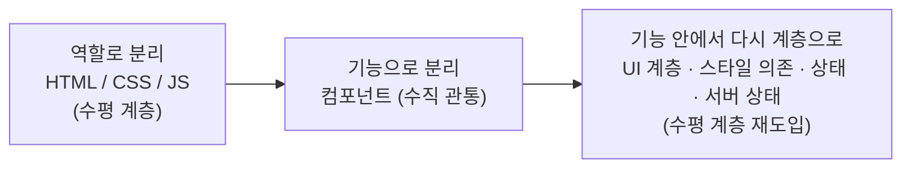

> 테오(teo)의 「[프론트엔드 개발자 관점으로 바라보는 관심사의 분리와 좋은 폴더 구조 (feat. FSD)](https://velog.io/@teo/separation-of-concerns-of-frontend)」(2024.09)를 바탕으로 재구성한 노트다.

## 관심사의 분리란

**관심사의 분리(Separation of Concerns)는** 언어, 모듈, 파일, 함수 같은 단위가 구분 가능한 하나의 역할만 하도록 설계하는 일이다.

이유는 사람의 인지 한계다. 초록 사각형 사이에서 빨간 사각형 하나 찾기는 방해물이 늘어도 금방 끝난다. 조건이 둘만 돼도 멈칫하고, 비슷한 것들이 섞여 있으면 찾는 비용이 크게 뛴다. 비슷한 코드가 구분 없이 뒤섞인 1000줄짜리 파일에서 버그를 찾는 상황이 그렇다. 그래서 분리는 하나의 명확한 기준으로 선명하게 나뉘어야 효과가 있다.

## 분리 축이 바뀌어 온 과정

### 1. 역할: HTML, CSS, JS

웹은 처음부터 구조·표현·동작을 나누려던 게 아니다. 문서 구조(HTML)에 서식(CSS)이 붙고, 동적 변화(JS)가 붙으며 각 언어가 목적대로 자랐다. 결과적으로 역할에 따른 분리가 됐고, 한 언어로 다 하는 방식보다 효율이 좋았다. Ajax 이후 서버는 데이터, 클라이언트는 화면을 맡으며 프론트엔드라는 관심사 자체가 생겼다.

### 2. 기능: 컴포넌트

기능 하나를 만들려면 HTML·CSS·JS·API 계층을 오가야 했다. 컴포넌트는 이 수평 계층을 수직으로 관통해 한 기능에 필요한 것을 한 단위로 묶는다. 층층이 쌓은 케이크를 조각으로 자른 셈이다. 재사용, 독립 개발, 독립 테스트가 쉬워졌다.

그런데 커지자 문제가 나왔다.

| 문제 | 내용 |
| --- | --- |
| 컴포넌트 비대화 | 데이터 관리, 표현, 비즈니스 로직이 한 컴포넌트에 몰린다 |
| 높은 결합도 | props drilling으로 중간 컴포넌트가 위아래에 끼인다 |
| 관리의 어려움 | `/components` 아래 수백 개가 쌓인다 |

### 3. 컴포넌트 안에서 다시 계층으로

컴포넌트라는 틀은 유지하되 그 안을 다시 수평으로 나눴다.

| 시도 | 무엇을 나눴나 | 핵심 |
| --- | --- | --- |
| Atomic Design | UI 컴포넌트의 계층 | 이름보다 **한곳에 몰린 컴포넌트를 나눌 기준**이 생긴 것이 의미 |
| BEM, CSS Modules, CSS-in-JS | HTML과 CSS의 양방향 의존 | 자주 바뀌는 구조(HTML)를 덜 바뀌는 스타일이 **따라가게** 단방향으로 |
| 상태 관리 | 데이터와 화면 | 데이터는 안정적, 화면은 자주 바뀐다. **데이터 → 화면** 단방향 |
| 서버 상태 관리 | 서버 데이터 다루기와 비즈니스 로직 | 캐싱, 재시도, 로딩, 낙관적 업데이트, 페이지네이션은 비즈니스 로직이 아니다. 별도 계층으로 |

공통된 교훈은 두 가지다. 역할만 나누면 서로 영향을 주는 관계(HTML↔CSS)가 남는다. 의존 방향을 한쪽으로 정해야 관리된다. 그리고 한 패러다임(상태 관리)에 모든 걸 넣으면 그것도 비대해진다.

## 관심사의 방향은 여럿이다

| 방향 | 기준 | 예 |
| --- | --- | --- |
| 레이어(Layer) | 역할에 따른 수평 분리 | `api/`, `components/`, `hooks/` |
| 모듈(Module) | 기능·도메인에 따른 수직 분리 | `cart/`, `order/` |
| 데이터 흐름 | 입력에서 출력까지의 경로 | 클린 아키텍처의 동심원 계층 |

계층으로 나누면 독립 기능이 필요해지고, 기능으로 나누면 다시 계층이 필요해진다. 어느 쪽이 맞는 게 아니라 지금 필요한 관심사가 무엇이냐의 문제다.

문제는 폴더 구조가 태그와 달리 **하나만 고를 수 있다**는 점이다. `/cart/api`와 `/api/cart` 중 하나를 골라야 하고, 그 선택이 팀 전체에 영향을 준다. 이것이 폴더 구조 고민의 본질이다. 역할 기반 구조는 작을 때 충분히 좋지만, 커지면 장바구니 같은 관심사가 역할 폴더마다 찢어진다. FSD는 이 문제에 대한 문서화된 표준 하나다([[feature-sliced-design|Feature-Sliced Design]]).

## 시기에 따라 관심사가 바뀐다

프론트엔드는 데이터 → 화면 → 사용자 → 행동 → 데이터로 순환한다. 프로젝트 시기마다 이 중 어디에 관심이 쏠리는지가 달라서 폴더 구조도 따라 바뀐다. 시기·성격별 구조는 [[frontend-folder-structure#프로젝트 시기·성격에 맞게 변용하기|프론트엔드 폴더 구조의 진화]]에 정리했다.

모양이 같다고 같은 컴포넌트로 합치는 것은 흔한 실수다. 데이터가 다르면 UI도 결국 달라지고, 정말 같은 화면이면 데이터 쪽 어댑터로 맞춘다. 자세한 기준은 [[component-splitting#모양이 같다고 중복은 아니다|컴포넌트를 분리하는 기준과 방법]]에 있다.

## 기대어 갈 원칙

| 원칙 | 프론트엔드에서 |
| --- | --- |
| 단일 책임 | 컴포넌트는 화면을 그리고, 상태·비즈니스 로직은 다른 모듈이 맡는다 |
| 의존과 단방향 흐름 | 자주 변하는 것과 덜 변하는 것을 가려 한 방향으로 흐르게 |
| 개방-폐쇄 | `if`가 쌓이기 시작하면 확장 구조로 바꿀 신호 |
| 높은 응집, 낮은 결합 | 언제든 떼어 낼 수 있게, 그러나 같은 역할은 가까이 |

## 정리

- 관심사의 분리는 인지 부하를 줄이려고 한다. 기준은 하나로, 선명하게.
- 프론트엔드는 역할 → 기능(컴포넌트) → 컴포넌트 안의 계층으로 분리 축을 옮겨 왔다.
- 분리만으로는 부족하다. 의존 방향을 한쪽으로 정해야 한다.
- 관심사는 레이어·모듈·데이터 흐름 여러 방향이 있고, 폴더는 하나만 고를 수 있다. 시기별 관심사에 맞춰 구조를 키운다.
- 모양이 같다고 합치지 않는다. 같은 화면을 공유해야 하면 데이터를 어댑터로 맞춘다.

관련 노트: [[frontend-folder-structure|프론트엔드 폴더 구조의 진화]], [[feature-sliced-design|Feature-Sliced Design]], [[frontend-mv-architecture|프론트엔드 MV* 아키텍처의 흐름]], [[frontend-dependency|프론트엔드에서 의존성 관리하기]], [[frontend-solid|프론트엔드와 SOLID 원칙]], [[abstraction-layers|추상화 계층과 데이터 흐름]], [[component-splitting|컴포넌트를 분리하는 기준과 방법]]
