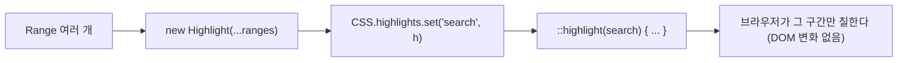

> Korean FE Article 뉴스레터가 소개한 샛별(typo)의 번역 「[성능과 하이라이팅을 모두 잡는 CSS Highlights API](https://velog.io/@typo/high-performance-syntax-highlighting-with-css-highlights-api)」(2026.02, 원문 pavi2410)를 바탕으로, 허용 속성·브라우저 지원은 MDN으로 확인해 재구성한 노트다.

## CSS Custom Highlight API란

**CSS Custom Highlight API는 문서의 임의 구간(Range)에 DOM을 바꾸지 않고 스타일을 입히는 API다.** 검색 결과 강조, 코드 구문 하이라이팅, 맞춤법 밑줄, 협업 편집기의 다른 사람 선택 영역처럼 「글자는 그대로 두고 색만 칠하고 싶은」 곳에 쓴다.

예전에는 칠할 구간을 `<span class="keyword">`나 `<mark>`로 감쌌다. 이 방식은 칠하기 위해 문서 구조를 바꾼다. Highlight API는 **어디를(Range) 칠할지와 어떻게(CSS) 칠할지만** 브라우저에 알려 주고, 문서 트리는 텍스트 노드 하나로 남겨 둔다.

## 구성 요소

| 요소 | 역할 |
| --- | --- |
| `Range` / `StaticRange` | 칠할 구간. 「노드 + 오프셋」 경계 두 개다([[selection-and-range\|Selection과 Range]]) |
| `Highlight` | Range를 모은 Set 비슷한 객체. `add()`·`delete()`·`clear()`·`has()`, `size`, 겹칠 때 쓰는 `priority`, 의미를 알리는 `type`을 가진다 |
| `CSS.highlights` | `HighlightRegistry`. Map 비슷한 전역 등록소로, Highlight를 **이름**으로 등록한다(`set`·`get`·`delete`·`clear`) |
| `::highlight(이름)` | 등록한 이름의 구간에 적용할 스타일을 고르는 의사 요소 |



## 왜 span으로 감싸는 것보다 나은가

| 항목 | span·mark로 감싸기 | Highlight API |
| --- | --- | --- |
| DOM 노드 | 토큰·검색 결과마다 요소가 생긴다. 코드 한 화면이면 수백~수천 개 | 텍스트 노드 하나 그대로 |
| 렌더링 비용 | 노드마다 파싱·스타일 계산·레이아웃·페인트 대상이 늘고 메모리를 더 쓴다 | 구간 정보만 들고, 칠하기는 페인트 단계에서 처리한다 |
| 다시 칠하기 | 기존 span을 걷어 내고 텍스트 노드를 다시 합친 뒤 새로 감싼다 | 등록소에서 지우고 새 Range로 다시 등록한다 |
| 다른 코드와의 충돌 | 리치 텍스트 편집기·React 같은 프레임워크가 관리하는 DOM을 바꿔 상태가 어긋난다. 요소 경계를 넘는 구간은 감싸기 어렵다 | DOM을 건드리지 않으므로 충돌이 없다. Range는 요소 경계를 넘어도 된다 |
| 스타일 범위 | 모든 CSS 속성 | 색·배경·텍스트 장식 계열만 |
| 지원 | 모든 브라우저 | 2025년 이후 주요 브라우저 |

DOM 크기와 렌더링 비용의 관계는 [[browser-rendering|브라우저 렌더링]]에 있다.

## 쓰는 법

### 검색어 강조

텍스트 노드를 `TreeWalker`로 훑어 일치하는 구간마다 Range를 만든다. 대소문자는 단순히 `toLowerCase()`로 맞췄다.

```javascript
function highlightMatches(root, query) {
  if (!('highlights' in CSS)) return // 기능 감지
  CSS.highlights.delete('search')
  if (!query) return

  const needle = query.toLowerCase()
  const ranges = []
  const walker = document.createTreeWalker(root, NodeFilter.SHOW_TEXT)

  for (let node = walker.nextNode(); node; node = walker.nextNode()) {
    const text = node.textContent.toLowerCase()
    let start = text.indexOf(needle)
    while (start !== -1) {
      const range = new Range()
      range.setStart(node, start)
      range.setEnd(node, start + needle.length)
      ranges.push(range)
      start = text.indexOf(needle, start + needle.length)
    }
  }

  CSS.highlights.set('search', new Highlight(...ranges))
}
```

```css
::highlight(search) {
  background-color: #ffeb3b;
  color: black;
}
```

입력마다 문서 전체를 다시 훑으므로, 큰 문서에서는 입력을 디바운스하거나 찾는 범위를 줄인다.

### 구문 하이라이팅

렉서가 돌려준 토큰(`{ type, start, end }`)을 종류별로 묶어, **종류 하나에 Highlight 하나**를 등록한다. 코드 블록이 여러 개면 같은 이름의 Highlight에 Range를 더한다.

```javascript
function highlightCode(el, tokens) {
  const text = el.firstChild // 코드가 텍스트 노드 하나로 들어 있다고 가정
  const added = []

  for (const [type, list] of Map.groupBy(tokens, (t) => t.type)) {
    const name = `code-${type}`
    const highlight = CSS.highlights.get(name) ?? new Highlight()
    for (const { start, end } of list) {
      const range = new Range()
      range.setStart(text, start)
      range.setEnd(text, end)
      highlight.add(range)
      added.push([name, range])
    }
    CSS.highlights.set(name, highlight)
  }

  // 정리 함수: 이 블록의 Range만 빼고, 빈 Highlight는 등록을 지운다
  return () => {
    for (const [name, range] of added) {
      const highlight = CSS.highlights.get(name)
      highlight?.delete(range)
      if (highlight?.size === 0) CSS.highlights.delete(name)
    }
  }
}
```

```css
::highlight(code-keyword) { color: #0000ff; }
::highlight(code-string)  { color: #a31515; }
::highlight(code-comment) { color: #008000; text-decoration: underline dotted; }
```

React에서는 `useEffect` 안에서 `highlightCode`를 부르고 돌려받은 정리 함수를 반환하면, 코드가 바뀌거나 컴포넌트가 사라질 때 등록이 정리된다.

## 동작의 세부

**쓸 수 있는 속성이 정해져 있다.** `::highlight()`에는 `color`, `background-color`, `text-decoration`과 그 하위 속성, `text-shadow`, `-webkit-text-stroke-color`·`-webkit-text-fill-color`·`-webkit-text-stroke-width`만 적용된다. `background-image`는 무시된다. 레이아웃을 바꾸는 `font-weight`, `font-style`, `padding` 같은 속성은 쓸 수 없으므로, 굵게·기울임으로 토큰을 구분하던 테마는 색과 밑줄로 바꿔야 한다. 칠하기가 레이아웃을 바꾸지 않는다는 제약이 곧 이 API가 빠른 이유다.

**겹치면 `priority`가 정한다.** 두 Highlight가 같은 글자를 덮으면 `priority` 숫자가 큰 쪽의 스타일이 위에 칠해진다. 검색 강조를 구문 색 위에 보이게 하려면 검색 쪽 `priority`를 높인다.

**Range는 살아 있고 StaticRange는 고정이다.** Highlight는 둘 다 받는다. `Range`는 DOM이 바뀌면 경계가 따라 움직이지만 그만큼 추적 비용이 있다. `StaticRange`는 만들 때의 위치에 고정돼 가볍다. 어느 쪽이든 **텍스트 내용이 바뀌면 칠할 위치를 다시 계산**하는 것은 개발자 몫이다.

**클릭 위치의 하이라이트 찾기**: `CSS.highlights.highlightsFromPoint(x, y)`는 화면 좌표에 걸린 Highlight와 Range 목록을 돌려준다. 하이라이트를 눌렀을 때 메뉴를 띄우는 데 쓸 수 있지만, 아직 일부 브라우저만 지원한다(Limited availability).

**접근성**: 칠하기는 시각 효과일 뿐이라 보조 기술에 「강조됨」이 전달되지 않는다. `type`을 `spelling-error`·`grammar-error`로 두면 그 의미를 노출하려는 장치가 있지만 플랫폼마다 지원이 다르다. 강조 자체가 내용의 의미라면(검색 결과 개수를 읽어 줘야 하는 경우 등) `<mark>`나 별도의 텍스트 안내를 함께 쓴다.

## 브라우저 지원

Chrome·Edge 105, Safari 17.2에 이어 **Firefox 140(2025년 6월)이 지원하면서 Baseline 2025**가 됐다. 그 이전 브라우저까지 받쳐야 하면 `'highlights' in CSS`로 감지해 없을 때만 span 방식으로 되돌린다. `highlightsFromPoint()`는 Baseline에 들지 않았다.

## 한계

- 칠하기만 한다. 글자 굵기·크기·여백처럼 레이아웃에 영향을 주는 표현은 할 수 없다.
- Range는 텍스트 오프셋에 묶여 있어, 내용이 바뀌는 편집기에서는 변경마다 구간을 다시 계산하는 로직이 필요하다.
- 하이라이트 구간은 요소가 아니라서 이벤트 리스너를 달 수 없다. 클릭 처리는 좌표로 찾아야 한다.
- 이름 공간이 문서 전역이다. 여러 컴포넌트가 같은 이름을 쓰면 서로의 Range를 지울 수 있으니 접두사로 나눈다.

## 정리

- 칠하기만 하려면 DOM을 감싸지 말고 Range + `Highlight` + `CSS.highlights` + `::highlight()`를 쓴다.
- DOM 노드가 늘지 않아 큰 코드 블록·긴 문서의 하이라이팅이 가볍고, 편집기·프레임워크의 DOM과 충돌하지 않는다.
- 허용 속성은 색·배경·텍스트 장식·그림자 계열뿐이다. 굵게·기울임 구분은 색으로 바꾼다.
- 겹침은 `priority`, 정리는 `delete`·`clear`, 텍스트 변경 뒤에는 Range 재계산.
- 2025년 6월부터 Baseline이다. 의미 전달이 필요하면 `<mark>`나 텍스트 안내를 함께 쓴다.

관련 노트: [[selection-and-range|Selection과 Range]], [[dom-manipulation|DOM 조작]], [[browser-rendering|브라우저 렌더링]], [[css-houdini|CSS Houdini]], [[css-progressive-enhancement|CSS 점진적 향상]]
