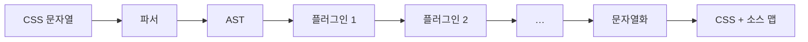

> 「[PostCSS – A Comprehensive Introduction](https://www.smashingmagazine.com/2015/12/introduction-to-postcss/)」, 「[PostCSS – Sass Killer or Preprocessing Pretender?](https://ashleynolan.co.uk/blog/postcss-a-review)」을 바탕으로, 현재 도구 구성은 postcss-preset-env·Vite·Lightning CSS 문서로 확인해 재구성한 노트다.

## PostCSS란

PostCSS는 **JS 플러그인으로 CSS를 변환하는 도구**다. CSS를 파싱해 추상 구문 트리(AST)로 만들고, 플러그인이 그 트리를 고친 뒤 다시 CSS 문자열로 내보낸다. PostCSS 자체는 API일 뿐 아무 변환도 하지 않는다. 기능은 전부 플러그인에서 나온다. Autoprefixer를 만든 Andrey Sitnik이 만들었고, 소스 맵을 함께 만든다.



"후처리기(post-processor)"라는 이름과 달리, 빌드 단계에서 확장 문법을 CSS로 바꾼다는 점에서 전처리기와 같은 자리에 선다.

## Sass와 무엇이 다른가

| | Sass | PostCSS |
| --- | --- | --- |
| 구성 | 변수·중첩·믹스인·제어문이 **한 묶음** | 빈 상태에서 **필요한 플러그인만** 추가 |
| 문법 | `.scss` 고유 문법 | 기본은 표준 CSS. 플러그인이 정하는 문법 |
| 확장 | 컴파일러에 기능이 들어가야 한다 | 플러그인 하나를 직접 써서 넣는다 |
| 기능 제한 | 어렵다. 팀 누구나 `@extend`·깊은 중첩을 쓸 수 있다 | 허용할 기능만 켜 둘 수 있다 |
| Sass가 못 하는 일 | - | 브라우저 대상에 맞춘 접두사·폴리필, 미디어 쿼리 병합, 린트(stylelint도 PostCSS 기반) |

둘은 배타적이지 않다. Sass로 컴파일한 뒤 PostCSS로 Autoprefixer를 돌리는 구성이 흔했다. Sass를 PostCSS로 그대로 옮기려 하면 믹스인 문법 같은 빈틈이 생긴다. Sass의 현재 위치는 [[sass|Sass]]에 있다.

## 대표 플러그인

| 플러그인 | 하는 일 |
| --- | --- |
| **Autoprefixer** | 지원 대상 브라우저에 필요한 벤더 접두사(`-webkit-`)만 붙인다. 접두사 없이 표준 속성만 쓰면 된다 |
| **postcss-preset-env** | 새 CSS 문법을 대상 브라우저가 이해하는 문법으로 낮춘다. Autoprefixer를 포함한다 |
| postcss-import | `@import`를 빌드 때 한 파일로 합친다 |
| postcss-nesting | 표준 CSS 중첩 문법을 펼친다 |
| cssnano | 압축 |
| stylelint | 린트 규칙 검사 |

## browserslist로 대상 정하기

postcss-preset-env와 Autoprefixer는 **browserslist** 설정을 읽어, 대상 브라우저에서 이미 지원하는 기능은 건너뛴다. 대상이 바뀌면 설정만 고치면 불필요한 폴백이 빠진다.

```text
# .browserslistrc
> 0.5%, last 2 versions, not dead
```

```js
// postcss.config.js
export default {
  plugins: { 'postcss-preset-env': { stage: 2 } },   // 기본값 2
}
```

postcss-preset-env는 기능마다 표준화 단계(stage 0 실험 ~ 4 안정)를 붙인 목록 **cssdb**를 쓴다. 기본은 stage 2 이상만 변환한다.

### 미래 문법을 미리 쓸 때의 위험

"내일의 CSS를 오늘 쓴다"는 말은 매력적이지만, 스펙은 구현되기 전에 바뀐다. 실제로 커스텀 속성 믹스인 `@apply`는 플러그인으로 한때 유행했다가 스펙에서 폐기됐다. 낮은 stage 기능을 쓰면 언젠가 내 코드를 다시 고쳐야 할 수 있다. 변환의 한계는 [[css-progressive-enhancement|CSS 점진적 향상]]에 있다.

## 지금의 역할 분담

PostCSS는 여전히 넓게 쓰이지만, 변환·접두사·압축을 한 번에 하는 **Lightning CSS**(Rust로 작성, Parcel 팀)가 같은 자리의 대안으로 쓰인다. Tailwind CSS v4는 내부에 채택했고, Vite는 실험적 옵션으로 지원한다.

| 도구 | 기본 CSS 처리 |
| --- | --- |
| Vite | PostCSS(`postcss.config.*`가 있으면 적용). `css.transformer: 'lightningcss'`로 바꿀 수 있다(실험적 옵션) |
| Next.js | 내장 PostCSS 설정. `postcss.config.*`로 덮어쓴다 |
| Tailwind CSS v4 | 자체 엔진이 Lightning CSS로 접두사·문법 낮추기를 처리한다. PostCSS 환경에서는 `@tailwindcss/postcss` 플러그인으로 붙인다 |
| Lightning CSS 단독 | browserslist 대상으로 문법 낮추기, 접두사, CSS Modules, 압축 |

과거에는 Gulp·Grunt 태스크(`gulp-postcss`)로 PostCSS를 돌렸다. 지금은 번들러가 CSS 파이프라인을 내장하고, 설정 파일 하나만 두면 된다.

## 정리

- PostCSS는 CSS를 AST로 다루는 **플러그인 플랫폼**이다. 기능은 고른 플러그인만큼이다.
- 핵심 쓰임은 **browserslist 대상에 맞춘 변환**(Autoprefixer, postcss-preset-env)이다.
- 표준화가 덜 된 문법은 미리 쓰지 않는다. 스펙이 바뀌면 코드를 다시 고친다.
- 새 프로젝트는 번들러 기본값을 쓰고, 속도가 필요하면 Lightning CSS를 검토한다.

관련 노트: [[sass|Sass: 파일 구조, 믹스인과 @extend]], [[css-progressive-enhancement|CSS 점진적 향상: 폴백과 피처 쿼리]], [[bundlers-and-vite|번들러의 역사와 Vite]], [[utility-first-css|유틸리티 우선 CSS]]
