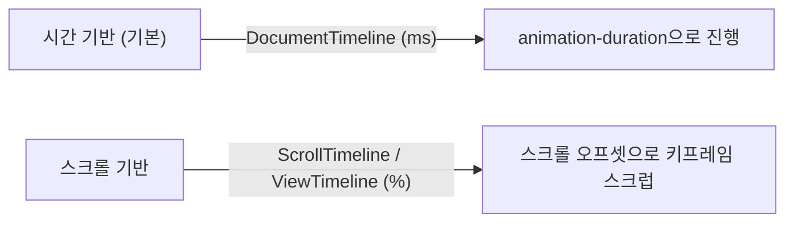

> Josh Comeau의 뉴스레터 「Scroll-driven animations」(2026.04)와 MDN 「[Scroll-driven animation timelines](https://developer.mozilla.org/en-US/docs/Web/CSS/Guides/Scroll-driven_animations/Timelines)」를 바탕으로 재구성한 노트다.

## 스크롤 기반 애니메이션이란

**스크롤 기반 애니메이션(Scroll-Driven Animations)** 은 `@keyframes` 애니메이션의 진행도를 시간(`animation-duration`) 대신 **스크롤 위치**에 묶는 CSS 표준 기능이다. 기존에는 스크롤에 맞춰 요소를 움직이려면 `scroll` 이벤트 리스너나 `IntersectionObserver`로 JavaScript에서 값을 계산해야 했다. 메인 스레드가 바쁘면 프레임이 밀리고 버벅임이 생기기 쉽다.

CSS `animation-timeline`을 사용하면 브라우저가 스크롤과 애니메이션을 **컴포지터 스레드(compositor thread)** 에서 함께 처리할 수 있다. `transform`, `opacity`처럼 합성에만 관여하는 속성을 움직이면 메인 스레드가 JavaScript 작업으로 바빠도 60fps 이상으로 부드럽게 동작한다.



## 두 가지 타임라인: `scroll()`과 `view()`

스크롤 타임라인은 무엇을 기준으로 진행률(0%~100%)을 계산하는지에 따라 둘로 나뉜다.

| 타임라인 | 기준 | 익명 함수 | 이름 지정 속성 | 대표 용도 |
| --- | --- | --- | --- | --- |
| 스크롤 진행(Scroll Progress) | 스크롤 컨테이너의 스크롤 위치 | `scroll(<scroller> <axis>)` | `scroll-timeline-name`, `scroll-timeline-axis` | 페이지 상단 읽기 진행 바, 패럴랙스 배경 |
| 뷰 진행(View Progress) | 대상 요소가 스크롤포트에 들어오고 나가는 위치 | `view(<axis> <inset>)` | `view-timeline-name`, `view-timeline-inset` | 화면에 들어올 때 페이드인, 카드 확대·축소 |

### `scroll()`로 읽기 진행 바 만들기

`scroll()`은 가장 가까운 스크롤 조상(`nearest`), 루트(`root`), 또는 자기 자신(`self`)의 스크롤 비율을 0%에서 100%로 바꾼다.

```css
@keyframes grow-progress {
  from { transform: scaleX(0); }
  to { transform: scaleX(1); }
}

.reading-progress {
  position: fixed;
  inset-block-start: 0;
  inset-inline: 0;
  height: 4px;
  transform-origin: 0 50%;
  animation: grow-progress 1ms linear both;
  animation-timeline: scroll(root block);
}
```

### `view()`로 요소 등장 애니메이션 만들기

`view()`는 요소 자체가 스크롤 영역에 막 들어오기 시작할 때(0%)부터 완전히 빠져나갈 때(100%)까지의 진행률을 추적한다.

```css
@keyframes reveal {
  from {
    opacity: 0;
    transform: translateY(24px) scale(0.96);
  }
  to {
    opacity: 1;
    transform: translateY(0) scale(1);
  }
}

.card {
  animation: reveal 1ms linear both;
  animation-timeline: view();
  animation-range: entry 0% cover 40%;
}
```

## `animation-range`와 선언 순서 주의점

`view()`의 기본 0%~100% 구간은 요소의 첫 1px이 화면 아래로 들어오는 순간부터 마지막 1px이 화면 위로 사라지는 순간까지다. 대개 요소가 **완전히 들어온 뒤**(예: `cover 40%`)에는 애니메이션이 끝나 있어야 자연스럽다. 이때 `animation-range`로 시작·종료 지점을 자른다.

| 키워드 | 의미 | 자주 쓰는 조합 |
| --- | --- | --- |
| `entry` | 요소가 스크롤포트에 막 진입하는 구간 | `entry 0% entry 100%` (완전히 들어올 때까지) |
| `exit` | 요소가 스크롤포트에서 빠져나가는 구간 | `exit 0% exit 100%` |
| `cover` | 진입 시작부터 완전히 빠져나갈 때까지 전체 구간 | `entry 0% cover 40%` |
| `contain` | 요소가 스크롤포트 안에 온전히 담긴 구간 | `contain 0% contain 100%` |

실무에서 흔히 겪는 함정은 세 가지다.

1. **`animation` 단축 속성 순서**: `animation: ...` 단축 속성은 `animation-timeline`을 기본값 `auto`로 초기화한다. 반드시 `animation` 단축 속성 **뒤에** `animation-timeline`과 `animation-range`를 선언한다.
2. **명시적 `animation-duration`**: `animation-duration`을 생략하면 기본값 `0s`가 적용되는데, Firefox 159+ 등에서는 시간이 0이면 애니메이션이 적용되지 않는 경우가 있어 `1ms` 또는 `auto`를 명시한다.
3. **형제·외부 요소 연결**: 조상·자손 관계가 아닌 다른 요소의 스크롤을 따라가려면 스크롤 컨테이너에 `scroll-timeline-name: --box`, 공통 조상에 `timeline-scope: --box`, 대상 요소에 `animation-timeline: --box`를 둔다.

## 브라우저 지원과 점진적 향상

2026년 10월 Firefox 159가 지원에 합류하면서 Chrome 115+, Edge 115+, Safari 26+, Firefox 159+ 모두에서 동작하는 **Baseline Newly Available** 기능이 됐다. 구형 브라우저와 모션 민감 사용자를 위해 `@supports`와 `prefers-reduced-motion`을 함께 감싼다.

```css
@media (prefers-reduced-motion: no-preference) {
  @supports (animation-timeline: view()) {
    .card {
      animation: reveal 1ms linear both;
      animation-timeline: view();
      animation-range: entry 0% cover 40%;
    }
  }
}
```

## 한계

- `animation-timeline`은 `transform`·`opacity` 같은 합성 속성만 쓸 때 컴포지터 이점을 온전히 얻는다. `width`·`height`·`top`처럼 레이아웃을 다시 계산하는 속성을 넣으면 스크롤마다 리플로우가 일어난다.
- 특정 시점에 클래스 토글이나 데이터 페칭 같은 **부수 효과**를 일으켜야 한다면 스크롤 기반 CSS 애니메이션이 아니라 `IntersectionObserver`가 맞다.

## 정리

- `scroll()`은 컨테이너의 스크롤 비율, `view()`는 요소의 뷰포트 통과 비율을 키프레임 진행률로 바꾼다.
- `animation-timeline`은 `animation` 단축 속성 뒤에 적고, `animation-duration: 1ms`와 `animation-range`를 함께 맞춰야 의도대로 동작한다.
- 스크롤에 매끄럽게 따라가는 시각 효과는 CSS로, 상태 변경·지연 로딩 트리거는 `IntersectionObserver`로 역할을 나눈다.

관련 노트: [[css-animation|CSS 애니메이션: transition과 @keyframes]], [[css-progressive-enhancement|CSS 점진적 향상: 폴백과 피처 쿼리]], [[view-transitions|View Transitions: 화면 전환 애니메이션]]
