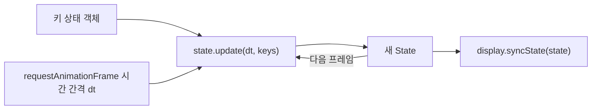

> Marijn Haverbeke의 『[Eloquent JavaScript](https://eloquentjavascript.net/)』(4판, 2024) 16장 「Project: A Platform Game」과 17장 「Drawing on Canvas」의 게임 부분을 바탕으로 재구성한 노트다.

## 구성 요소

플랫폼 게임(점프하며 옆으로 진행하는 2D 게임)은 **변하지 않는 배경 격자** 위에 **움직이는 요소(액터)** 를 겹친 모양이다. 배경 칸은 빈칸·벽·용암 중 하나이고, 액터(플레이어, 동전, 움직이는 용암)는 격자에 묶이지 않고 소수 좌표로 부드럽게 움직인다.

| 부품 | 책임 |
| --- | --- |
| `Level` | 레벨 문자열을 읽어 배경 격자(`rows`)와 시작 액터 목록을 만든다. 변하지 않는다 |
| `State` | 지금 이 순간의 게임: 레벨, 액터 배열, 상태(`playing`·`won`·`lost`). 갱신하면 **새 State**를 돌려준다 |
| 액터(`Player`, `Coin`, `Lava`) | 같은 인터페이스: `pos`·`size`·`type`과 `update(time, state, keys)`, `collide(state)` |
| `Vec` | 2차원 벡터. `plus`, `times(배수)` |
| 디스플레이 | `syncState(state)`로 상태를 그리고, `clear()`로 치운다. DOM 판과 Canvas 판을 갈아 끼울 수 있다 |
| 게임 루프 | 매 프레임 `state = state.update(dt, keys)` → `display.syncState(state)` |



## 레벨을 문자열로 적는다

사람이 읽고 고치기 쉽도록 레벨을 글자 격자로 적는다.

```text
......................
..#................#..
..#..............=.#..
..#.........o.o....#..
..#.@......#####...#..
..#####............#..
......#++++++++++++#..
......##############..
```

`.` 빈칸, `#` 벽, `+` 용암, `@` 플레이어 시작점, `o` 동전, `=` 좌우로 오가는 용암, `|` 위아래로 오가는 용암, `v` 떨어졌다 제자리로 돌아오는 용암. 글자 → 배경 종류(문자열) 또는 액터 클래스 대응표(`levelChars`)를 두고, 액터 글자 자리는 배경을 빈칸으로 둔 뒤 클래스의 `static create(pos, ch)`로 액터를 만든다. 데이터(레벨)와 로직(클래스)이 분리돼 레벨 추가가 쉽다.

## 상태는 불변: 매 프레임 새로 만든다

`State.update`와 액터의 `update`는 기존 객체를 고치지 않고 **새 객체를 돌려준다**(영속 자료 구조, [[functional-programming|함수형 프로그래밍]]의 불변성). 이전 상태와 다음 상태를 나란히 비교하거나, 판정을 단계별로 쌓기가 쉽다.

```javascript
State.prototype.update = function (time, keys) {
  const actors = this.actors.map((a) => a.update(time, this, keys))
  let newState = new State(this.level, actors, this.status)
  if (newState.status != "playing") return newState   // 끝난 게임은 더 바뀌지 않는다
  const player = newState.player
  if (this.level.touches(player.pos, player.size, "lava")) {
    return new State(this.level, actors, "lost")
  }
  for (const actor of actors) {
    if (actor != player && overlap(actor, player)) newState = actor.collide(newState)
  }
  return newState
}
```

- 동전의 `collide`는 자신을 뺀 액터 목록으로 새 State를 만들고, 남은 동전이 없으면 `won`으로 바꾼다. 용암의 `collide`는 `lost`.
- 모든 인스턴스가 같은 값(크기 `Vec`)은 인스턴스가 아니라 **프로토타입에 한 번** 둔다(`Player.prototype.size = new Vec(0.8, 1.5)`). getter로 두면 읽을 때마다 새 객체를 만든다.
- 동전의 출렁임은 `Math.sin(위상)`으로 만든다. 위상 시작값을 `Math.random() * Math.PI * 2`로 흩어 모든 동전이 똑같이 움직이지 않게 한다.

## 움직임: 시간 간격 × 속도

게임 시간을 작은 간격으로 쪼개고, 간격마다 **속도 × 간격**만큼 옮긴다. 속도는 "초당 칸 수"로 적는다. 프레임 수가 아니라 실제 경과 시간에 비례하므로 기기 성능과 무관하게 같은 빠르기로 움직인다.

```javascript
function runAnimation(frameFunc) {
  let lastTime = null
  function frame(time) {
    if (lastTime != null) {
      const timeStep = Math.min(time - lastTime, 100) / 1000  // 최대 0.1초, 초 단위로
      if (frameFunc(timeStep) === false) return              // false를 돌려주면 멈춘다
    }
    lastTime = time
    requestAnimationFrame(frame)
  }
  requestAnimationFrame(frame)
}
```

**시간 간격에 상한을 둔다.** 탭이 숨겨지면 `requestAnimationFrame`이 멈췄다가, 돌아왔을 때 숨어 있던 시간 전체가 한 번의 간격으로 들어온다. 그대로 쓰면 플레이어가 한 프레임에 바닥을 뚫고 떨어진다. `requestAnimationFrame`의 동작은 [[timers|타이머]]와 [[js-animation|JavaScript 애니메이션]]에 있다.

레벨 하나를 Promise로 감싸면 게임 전체 흐름을 `async` 함수로 순서대로 쓸 수 있다.

```javascript
async function runGame(plans, Display) {
  for (let level = 0; level < plans.length; ) {
    const status = await runLevel(new Level(plans[level]), Display) // 끝나면 "won"·"lost"로 resolve
    if (status == "won") level++                                     // 지면 같은 레벨 재시작
  }
}
```

## 충돌 판정

일반적인 물리 시뮬레이션은 **물리 엔진**의 몫이다. 단순한 게임은 사각형끼리만, 단순하게 처리한다.

### 배경 격자와의 충돌

사각형의 네 변을 `Math.floor`·`Math.ceil`로 내림·올림하면 그 사각형이 걸치는 격자 칸 범위가 나온다. 범위를 돌며 원하는 종류의 칸이 있으면 닿은 것이다. **레벨 밖은 벽으로 친다.** 플레이어가 세상 밖으로 나가지 않고, 배열 범위 밖을 읽는 실수도 막는다.

```javascript
Level.prototype.touches = function (pos, size, type) {
  for (let y = Math.floor(pos.y); y < Math.ceil(pos.y + size.y); y++) {
    for (let x = Math.floor(pos.x); x < Math.ceil(pos.x + size.x); x++) {
      const outside = x < 0 || x >= this.width || y < 0 || y >= this.height
      if ((outside ? "wall" : this.rows[y][x]) == type) return true
    }
  }
  return false
}
```

### 액터끼리의 충돌 (AABB)

축에 나란한 두 사각형은 **x축으로도 겹치고 y축으로도 겹칠 때** 겹친다.

```javascript
function overlap(a, b) {
  return a.pos.x + a.size.x > b.pos.x && a.pos.x < b.pos.x + b.size.x &&
         a.pos.y + a.size.y > b.pos.y && a.pos.y < b.pos.y + b.size.y
}
```

### 움직이기 전에 검사하고, 축별로 따로 옮긴다

새 위치가 벽 안이면 **그 이동을 통째로 취소**한다. 반응은 액터마다 다르다: 플레이어는 멈추고, 오가는 용암은 속도에 -1을 곱해 되돌아가고, 떨어지는 용암은 시작 위치로 돌아간다.

플레이어는 **x와 y를 따로** 옮긴다. 바닥에 닿았다고 옆으로 못 가면 안 되고, 벽에 붙었다고 떨어지지 않으면 안 되기 때문이다.

```javascript
const playerXSpeed = 7, gravity = 30, jumpSpeed = 17   // 숫자는 해 보면서 손맛으로 정한다

Player.prototype.update = function (time, state, keys) {
  let xSpeed = 0
  if (keys.ArrowLeft) xSpeed -= playerXSpeed
  if (keys.ArrowRight) xSpeed += playerXSpeed
  let pos = this.pos
  const movedX = pos.plus(new Vec(xSpeed * time, 0))
  if (!state.level.touches(movedX, this.size, "wall")) pos = movedX

  let ySpeed = this.speed.y + time * gravity             // 중력으로 가속
  const movedY = pos.plus(new Vec(0, ySpeed * time))
  if (!state.level.touches(movedY, this.size, "wall")) pos = movedY
  else if (keys.ArrowUp && ySpeed > 0) ySpeed = -jumpSpeed // 아래로 가다 막혔다 = 땅 위 → 점프
  else ySpeed = 0
  return new Player(pos, new Vec(xSpeed, ySpeed))
}
```

이동 취소 방식은 물체가 실제로 닿기 전에 멈추므로, 간격이 크면 플레이어가 바닥 위에 떠 보인다. **간격을 작게 유지해 이 오차를 숨긴다.** 더 정확하지만 복잡한 방법은 정확한 충돌 지점을 계산해 거기까지 옮기는 것이다.

## 입력: 누른 순간이 아니라 누르고 있는 동안

게임에서는 키를 누를 때 한 번이 아니라 **누르고 있는 동안 계속** 효과가 있어야 한다. `keydown`·`keyup`을 같은 핸들러로 받아 키별 눌림 상태를 객체에 적어 두고, 게임 루프가 매 프레임 그 객체를 읽는다. 방향키가 페이지를 스크롤하지 않도록 `preventDefault()`도 한다.

```javascript
function trackKeys(keys) {
  const down = Object.create(null)
  function track(event) {
    if (keys.includes(event.key)) {
      down[event.key] = event.type == "keydown"
      event.preventDefault()
    }
  }
  window.addEventListener("keydown", track)
  window.addEventListener("keyup", track)
  return down
}
const arrowKeys = trackKeys(["ArrowLeft", "ArrowRight", "ArrowUp"])
```

이벤트 → 상태 기록 → 루프에서 읽기로 나누면 입력 처리와 시뮬레이션이 섞이지 않는다. `key`와 `code`의 차이는 [[ui-input-events|마우스·포인터·키보드 이벤트]]에 있다.

## 그리기: 디스플레이를 인터페이스 뒤에 둔다

게임 로직은 디스플레이 **생성자를 인자로 받고**, `syncState`·`clear`만 부른다. 같은 게임에 다른 그리기 방식을 끼울 수 있다.

| | DOM 디스플레이 | Canvas 디스플레이 |
| --- | --- | --- |
| 배경 | `<table>`로 **한 번만** 그린다(칸 = `<td>`, 종류 = 클래스) | 매 프레임 보이는 칸만 다시 그린다. 그린 도형은 픽셀이라 옮기거나 지울 수 없다 |
| 액터 | 매 프레임 액터 레이어를 지우고 절대 위치 요소로 다시 만든다 | `drawImage`로 스프라이트 시트의 해당 영역을 그린다 |
| 화면 이동 | 감싼 요소의 스크롤 위치 | 자체 뷰포트 좌표. `Math.max`·`Math.min`으로 레벨 밖을 보이지 않게 고정 |
| 상태 표현 | 감싼 요소에 `won`·`lost` 클래스를 달고 `.lost .player` 같은 CSS로 | 지울 때 배경색을 다르게 |
| 좌우 반전 | - | 마지막 이동 방향을 기억하고, 변환(`scale(-1, 1)`)으로 스프라이트를 뒤집어 그린다 |

- 게임 단위(1칸)와 픽셀은 `scale` 상수(예: 20)로 바꾼다. 로직은 칸 단위로만 생각한다.
- 액터 수가 적으면 DOM 요소를 재사용하는 장부 정리보다 **매번 지우고 다시 만드는 편이 단순하다.** 최적화는 필요해질 때 한다.
- 플레이어가 화면 가장자리에 가까워지면 뷰포트를 옮겨 늘 일정 여백 안에 둔다.

HTML·SVG·Canvas 중 무엇으로 그릴지는 [[canvas-2d|Canvas 2D]]의 비교표를 따른다. 이 정도 게임은 글자도, 요소별 마우스 처리도, 엄청난 수의 요소도 없어서 셋 중 무엇이든 된다.

## 정리

- 게임 = 불변 **레벨** + 매 프레임 새로 만드는 **상태** + 같은 인터페이스의 **액터** + 갈아 끼울 수 있는 **디스플레이**.
- 움직임은 **속도 × 경과 시간**. 시간 간격에 상한을 둬 탭 전환 뒤의 거대한 한 걸음을 막는다.
- 충돌은 이동 전에 검사해 취소하고, x·y를 따로 옮긴다. 액터끼리는 AABB 겹침, 배경은 격자 칸 범위 검사. 레벨 밖은 벽이다.
- 키는 눌림 상태 객체로 추적하고 루프에서 읽는다.
- 레벨을 Promise로 감싸면 게임 진행을 `async` 반복문으로 쓴다.

관련 노트: [[canvas-2d|Canvas 2D]], [[js-animation|JavaScript 애니메이션]], [[functional-programming|함수형 프로그래밍]], [[ui-input-events|마우스·포인터·키보드 이벤트]], [[multiplayer-game-server|멀티플레이 게임 서버 설계]]
