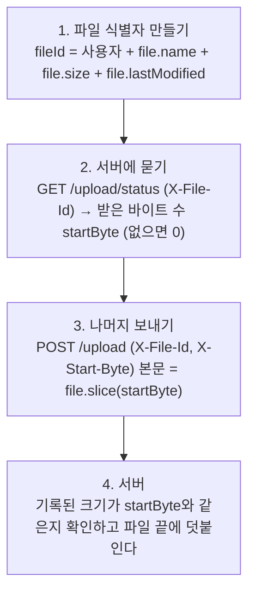

> 직접 정리한 내용에 Wes Bos의 「Beginner JavaScript」 강의 노트(wesbos.com/javascript)와 javascript.info(모던 JavaScript 튜토리얼)의 「fetch」, 「FormData」, 「fetch 다운로드 진행 상황 추적하기」, 「fetch 중단하기」, 「fetch와 Cross-Origin 요청」, 「fetch API」, 「URL 객체」, 「XMLHttpRequest」, 「업로드 재개하기」 글을 함께 참고해 재구성한 노트다. 「[Abortable fetch](https://developer.chrome.com/blog/abortable-fetch)」와 MDN 「[Fetch API](https://developer.mozilla.org/en-US/docs/Web/API/Fetch_API)」로 취소의 세부·역사와 지연 fetch를 보강했다. 「[Must-Know-About-Frontend: AJAX](https://github.com/baeharam/Must-Know-About-Frontend/blob/main/Notes/javascript/ajax.md)」의 내용을 더해 보강했다.

**AJAX(Asynchronous JavaScript And XML)** 는 페이지 전체를 새로 받지 않고, JavaScript로 서버와 **비동기 통신**해 필요한 데이터만 받아 화면 일부를 갱신하는 기법이다. SPA와 CSR의 기반이 되는 기술이다.

## 개요

- 원래 `XMLHttpRequest`(XHR) 객체로 서버와 통신했다.
- JSON, XML, HTML, 일반 텍스트 등 다양한 형식을 주고받을 수 있다.
- 이름의 X는 XML이지만, 지금은 더 가볍고 JavaScript 객체와 바로 호환되는 **JSON**을 주로 쓴다.

## 요청을 보내는 방법

### XMLHttpRequest (과거 방식)

```javascript
const xhr = new XMLHttpRequest()
xhr.open('GET', '/api/users')
xhr.onload = () => console.log(JSON.parse(xhr.responseText))
xhr.send()
```

콜백 기반이라 코드가 장황하다. 지금은 직접 쓸 일이 거의 없다. 옛 코드를 읽을 때 알아 둘 점만 정리한다.

| 항목 | 내용 |
| --- | --- |
| 흐름 | `open(method, url)`은 설정만 하고, 연결은 `send(body)`에서 시작한다 |
| 결과 | `xhr.status`, `xhr.response`. `xhr.responseType`을 `'json'`·`'blob'`·`'arraybuffer'`로 두면 변환해 준다. `responseText`·`responseXML`은 옛 이름이다 |
| 이벤트 | `loadstart → progress → load / error / abort / timeout → loadend`. 4xx·5xx도 `load`다. `readystatechange`와 `readyState` 0~4는 이벤트가 생기기 전의 방식이다 |
| 기타 | `xhr.timeout`(ms), `xhr.abort()`, 교차 출처 쿠키는 `xhr.withCredentials = true`. `open(…, false)` 동기 요청은 페이지를 멈추므로 쓰지 않는다 |
| 지금도 쓰는 이유 | **업로드 진행률**(`xhr.upload.onprogress`). 아래 「진행률」 절 |

### fetch (브라우저 내장, Promise 기반)

```javascript
async function getUsers() {
  const response = await fetch('/api/users')
  if (!response.ok) {
    throw new Error(`HTTP ${response.status}`) // fetch는 4xx/5xx에서 reject되지 않는다
  }
  return response.json()
}
```

`fetch`는 Promise를 **두 번** 기다린다. 첫 `await`는 헤더가 도착한 `Response` 객체를, 두 번째 `response.json()`(또는 `.text()`·`.blob()`)은 본문을 다 받아 변환한 값을 준다. fetch는 응답 형식을 짐작하지 않으므로 어떤 형식으로 읽을지 직접 고른다.

요청을 바꾸려면 두 번째 인자로 옵션 객체를 넘긴다.

```javascript
const params = new URLSearchParams({ q: 'pizza', page: 2 }) // 'q=pizza&page=2', 값은 자동 인코딩
const response = await fetch(`/api/recipes?${params}`, {
  method: 'POST',
  headers: {
    Accept: 'application/json',          // 이런 형식으로 응답해 달라
    'Content-Type': 'application/json',  // 보내는 본문의 형식
  },
  body: JSON.stringify({ title: '새 레시피' }), // 객체는 문자열로 바꿔 보낸다
})
```

- **쿼리 파라미터**는 `?` 뒤에 `키=값`을 `&`로 잇는다. 이름과 여러 값을 담는 방식(쉼표, 반복 키)은 API마다 다르니 문서를 본다. 문자열을 직접 이어 붙이기보다 `URLSearchParams`나 `URL` 객체를 쓰면 인코딩을 빠뜨리지 않는다.
- 같은 주소가 HTML·JSON·텍스트를 모두 줄 수 있는 API는 `Accept` 헤더로 형식을 고른다.

### Response와 본문

| 확인할 것 | 방법 |
| --- | --- |
| 성공 여부 | `response.ok`(200~299), `response.status`, `statusText` |
| 응답 헤더 | `response.headers.get('Content-Type')`, `for (const [k, v] of response.headers)`. Map처럼 쓰지만 Map은 아니다 |
| 최종 주소 | `response.url`, 리다이렉트를 거쳤으면 `response.redirected === true` |
| 본문 | `json()`, `text()`, `blob()`, `arrayBuffer()`, `bytes()`, `formData()`, 스트림 `body` 중 **하나만, 한 번만** 읽는다. 두 번 읽으면 `TypeError: body used already`. 두 번 필요하면 읽기 전에 `response.clone()` |

- **fetch가 reject하는 것은 요청 자체가 실패했을 때뿐이다.** 네트워크 끊김, DNS 실패, CORS 차단, 취소가 그렇고 대부분 `TypeError: Failed to fetch`로 뭉뚱그려진다. 브라우저는 보안상 CORS 차단 이유를 JS에 알려 주지 않으므로 콘솔과 Network 패널에서 확인한다.
- `Cookie`, `Host`, `Origin`, `Referer`, `Content-Length`, `Sec-*`, `Proxy-*` 같은 헤더는 **브라우저만 설정하는 금지 헤더**라 `headers`에 넣어도 무시된다.

본문 형식에 따라 `Content-Type`이 자동으로 정해진다. 직접 지정할 것은 JSON뿐이다.

| `body`에 넣는 값 | 자동 `Content-Type` | 쓰임 |
| --- | --- | --- |
| 문자열 | `text/plain;charset=UTF-8` | JSON이면 `application/json`을 **직접** 지정한다 |
| `FormData` | `multipart/form-data; boundary=…` | 폼, 파일 업로드 |
| `URLSearchParams` | `application/x-www-form-urlencoded;charset=UTF-8` | 옛 폼 형식을 받는 API |
| `Blob`·`File` | Blob의 `type` (`image/png` 등) | 파일 하나를 그대로 |
| `ArrayBuffer`·TypedArray | 없음 | 원시 바이트 |

Blob·File·ArrayBuffer의 차이는 [[binary-data-and-files|바이너리 데이터와 파일]]에 있다.

### FormData

`FormData`는 폼 필드를 `multipart/form-data`로 보내는 객체다. `new FormData(formElement)`는 폼의 필드를 모두 담고, 폼 없이 만들어 채울 수도 있다. 서버 입장에서는 일반 폼 제출과 같다.

```javascript
const fd = new FormData(form)
fd.append('tags', 'js')                 // 같은 이름을 여러 번 넣을 수 있다
fd.set('title', '새 글')                 // 같은 이름을 모두 지우고 하나만 남긴다
fd.append('image', blob, 'cover.png')   // 세 번째 인자 = 파일 이름. Blob을 파일 필드로 만든다
fd.get('title'); fd.getAll('tags'); fd.has('image'); fd.delete('tags')
for (const [name, value] of fd) console.log(name, value)
Object.fromEntries(fd)                  // 값이 하나씩인 폼을 객체로
await fetch('/posts', { method: 'POST', body: fd }) // Content-Type을 직접 쓰지 않는다
```

**`Content-Type: multipart/form-data`를 직접 지정하면 안 된다.** 브라우저가 붙이는 `boundary` 값이 빠져 서버가 본문을 나누지 못한다. 녹음 Blob과 JSON을 함께 보내는 예는 [[audio-recording|React에서 음성 녹음하기]]에 있다.

### axios (라이브러리)

```javascript
import axios from 'axios'

const { data } = await axios.get('/api/users')                    // JSON 자동 파싱
await axios.post('/api/users', { email, nickname, password })      // 객체를 JSON으로 자동 변환
await axios.get('/api/users', { withCredentials: true })           // 다른 출처에 쿠키 포함
```

| | fetch | axios |
| --- | --- | --- |
| 설치 | 불필요 | 필요 |
| JSON 처리 | `response.json()` 직접 호출 | 자동 |
| HTTP 에러(4xx/5xx) | reject되지 않음, `response.ok` 확인 필요 | reject됨 → `catch`에서 `error.response`로 확인 |
| 부가 기능 | - | 인터셉터, 기본 설정 인스턴스, 요청 취소 등 |

axios의 에러 객체에서 서버 응답은 `error.response?.data`처럼 옵셔널 체이닝으로 꺼내는 것이 안전하다(네트워크 오류면 `response`가 없다).

## URL과 URLSearchParams

`URL` 객체는 주소를 만들고 쪼갠다. `fetch`를 비롯해 URL을 받는 거의 모든 API에 문자열 대신 넘길 수 있다.

```javascript
const url = new URL('/search?page=2#top', 'https://site.com:8080') // (상대 주소, 기준 주소)
url.origin      // 'https://site.com:8080'
url.host        // 'site.com:8080' (hostname은 포트 제외)
url.pathname    // '/search'
url.search      // '?page=2'
url.hash        // '#top'
url.searchParams.set('q', 'rock & roll')
url.href        // 'https://site.com:8080/search?page=2&q=rock+%26+roll#top'

new URL('tester', 'https://site.com/profile/admin').href // 'https://site.com/profile/tester'
```

| 도구 | 쓰임 |
| --- | --- |
| `URL.canParse(str, base?)` | 올바른 주소인지 검사. `new URL`은 잘못된 주소에서 예외를 던진다 |
| `URL.parse(str, base?)` | 실패하면 예외 대신 `null` (Baseline 2024). `try/catch` 없이 쓴다 |
| `searchParams.get` / `getAll` / `has` / `set` / `append` / `delete` / `sort` | 쿼리 읽고 쓰기. 같은 이름이 여러 번이면 `getAll`. `has(name, value)`·`delete(name, value)`로 특정 값만 다룰 수도 있다 |
| `searchParams.size` | 파라미터 개수 |
| `new URLSearchParams(location.search)` | 현재 페이지 쿼리 읽기. 객체(`{ q, page }`)나 `[키, 값]` 배열로도 만든다 |

`URL`과 `URLSearchParams`는 값을 **자동으로 인코딩**한다. 문자열로 직접 이어 붙일 때는 인코딩 함수를 고른다.

| 함수 | 인코딩하는 범위 | 쓰는 곳 |
| --- | --- | --- |
| `encodeURI` | URL에 아예 쓸 수 없는 문자(공백, 한글 등)만. `: / ? & = #`은 남긴다 | 주소 전체 |
| `encodeURIComponent` | 위에 더해 `# $ & + , / : ; = ? @`까지 | 쿼리 값, 경로 한 조각 |

`?q=${encodeURI('Rock&Roll')}`은 `q=Rock&Roll`이 되어 `Roll`이라는 다른 파라미터가 생긴다. **값 하나에는 늘 `encodeURIComponent`** 를 쓴다. 인코딩 함수는 옛 URI 명세(RFC 2396)를 따라 IPv6 주소의 `[ ]`까지 바꾸는 등 `URL` 객체와 미묘하게 다르므로, 가능하면 `URL`을 쓴다. 공백은 `URLSearchParams`가 `+`로, `encodeURIComponent`가 `%20`으로 바꾸며 서버는 둘 다 공백으로 읽는다.

## 요청 취소와 타임아웃: AbortController

`fetch`는 기본 타임아웃이 없고, Promise는 한 번 시작하면 스스로 멈추지 않는다. 요청을 끊으려면 `AbortController`의 `signal`을 넘긴다.

```javascript
const controller = new AbortController()
fetch(`/api/search?q=${q}`, { signal: controller.signal })
controller.abort() // 진행 중인 요청을 끊는다 → fetch가 'AbortError'로 reject

await fetch('/api/slow', { signal: AbortSignal.timeout(5000) }) // 5초 뒤 'TimeoutError'로 reject
```

- 검색창처럼 입력할 때마다 요청을 보내면 앞 요청을 `abort()`해 늦게 도착한 옛 응답이 화면을 덮어쓰는 경합을 막는다. 요청 수 자체를 줄이는 것은 [[debounce-throttle|Debounce와 Throttle]]의 몫이다.
- 컴포넌트가 사라질 때(React `useEffect` 정리 함수 등) 진행 중인 요청을 끊는 데도 쓴다.
- 여러 신호를 합칠 때는 `AbortSignal.any([사용자 취소 신호, AbortSignal.timeout(5000)])`를 쓴다. axios도 같은 `signal` 옵션을 받는다.
- 취소로 생긴 거부는 실패가 아니므로 `error.name === 'AbortError'`면 사용자에게 에러를 보여 주지 않는다. `AbortSignal.timeout()`으로 끊기면 이름이 `'TimeoutError'`라서 「시간 초과」 안내와 구분할 수 있다.
- **한 컨트롤러로 여러 요청을 한꺼번에** 끊을 수 있다. `Promise.all(urls.map((u) => fetch(u, { signal })))`에 같은 `signal`을 넘기면 `abort()` 한 번에 모두 멈춘다.

- 취소는 요청과 응답을 함께 끊는다. 헤더를 받은 뒤라도 `response.text()`·`json()` 같은 **본문 읽기까지 `AbortError`로 끝난다.** 이미 끝난 요청에 `abort()`를 불러도 아무 일도 없다.
- 모든 `Request`에는 `request.signal`이 있다. 서비스 워커의 `fetch` 이벤트에서 `event.request.signal`은 페이지가 요청을 버리면 abort를 알린다. `respondWith(fetch(event.request))`는 자동으로 따라 끊기고, URL을 바꿔 새로 요청할 때는 `fetch(url, { signal: event.request.signal })`로 넘긴다.

취소 API는 「fetch가 돌려주는 객체에 `abort()`를 붙이자」는 안과 「응답 받기와 조작을 분리하자」는 안이 맞서 2015년부터 오래 논의됐다. TC39의 「취소 가능한 Promise」(세 번째 상태와 `catch cancel` 문법)는 합의를 얻지 못해 철회됐고, 결국 새 문법이 필요 없는 `AbortController`/`AbortSignal`을 DOM 표준에 정의했다. Edge 16·Firefox 57(2017)부터 들어와 지금은 모든 브라우저가 지원한다.

`AbortController`는 fetch 전용이 아니라 **「취소」를 전달하는 범용 장치**다. 내가 만든 비동기 작업과 이벤트 리스너도 같은 신호로 멈춘다.

```javascript
controller.abort(new Error('사용자가 닫음'))  // 이유를 줄 수 있다 → signal.reason

async function task(signal) {
  signal.throwIfAborted()                     // 이미 취소됐으면 즉시 reason을 던진다
  signal.addEventListener('abort', () => cleanup(), { once: true })
}

window.addEventListener('resize', onResize, { signal }) // abort() 하면 리스너도 함께 제거된다
```

## 진행률

### 다운로드: 응답 본문을 스트림으로 읽기

`response.json()` 같은 메서드는 본문을 다 받은 뒤에 한 번에 준다. `response.body`는 도착하는 대로 조각(`Uint8Array`)을 주는 `ReadableStream`이라, 받은 양을 세면 진행률이 된다.

```javascript
const response = await fetch(url)
const total = Number(response.headers.get('Content-Length')) // 없으면 0 → 진행률 대신 받은 양만 표시
const chunks = []
let received = 0
for await (const chunk of response.body) {   // 옛 브라우저까지면 getReader()로 { done, value } 루프
  chunks.push(chunk)
  received += chunk.length
  onProgress(received, total)
}
const blob = new Blob(chunks)                // 문자열이면 await blob.text(), JSON이면 JSON.parse
```

- 스트림을 읽으면 그 응답의 `json()` 등은 더 쓸 수 없다. 조각을 모아 직접 합친다. `Uint8Array` 하나로 합치려면 전체 길이로 만든 배열에 `set(chunk, offset)`으로 차례로 복사하고, 문자열은 `TextDecoder`로 바꾼다.
- `Content-Length`는 서버가 보내지 않을 수 있고, 교차 출처 응답에서는 서버가 `Access-Control-Expose-Headers: Content-Length`를 줘야 읽힌다. 응답이 gzip 등으로 압축되면 헤더 값은 압축된 크기인데 스트림은 풀린 바이트를 주므로 100%를 넘을 수 있다.
- `ReadableStream`의 `for await…of`는 사파리가 가장 늦게 지원했다. 구형 브라우저를 고려하면 `const reader = response.body.getReader()`와 `while` 루프를 쓴다.
- 서버가 조금씩 보내는 텍스트 이벤트(SSE, LLM 응답)를 이 방식으로 읽는 예는 [[browser-realtime-apis|브라우저 실시간 통신]]에 있다.

### 업로드

**fetch에는 업로드 진행률 이벤트가 없다.** 업로드 진행 막대가 필요하면 `XMLHttpRequest`의 `xhr.upload`를 쓴다. `xhr.upload`는 메서드 없이 업로드 단계의 이벤트만 내는 객체다.

```javascript
function upload(file, onProgress) {
  return new Promise((resolve, reject) => {
    const xhr = new XMLHttpRequest()
    xhr.upload.onprogress = (e) => e.lengthComputable && onProgress(e.loaded, e.total)
    xhr.onload = () => (xhr.status < 300 ? resolve(xhr.response) : reject(new Error(xhr.statusText)))
    xhr.onerror = () => reject(new TypeError('네트워크 오류'))
    xhr.open('POST', '/upload')
    xhr.send(file)                         // FormData도 된다
  })
}
```

요청 본문을 `ReadableStream`으로 보내는 fetch 업로드 스트리밍(`body: stream, duplex: 'half'`)도 있지만 크로미엄 계열만 지원하고 HTTP/2 이상이 필요하다.

## 업로드 재개

연결이 끊긴 큰 파일 업로드를 처음부터 다시 하지 않으려면 **서버가 실제로 받은 바이트 수**를 기준으로 이어 보낸다. `xhr.upload.onprogress`의 숫자는 브라우저가 보낸 양이지 서버가 저장한 양이 아니므로(중간 프록시 버퍼, 서버 프로세스 중단) 재개 기준이 될 수 없다.



진행률은 `startByte + e.loaded`로 표시한다. 직접 만들기보다 재개 업로드 프로토콜 **tus**나 클라우드 스토리지의 재개·멀티파트 업로드 API(S3 multipart, GCS resumable)를 쓰는 것이 일반적이다. HTTP 표준으로 재개 업로드를 정하는 IETF 작업도 진행 중이다.

## 나머지 fetch 옵션

`method`·`headers`·`body`·`signal` 말고도 옵션이 있다. 대부분은 기본값으로 충분하다.

| 옵션 | 기본값 | 다른 값과 쓰임 |
| --- | --- | --- |
| `credentials` | `'same-origin'` | `'include'`: 교차 출처에도 쿠키·HTTP 인증을 싣는다(서버 허용 필요, 아래 CORS 절). `'omit'`: 같은 출처에도 안 싣는다 |
| `mode` | `'cors'` | `'same-origin'`: 교차 출처 요청을 아예 막는 안전장치. `'no-cors'`: 단순 요청만 보내고 응답은 **읽을 수 없는 불투명(opaque) 응답**이 된다. CORS 오류를 「해결」하는 옵션이 아니다 |
| `cache` | `'default'` (HTTP 캐시 규칙) | `'no-store'`(캐시 무시·저장 안 함), `'reload'`(무시하고 새로 받아 저장), `'no-cache'`(조건부 요청으로 재검증), `'force-cache'`(오래돼도 캐시 우선), `'only-if-cached'`(캐시에 없으면 오류, `same-origin` 전용) |
| `redirect` | `'follow'` | `'error'`: 리다이렉트면 실패. `'manual'`: 따라가지 않는다 |
| `referrerPolicy` | `'strict-origin-when-cross-origin'` | 같은 출처엔 전체 URL, 다른 출처엔 출처만, HTTPS→HTTP엔 안 보낸다. `'no-referrer'`, `'origin'`, `'same-origin'` 등. 페이지 전체는 `Referrer-Policy` 헤더나 `<a rel="noreferrer">`로 정한다 |
| `referrer` | 현재 페이지 | `''`이면 `Referer`를 보내지 않는다. 같은 출처 안의 다른 URL로만 바꿀 수 있다 |
| `integrity` | 없음 | `'sha384-…'`: 받은 본문의 해시가 다르면 실패한다(하위 리소스 무결성) |
| `keepalive` | `false` | `true`: 페이지를 떠난 뒤에도 요청을 끝까지 보낸다. 본문 합계가 **64KiB 이하**여야 하고 응답은 처리할 수 없다 |

페이지를 떠날 때 분석 데이터를 보내는 용도로는 `keepalive` fetch나 `navigator.sendBeacon(url, data)`를 쓴다. 보내는 시점은 `unload`가 아니라 `visibilitychange`에서 `document.visibilityState === 'hidden'`일 때가 안정적이다. `unload`는 모바일에서 잘 발생하지 않고 bfcache를 막는다. Chromium에는 보낼 시점을 브라우저에 맡기는 `fetchLater(url, { activateAfter })`(지연 fetch)도 있다. 페이지를 닫거나 떠날 때, 또는 정한 시간이 지나면 보내 준다. 아직 Baseline이 아니다.

## 자주 만나는 오류

| 증상 | 원인 | 해결 |
| --- | --- | --- |
| `SyntaxError: Unexpected token '<' … is not valid JSON` | JSON을 기대했는데 HTML(`<!DOCTYPE …`)이 왔다. 잘못된 주소의 404 페이지, 로그인 리다이렉트, `Accept` 헤더가 없어 HTML로 응답하는 API가 흔하다 | Network 패널에서 실제 응답 본문을 본다. 주소·`Accept` 헤더를 고치고, `response.ok`와 `Content-Type`을 확인한 뒤 `json()`을 호출한다 |
| `fetch`했는데 `Promise {<pending>}`이 찍힌다 | `fetch`나 `response.json()` 앞의 `await`(또는 `then`)를 빠뜨렸다 | 두 단계 모두 기다린다 |
| `from origin 'null' has been blocked by CORS policy` | HTML을 `file://`로 열어서 출처가 `null`이다 | 로컬 서버(Vite 개발 서버, VS Code Live Server 등)로 연다. ES 모듈도 같은 이유로 `file://`에서 막힌다 |
| `No 'Access-Control-Allow-Origin' header` (서버로 열었는데도) | 상대 API가 CORS 정책을 두지 않았다 | 아래 CORS 절의 프록시를 쓴다 |

## 예시: 새로고침 없는 폼 제출

폼의 기본 제출을 막고, JavaScript가 비동기 요청을 보내고, 서버가 돌려준 JSON으로 바뀐 부분만 DOM에서 고치는 구조다. 좋아요·팔로우 같은 토글 버튼의 기본형이다.

```javascript
form.addEventListener('submit', async (event) => {
  event.preventDefault()                        // 기본 제출(새로고침)을 막는다
  const response = await fetch(form.action, { method: 'POST', body: new FormData(form) })
  if (response.status === 401) return location.assign('/login')
  const { liked, count } = await response.json()
  countEl.textContent = `${count}명`
})
```

- 이벤트는 `click`이 아니라 **`submit`** 에 건다. 엔터 키 제출도 잡히고 `event.target`이 항상 폼이 된다.
- 비로그인일 때 서버가 로그인 페이지로 리다이렉트하면 클라이언트는 그 HTML을 성공 응답으로 받는다. 분기하려면 서버가 **`401` 상태 코드**를 돌려줘야 한다.
- 서버 응답의 키 이름과 구조 분해하는 이름이 어긋나면 오류 없이 화면만 안 바뀐다. 키 이름 규칙을 하나로 정한다.

## CORS

**CORS(Cross-Origin Resource Sharing)** 는 브라우저가 **다른 출처(origin: 프로토콜+도메인+포트)** 의 서버로 요청할 때 적용하는 보안 정책이다. 서버가 응답 헤더(`Access-Control-Allow-Origin` 등)로 허용하지 않으면 브라우저가 응답을 막는다.

- 브라우저에서만 발생한다. 서버끼리의 요청이나 같은 출처로의 요청에는 적용되지 않는다.
- 근본적인 해결은 **서버에서 허용 출처를 설정**하는 것이다. 허용 헤더의 종류, preflight 요청, 자격 증명을 포함할 때의 조건은 [[cors|CORS]]에 정리했다.
- 개발 환경에서는 프론트 개발 서버에 **프록시**를 두어 우회할 수 있다(아래).

### 클라이언트에서 보이는 CORS

preflight와 서버 설정은 [[cors|CORS]]에 있다. 브라우저 코드 입장에서 알아 둘 것만 정리한다.

| 상황 | 일어나는 일 |
| --- | --- |
| **단순 요청**: `GET`·`HEAD`·`POST`이고, 헤더가 `Accept`·`Accept-Language`·`Content-Language`·`Content-Type` 정도이며 `Content-Type`이 `text/plain`·`multipart/form-data`·`application/x-www-form-urlencoded` 중 하나 | preflight 없이 바로 나간다. `<form>`과 `<script>`로도 예전부터 보낼 수 있던 요청이라 서버가 이미 대비하고 있다고 보는 것이다. 응답에 `Access-Control-Allow-Origin`이 없으면 **요청은 서버에 도착했지만** JS가 응답을 못 읽는다 |
| 그 밖의 요청 (`PUT`·`PATCH`·`DELETE`, `application/json`, `Authorization`·커스텀 헤더) | 브라우저가 먼저 `OPTIONS` preflight를 보낸다. JS는 preflight를 관찰할 수 없고, 허용되지 않으면 본 요청은 **나가지 않는다**. `Access-Control-Max-Age`만큼 결과가 캐시된다 |
| 쿠키를 싣고 싶다 | `fetch(url, { credentials: 'include' })`(axios는 `withCredentials: true`). 서버는 `Access-Control-Allow-Credentials: true`와 **`*`이 아닌 정확한 출처**를 줘야 한다 |
| 응답 헤더를 읽고 싶다 | 교차 출처에서 JS가 읽는 헤더는 기본 몇 개(`Cache-Control`, `Content-Language`, `Content-Length`, `Content-Type`, `Expires`, `Last-Modified`, `Pragma`)뿐이다. 나머지(`X-Total-Count` 등)는 서버가 `Access-Control-Expose-Headers`에 적어야 한다 |
| 실패했을 때 | `TypeError: Failed to fetch`만 온다. 원인은 콘솔 메시지와 Network 패널에서 본다 |

과거에는 CORS 이전에 `<script src>`로 다른 도메인의 콜백 함수를 실행시키는 **JSONP**나 iframe 트릭으로 교차 출처 데이터를 받았다. 받은 스크립트를 그대로 실행하므로 위험하고 GET만 된다. 지금은 CORS를 쓴다.

### 개발 중 우회: 프록시

프론트 개발 서버에 프록시를 두면 브라우저는 같은 출처(프론트 개발 서버)로 요청하고, 개발 서버가 백엔드로 대신 전달한다.

```typescript
// vite.config.ts: /api로 시작하는 요청을 백엔드(3095)로 전달
export default defineConfig({
  server: {
    port: 3090,
    proxy: {
      '/api': {
        target: 'http://localhost:3095',
        changeOrigin: true,
      },
    },
  },
})
```

이 방법은 프론트와 백엔드가 모두 로컬에서 돌 때 쓰는 개발용 우회다. webpack-dev-server의 `devServer.proxy`, Next.js의 `rewrites`도 같은 개념이다.

CORS는 브라우저만 지키는 규칙이라 서버에서 보낸 요청에는 걸리지 않는다. 그래서 CORS를 허용하지 않는 외부 API를 배포 환경에서 써야 하면 **내 서버(또는 서버리스 함수)를 프록시로 두고** 그 서버가 대신 호출하게 한다. 인터넷에 공개된 CORS 프록시 서비스는 요청 내용이 제3자를 거치므로 데모에만 쓴다.

## 브라우저 코드는 공개된다

프런트엔드 JavaScript는 사용자의 브라우저로 내려가 실행되므로 **누구나 읽고 고칠 수 있다.** 난독화·압축은 숨기는 수단이 되지 못한다.

| 대상 | 원칙 |
| --- | --- |
| API 키 | 지도·결제 위젯처럼 **공개용(publishable) 키**는 브라우저에 둬도 된다. 대신 서비스 콘솔에서 허용 도메인(리퍼러)·사용량을 제한한다. **비밀(secret) 키**는 번들에 넣지 않고 서버나 서버리스 함수를 거쳐 호출한다 |
| 환경 변수 | Vite의 `VITE_`, Next.js의 `NEXT_PUBLIC_` 접두사가 붙은 값은 빌드할 때 번들에 그대로 박힌다. 접두사 규칙은 [[tooling\|React 빌드 환경 직접 구성하기]]에 있다 |
| 가격·권한·검증 | 화면 표시용으로 클라이언트에서 계산해도, **결정은 서버가 다시 계산·검증**한다. 버튼의 가격이나 숨긴 비공개 다운로드 링크는 바꾸거나 찾아낼 수 있다 |
| 전송 | 데이터를 주고받는 API는 HTTPS만 쓴다. HTTP 요청은 같은 네트워크의 누구나 엿보고 바꿀 수 있다 |

받아 온 데이터나 사용자 입력을 `innerHTML`로 넣을 때 생기는 XSS는 [[web-security|웹 보안: CSRF와 XSS]]에 있다.

## 디버깅 팁

요청이 실제로 어떻게 나갔는지(URL, 메서드, 헤더, 쿠키, 상태 코드, 응답 본문)는 DevTools Network 패널에서 확인한다. 보는 법과 Edit and resend as fetch로 다시 보내는 법은 [[devtools-network|DevTools Network 패널]]에 있다.

## 핵심 정리

- AJAX = 새로고침 없이 비동기로 데이터만 주고받기. 형식은 주로 JSON.
- 현대 코드에서는 `fetch` 또는 `axios`를 Promise/async-await와 함께 쓴다.
- fetch는 HTTP 에러에서 reject되지 않으니 `response.ok`를 확인한다. 옵션 객체로 메서드·헤더·본문을, `URLSearchParams`로 쿼리를 만든다.
- 요청 취소와 타임아웃은 `AbortController`·`AbortSignal.timeout()`으로 한다. 같은 신호로 여러 요청·리스너·내 작업을 함께 멈춘다.
- 본문은 한 번만 읽는다. FormData의 `Content-Type`은 직접 쓰지 않는다. 쿼리는 `URL`·`URLSearchParams`로 만든다.
- 다운로드 진행률은 `response.body` 스트림, 업로드 진행률은 XHR `upload`로 본다.
- 비밀 키와 최종 검증은 서버에 둔다. 브라우저 코드는 공개된다.
- CORS는 브라우저 정책이다. 해결은 서버 설정, 개발 중 우회는 프록시.

관련 노트: [[cors|CORS(서버 설정 관점)]], [[rest-api|REST API]], [[vuex|Vue 상태 관리: Pinia(옛 Vuex)]]: axios로 받은 데이터를 스토어에 모으기, [[binary-data-and-files|바이너리 데이터와 파일]], [[browser-realtime-apis|브라우저 실시간 통신]]
