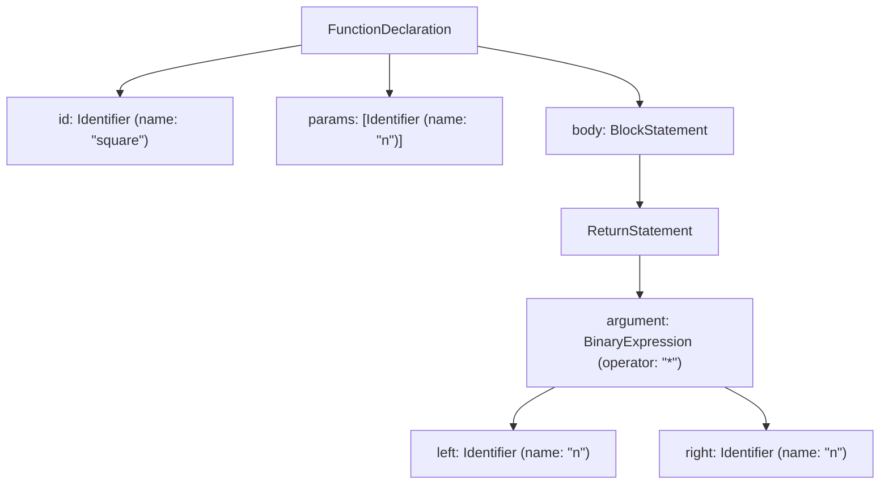

> 「[Babel User Handbook](https://github.com/thejameskyle/babel-handbook/blob/master/translations/en/user-handbook.md)」과 「[Babel Plugin Handbook](https://github.com/thejameskyle/babel-handbook/blob/master/translations/en/plugin-handbook.md)」을 뼈대로, 설정과 폴리필은 Babel 공식 문서 「[@babel/preset-env](https://babeljs.io/docs/babel-preset-env)」·「[Upgrade to Babel 8](https://babeljs.io/docs/v8-migration)」으로 확인해 재구성한 노트다. codemod는 「[Effective JavaScript Codemods](https://medium.com/@cpojer/effective-javascript-codemods-5a6686bb46fb)」(2015.07)를 바탕으로 보강했다.

## Babel이란

**Babel은 JavaScript를 받아 JavaScript를 내놓는 소스 대 소스 컴파일러(트랜스파일러)다.** 최신 문법(`?.`, 클래스 필드, JSX, TypeScript)을 대상 환경이 이해하는 문법으로 다시 쓴다. 문법은 변환하고 내장 API는 폴리필로 채운다는 구분은 [[ecmascript-tc39|ECMAScript 표준과 TC39 프로세스]]에 있다.

Babel은 변환기이기 전에 **정적 분석 도구 모음**이다. 코드를 실행하지 않고 구조를 읽는 파서·순회기·생성기를 따로 쓸 수 있어서, 린터·포매터·코드 커버리지 도구·codemod가 같은 원리 위에 만들어졌다.

| 지금의 위치 | 내용 |
| --- | --- |
| 최신판 | **Babel 8**(2026.06). 7 이후 8년 만의 메이저다. 모든 패키지가 **ESM 전용**이고 Node.js `^22.18.0 \|\| >=24.11.0`에서 돈다(출력 코드는 옛 Node용으로도 낼 수 있다) |
| 번들러 안의 변환 | Vite(Rolldown·Oxc), esbuild, SWC처럼 네이티브 언어로 쓴 변환기가 일상적인 문법·TS·JSX 변환을 맡는다 |
| Babel이 남는 곳 | **Babel 플러그인이 필요한 변환**. React Compiler(`babel-plugin-react-compiler`), 아직 표준이 아닌 제안 문법, 사내 커스텀 변환, Jest의 `babel-jest` 등 |

## 세 단계: parse → transform → generate


| 단계 | 하는 일 |
| --- | --- |
| 어휘 분석(lexical analysis) | 문자열을 **토큰**의 평평한 배열로 자른다. `n * n` → `n`, `*`, `n`. 토큰마다 `start`·`end`·`loc`(위치)가 붙는다 |
| 구문 분석(syntactic analysis) | 토큰 흐름을 **AST(추상 구문 트리)** 로 묶는다 |
| 변환(transform) | AST를 재귀로 순회하며 노드를 바꾼다. **플러그인이 일하는 곳**이고 컴파일러에서 가장 복잡한 부분이다 |
| 생성(generate) | 최종 AST를 깊이 우선으로 돌며 코드 문자열과 소스 맵을 만든다 |

`function square(n) { return n * n }`의 AST는 이렇게 생겼다. 모든 노드에 `type`이 있고, 자식 노드를 속성으로 가진다.



Babel의 AST는 표준 형식 **ESTree**를 조금 고친 것이다. [AST Explorer](https://astexplorer.net/)에 코드를 붙이면 노드 구조를 바로 볼 수 있다. 플러그인이나 codemod를 쓸 때 가장 먼저 여는 도구다.

## 설정: 플러그인과 프리셋

**플러그인은 변환 하나, 프리셋은 플러그인 묶음이다.** 아무 플러그인도 없으면 Babel은 코드를 파싱했다가 그대로 다시 찍어 낼 뿐이다.

| 파일 | 범위 |
| --- | --- |
| `babel.config.json`(`.js`, `.ts`도 가능) | 프로젝트 전체. 모노레포 루트, `node_modules` 안의 패키지까지 컴파일할 때 |
| `.babelrc.json` | 그 파일이 있는 패키지 안의 파일에만 적용 |

```json
{
  "targets": "defaults",
  "presets": [["@babel/preset-env"], ["@babel/preset-react", { "runtime": "automatic" }], "@babel/preset-typescript"],
  "plugins": ["babel-plugin-react-compiler"]
}
```

**실행 순서**는 직관과 다르다.

1. 플러그인이 프리셋보다 먼저 돈다.
2. 플러그인은 **앞에서 뒤로** 돈다.
3. 프리셋은 **뒤에서 앞으로** 돈다. 위 예에서는 TypeScript → React → env 순서다. 타입을 먼저 지우고, JSX를 바꾸고, 마지막에 문법을 낮춘다.

옵션은 `["플러그인 이름", { 옵션 }]` 배열로 넘긴다. 환경마다 다른 설정은 `env` 키나 JS 설정 파일의 `api.env("production")`으로 나눈다.

## preset-env: 대상 환경에 필요한 것만

`@babel/preset-env`는 **대상 브라우저가 이미 지원하는 문법은 건드리지 않고 모자란 것만 변환**한다. browserslist·compat-table 데이터로 "어느 브라우저가 어느 버전부터 어떤 문법을 지원하나"를 플러그인 목록에 대응시켜 둔 덕분이다.

| 항목 | 내용 |
| --- | --- |
| 대상 지정 | 최상위 `targets` 또는 `.browserslistrc`(`> 0.25%, not dead`). autoprefixer·stylelint·eslint-plugin-compat이 같은 파일을 읽는다 |
| 기본 대상 | Babel 8은 `targets`가 없으면 browserslist의 `defaults`를 쓴다. Babel 7은 모든 브라우저(`>= 0%`)였다 |
| 다루는 문법 | **Stage 4(표준)만** 넣는다. Stage 3 중 브라우저가 이미 내놓은 것은 `shippedProposals: true`로 켠다. 그보다 이른 제안은 플러그인을 직접 추가한다 |
| `modules` | 기본 `"auto"`. 번들러(babel-loader, @rollup/plugin-babel)가 ESM을 이해한다고 알려 주면 `import`/`export`를 그대로 둔다. 그래야 번들러가 트리 셰이킹과 스코프 호이스팅을 한다 |
| `debug: true` | 어떤 대상 때문에 어떤 변환·폴리필이 들어갔는지 출력한다 |

### 폴리필 넣기

문법 변환과 달리 `Promise`, `Array.prototype.at` 같은 API는 실행할 때 구현을 채워야 한다. Babel은 **core-js 3**를 쓴다.

| 방식 | 하는 일 |
| --- | --- |
| entry | 진입 파일의 `import "core-js/stable"` 한 줄을 대상 환경에 필요한 개별 모듈 import로 바꾼다. 앱 전체에서 한 번만 import한다 |
| usage | 파일마다 **실제로 쓴 API**만 그 파일 맨 위에 import한다. 번들러가 같은 폴리필을 한 번만 넣는다 |
| usage-pure | 전역을 고치지 않고 `import _Promise from "core-js-pure/..."`처럼 지역 변수로 바꿔 넣는다. 전역 오염이 문제인 **라이브러리**용 |

Babel 8에서는 이 일을 **`babel-plugin-polyfill-corejs3`** 이 맡는다(`method: "usage-global" | "entry-global" | "usage-pure"`, `version: "3.x"`). Babel 7의 `preset-env` `useBuiltIns`·`corejs` 옵션과 `@babel/plugin-transform-runtime`의 `corejs` 옵션은 8에서 없어졌다.

`@babel/plugin-transform-runtime`은 이제 **헬퍼 중복 제거**용이다. 클래스·async 변환 때 파일마다 복사되는 헬퍼 함수를 `@babel/runtime`에서 import하게 바꿔 번들을 줄인다.

## 플러그인 쓰기

### 방문자(visitor) 패턴

AST를 직접 재귀로 돌지 않는다. **노드 타입 이름을 메서드로 가진 객체(visitor)** 를 주면, 순회기가 그 타입의 노드를 만날 때마다 메서드를 부른다. `Identifier() {}`는 `Identifier: { enter() {} }`의 줄임이고, 자식까지 다 돈 뒤 부르는 `exit`도 있다.

```js
// a === b 를 b === a 로 뒤집는 플러그인
export default function ({ types: t }) {
  return {
    visitor: {
      BinaryExpression(path) {
        if (path.node.operator !== "===") return
        const { left, right } = path.node
        path.node.left = right
        path.node.right = left
      },
    },
  }
}
```

| 개념 | 뜻 |
| --- | --- |
| `path` | 노드 자체가 아니라 **트리 안의 위치**를 나타내는 객체. `path.node`, `path.parentPath`, `path.scope`를 갖고 `replaceWith`, `insertBefore`, `remove`, `skip`, `stop` 같은 조작 메서드를 준다 |
| `state` | 파일 하나를 도는 동안 공유되는 상태. `state.opts`로 플러그인 옵션을 읽는다 |
| `scope`·바인딩 | 변수가 어디서 선언(binding)되고 어디서 참조되는지. `scope.hasBinding("x")`, `scope.generateUidIdentifier("tmp")`(충돌 없는 이름), `scope.rename("a", "b")`(참조까지 함께 바꿈) |
| `@babel/types`(`t`) | 노드를 만들고(`t.identifier("x")`) 확인하는(`t.isIdentifier(node, { name: "x" })`) 함수 모음 |
| `@babel/template` | ``template.statement`const %%name%% = require(%%src%%)` `` 처럼 **코드 조각으로 노드를 만든다** |
| `pre`·`post` | 파일 순회 전후 훅. 수집한 정보를 정리할 때 쓴다 |

### 빠르고 안전하게

| 원칙 | 이유 |
| --- | --- |
| 방문자는 합친다 | `path.traverse`를 여러 번 부르면 트리를 그만큼 다시 돈다. 한 visitor에 메서드를 모은다 |
| 수동 조회로 충분하면 순회하지 않는다 | `path.get("params.0")`처럼 위치를 아는 노드는 바로 꺼낸다 |
| 중첩 visitor는 바깥에 정의한다 | 메서드 안에서 visitor 객체를 매번 새로 만들지 않는다. 필요한 값은 `traverse(visitor, { 상태 })`로 넘긴다 |
| 중첩 구조를 의심한다 | 함수 안의 함수, 같은 이름을 다시 선언한 스코프처럼 "한 번만 있을 것"이라는 가정이 깨지는 입력을 테스트한다 |
| 바꾼 노드가 다시 방문된다는 것을 안다 | 새로 넣은 노드도 순회 대상이라 무한 루프가 될 수 있다. 조건으로 막거나 `path.skip()` |

테스트는 입력 코드 → 출력 코드의 **스냅숏**, 결과 AST의 특정 노드를 확인하는 **AST 테스트**, 변환된 코드를 실제로 돌려 보는 **실행 테스트** 세 가지를 쓴다. `babel-plugin-tester`가 이 틀을 준다.

## 같은 원리로 코드베이스를 고친다: codemod

**codemod는 AST 변환을 빌드가 아니라 소스 코드 자체에 한 번 적용해 커밋하는 도구다.** API를 바꾸거나 낡은 패턴을 걷어 낼 때, 수천 개 파일의 호출부를 사람이 고치지 않고 변환 스크립트로 고친다.

정규식으로는 안 되는 이유가 구체적이다.

- 같은 모듈이 파일마다 다른 이름으로 import된다(`merge`가 어디선 `m`, 어디선 `mergeAll`).
- 호출이 중첩된다. `merge(a, { fn() { return merge(b, c) } })`의 안쪽 호출까지 바꿔야 한다.
- 따옴표·줄바꿈·주석 같은 스타일 차이를 정규식이 다 감당하지 못한다.

**jscodeshift**는 Babel 파서, 노드 생성용 ast-types, **원래 서식을 보존해 다시 찍는 recast**를 묶고, 수천 개 파일에 병렬로 적용하는 러너를 붙인 도구다. 바뀐 부분만 다시 찍으므로 diff가 작아 리뷰할 수 있다.

```js
// merge(a, { b: 1 }, c)  →  ({ ...a, b: 1, ...c })
export default function transformer(file, { jscodeshift: j }) {
  return j(file.source)
    .find(j.CallExpression, { callee: { name: "merge" } })
    .replaceWith(({ node }) =>
      j.objectExpression(node.arguments.map((arg) =>
        arg.type === "ObjectExpression" ? arg.properties : j.spreadElement(arg)).flat()))
    .toSource()
}
```

```bash
npx jscodeshift -t rm-merge.js src/ --dry --print   # 먼저 결과만 본다
npx jscodeshift -t rm-merge.js src/                 # 적용 후 diff를 리뷰하고 커밋
```

| 쓰임 | 예 |
| --- | --- |
| 프레임워크 업그레이드 | `npx @next/codemod`, React의 `react-codemod`(과거 `createClass` → class 변환부터 이어진 도구) |
| 사내 API 폐기 | 옛 유틸 호출을 새 API로 일괄 교체하고 옛 모듈 삭제 |
| 언어 기능 전환 | `var` → `let/const`, `require` → `import` |

큰 변경은 **사람을 멈추게 하지 않는 것**이 목표다. 변환을 작게 나눠 여러 번 적용하고, 테스트·타입 검사·린트를 통과한 결과만 합친다. 패턴 매칭 중심의 다국어 도구로는 ast-grep도 쓴다.

## 역사

- 처음 이름은 **6to5**였다. ES6를 ES5로 바꾸는 도구로 시작해 2015년 Babel로 이름을 바꿨다.
- Babel 6에서는 `babel-preset-es2015`, `babel-preset-stage-0`~`stage-3` 같은 **연도별·단계별 프리셋**을 썼다. 제안 단계 문법은 단계가 바뀌거나 철회되기 때문에 Babel 7(2018)에서 stage 프리셋을 없애고, 연도 프리셋은 `preset-env`로 통합했다. 패키지 이름도 `@babel/` 스코프로 바뀌었다.
- `@babel/polyfill`은 7.4에서 폐기됐다. `core-js/stable` import와 `useBuiltIns`로 넘어갔고, 8에서는 그 옵션도 폴리필 플러그인으로 옮겨 갔다.
- 표준이 된 제안 플러그인은 `plugin-proposal-*`에서 `plugin-transform-*`로 이름이 바뀌었다(예: `class-properties`, `object-rest-spread`, `optional-chaining`).
- `loose`·`spec` 옵션은 7.13의 최상위 `assumptions`로 대체됐고 8의 `preset-env`에서 제거됐다.
- 데코레이터는 레거시 TypeScript 방식과 TC39 Stage 3 방식이 다르다. 8에서는 `@babel/plugin-proposal-decorators`에 `version: "legacy"` 또는 `"2023-11"`을 명시한다.

## 정리

- Babel = parse(토큰 → AST) → transform(플러그인) → generate(코드 + 소스 맵).
- 플러그인이 프리셋보다 먼저, 플러그인은 앞→뒤, 프리셋은 뒤→앞으로 돈다.
- `preset-env`는 `targets`·browserslist 기준으로 필요한 변환만 넣는다. 폴리필은 Babel 8에서 `babel-plugin-polyfill-corejs3`가 맡는다.
- 플러그인은 visitor 객체와 `path`·`scope`로 쓰고, 순회 횟수를 줄인다.
- 같은 AST 원리를 소스에 한 번 적용하면 codemod다. 대규모 리팩터링은 정규식이 아니라 jscodeshift 같은 AST 도구로 한다.

관련 노트: [[ecmascript-tc39|ECMAScript 표준과 TC39 프로세스]], [[bundlers-and-vite|번들러의 역사와 Vite]], [[webpack|webpack 동작 원리]], [[typescript-basics|TypeScript: 개념과 문법 한눈에 보기]], [[eslint-prettier|ESLint와 Prettier 설정]], [[static-analysis|정적 분석]], [[typescript-compiler-internals|TypeScript 컴파일러 내부 구조]]
