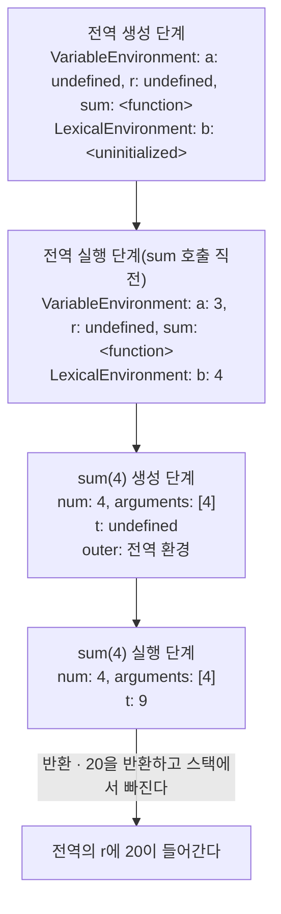

> 「[Must-Know-About-Frontend: 실행 컨텍스트](https://github.com/baeharam/Must-Know-About-Frontend/blob/main/Notes/javascript/execution-context.md)」를 바탕으로, ECMA-262 명세의 「Execution Contexts」, 「Environment Records」 절로 최신화해 재구성한 노트다. 환경 레코드의 종류, 매개변수 스코프, funarg 문제, ES3 용어와의 대응은 Dmitry Soshnikov의 「[JavaScript. The Core](http://dmitrysoshnikov.com/ecmascript/javascript-the-core/)」, ECMA-262-3 시리즈(「[Execution Contexts](http://dmitrysoshnikov.com/ecmascript/chapter-1-execution-contexts/)」, 「[Variable object](http://dmitrysoshnikov.com/ecmascript/chapter-2-variable-object/)」, 「[Scope chain](http://dmitrysoshnikov.com/ecmascript/chapter-4-scope-chain/)」, 「[Closures](http://dmitrysoshnikov.com/ecmascript/chapter-6-closures/)」), ECMA-262-5 「Lexical environments」 두 편([Common Theory](http://dmitrysoshnikov.com/ecmascript/es5-chapter-3-1-lexical-environments-common-theory/), [ECMAScript implementation](http://dmitrysoshnikov.com/ecmascript/es5-chapter-3-2-lexical-environments-ecmascript-implementation/)), 「[Default values of parameters](http://dmitrysoshnikov.com/ecmascript/es6-notes-default-values-of-parameters/)」을 바탕으로 보강했다.

## 실행 컨텍스트란

**실행 컨텍스트(execution context)는 엔진이 코드 한 덩어리를 실행하는 동안 필요한 정보(어떤 이름이 보이는지, `this`가 무엇인지, 어디까지 실행했는지)를 담아 두는 명세상의 단위**다. 코드에서 직접 꺼낼 수 없는 내부 개념이지만, 호이스팅·스코프 체인·클로저·`this`가 모두 이 구조에서 나온다. 각각의 자세한 동작은 [[scope-and-closures|스코프와 클로저]], [[functions|함수와 this]]에 있고, 이 노트는 그 공통 뼈대를 다룬다.

| 종류 | 만들어지는 때 |
| --- | --- |
| 전역 실행 컨텍스트 | 스크립트를 평가하기 시작할 때 하나 |
| 모듈 실행 컨텍스트 | ES 모듈 파일을 평가할 때 파일마다 하나. `this`는 `undefined`다 |
| 함수 실행 컨텍스트 | **함수를 호출할 때마다** 하나. 정의할 때가 아니다 |
| eval 실행 컨텍스트 | `eval(code)`를 실행할 때([[strict-mode\|strict mode]]의 「eval과 strict mode」) |

## 실행 컨텍스트 스택(콜 스택)

컨텍스트는 **실행 컨텍스트 스택**, 흔히 말하는 콜 스택에 쌓인다. 맨 위에 있는 것이 지금 실행 중인 컨텍스트(running execution context)다.

```javascript
function inner() { console.log('inner') }
function outer() { inner() }
outer()
```


- 함수를 부르면 현재 컨텍스트는 멈춘 채 스택에 남고, 새 컨텍스트가 위에 올라간다. 반환하면 꺼내지고 멈춘 곳부터 이어 간다.
- 스택 깊이에는 한도가 있어, 끝나지 않는 재귀는 `RangeError: Maximum call stack size exceeded`로 끝난다([[functions|함수와 this]]의 「재귀와 콜 스택」).
- 스택이 비어야 이벤트 루프가 다음 태스크를 꺼낸다([[event-loop|이벤트 루프]]).

## 구성 요소

명세의 실행 컨텍스트는 코드 평가 상태, 실행 중인 함수, Realm(전역 객체와 내장 객체 묶음), 스크립트·모듈 정보와 함께 아래 세 환경 슬롯을 가진다.

| 슬롯 | 담는 것 |
| --- | --- |
| LexicalEnvironment | `let`·`const`·`class` 선언. 블록에 들어갈 때마다 새 환경으로 바뀐다 |
| VariableEnvironment | `var`와 함수 선언. 함수(또는 스크립트) 단위로 하나이고 블록에서 바뀌지 않는다 |
| PrivateEnvironment | 클래스 본문의 `#private` 이름(ES2022에 추가) |

각 환경은 **환경 레코드(Environment Record)** 와 **바깥 환경 참조(outer)** 로 이뤄진다. 레코드에서 이름을 못 찾으면 outer를 따라 올라가고, outer가 `null`인 전역 환경에서도 없으면 `ReferenceError`다. 이 연결이 스코프 체인이다([[scope-and-closures#렉시컬 환경으로 보는 원리|스코프와 클로저]]).

### 환경 레코드의 종류와 식별자 해석

환경 레코드는 이름을 무엇에 저장하느냐에 따라 둘로 나뉜다.

| 종류 | 저장 방식 | 쓰이는 곳 |
| --- | --- | --- |
| **선언적(declarative)** 레코드 | 엔진 내부 구조. 이름 목록이 코드에서 정적으로 정해진다 | 함수(함수 환경 레코드), 블록, `catch`, 모듈(모듈 환경 레코드) |
| **객체(object)** 레코드 | 실제 JavaScript 객체의 속성 | 전역 객체, `with (obj)` 블록 |

선언적 레코드는 어떤 이름이 어느 칸에 있는지 **코드만 보고 알 수 있어서**, 엔진이 이름을 해시 조회 대신 "몇 단계 바깥의 몇 번째 칸" 같은 고정 위치로 바꿔 빠르게 접근한다. 클로저가 바깥 변수 중 **실제로 쓰는 것만** 붙잡도록 최적화할 수 있는 것도 이 덕분이다.

이 최적화를 깨는 것이 둘 있다.

- **`with`**: 객체 레코드를 스코프 체인 맨 앞에 끼운다. 블록 안의 `x`가 `obj.x`인지 바깥 변수인지 **실행해 봐야** 안다. 그래서 strict mode에서 금지됐다.
- **직접 `eval`**: 문자열 안에서 `var`를 선언해 바깥 환경에 이름을 더할 수 있다(sloppy mode). 엔진은 `eval`이 보이는 함수의 환경을 통째로 남겨 둬야 한다. strict mode의 `eval`은 자기 환경을 따로 만든다([[strict-mode|strict mode]]).

위의 outer 사슬을 따라 이름을 찾는 일(식별자 해석)의 결과는 값이 아니라 **참조(Reference: 어느 레코드·객체의 어떤 이름인가)** 다. 참조를 읽을 때 값을 꺼내고, 대입할 때 그 칸에 쓴다. `obj.method()` 호출에서 `this`가 `obj`가 되는 것도 이 참조의 「어느 객체」를 쓰기 때문이다([[functions#this|함수와 this]]).

### 전역 환경은 두 칸이다

전역 환경 레코드는 위 두 종류를 함께 가진다. **객체 레코드**는 전역 객체 `window`에 연결되고, **선언적 레코드**는 엔진 내부에 있다. `var`와 함수 선언은 객체 레코드에 들어가 `window`의 속성이 되고, `let`·`const`·`class`는 선언적 레코드에 들어가 전역이지만 `window`에는 붙지 않는다.

```javascript
var a = 1
let b = 2
window.a // 1
window.b // undefined
```

### this는 환경 레코드에 있다

ES2015부터 `this`는 실행 컨텍스트의 별도 칸이 아니라 **환경 레코드가 들고 있는 값**이다.

| 환경 레코드 | `this` |
| --- | --- |
| 전역 | 전역 객체(`globalThis`) |
| 모듈 | `undefined` |
| 일반 함수 | 호출 방식에 따라 정해진 값([[functions\|함수와 this]]의 「this」) |
| 화살표 함수 | **자기 `this`가 없다.** 레코드에 바인딩이 없어서 outer를 따라 바깥의 `this`를 찾는다 |

화살표 함수의 `this`가 "렉시컬"인 이유가 이것이다. 변수를 찾듯 바깥 환경에서 찾는다.

## 생성 단계와 실행 단계

컨텍스트는 두 단계를 거친다.

1. **생성 단계**: 코드를 한 줄도 실행하기 전에 그 범위의 선언을 모두 찾아 환경 레코드에 등록한다. 함수 선언은 본문까지 함수 객체로 바로 초기화하고, `var`는 `undefined`로 초기화하고, `let`·`const`·`class`는 **초기화하지 않은(uninitialized)** 상태로 둔다. 함수 컨텍스트라면 매개변수와 `arguments`도 이때 채운다.
2. **실행 단계**: 위에서부터 코드를 실행하며 대입문을 만날 때 값을 넣는다. `let`·`const`는 선언 줄에 닿는 순간 초기화된다.

```javascript
var a = 3
let b = 4

function sum(num) {
  var t = 9
  return a + b + num + t
}

var r = sum(4)
```



이 두 단계에서 익숙한 현상들이 나온다.

| 현상 | 실행 컨텍스트로 보는 원인 |
| --- | --- |
| 호이스팅 | 생성 단계에서 선언을 먼저 등록하므로, 선언 위쪽에서도 이름이 이미 있다 |
| `var`를 선언 전에 읽으면 `undefined` | 생성 단계에서 `undefined`로 초기화했다 |
| TDZ | `let`·`const`는 등록만 되고 초기화되지 않은 상태라, 그 사이 접근은 `ReferenceError`다 |
| 함수 선언은 선언 전에 호출된다 | 생성 단계에서 본문까지 초기화했다. 같은 이름의 `var`가 있어도 대입문이 실행되기 전까지는 함수다 |
| `var`가 블록을 무시한다 | 블록은 LexicalEnvironment만 새로 만들고 VariableEnvironment는 그대로 두기 때문이다 |
| 클로저 | 함수는 만들어질 때의 환경을 기억하고, 호출 때 새 환경의 outer로 그 환경을 쓴다 |

선언 종류별 호이스팅 표와 TDZ 예시는 [[scope-and-closures#호이스팅과 TDZ|스코프와 클로저]]에, 엔진 파이프라인에서 컨텍스트가 만들어지는 위치는 [[js-engine-v8|JavaScript 엔진과 V8]]에 있다.

### 매개변수 기본값이 있으면 스코프가 하나 더 생긴다

기본값이 하나라도 있는 함수는 **매개변수만 담는 환경**을 본문 환경과 따로 만든다. 기본값 식은 그 환경에서 왼쪽부터 차례로, 호출할 때마다 평가된다.

```javascript
function f(a = b, b = 1) {} // f() → ReferenceError: b는 아직 TDZ다
function g(a, b = a * 2) {} // 앞 매개변수는 쓸 수 있다

const x = 1
function h(cb = () => x) {
  var x = 2       // 본문의 x. 기본값 식의 클로저는 이 x를 보지 못한다
  return cb()     // 1
}
```

- 매개변수도 `let`처럼 **TDZ**를 가진다. 오른쪽 매개변수를 왼쪽 기본값에서 쓰면 에러다.
- 기본값 안의 클로저는 매개변수 환경을 붙잡으므로, 본문의 같은 이름 `var`와 섞이지 않는다.
- 기본값이 매 호출 새로 평가된다는 점은 Python(정의할 때 한 번 평가)과 다르다. `function push(item, list = [])`의 `list`는 호출마다 새 배열이다.

## 클로저: funarg 문제의 해법

함수를 값으로 넘기는 언어는 **funarg 문제**를 풀어야 한다. 함수를 인자로 넘길 때(아래로 가는 funarg) 그 함수 안의 자유 변수를 호출한 쪽이 아니라 **정의한 쪽**의 환경에서 찾아야 하고(정적·렉시컬 스코프), 함수를 반환할 때(위로 가는 funarg) 만든 함수의 실행 컨텍스트가 스택에서 빠진 뒤에도 그 환경이 살아 있어야 한다. 그래서 환경은 스택이 아니라 힙에 두고, 함수 객체가 만들어질 때 그 환경을 `[[Environment]]` 슬롯에 저장한다. 이것이 클로저다.

- 같은 실행 컨텍스트에서 만든 클로저들은 **하나의 환경을 공유**한다. 그래서 `var`로 돈 반복문의 콜백들은 모두 마지막 `i`를 보고, 한 클로저가 쓰는 큰 값은 다른 클로저가 살아 있는 동안 회수되지 않는다([[garbage-collection#클로저끼리 환경을 나눠 쓰는 누수|가비지 컬렉션]]).
- `new Function`으로 만든 함수의 `[[Environment]]`는 언제나 **전역 환경**이다. 만든 자리의 지역 변수를 볼 수 없다([[functions|함수와 this]]의 「new Function」).

## 역사: ES3의 변수 객체와 활성 객체

ES5 이전 명세는 같은 구조를 다른 이름으로 설명했다. 옛 글에서 VO·AO·`[[Scope]]`를 보면 아래처럼 바꿔 읽는다.

| ES3 용어 | 지금의 용어 |
| --- | --- |
| 변수 객체(Variable Object, VO) | 환경 레코드 |
| 활성 객체(Activation Object, AO): 함수 컨텍스트의 VO. 매개변수·`arguments`·지역 변수를 담았다 | 함수 환경 레코드 |
| 전역 컨텍스트의 VO = 전역 객체 | 전역 환경 레코드(객체 레코드 + 선언적 레코드) |
| 스코프 체인(`[[Scope]]` + 현재 AO의 목록) | LexicalEnvironment의 outer 사슬, 함수의 `[[Environment]]` |
| 컨텍스트에 들어갈 때(entering) / 코드 실행(execution) | 생성 단계 / 실행 단계 |

ES3 모델에서는 VO가 "객체"라 일부 엔진이 `__parent__`로 들여다보게 해 줬다. ES5가 이를 환경 레코드로 바꾸며 블록 스코프(`let`·`const`)와 정적 최적화를 설명할 수 있게 됐다.

## 정리

- 실행 컨텍스트는 전역·모듈·함수 호출·eval마다 만들어지고, 콜 스택에 쌓였다가 실행이 끝나면 빠진다.
- 컨텍스트의 LexicalEnvironment는 `let`·`const`·`class`를, VariableEnvironment는 `var`와 함수 선언을 담고, 각 환경은 outer로 바깥과 이어진다. 레코드는 정적으로 정해지는 선언적 레코드와 객체 속성을 쓰는 객체 레코드(전역, `with`)로 나뉜다.
- `this`는 환경 레코드에 담긴다. 화살표 함수는 자기 `this`가 없어 바깥에서 찾는다.
- 생성 단계에서 선언을 먼저 등록하고 실행 단계에서 값을 채운다. 호이스팅·TDZ·클로저가 모두 이 순서에서 나온다. 기본값 있는 매개변수는 본문과 별도 스코프에서 왼쪽부터 평가된다.
- 클로저는 함수가 만들어질 때의 환경을 힙에 붙잡아 funarg 문제를 푼다. 같은 컨텍스트의 클로저들은 그 환경을 공유한다.

관련 노트: [[scope-and-closures|스코프와 클로저]], [[functions|함수와 this]], [[event-loop|이벤트 루프]], [[js-engine-v8|JavaScript 엔진과 V8]], [[variables-and-types|변수와 데이터 타입]]
